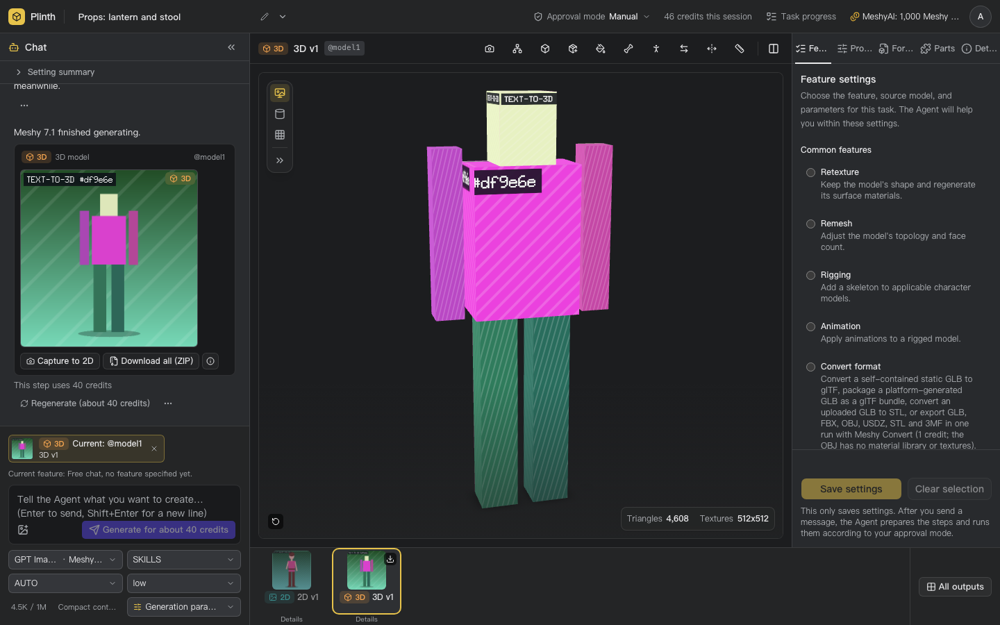
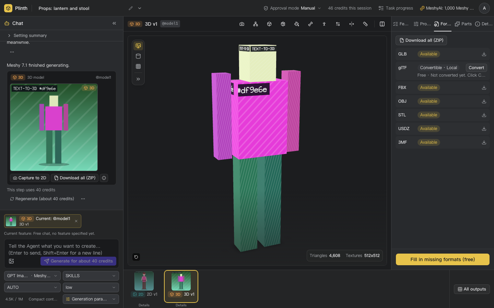
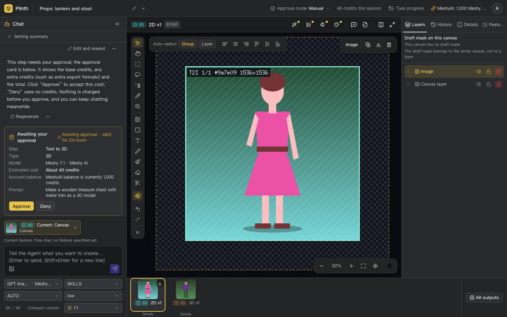
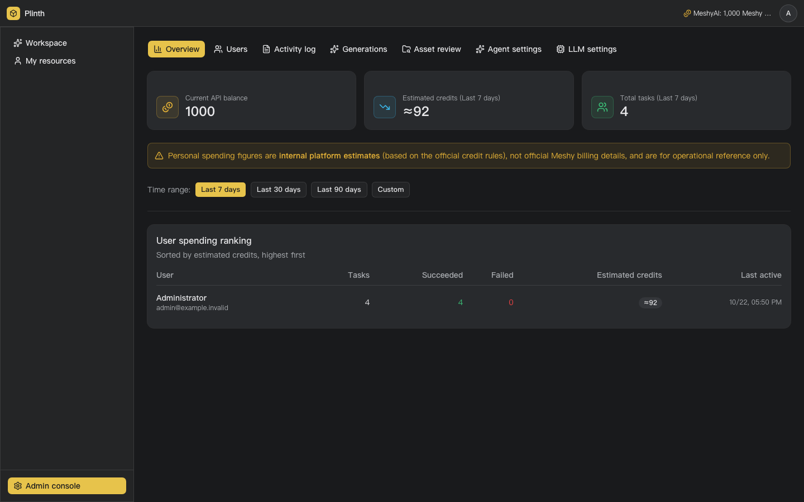

# Plinth

[中文](README.md) | English

Plinth is a self-hosted AI art asset workspace. In a desktop chat + canvas workspace you
call several image and 3D generation services, either through an Agent or with explicit
parameters, and keep every result as a durable asset on your own server: view it, keep
working on it and download it. It is built for indie game developers and small to
mid-sized teams for internal use; you bring your own Provider API keys.

- **Images**: text-to-image, image-to-image, masked inpainting, background removal, and a
  2D canvas (layers, crop, brush, mask, export).
- **3D**: text-to-3D, image-to-3D, retexturing, remeshing, rigging and animation, a 3D
  viewer and multi-format downloads (GLB, glTF, OBJ, STL, FBX, USDZ and more, depending on
  what each Provider supports).
- **Agent**: describe what you want in plain language; the Agent picks models and
  parameters and starts the tasks. Paid steps follow the session's approval mode (auto or
  manual). The Agent works with any multimodal model behind an OpenAI chat completions
  compatible API.
- **Built-in Providers**: Meshy, Tripo, Hyper3D, Jimeng, Gemini, plus OpenAI images and a
  self-hosted matting service. Providers become available when a valid key and any
  required base URL are configured; missing configuration is shown as unavailable,
  and Plinth never silently switches to another model.
- **Try it without keys**: the default Mock mode returns built-in sample results and calls
  no paid upstream. This only shows the UI and mock flows; for real use set
  `AGENT_MODE=live` and the `LLM_*` variables.
- **Users**: administrators and regular users, with username and password sign-in.
- **UI languages**: Chinese and English, see "UI language" below.

Plinth targets desktop browsers only.

## Screenshots

These screenshots come from the keyless Mock mode (the images and 3D models are built-in
sample results). The Chinese UI is shown in the [Chinese README](README.md#截图).

<table>
  <tr>
    <td width="50%"><br>Workspace: chat with the Agent, view the 3D model on the stage</td>
    <td width="50%"><br>Format delivery: download each file or everything as a ZIP</td>
  </tr>
  <tr>
    <td width="50%"><br>Approval card for a paid step (Manual approval mode)</td>
    <td width="50%"><br>Admin console</td>
  </tr>
</table>

## Quick start

You only need Docker. The next section is the full self-deploy guide; the shortest path is:

```bash
git clone https://github.com/LeXwDeX/Plinth.git
cd Plinth
cp .env.example .env && chmod 600 .env
# Generate and write SESSION_SECRET and ADMIN_PASSWORD (explained in the next section; you can also edit .env by hand)
sed -i.bak \
  -e "s|^SESSION_SECRET=.*|SESSION_SECRET=$(openssl rand -base64 48)|" \
  -e "s|^ADMIN_PASSWORD=.*|ADMIN_PASSWORD=$(openssl rand -base64 24)|" \
  .env && rm .env.bak
ART_AI_SOURCE_COMMIT=$(git rev-parse HEAD) docker compose up -d --build --wait
```

Once the command returns successfully, open
<http://127.0.0.1:13333/login> and sign in as `admin` with the `ADMIN_PASSWORD` you set.

If port 13333 is taken, or another Plinth stack already runs on this host, see "Several stacks on one host" and "If startup fails" in the next section.

## Self-deploy with Docker Compose

Self-deploy uses the root `docker-compose.yml` and `.env.example`.

**Prerequisites:** Docker Engine and Docker Compose v2.24+ (the `required` form of
`env_file` needs it), plus `git`, `openssl` and `curl`. You do not need to install Go, Node
or pnpm: the image builds from source. The build host needs access to Docker Hub (base images
`node:22-alpine`, `golang:1.27` and `alpine:3.23`), the public npm registry (fixed to
`https://registry.npmjs.org/`) and the Go module proxy (you can set `GOPROXY` in `.env`). The
first build takes a few minutes.

**1. Prepare `.env`:** copy the template and generate the two required values into it (the
command below works on both Linux and macOS):

```bash
cp .env.example .env
sed -i.bak \
  -e "s|^SESSION_SECRET=.*|SESSION_SECRET=$(openssl rand -base64 48)|" \
  -e "s|^ADMIN_PASSWORD=.*|ADMIN_PASSWORD=$(openssl rand -base64 24)|" \
  .env && rm .env.bak
chmod 600 .env
```

The first administrator's password (default username `admin`) is the `ADMIN_PASSWORD` in
`.env`, and you need it to sign in. Open `.env` in an editor to read it; do not print it with
`grep`, `cat` or similar, because the password would stay in terminal scrollback, shell history,
screen recordings and CI logs.

You can also fill the values in by hand: `SESSION_SECRET` is the output of
`openssl rand -base64 48` (at least 32 characters), and `ADMIN_PASSWORD` is a password of at
least 6 characters (`openssl rand -base64 24` is a good choice). Keep `.env` private and do not
commit it. Every other setting has a working default, so you can try Plinth with zero Provider
keys.

**2. Build and start the service:**

```bash
# ART_AI_SOURCE_COMMIT embeds the source commit in the image so /api/version reports it
# (otherwise "unknown"); --wait returns only after the health check passes and reports startup failures.
ART_AI_SOURCE_COMMIT=$(git rev-parse HEAD) docker compose up -d --build --wait
curl http://127.0.0.1:13333/readyz        # {"service":"art-ai-go","status":"ok"}
curl http://127.0.0.1:13333/api/version   # {"version":"<the full SHA above>"}
```

In a source archive without `.git` (for example a downloaded zip), `git rev-parse HEAD`
fails: replace it with the full 40-character commit SHA, or drop the
`ART_AI_SOURCE_COMMIT=...` prefix (`/api/version` then reports `unknown`). The build uses
Docker's default BuildKit. BuildKit does not support `docker build --network <NETWORK>`
(it fails with `network mode ... not supported by buildkit`); when you need to isolate or
observe the network during the build, build the image on its own with the classic builder and
then start it with Compose (the image name and tag must match Compose, `art-ai:local` by default):

```bash
DOCKER_BUILDKIT=0 docker build -f Dockerfile.go-runtime --target runtime \
  --build-arg GO_SOURCE_COMMIT=$(git rev-parse HEAD) --network <NETWORK> -t art-ai:local .
docker compose up -d --wait
```

Alternatively, use buildx's `network` driver option.

A plain `docker compose up -d` also starts the service: the first run builds the image
automatically, but `/api/version` is then `unknown`, and later runs do not rebuild after a code
update, so always pass `--build` when upgrading.

**3. Sign in and try it:** open `http://127.0.0.1:13333/login` in a browser and sign in as
`admin` (`ADMIN_USERNAME` in `.env`) with the `ADMIN_PASSWORD` from step 1. With the default Mock settings, tasks return built-in
sample results, without calling an upstream service or incurring a charge:

- **Image:** pick a 2D model in the model picker below the message box, type a short
  description and send it to get a sample image.
- **3D model:** pick a 3D model and include "3D" in the description (the Mock Agent decides on
  3D from keywords only). An approval card appears in the chat, because a new
  session's approval mode is Manual and text-to-3D needs your approval; click Approve to get a
  sample 3D model (GLB, FBX, OBJ, STL, USDZ and 3MF) that you can view on the stage and
  download.

The Mock Agent does not understand meaning: every message calls one generation tool chosen by
keywords. When no model is selected for that kind of result, it replies "This step did not
finish" and asks you to select a model first.

**If startup fails:** when `--wait` reports an error or `docker compose ps` shows `Restarting`,
check `docker compose logs art-ai`.

| Error | What to check |
|---|---|
| `required variable SESSION_SECRET is missing a value` or the same message for `ADMIN_PASSWORD` | The value is empty in `.env`; generate and write it as in step 1. |
| `SESSION_SECRET` is too short | Generate a new value with `openssl rand -base64 48`. |
| `ADMIN_PASSWORD` is too short | Use a password of at least 6 characters; this is checked when the first administrator is created or reset. |
| `address already in use` (a non-Docker process holds the port) or `Bind for 127.0.0.1:<port> failed: port is already allocated` (another Docker container holds it) | The port is taken; the fix is the same: change `ART_AI_PORT` in `.env`. |

### Configuration

- **Required values:** Compose requires `SESSION_SECRET` and `ADMIN_PASSWORD`. An empty value
  makes Compose fail before startup; the service also refuses a `SESSION_SECRET` shorter than
  32 characters. Changing the session secret signs out existing sessions.
- **Run mode:** Compose fixes `APP_ENV=production` and `AUTH_MODE=session`. Username/password
  sign-in is enabled, mock sign-in is rejected, and setting `APP_ENV` or `AUTH_MODE` in `.env`
  has no effect.
- **Reset the administrator password:** set the new `ADMIN_PASSWORD` and
  `ADMIN_PASSWORD_RESET=true` in `.env`, then run `docker compose up -d --wait`. This recreates
  the service with the new environment, resets that administrator's password and signs out
  existing admin sessions. After signing in, set `ADMIN_PASSWORD_RESET=false` and run
  `docker compose up -d --wait` again. Editing `.env` alone or running
  `docker compose restart` does not update a container's environment.
  Creating or resetting the administrator at startup writes an INFO log line and an
  administration audit entry (never the password).
- **Try it without keys:** `PROVIDER_MODE=mock` and `AGENT_MODE=mock` are the defaults. Image
  and 3D tasks and the chat Agent return built-in sample results without charges; this only
  shows the UI and mock flows. Mock is for testing and demos only: for real use you must set
  `AGENT_MODE=live` with `LLM_BASE_URL`, `LLM_API_KEY` and `LLM_MODEL`, or the Agent is not
  usable. To call real
  Providers, switch `PROVIDER_MODE=live` and configure each Provider with its own valid API
  key and any required base URL. A Provider is unavailable when a required value is missing;
  a configured key must also be accepted by the upstream service. See
  [Provider configuration](docs/provider-configuration.md).
- **Agent chat model:** `LLM_BASE_URL` and `LLM_API_KEY` configure only the Agent chat model.
  They do not configure image or 3D Providers. `LLM_MODEL` defaults to the Schema value
  `deepseek`; set it to the model name served by your endpoint when needed. The Agent model
  must support multimodal input and at least be able to read images.
- **Gemini images:** set both `GEMINI_API_KEY` and `GEMINI_BASE_URL` to enable Gemini. It has
  no default base URL and never borrows `LLM_BASE_URL`; if all models use one gateway, set
  `LLM_BASE_URL`, `OPENAI_BASE_URL` and `GEMINI_BASE_URL` to the gateway address.
- **Signed asset delivery (optional):** configure this only when an upstream Provider must
  fetch an asset from this server by URL. Set both `PUBLIC_BASE_URL` (the externally reachable
  HTTPS URL of this service) and `ASSET_SIGNING_KEY` (at least 32 bytes; generate with
  `openssl rand -base64 48`), or leave both empty. Mock mode does not need them.
- **Address and port:** by default, the service listens only on `127.0.0.1:13333`. Change
  `ART_AI_BIND_IP` or `ART_AI_PORT` in `.env`, then run `docker compose up -d --wait` to
  apply the change. For access from other machines, put the service behind an HTTPS reverse
  proxy and set `NEXT_PUBLIC_APP_URL` and `TRUSTED_PROXY_CIDRS`; see
  [self-deploy security](docs/self-deploy-security.md) (in Chinese). Compose uses the default
  bridge network without a fixed subnet or container IP.
- **Several stacks on one host:** the Compose project name defaults to `art-ai` and the image
  to `art-ai:local`. When the host already runs another Plinth, set a different
  `COMPOSE_PROJECT_NAME` and `ART_AI_IMAGE_TAG` in `.env` for the second one (see the Build
  section of `.env.example`) and pick another `ART_AI_PORT`; otherwise it reuses the same project
  and overwrites the same image tag. Volume and container names follow the project name.
- **Persistent data:** SQLite data and assets live in the named volumes `art-ai-data` and
  `art-ai-storage` (in `docker volume ls` they carry the Compose project name prefix, by default
  `art-ai_art-ai-data` and `art-ai_art-ai-storage`). `docker compose restart`, `down` followed by `up`, and image rebuilds
  retain them; `docker compose down -v` deletes them. Back up both volumes before upgrading.
  To update, pull or check out the new source and run
  `ART_AI_SOURCE_COMMIT=$(git rev-parse HEAD) docker compose up -d --build --wait`; database
  migrations run at startup.
- **Logs:** run `docker compose logs -f art-ai`; `LOG_LEVEL` in `.env` controls the level.
- **Agent tool calls:** `AGENT_MAX_TOOL_CALLS_PER_REPLY` caps tool calls in one Agent reply;
  each new reply starts from zero. Empty uses the default 20; allowed values are 1–100. See
  [Provider configuration](docs/provider-configuration.md#agent-对话模型--agent-chat-model).

## Provider configuration

Compose passes the variables in `.env` to the service. Each live Provider uses its own
`<ID>_API_KEY` and, where required, its own `<ID>_BASE_URL`, for example `MESHY_API_KEY`,
`TRIPO_API_KEY`, `HYPER3D_API_KEY`, `JIMENG_API_KEY` and `GEMINI_API_KEY`; a key or URL is never
borrowed from another Provider or from the Agent. Configure the Providers you intend to use, then
set `PROVIDER_MODE=live`. Real requests spend the corresponding Provider account's credits or
money. A configured key must be valid at the upstream service.

`AGENT_MODE` still defaults to `mock` (testing and demos only; real use needs `live`) and is independent of `PROVIDER_MODE`. With
`PROVIDER_MODE=live` and `AGENT_MODE=mock`, the Mock Agent does not understand meaning and
submits a generation for every message based on keywords (the service logs a WARN, and paid steps
still need your approval). To drive real generation with natural language, set both to `live`
and configure the Agent chat model below.

Gemini images require both `GEMINI_API_KEY` and an explicit `GEMINI_BASE_URL`: Gemini has no
default URL, and it does not use `LLM_BASE_URL`. When one gateway serves several models,
set every connection's base URL explicitly.

For live Agent chat, set `AGENT_MODE=live`, `LLM_BASE_URL` and `LLM_API_KEY`. `LLM_MODEL`
uses the Schema default `deepseek` when empty; set the model name served by your endpoint if
that default does not apply. The Agent model must support multimodal input and image reading; prefer a strong vision model, since weak ones miss canvas annotations (red circles, arrows).

To let users pick more chat models, list connection IDs in `LLM_CONNECTIONS` (for example
`QWEN,GLM`). Each connection reads only its own `<ID>_BASE_URL`, `<ID>_API_KEY` and `<ID>_MODEL`
(with one gateway, write the same URL for each). An administrator then tests the connections and
sets the default model and the offered thinking levels on the admin page "LLM settings".

See [Provider configuration](docs/provider-configuration.md) for the full variable table,
base URLs and billing notes. After editing `.env`, run `docker compose up -d --wait` to apply
the changes; `docker compose restart` keeps the existing container environment.

## UI language

The UI supports Simplified Chinese (`zh-CN`, the default) and English (`en`). The language
is chosen as "saved choice → browser `Accept-Language` → Chinese". Switch it from the user
menu in the top bar or on the sign-in page; the choice is stored in a browser cookie and
works before sign-in. Forms, parameter help, error messages and Agent replies all follow
the UI language. UI text comes from the Product Schema's language bundles; see the
language section of [the architecture document](docs/architecture.md) (in Chinese).

## Architecture overview

```
Browser (React SPA)
   │  same-origin HTTP / SSE
   ▼
art-ai (one Go process, one container)
   ├─ Web host: static assets, SPA routes, CSP
   ├─ HTTP API: auth, sessions, tasks, assets, chat, admin console
   ├─ Agent: OpenAI-compatible chat completions + tool calls
   ├─ Generation kernel: Task / Attempt, lease scheduling, idempotency, events
   ├─ Provider adapters: Meshy, Tripo, Hyper3D, Jimeng, Gemini, OpenAI, Matting, Mock
   └─ Storage: SQLite (WAL) + content-addressed asset files (Docker named volumes)
```

- **The Product Schema is the single source of truth**:
  `internal/catalog/default_catalog.json` declares every Provider, model, capability,
  parameter, price, piece of UI text and UI setting; the frontend only consumes the public
  projection at `/api/v1/schema`.
- **One task kernel**: every generation or processing step is a public Task whose state
  `internal/generation` owns; a Task succeeds only after all required outputs are stored
  and checked.
- **The runtime image** contains only the Go binaries and the built frontend; Node and
  pnpm are used only to compile the frontend in the multi-stage build.

Design details are in [docs/architecture.md](docs/architecture.md) and domain terms in
[CONTEXT.md](CONTEXT.md) (both in Chinese).

## Local development

Prerequisites: Go ([install guide](https://go.dev/doc/install); minimum 1.26, per `go.mod`; the image and CI use 1.27, which is the
recommended version), Node 22 ([download](https://nodejs.org/en/download)), pnpm (the version is the `packageManager` in `package.json`; install it with
`npm install -g pnpm@12.5.1`: the corepack 0.34.0 bundled with Node 22.21.1 cannot fetch that
version through `corepack enable`, and if you already enabled the corepack shims, run
`corepack disable` first), `git`, `python3`, `bash`, `jq` and `sqlite3` (some frontend tests
and `scripts/tests` call them); the `--race` check also needs a C compiler (`gcc` or `cc`, for CGO).
`python3 scripts/verify-local.py` checks for these commands at startup and lists any that are
missing. Details are in [CONTRIBUTING.md](CONTRIBUTING.md).

```bash
pnpm install --frozen-lockfile
pnpm build                                   # the frontend goes to build/go-web
WEB_ASSETS_ROOT=build/go-web go run ./cmd/art-ai
```

Development mode uses the Mock Provider and a development identity by default and
listens on `127.0.0.1:13333`. Run `python3 scripts/verify-local.py` before you push. Dev
setup, checks and commit conventions are in [CONTRIBUTING.md](CONTRIBUTING.md).

## Documentation

| Document | Contents |
|---|---|
| [docs/provider-configuration.md](docs/provider-configuration.md) | Environment variables for Providers and the Agent model |
| [docs/self-deploy-security.md](docs/self-deploy-security.md) | Security settings before exposing the service (HTTPS, reverse proxy, rate limits) |
| [docs/storage-maintenance.md](docs/storage-maintenance.md) | Storage maintenance |
| [docs/architecture.md](docs/architecture.md) | Architecture and responsibilities |
| [docs/acceptance-1.0.md](docs/acceptance-1.0.md) | 1.0 acceptance checklist |
| [CONTRIBUTING.md](CONTRIBUTING.md) | Contributing |
| [SECURITY.md](SECURITY.md) | Reporting security vulnerabilities |

Documents under `docs/` other than the Provider configuration are currently in Chinese.

The repository also holds release scripts and historical migration tools used by the
maintainers' internal test environments. Self-deploy does not need them; they are listed
in [docs/deployment.md](docs/deployment.md#内部运维资产自部署不需要).

## Known limitations

- Some user-facing text produced by the server is still Chinese only: task failure reasons,
  rejection reasons before a step is submitted, and tool explanations the Agent passes on. The
  English UI shows these in Chinese; making them follow the UI language is planned after 1.0.
- Desktop browsers only.
- Not in 1.0: adding your own Providers (only the built-in Providers listed above), teams and
  organizations (there are only administrators and regular users), encrypted storage of
  Provider keys (keys live in `.env`, protected by file permissions), and chat protocols other
  than OpenAI chat completions.

## Contributing and security

Issues and pull requests are welcome; see [CONTRIBUTING.md](CONTRIBUTING.md). Please do
not report security vulnerabilities in public issues; follow [SECURITY.md](SECURITY.md).

## License

MIT, see [LICENSE](LICENSE). Third-party dependencies and bundled materials are listed in the [third-party license inventory](docs/third-party-licenses.md).
