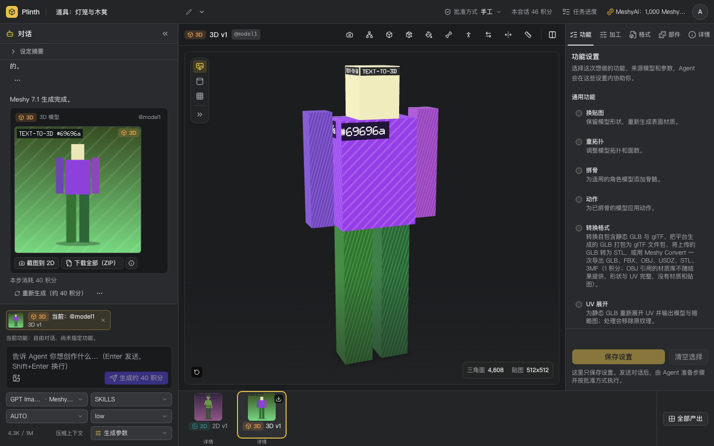
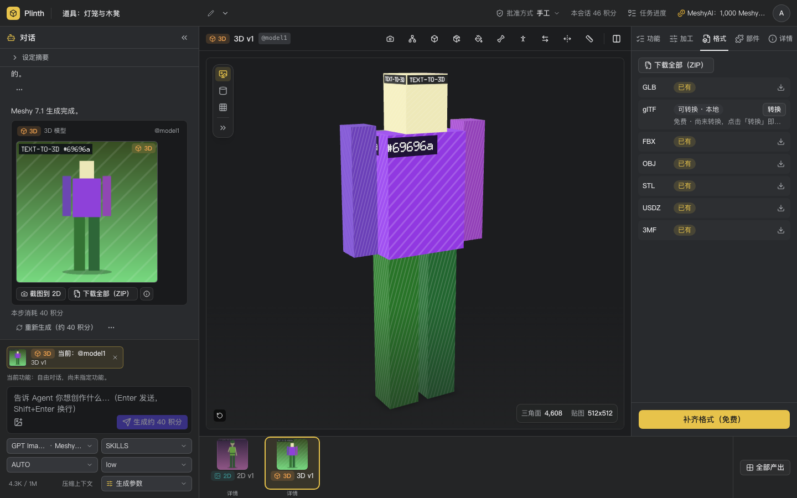
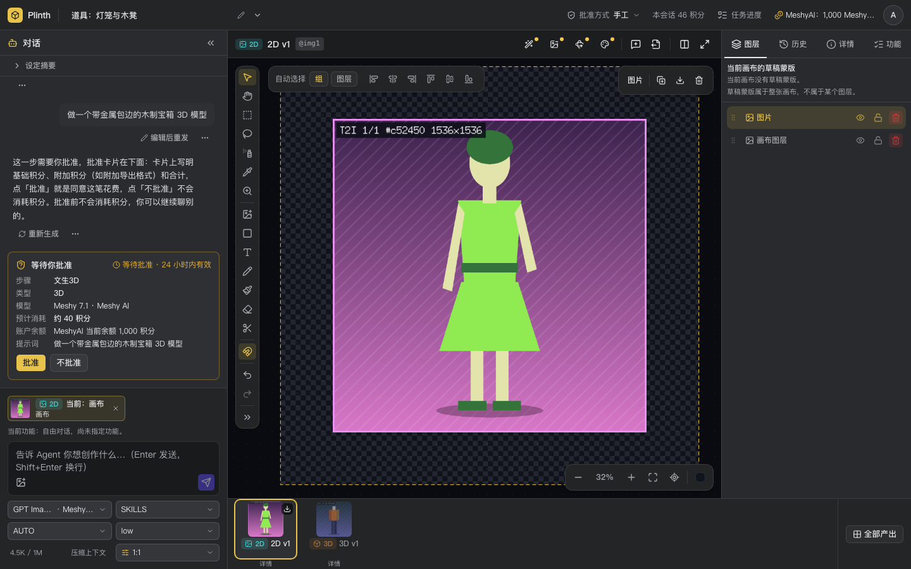
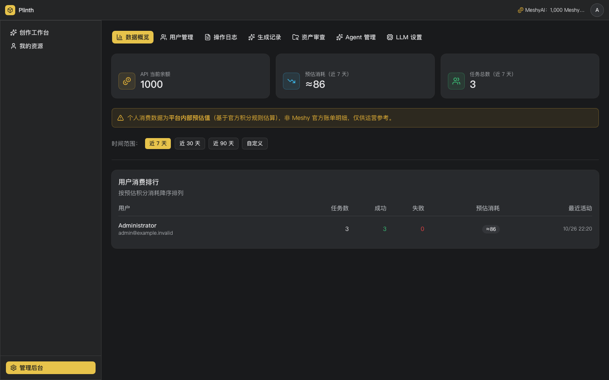

# Plinth

中文 | [English](README.en.md)

Plinth 是一个自部署的 AI 美术资产工作台：在一个对话 + 画布的桌面工作区里，用 Agent
或手动参数调用多家图像与 3D 生成服务，把结果作为自己服务器上的持久资产保存、查看、
继续加工和下载。面向独立游戏开发者和中小团队内部使用，自行提供各家 Provider 的 API key。

- **图像**：文生图、图生图、局部重绘、去背景，2D 画布（图层、裁切、画笔、遮罩、导出）。
- **3D**：文生 3D、图生 3D、换贴图、重拓扑、绑骨与动画，3D 查看器与多格式下载
  （GLB、glTF、OBJ、STL、FBX、USDZ 等，以各 Provider 实际支持为准）。
- **Agent**：用自然语言描述需求，Agent 选择模型和参数并发起任务；付费步骤按会话的
  批准方式（自动 / 手动）执行。Agent 使用任意 OpenAI chat completions 兼容的多模态模型。
- **内置 Provider**：Meshy、Tripo、Hyper3D、即梦（Jimeng）、Gemini，以及 OpenAI 图像与
  自部署抠图服务。配置有效的 key 和所需地址后才可用；配置缺失时明确显示不可用，不会切换模型。
- **零 key 可体验**：默认 Mock 模式返回内置示例结果，不调用任何付费上游。
- **用户**：管理员 + 普通用户，账号密码登录。
- **界面语言**：中文与英文，见下文「界面语言」。

项目只面向 PC 桌面浏览器。

## 截图

以下截图来自零 key 的 Mock 模式（图片与 3D 是内置示例结果），英文界面见
[English README](README.en.md#screenshots)。

<table>
  <tr>
    <td width="50%"><br>工作区：与 Agent 对话，舞台查看 3D 模型</td>
    <td width="50%"><br>格式交付：逐个下载或下载全部（ZIP）</td>
  </tr>
  <tr>
    <td width="50%"><br>付费步骤的批准卡（手工批准方式）</td>
    <td width="50%"><br>管理后台</td>
  </tr>
</table>

## 快速开始

只需要 Docker。下一节是完整的自部署说明；最短路径：

```bash
git clone https://github.com/LeXwDeX/Plinth.git
cd Plinth
cp .env.example .env && chmod 600 .env
# 编辑 .env，填写 SESSION_SECRET 与 ADMIN_PASSWORD（生成方法写在 .env.example 里）
ART_AI_SOURCE_COMMIT=$(git rev-parse HEAD) docker compose up -d --build --wait
```

命令成功返回（`--wait` 已等到健康检查通过）后，打开 <http://127.0.0.1:13333/login>，用
`admin` 和你填写的 `ADMIN_PASSWORD` 登录。

## Docker Compose 自部署

自部署只用根目录的 `docker-compose.yml` 与 `.env.example`。

**准备**：Docker Engine 与 Docker Compose v2.24+（用到 `env_file` 的 `required`
写法），以及 `git`、`openssl`、`curl`。不需要装 Go、Node 或 pnpm：镜像从源码构建，
构建时要能访问 Docker Hub（基础镜像 `node:22-alpine`、`golang:1.27`、`alpine:3.23`）、
公共 npm registry（固定为 `https://registry.npmjs.org/`）与 Go 模块代理（可在 `.env`
用 `GOPROXY` 改源）。首次构建需要几分钟。

**1. 准备 `.env`**：复制模板，生成两个必填项写进去（下面的命令 Linux 与 macOS 通用）：

```bash
cp .env.example .env
sed -i.bak \
  -e "s|^SESSION_SECRET=.*|SESSION_SECRET=$(openssl rand -base64 48)|" \
  -e "s|^ADMIN_PASSWORD=.*|ADMIN_PASSWORD=$(openssl rand -base64 24)|" \
  .env && rm .env.bak
chmod 600 .env
```

首个管理员（默认用户名 `admin`）的密码就是 `.env` 里的 `ADMIN_PASSWORD`，登录时要用。用编辑器
打开 `.env` 查看；不要用 `grep`、`cat` 之类的命令打印它，口令会留在终端回滚、shell 历史、
录屏和 CI 日志里。

也可以手工填写：`SESSION_SECRET` 填 `openssl rand -base64 48` 的输出（至少 32 字符），
`ADMIN_PASSWORD` 填至少 6 个字符的密码（建议 `openssl rand -base64 24`）。其余项都有
可用的默认值，零 Provider key 即可体验。

**2. 构建并启动**：

```bash
# ART_AI_SOURCE_COMMIT 把源码提交写进镜像，/api/version 才会返回它（否则为 unknown）；
# --wait 等到服务通过健康检查才返回，启动失败时直接报错。
ART_AI_SOURCE_COMMIT=$(git rev-parse HEAD) docker compose up -d --build --wait
curl http://127.0.0.1:13333/readyz        # {"service":"art-ai-go","status":"ok"}
curl http://127.0.0.1:13333/api/version   # {"version":"<上面的完整 SHA>"}
```

没有 `.git` 的源码包（例如下载的压缩包）里 `git rev-parse HEAD` 会失败：把它换成完整的
40 位提交 SHA，或者去掉 `ART_AI_SOURCE_COMMIT=...` 前缀（此时 `/api/version` 为 `unknown`）。
构建使用 Docker 默认的 BuildKit。BuildKit 不支持 `docker build --network <NETWORK>`
（报 `network mode ... not supported by buildkit`）；需要在构建期隔离或观测网络时，改用经典
构建器单独构建镜像，再用 Compose 启动（镜像名与标签要和 Compose 一致，默认 `art-ai:local`）：

```bash
DOCKER_BUILDKIT=0 docker build -f Dockerfile.go-runtime --target runtime \
  --build-arg GO_SOURCE_COMMIT=$(git rev-parse HEAD) --network <NETWORK> -t art-ai:local .
docker compose up -d --wait
```

也可以使用 buildx 的 `network` driver 选项。

只写 `docker compose up -d` 也能启动：第一次会自动构建镜像，但 `/api/version` 为
`unknown`，而且之后更新代码时它不会重新构建，所以升级一定要带 `--build`。

**3. 登录并试用**：浏览器打开 `http://127.0.0.1:13333/login`，用户名 `admin`（`.env` 的
`ADMIN_USERNAME`），密码是第 1 步 `.env` 里的 `ADMIN_PASSWORD`。默认 Mock 模式返回内置的
示例结果，不调用任何上游、不产生费用：

- **图片**：在输入框下方的模型选择器里选一个 2D 模型，输入一句描述发送，得到示例图片。
- **3D 模型**：选一个 3D 模型，描述里写上「3D」或「模型」（Mock Agent 只按这类关键词判断
  要做 3D），发送后对话里出现批准卡（新会话的批准方式是「手工」，文生 3D 要你批准），点
  「批准」后得到示例 3D 模型（含 GLB、FBX、OBJ、STL、USDZ、3MF），可在舞台查看和下载。

Mock Agent 不理解语义，每条消息都会按关键词调用一个生成工具；对应领域还没选模型时，它回复
“这一步没有完成”并提示先选择模型。

**启动失败时**：`--wait` 报错或 `docker compose ps` 显示 `Restarting` 时，先看
`docker compose logs art-ai`。常见原因：

| 报错 | 处理 |
|---|---|
| `required variable SESSION_SECRET is missing a value`（`docker compose` 直接报错） | `.env` 里该项为空，按第 1 步填写；`ADMIN_PASSWORD` 同理 |
| 日志 `SESSION_SECRET 至少需要 32 个字符` | 按第 1 步重新生成 `SESSION_SECRET` |
| 日志 `ADMIN_PASSWORD 至少需要 6 个字符` | 首次启动创建管理员时检查；换一个更长的密码 |
| `address already in use`（`docker compose` 直接报错） | 端口被占用，在 `.env` 改 `ART_AI_PORT` |

### 配置说明

- **必填项**：`SESSION_SECRET`（至少 32 字符，签发登录会话；更换后所有人需要重新登录）
  与 `ADMIN_PASSWORD`（首个管理员密码）。任一为空时 `docker compose up` 直接报错并给出
  生成方法；长度不够时服务拒绝启动，原因写在 `docker compose logs art-ai`。
- **运行模式**：Compose 固定 `APP_ENV=production` 与 `AUTH_MODE=session`：只能用账号
  密码登录，Mock 登录被拒绝，密钥缺失或过短时拒绝启动。`.env` 里写 `APP_ENV` /
  `AUTH_MODE` 不生效。
- **首个管理员**：首次启动时，若 `ADMIN_USERNAME`（默认 `admin`）不存在，就用
  `ADMIN_PASSWORD` 创建该管理员；之后在产品里改的密码不会被重启覆盖。忘记密码时在
  `.env` 写入新的 `ADMIN_PASSWORD` 和 `ADMIN_PASSWORD_RESET=true`，执行
  `docker compose up -d --wait` 重建服务（该管理员已登录的会话随之失效）。登录后将
  `ADMIN_PASSWORD_RESET` 改回 `false`，再执行一次 `docker compose up -d --wait` 应用配置；
  只编辑 `.env` 或执行 `docker compose restart` 不会更新已有容器的环境。
  创建与重置都会写一条 INFO 日志「管理员初始化」并记入管理后台审计（不含密码）。
- **零 Key 可体验**：默认 `PROVIDER_MODE=mock`、`AGENT_MODE=mock`，不需要任何
  Provider key：图片与 3D 生成、对话 Agent 都返回内置示例结果，不产生费用。接真实
  模型时改成 `live`，只填要用的 Provider key，见
  [Provider 配置](docs/provider-configuration.md)。`AGENT_MODE=live` 必须设置
  `LLM_BASE_URL` 与 `LLM_API_KEY`，缺少地址或 key 时 Agent 显示“未配置”。`LLM_MODEL`
  留空使用 Schema 默认值 `deepseek`，请按实际端点支持的模型名设置。`LLM_BASE_URL`
  只供 Agent 对话使用，图像 Provider 各读自己的
  `<ID>_BASE_URL`：启用 Gemini 时必须设置 `GEMINI_BASE_URL`（没有默认值）；所有模型
  经同一网关时，把 `LLM_BASE_URL`、`OPENAI_BASE_URL`、`GEMINI_BASE_URL` 都设为网关地址。
- **资产签名（可选）**：只有上游 Provider 需要按 URL 回拉本服务的资产时才配置
  `PUBLIC_BASE_URL`（本服务对外的 https 地址）与 `ASSET_SIGNING_KEY`，两者同时设置；
  `ASSET_SIGNING_KEY` 用 `openssl rand -base64 48` 生成（至少 32 字节）。Mock 模式不需要。
- **地址与端口**：默认只监听本机 `127.0.0.1:13333`，在 `.env` 改 `ART_AI_BIND_IP` /
  `ART_AI_PORT` 后执行 `docker compose up -d --wait` 生效，上文命令和地址里的 `13333` 随之替换。
  对外提供服务时放在 HTTPS 反向代理之后，并设置 `NEXT_PUBLIC_APP_URL` 与
  `TRUSTED_PROXY_CIDRS`，见 [自部署安全配置](docs/self-deploy-security.md)。Compose
  使用默认桥接网络，不固定子网或容器 IP。
- **数据**：数据库与资产保存在命名卷 `art-ai-data`、`art-ai-storage`（`docker volume ls`
  里带 Compose 项目名前缀，默认是 `art-ai_art-ai-data`、`art-ai_art-ai-storage`）；
  `docker compose restart`、`down` 后再 `up -d`、升级重建都保留数据，只有
  `docker compose down -v` 会删除。升级：更新代码后执行
  `ART_AI_SOURCE_COMMIT=$(git rev-parse HEAD) docker compose up -d --build --wait`，
  数据库迁移在启动时自动执行；升级前先备份这两个卷。
- **同机部署多套**：Compose 项目名默认 `art-ai`，镜像默认 `art-ai:local`。同一台主机上已有
  一套 Plinth 时，再起第二套必须在 `.env` 设置不同的 `COMPOSE_PROJECT_NAME` 与
  `ART_AI_IMAGE_TAG`（见 `.env.example` 的 Build 段），并换一个 `ART_AI_PORT`；否则会复用同名
  项目、覆盖同名镜像标签。命名卷、容器名随项目名变化。
- **日志**：`docker compose logs -f art-ai`，级别由 `.env` 的 `LOG_LEVEL` 控制。
- **Agent 工具次数**：`.env` 的 `AGENT_MAX_TOOL_CALLS_PER_REPLY` 限定一次 Agent 回复
  最多执行的工具调用数，每次新回复重新计数；留空为 20，可设 1–100，见
  [Provider 配置](docs/provider-configuration.md#agent-对话模型--agent-chat-model)。

## Provider 配置

所有 Provider 的地址和 key 都写在 `.env`，由 Compose 注入容器：

- 每个 Provider 读两个变量：`<ID>_BASE_URL`（有默认地址时可留空）与 `<ID>_API_KEY`
  （设置了才启用）。例如 `MESHY_API_KEY`、`TRIPO_API_KEY`、`HYPER3D_API_KEY`、
  `JIMENG_API_KEY`、`GEMINI_API_KEY`（启用 Gemini 时同时设置 `GEMINI_BASE_URL`）。
- 把 `PROVIDER_MODE` 改为 `live` 才会调用真实上游；只填要用的 key。真实生成会消耗对应
  账户的积分或费用。
- `AGENT_MODE` 默认仍是 `mock`，与 `PROVIDER_MODE` 各自独立。`PROVIDER_MODE=live` 而
  `AGENT_MODE=mock` 时，Mock Agent 不理解语义，每条消息都会按关键词提交一次生成（服务日志
  有 WARN，付费步骤仍要你同意）。要用自然语言驱动真实生成，两者都设为 `live`，并配置
  下面的 Agent 对话模型。
- Agent 对话模型：`AGENT_MODE=live` 时设置 `LLM_BASE_URL`、`LLM_API_KEY`、`LLM_MODEL`，
  指向任意 OpenAI chat completions 兼容的接口；模型必须是多模态的，至少能读图。
  想让用户选择更多对话模型时，用 `LLM_CONNECTIONS=QWEN,GLM` 列出连接，每个连接只读自己的
  `<ID>_BASE_URL`、`<ID>_API_KEY`、`<ID>_MODEL`（统一网关也要逐个写同一个地址），再由管理员在
  管理后台「LLM 设置」测试连接、设置默认模型与开放的思考档位。

完整变量表、默认地址与计费说明见
[Provider 配置](docs/provider-configuration.md)。改完 `.env` 后执行
`docker compose up -d --wait` 生效；`docker compose restart` 沿用容器原有的环境，不会读取新的
`.env`。

## 界面语言

界面支持简体中文（`zh-CN`，默认）和英文（`en`）。语言按「已保存的选择 → 浏览器
`Accept-Language` → 中文」决定；在顶栏用户菜单或登录页可以切换，选择保存在浏览器
cookie 里，登录前也有效。表单、参数说明、错误提示和 Agent 回复都跟随界面语言。界面文案
来自 Product Schema 的多语言包，实现说明见
[架构文档的语言章节](docs/architecture.md)。

## 架构概览

```
浏览器（React SPA）
   │  同源 HTTP / SSE
   ▼
art-ai（单个 Go 进程，单容器）
   ├─ Web 托管：静态资源、SPA 路由、CSP
   ├─ HTTP API：鉴权、会话、任务、资产、对话、管理后台
   ├─ Agent：OpenAI 兼容 chat completions + 工具调用
   ├─ Generation 内核：Task / Attempt、租约调度、幂等、事件
   ├─ Provider Adapter：Meshy、Tripo、Hyper3D、Jimeng、Gemini、OpenAI、Matting、Mock
   └─ 存储：SQLite（WAL）+ 内容寻址的资产文件（Docker 命名卷）
```

- **Product Schema 是唯一真源**：`internal/catalog/default_catalog.json` 声明所有 Provider、
  模型、能力、参数、费用、文案和界面配置；前端只消费 `/api/v1/schema` 的公开投影。
- **统一任务内核**：每次生成或加工都是一个公开 Task，由 `internal/generation` 管理状态；
  必需产物全部保存并校验后才算成功。
- **运行镜像**只含 Go 二进制和构建好的前端静态文件；Node/pnpm 只在多阶段构建中编译前端。

详细设计见 [docs/architecture.md](docs/architecture.md)，领域术语见 [CONTEXT.md](CONTEXT.md)。

## 本地开发

前置工具：Go（最低 1.26，即 `go.mod`；镜像与 CI 使用 1.27，推荐 1.27）、Node 22、pnpm
（版本以 `package.json` 的 `packageManager` 为准，`corepack enable` 可取得）、`git`、
`python3`、`bash` 与 `jq`（部分前端测试会调用）；运行 `--race` 门禁还需要 C 编译器（`gcc`
或 `cc`，CGO）。`python3 scripts/verify-local.py` 启动时会检查这些命令，缺失时直接列出。
完整说明见 [CONTRIBUTING.md](CONTRIBUTING.md)。

```bash
pnpm install --frozen-lockfile
pnpm build                                   # 前端输出到 build/go-web
WEB_ASSETS_ROOT=build/go-web go run ./cmd/art-ai
```

开发模式默认使用 Mock Provider 和开发身份，监听 `127.0.0.1:13333`。提交前运行
`python3 scripts/verify-local.py`。开发环境、门禁和提交规范见
[CONTRIBUTING.md](CONTRIBUTING.md)。

## 文档

| 文档 | 内容 |
|---|---|
| [docs/provider-configuration.md](docs/provider-configuration.md) | Provider 与 Agent 模型的环境变量 |
| [docs/self-deploy-security.md](docs/self-deploy-security.md) | 对外提供服务前的安全配置（HTTPS、反向代理、限流） |
| [docs/storage-maintenance.md](docs/storage-maintenance.md) | 存储维护 |
| [docs/architecture.md](docs/architecture.md) | 架构与职责 |
| [docs/acceptance-1.0.md](docs/acceptance-1.0.md) | 1.0 功能验收清单 |
| [CONTRIBUTING.md](CONTRIBUTING.md) | 参与开发 |
| [SECURITY.md](SECURITY.md) | 报告安全漏洞 |

仓库里还有维护者内部测试环境使用的发布脚本和历史迁移工具，自部署不需要，清单见
[docs/deployment.md](docs/deployment.md#内部运维资产自部署不需要)。

## 已知限制

- 部分由服务端生成、展示给用户的文字目前只有中文：任务失败原因、提交前的拒绝原因，以及
  Agent 转述的工具说明。英文界面下这些地方仍会出现中文，计划在 1.0 之后改为按界面语言显示。
- 只面向 PC 桌面浏览器。
- 1.0 不包含：用户自行添加 Provider（只能使用上文列出的内置 Provider）、团队与组织（只有
  管理员和普通用户两种角色）、Provider key 的加密存储（key 写在 `.env`，靠文件权限保护）、
  OpenAI chat completions 以外的对话协议。

## 参与与安全

欢迎提交 Issue 和 Pull Request，流程见 [CONTRIBUTING.md](CONTRIBUTING.md)。安全漏洞请不要
公开提 Issue，按 [SECURITY.md](SECURITY.md) 私下报告。

## 许可证

MIT，见 [LICENSE](LICENSE)。第三方依赖与随仓库提供材料的许可证记录见[第三方许可证清单](docs/third-party-licenses.md)。
