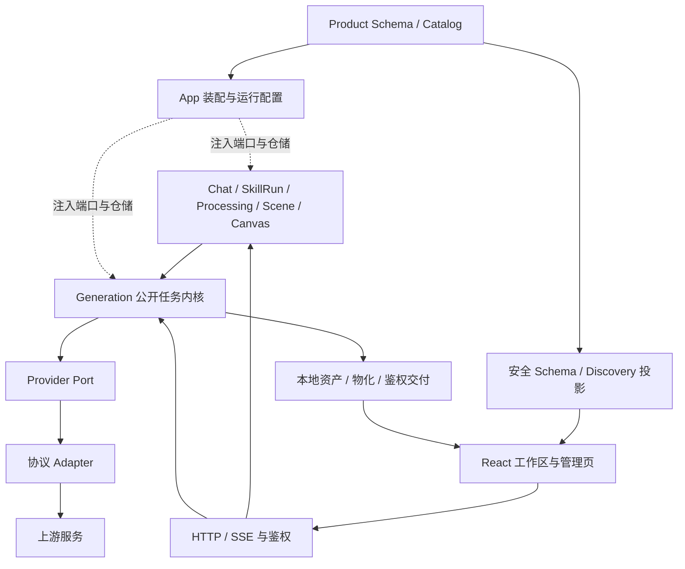

# Plinth 架构与职责地图

更新：2026-10-08，补充 Issue #134/#135 的 PC Skill 弹窗与可选分类合同。
源码基线为主线 `5bb885e453c0b7951bcd47fe9e3cb26089954020`；本文同时说明本次改动。
项目只面向 PC。工作区按桌面浏览器、鼠标和键盘设计与验收。历史移动视口记录保留为历史证据。

本次保留 Go 单进程、React SPA、Product Schema 真源和 Generation 统一任务内核。
Skill 创建与选择不再展示分类。新建请求可省略分类，服务端保存空值；旧分类保留为兼容元数据。
Skill 选择使用有宽高上限的桌面面板。搜索区固定，卡片列表和完整提示词预览分别滚动。
个人 Skill 的 owner、持久化、冻结配置和付费同意边界保持原合同。

运行基线 `7c1474dd7b27f5480524fdfa06a08d6b95b81316` 已发布到 dev-test，并通过所记 L0/L1/L2 与相关 UI/API 检查。
本次新改动的精确 Git SHA、发布标签及部署后检查以发布回执为准，不从源码入口推定。
历史发布、失败与回滚见 [系统补齐记录](system-completion-2026-10-03.md) 和对应原生 Issue/MR；更早的审查报告与实现台账已移出仓库，只保留在内部 Git 历史中。
未闭环能力与验收由 #162、#166 及 V3 验收里程碑（Milestone #1）记录。默认使用可独立控制的隔离浏览器，物理 Safari 仅在明确要求的专项验收中使用。

### Tripo 四视角图片组候选（#191）

`image-to-multiview` 和 `edit-multiview` 各是一项独立公开 Generation Task；Tripo v3 的文件上传、创建派发与轮询只在 Adapter 私有检查点中运行。两个 Offering 于 2026-10-20 按路线 B 启用（先启用、发布后在开发测试环境做公开付费验收，不通过即回退禁用，见 #191）。生成以本人 PNG/JPEG 图片字节上传，成功须分别物化 `image` 角色的 front、left、back、right 四个必需 variant；编辑以同 owner/session、同 Provider、已成功的四视角生成 Task 为 `source_task`，内核冻结已确认 remote Job 和来源字节身份，Adapter 只使用绑定的 remote ID。它不是旧三视图 SkillRun，也不进入 3D 模型加工。

编辑的四个可选标量 prompt 至少有一个非空。每个 output 的 `required_when` 与该 prompt 的 `present` 条件对应（select 参数的 `equals` 形状见下文「Meshy Creative Lab 的阶段与来源合同」）；Generation 在提交时把未选槽位的 `minimum` 冻结为零，后续 claims、物化、成功门槛和恢复只读该 Task 快照。Adapter 仅接受所选视角的对应 URL，多余、未知或遗漏槽位均拒绝。单视角编辑只生成该视角的新资产，原 Task 的其余三张仍属于原 Task，不能伪装为本轮新产物。每视角原生估算5 Tripo积分，生成基础10；报价、额外授权与同一 PreparedInput/Grant 绑定。

公开 Schema 的 `image_result_group` 声明 UI 顺序、名称和组级来源选择；它和用于资源交付的 `AssetRequirement.Group` 不同。Task/Asset 投影沿既有 role、variant、ordinal 与鉴权交付，前端按公开 Schema 给图片组排列与标注，不解析 Tripo 私有字段。对话结果卡、版本条展开层和任务详情共用这一份声明（`src/lib/workspace/image-result-group.ts`）：对话卡只在一条消息的全部图片都属于任务跟踪里同一会话、同一 Task，且每张图的资产 variant 各落在一个声明槽位时，才显示为「能力名 · N 张」的图片组，按槽位顺序排列并标注视角；任一条件不满足（普通候选、跨 Task、Task 尚未被跟踪）时退回普通候选卡。是否允许缺视角由 Schema 按能力声明：`image_result_group.partial_message` 给出缺视角时显示的文案键，只有编辑四视角声明它；没有声明的分组（生成四视角）缺任何视角都退回普通候选卡。Catalog 校验要求带 `required_when` 条件图片输出的分组必须声明 `partial_message`，且它不能与整组来源选择 `source_selectable` 并存、必须指向已有文案。编辑只交付所选视角，卡上按该文案写明其余视角仍是来源任务的原图，不从来源补图。卡片记住的当前图片按图片身份而非位置，任务跟踪晚到、卡片按槽位重排后，高亮、下载与转 3D 仍作用于同一张图。Agent 的来源图片句柄/选择解析为本会话公开 Task ID，来源资格仍由内核核验。本地 Mock 栈为验证这条链补齐了两点（仅 `PROVIDER_MODE=mock`）：Mock Provider 实现只读 `DependencyBindingResolver`（投影来源 Task/Attempt/remote job，不做 I/O），只接受四个视角都已作为必需资产保存的 `image-to-multiview` 来源，与 Tripo Adapter 的检查一致；其他声明 `task_source_binding: provider` 的来源（如 Tripo Retarget 的绑骨来源、Meshy 键帽原型）在 Mock 栈上仍被拒绝，因为真实 Adapter 还要核对 Mock 没有的骨架规格或结果身份证据；Mock 不再交付冻结后 `minimum` 为 0 的条件必需槽位，与上游只返回所编辑视角一致。当前只完成本地候选合同与本地 Mock 浏览器验收（证据见 #191 评论）；真实公开 Task、Grant、字节物化、dev-test 页面和 API 验收及启用决策由 #191 记录。

### 已有产物恢复协议（#207）

`asset-recovery` 是由 Generation 管理的新公开能力。它只把已收集且重新验证的已有字节物化为新 Task 的资产；旧失败 Task、Attempt、私有检查点、资产登记和历史费用不改写。来源仍是失败状态，因此它不作为普通成功 Task 依赖，也不放宽 Processing、Scene 或 Provider 的来源检查。没有 ETL、上游重生成、转换或远端请求。

运行镜像随同版本打包 `art-ai-recover-assets`（源码入口 `cmd/recover-existing-assets`），不增加后台进程或自动恢复。该可信运维入口要求精确 owner、来源 Task/Attempt、已有 ZIP 的预先核定 SHA-256 和恢复 Offering。默认只读打开数据库，在私有临时目录固定包字节并按当前 CAS 检查器验证；不迁移、不写实时资产库或回执。包清单必须逐项对应来源冻结 Offering 的原槽位，大小、SHA-256、实际格式和目标 delivery profile 均重新检查；重复、遗漏、未知槽位、路径越界和未列出的文件拒绝。旧包内的 validation-receipt 仅是有界附件，不能替代当前检查。

显式 `--apply` 先只读检查部署的 migration 0054 校验和，再把验证后的字节写入已有 CAS；最后在事务内重读来源并插入不可变 `generation_recovery_receipts`，不直接登记公开 Asset 或提交 Task。回执摘要绑定 owner/session、来源 Task/当前失败 Attempt、原冻结 Offering 原始字节摘要、Task/Attempt/claims/assets 快照、包与清单摘要、替代 Offering 完整摘要以及全部原槽位→新槽位的字节身份。相同来源和摘要重放不产生第二条回执；不同摘要拒绝。数据库写入前失败可能留下无引用 CAS 字节，由既有 GC 处理；已落库回执的全部槽位纳入 `BlobReferenceRecords` 保护，来源/会话删除遵循外键级联。

首次实际 `--apply` 前，运维交付必须按现行 Plinth 发布/备份协议核实可用容量、保留一致性的数据库与资产备份，记录精确部署 revision、来源快照、包摘要和恢复范围；CLI 不把一次 dry-run 视为备份或写入授权。回执事务失败不留下半条记录，新写入但未被引用的 CAS 字节交给既有 GC，不直接删除共享 blob。当前 CLI 没有独立撤回模式。已附加回执或已创建新 Task 后发生验收失败时，先停止该测试栈的相关写入并按发布协议核对回滚范围；只有确认不会覆盖备份后新增的用户数据，才允许恢复该 Plinth 栈的一致性备份及匹配版本。否则保留失败证据和新 Task，由 Generation 的既有生命周期处理，记录具体阻塞，不盲删回执/资产、不改写 Task 终态或用旧库覆盖新写入。备份可用性和恢复演练属于实际 reintegration 验收，不由本机单元测试代证。

`GET /api/v1/tasks/{taskID}/recovery` 仅返回所有者的资格、公开槽位身份和已有恢复 Task 链接；没有有效回执则不可恢复。资格读取先保留来源 FAILED/会话、回执与来源快照、当前 Offering/Adapter 可用性和冻结输入校验，再查回执固定幂等键。已有 Task 的会话、Offering ID 与完整输入必须一致，符合时只返回既有 Task 链接与槽位信息，不重新读取暂存资产字节，也不新建 PreparedInput、Grant 或 Task；该链接不限制既有 Task 状态。仅幂等查询明确不存在时才执行完整 Provider 字节校验；其他仓储错误或绑定冲突直接失败。新恢复的 Prepare、Submit 与资产物化仍执行原完整校验。`POST .../recovery/prepare` 只接受预期回执摘要，返回稳定 PreparedInput 或已有恢复 Task。执行继续使用既有 Grant 与任务提交 API；幂等键由回执身份确定，缺少执行准入或改键均拒绝。当前免费恢复遵循既有批准策略，不新增人工批准能力；若 Schema 将它列入手动批准能力，同一链路等待决定。客户端不能上传任意包、URL、storage key 或自行声明回执。恢复入口文案来自可选的 `task_history.asset_recovery`，旧 Schema 缺省该块时客户端隐藏入口。

App 为闭合 `local-recovery` 协议注入回执与资产读取端口，live/mock 均使用真实本地 Adapter；缺少持久仓储或资产端口即不可用。InputValidationRequest 和 StartRequest 传入会话 ID，Adapter 在准备、提交、执行、读取产物时核对相同 owner/session、来源快照和回执。Adapter 没有网络客户端，只通过普通 Observation/ArtifactClaim 返回完成结果；私有 `recovery:<task>:<attempt>:<slot>` locator 绑定当前任务和 Attempt，不是可对外访问的 URL。物化读取再次流式校验摘要和长度，再由内核执行完整 CAS/profile 检查；必需槽位 READY 后才公开成功。

恢复 Task 的所有者详情提供 `recovery_source`（`kind: asset_recovery`），只包含原 Task/Attempt/Offering 修订和回执摘要；不投影定位信息、storage key、上游 ID/URL 或私有检查点。恢复得到的 GLB 可沿现有显式 Scene 来源选择使用，恢复能力不触发原图生 3D 的自动 Scene 选择。来源字节中的 `converted.gltf` 若实际为 GLB，目标仍标记 GLB，不能伪装为 JSON glTF；共享字节的原始 model 与 converted_model 两个必需槽位保留独立身份。

本机回归分别覆盖真实 SQLite/CAS/Generation 的批准、重启、重复提交、来源与回执/字节篡改、GC 引用，以及 CLI 包校验/只读预演和 HTTP 所有权、默认自动批准与显式手动批准策略。合成 fixture 不等于真实历史包公开交付；完整发布、真实历史回执附加、下载/预览与 Scene 验收由 #207 的精确运行记录证明。

### 可控验收装配边界

`internal/app.New` 始终使用默认依赖。私有 `newWithDependencies` 允许同包测试包裹 Provider Registry 与 Processing Gateway，并注入只读 `TaskAdmissionStore` 以核对任务实际批准的 PreparedInput；故障控制器、清单读取和测试服务器仅存在于 `_test.go`，普通发布二进制没有故障入口或控制 API。测试进程仍装配实际 HTTP、Processing、Generation、SQLite、worker 和资产模块，Task/Attempt 终态只能由 Generation 推进。

同一私有装配支持按连接 ID 装饰 Provider 和 Chat LLM 的 HTTP transport，用于测试采集与离线回放。普通 `New` 不启用该钩子，也没有对应环境开关或公开 API。装饰普通 transport 前复制标准 transport；钩子返回 nil 时拒绝请求，不回退真实网络。Tripo 匿名原生来源以独立的 `<connectionID>.native-source` 标识装饰已经构造的安全 transport，保留默认的公网 IP 固定、TLS、无代理和禁止重定向设置；未传钩子时运行行为不变。

`TestWireCaptureServer` 是独立的 opt-in 测试入口，不复用强制 mock Agent 的 `TestAcceptanceServer`。它要求显式 ACK、源码 SHA 链接的测试二进制、调用者所有的工作树外 0700 目录、0600 清单与 Catalog、Catalog SHA-256、数字 loopback 地址和 1–3600 秒时限。清单登记连接与有界脱敏策略，启动前用独立合成探针检查策略、元数据和连接配置，并确认选定连接实际经过装配钩子；探针不联网、不进入采集结果。每次运行独占创建 `run/`，冻结清单与 Catalog 字节，使用新 SQLite、资产、缓存、会话密钥和无管理员权限的测试 owner，不导入或伪造任务状态。Provider 和 Agent 保持 live Adapter；测试入口的 ACK 不是付费授权。

该入口只包裹选定连接的原 transport，未选连接和账户余额读取不在采集范围；它不是出站网络沙箱。清单省略 `deferred_limits` 时保留即时模式；显式提供 `{MaxBytes, MaxExchanges}` 才用 `NewDeferredRecorder`，入口要求 `MaxBytes` 为 1–67108864 bytes、`MaxExchanges` 为 1–1024。启动时仍预检原策略、连接与元数据，但不要求动态映射或最终策略文件已经存在。`Application.Run` 正常停止 HTTP 和后台 worker 后，延迟模式只读取私有根内固定的 `final-policy.json`：调用者所有的 0600 常规文件、最多 1 MiB，以目录句柄和 no-follow/non-blocking 打开，拒绝符号链接、未知 JSON 字段和尾随 JSON。最终策略必须保留完整 Keys、原 Allowed 与 Aliases 登记；body 上限只能保持或收紧，新增 Allowed/Aliases 仍经同一严格合成预检，不能借此扩充字段结构或自动批准动态值。随后单次 `Finalize`、`AssertComplete` 且每个选定连接至少有一条交互均须通过，才用 `WriteCandidate` 独占导出。缺文件、不安全策略、不完整交互或不干净停机一律释放延迟暂存，不补映射重试；出口不发网络请求。放弃/装配失败也调用 `Release`，即时模式的私有磁盘证据仍不自动删除。日志限于私有目录中的时间/级别事件，丢弃可能含上游内容的消息、属性和 HTTP server 原始诊断；不能用于完整故障分析。

延迟模式另从已验证的 candidate 构造无 Aliases 的 `replay-policy.json`：只复制原先预登记的公开 Keys/Allowed，再收集公开 payload、路径与保留头内已通过定稿校验的终端字符串/数字，重新 `Validate`；不从 raw 推导 Allowed，不导出原清单或私有最终策略。该策略最多 1 MiB，在 `NewPrivateStore` 复核隔离目录后经 `os.Root` 以 0600 独占创建；先写策略，再由既有 `WriteCandidate` 写 `candidate.json`，候选写入失败时删除本次新建策略，已有文件不覆盖。普通测试跳过交互入口，离线测试经过实际 prepare/assemble、HTTP 连接探测、正常 Run 停机及无网络回放；JSON 200 与 SSE 500 交互均是合成数据，SSE 用错误路径完整读取，不证明成功流式对话。真实浏览器、真实上游 corpus 和完整采集流程仍未验收。操作和限制见 `scripts/smoke/README.md`「Opt-In Wire Capture」。

`internal/testutil/wirefixture` 是测试辅助包。它对 HTTP 请求和响应制作受限副本，不改变业务响应、请求重试或任务终态。JSON 字段、字符串与数字须显式登记；布尔值和 null 按结构保留。所有字段先检查 `Policy.Keys`，未知凭据字段也拒绝；只有已登记的凭据字段才脱敏。已登记文本与别名目标仍须通过凭据、地址与嵌套内容检查；别名链拒绝，递归有界。OpenAI 风格 SSE 的 delta 仅支持 `role`、`content`、`reasoning_content` 与 `tool_calls`，其他 delta 字段即使登记也拒绝。内容、推理与工具 ID/名称/参数按 choice/tool 索引合并后检查，再输出标有 `normalized_sse` 的规范化流，不声称保留原始分片。回放严格匹配顺序、方法、公开主机别名、路径、允许保留的头和正文，未匹配请求直接失败，没有网络回退。头的范围固定为 Content-Type、请求 Accept/X-API-Version 与响应 Retry-After，其他头不参与回放契约。

普通 `Recorder` 保持即时脱敏模式，JSON body 的 `Close` 仍可能按既有上限补读排空。仅显式 `NewDeferredRecorder(metadata, DeferredLimits)` 启用延迟模式：在请求进入时分配序号，只观察调用者的 `Read`，不预读、不在 `Close` 补读，不调用或改写 `GetBody`，URL、ContentLength 和底层 Read/Close/transport 错误保持透传。`MaxBytes` 和 `MaxExchanges` 必须为正；前者合计在途与已完成 pending 的 body 缓冲容量及复制的路径、主机、固定保留头和元数据，后者限制整轮交互数量（也限制在途数量和取消注册）。每个 body 另限 8 MiB，读取时先检查预算再保留副本；预算不是进程 RSS 上限，不含业务原文、分配器开销和定稿时 sanitizer 临时对象。

延迟原始副本不写公开出口，也没有 raw getter、任意修改 callback 或日志。调用方停止新请求并等 RoundTrip 与 body I/O 静止后，显式调用一次 `Finalize(reviewedExactPolicy)`，按进入序号复用严格 sanitizer/Validate 定稿；Policy maps 克隆，较小的 Policy body 上限仍生效。库 API 未静止时返回 incomplete，可等待后重试；已封存或已失败的证据不能换 Policy 修复。采集服务器的出口更严格：任何失败都 Release，不提供补文件/映射后的二次定稿。Finalize 前 `AssertComplete` 失败且 `Exchanges` 为空；定稿失败也不公开部分结果。超限、transport/body 错误、未完成时取消或显式 `Release` 永久使整轮证据无效，释放采集的原始 body 副本、复制字段和取消 callback，后续只透传业务请求且只保留一个固定失败原因；成功定稿也释放这些引用。封存后新请求仍透传，但撤销本轮证据资格。放弃采集时调用方须 `Release`，它不读取或关闭业务 body。延迟模式仍忽略 `Recorder.Policy`；显式 `NewDeferredRecorderWithEvidence`（采集服务器使用）把二进制响应字节流式写入私有 `PrivateStore`，不经 8 MiB 原文池，单文件上限 2 GiB、整轮 4 GiB，截断或提前关闭只使证据无效，不改变业务字节。只读资产 GET（路径含 `/output/`）的传输错误允许业务层重试，失败尝试从证据中丢弃；其他传输错误仍使整轮无效。动态任务 ID、已登记字段中的签名 URL 与 query key 通过 `Policy.Projection`/`PublicHosts`/`QueryKeys` 在定稿时投影为固定公开 token；query 值不保留，未登记 key 失败。该服务器接线与媒体替换导出有离线回归，但真实浏览器、真实上游大媒体和完整链仍未验收，不代表 #365 已完成。

导出完整采集前，调用方须停止新请求并通过 `Recorder.AssertComplete()`；未完整读取的响应、transport 失败、私有证据不可读或描述不符都算缺口，不能当作完整样本。候选导出再次校验端点/协议元数据、正数且唯一的序号、正文唯一编码及安全值，快照递归复制正文、头、媒体与 multipart 描述，避免调用方后续修改影响回放。导出仅写到工作树外已有的 0700 普通目录，不使用 bind mount，以 0600 独占创建文件，禁止覆盖和符号链接，并按目录身份检查大小写别名。登记策略、元数据与别名须人工复核，不能把真实用户内容整体加入允许列表来替代脱敏；检查器不解码任意不透明编码，也不是任意内容的隐私证明。元数据区分采集日期、部署/Catalog revision、端点/API 版本、请求模型、返回模型和服务端构建版本；不能从模型标签推断 API 版本。

二进制响应与 multipart 文件请求只保存类型化描述符（媒体类型、长度、可选的固定合成 recipe、是否替换）及有序 part 名称/字段值，不保存私有路径、原始文件名、摘要、私有 ID 或二进制/编码内容。实际传输读取的二进制字节若需保留，只能由 `PrivateStore` 写到工作树外已有的 0700 真实目录，以 0600 随机名独占创建，禁止覆盖；目录用 `os.Root` 固定句柄，创建 sink 时复核路径、目录 inode 与句柄身份，并双向检查 worktree/证据目录的 inode 祖先；文件系统把大小写或 Unicode 等价路径解析到同一 inode 时同样拒绝。Linux 还读取 `/proc/self/mountinfo`，拒绝位于非根 bind mount 下的 worktree 或证据路径；该布局目前只有解析器回归，未在测试中实际创建 bind mount，不能视为完整防绕过。文件读取经固定目录句柄并使用 no-follow、non-blocking 标志，拒绝符号链接和 FIFO；文件每次读取复核普通文件、0600、长度与 SHA-256。失败只使本次采集无效，不改变业务响应、错误、重试或 `GetBody`，二进制关闭时不补读排空。同用户或特权进程在检查后替换/移动目录、bind mount 或文件的竞态仍属残余风险，测试辅助包不承诺隔离恶意同用户。公开 `Exchange` 不包含这些字节，`WriteCandidate` 拒绝仍依赖私有证据的样本；导出与私有存储错误只返回固定原因，不拼接路径，`PrivateStore`、`PrivateSource` 与 `MediaEvidence` 的格式化输出也做脱敏摘要。回放通过显式 `PrivateMediaResolver`（按序号与 part 位置取私有证据）或 `SyntheticMediaResolver`（只用固定 `png-1x1`/`glb-triangle` recipe 在运行时生成）提供字节；两类解析器不可互换，`MediaResolver` 接口含未导出方法，外部自定义实现不能绕过 digest/MIME/source 校验，解析结果按捕获时或 recipe 预声明的媒体类型、长度和 digest 校验，期望值不从请求反推。recipe 名称、媒体类型、长度与 digest 固定为 version 1 并自检，生成器变化会失败而不是静默改变 golden 输出。未替换的私有证据只允许 captured provenance；替换为合成字节的公开夹具必须带 recipe、`substituted` 和 derived/synthetic provenance，不能声称保存了原始捕获产物。

multipart 只接受 `multipart/form-data`，文件 MIME 限于已登记媒体类型（`image/png`、`image/jpeg`、`model/gltf-binary`、`model/gltf+json`、`model/obj`、`model/stl`、`model/fbx`、`model/3mf`、`model/vnd.usdz+zip`、`application/zip`、`application/octet-stream`、`application/x-tgif`、`text/plain`），保留 part 顺序与重复名称，只规范化 boundary；拒绝嵌套 multipart、未知 part 头或名称、base64 等传输编码、截断、preamble、前缀伪装、尾部垃圾及非空 epilogue。结束分隔符后只允许空行，第二个 close delimiter 也视为非空 epilogue 并拒绝。无 part 的空 multipart 或以 no-byte payload 表示的 multipart 都无效；只有显式结构化且至少一个 part 的请求才可作为空值字段的载体。回放经 `Replay.WithConnection` 保留连接身份，要求请求 `Host` override 与 URL host 一致（大小写不敏感），随后再做公开主机别名规范化，并逐轮严格匹配顺序、方法、公开主机别名、路径、允许保留的头和正文；出现首个不匹配或请求耗尽后的额外请求后整轮保持失败，即使后续重试消费了全部条目也不会恢复成功，`AssertConsumed` 也不通过，且没有网络回退。采集时注册的 query key 被接受但值不保留；公开 URL 与回放请求不含 query。仍不支持重定向、transport 错误回放、inline 二进制请求、multipart 响应和未登记媒体类型。该辅助包不能替代真实样本、资产字节或付费验收；真实样本、合成负控、隔离采集与主实例页面验收分别记录，覆盖与交付进度以 #365 为准。

上述 no-follow/non-blocking 标志仅在 Darwin/Linux 实现；其他平台不具备同等文件读取保证。候选目录“不使用 bind mount”是调用方前提，`WriteCandidate` 本身不读取 mountinfo。证据与候选导出依赖 POSIX 0700/0600 权限语义；文件系统无法提供该语义时失败关闭。HEAD/204 等无正文但带媒体 Content-Type 的响应仍不支持。调用方须关闭 `PrivateStore` 并管理私有目录生命周期；失败采集可能留下私有证据，辅助包不自动删除。

`internal/adapters/sqlite/sqlitetest` 仅供测试 fixture 导入，不进入应用二进制。它在测试进程内复用真实迁移后关闭并完成 WAL checkpoint 的空库字节，为各例创建独立文件；已有文件不替换，每次打开仍由 `sqlite.Open` 校验迁移。Generation、Agent 工具和 HTTP 的部分集成测试使用这一入口，迁移测试和运行时保持原路径。它不是运行时数据库缓存、备份或恢复机制，不改变持久化与任务生命周期合同。

隔离验收使用独立 loopback 端口、私有 Catalog、SQLite 和资产目录。种子脚本通过 SQLite backup 复制静止的真实任务记录，并核对选定成功来源资产的大小与 SHA-256；不写造任务、Grant 或 Plan 状态，不使用共享资产硬链接。故障清单绑定 owner/session/plan/step/Offering（图片绑定幂等键），一次性标记和出站 Start 上限跨重启持久保存，未登记任务不得派发上游。共享测试栈的配置与数据库不作为故障注入目标。

独立 Offering 资格可使用 `standalone` 场景，先经正常 HTTP Prepare，再登记同一 owner/session、capability、Offering ID/revision、PreparedInput ID/hash 和幂等键；随后才批准并提交。独立任务和图片故障场景都只允许一次 Provider Start，持久额度按 owner 与幂等键识别，改名称、fault、重启进程均不恢复额度。控制器复核冻结 PreparedInput 与 Task 输入；独立任务的 Start、Observe 及 Tripo 私有准备恢复还核对内核生成的 `schema.WireInput`。Tripo wrapper 保留输入字节预检和私有上传/创建恢复接口，既有 Processing Plan 场景仍使用步骤合同。此入口只存在于测试二进制，资格报告必须继续核对费用、全部必需字节、鉴权和界面；它不启用默认 Catalog 中的候选。

测试二进制、前端和 Catalog 摘要随完整源码 SHA 留存。合成边界故障、真实 Provider 成功调用与实际产物交付分开报告；保存原执行身份及出站记录只能证明未重复提交，不能代替 Provider 账单审计。旧 Catalog 恢复在隔离进程中验收，同版本 13333 的页面/API、正常模型链和发布门禁仍独立执行。操作契约见 `scripts/smoke/README.md`，每轮验收结果只记 GitLab Issue/MR。

### 正式迁移事务边界

正式 Next → Go 切换由 `scripts/finalize-go-production.sh` 编排，不进入应用运行时。
它独立核对显式主机名与 Docker daemon ID、旧容器全名/Compose 标签/不可变 ID，
并要求现场提供 IP、Go 与 preflight 端口及互斥项目。来源基线通过 SQLite 只读
online backup（包含 WAL）绑定一致性快照，采集器、活动源核验器和备份脚本使用相同
`sqlite3` CLI 与 DELETE 规范化步骤，保留包括 SQLite writer-version 页头在内的完整
文件摘要；活动源核验使用私有目录且总超时 60 秒，命令或完整性检查失败即拒绝。
最终 backup 的独立 DELETE 文件再按
实际字节核对，禁止把活动主库文件 SHA 当作全库证明。inventory 的采集真实性和
基线机械生成由独立授权流程负责，消费脚本仅检查 inventory 摘要格式。

ETL runner 与接管脚本共用 `scripts/etl-completeness-filter.jq`。八字段就绪证明
绑定数据库、报告及 manifest 摘要，未知/旧格式拒绝。事务逐项记录归档与提升，
失败仅撤销已发生的移动；Go 停止或旧目录恢复失败时保留所有数据并阻止启动旧服务，
明确报告回滚未完成。finalize 通过 `--finalize-legacy-id` 把冻结 ID 传给 takeover；
子脚本必须确认名字仍绑定该 ID 且 ID 仍停止，不重绑名字、不再次停旧，也不自行
恢复旧服务。外层按实际目录回位结果恢复原 ID，原本已停止的容器不会被启动。
独立 takeover 的恢复同样按冻结 ID，Go 停止失败阻止启动旧服务。生产健康探测取
实际绑定 IP（通配地址映射对应地址族的回环），IPv6 URL 加括号。
这些脚本和离线 fixture 不进入最终 runtime 镜像；不改变 Generation、Provider 或
前端数据流。正式操作门槛以 [迁移手册](production-migration-runbook.md) 为准；
本地合成测试不证明正式 inventory、现场切换或正式迁移验收。

## 1. 全局结构

运行时是一个 Go 进程，提供 React/Vite 静态 SPA、HTTP/SSE API 和同源资产。Node/pnpm 只用于构建。`src/app/**/page.tsx` 是 React 页面模块，不是 Next 服务端路由。



图中虚线是启动装配，实线是声明或运行数据流。代码依赖通过调用方定义的端口隔离实现；Generation 不 import Provider 或 SQLite 实现。

Catalog 加载时统一检查 URL 产物映射（`provider_options.result_assets`、`response_aliases`、`response.url_field`）具有非空的 `asset_hosts`，避免已执行上游任务后才发现没有可用下载域名。检查按已有 Schema 映射声明执行，不按 Provider 名维护域名表；内联报告、Base64 图片和本地转换不要求远端域名。冻结声明保持原值，实际 URL、HTTPS 与重定向域边界仍由下载器逐次校验；加载通过不代表域名正确、上游可用或产物验收通过。

### 本批内部调整与保留边界

| 位置 | 实际调整 | 保留边界 |
|---|---|---|
| `internal/assets/local` | 按格式解析交付字节，复用内容检查和共享工作预算；检查新入库与历史交付 | 服务端负责资产隔离；浏览器只读取同源资源 |
| `internal/generation` / SQLite 仓储 | 物化失败次数、事件及重试或终失败状态原子持久化 | Generation 仍是公开 Task/Attempt 的唯一生命周期写入者 |
| `internal/administration` / SQLite 仓储 | 管理员人数下限与用户修改放入同一个即时写事务 | 权限规则由业务合同提供；独立审计记录不属于该事务 |
| `internal/chat` / `skillrun` / Catalog | 补全三视图付费效果与取消声明；按持久步骤和精确 Grant 恢复原 Task | 保留冻结输入、独立人类同意及原幂等身份；其余两张视图由用户逐张继续（`internal/threeview`），不自动推进 |
| `internal/agentconfiguration` / SQLite migration 0042 | 退役内建默认 Skill；按 owner 保存文本自建 Skill；启动时按完整内容 fingerprint 移除未修改的旧内建项并发布新配置版本 | 用户改过或克隆过的 Skill 不因内建退役而删除；历史配置与已有 Chat checkpoint 不重写 |
| `src/components/studio/model-picker.tsx` / `table-popover.tsx` / Offering hook | 锚定在输入区的小表格浮层；2D 与 3D 合成一个选择器（按钮显示两边选中的简称，点开左 2D、右 3D 两张表各自单选，弹层不够宽时上下排；`TablePopover` 的 `sections` 承载多张表）；按 Provider 与 model ID 合并可用 Offering，列出模型、供应商、Schema 能力勾选和积分，不可用的模型置灰 | 能力来自运行时可用 Offering；模型名称不作为能力证据 |
| `src/components/workspace/skill-creator.tsx` / 个人 Skill API | 将 Skill 创建与选择分开；按当前 Principal 创建仅含文本内容的个人 Skill | 名称长度和推荐尺寸默认值来自公开 Schema；旧分类为可选元数据；创建接口没有图片上传或资源 URL 字段 |
| `src/components/studio/task-center.tsx` / SkillRun API | 顶栏按钮打开右侧任务抽屉，沿用任务托盘的逻辑（重试规则不变）：显示真实 SkillRun 步骤和 Agent 准备状态。2026-10-10 起抽屉只做任务列表：每个 Generation Task 一行（缩略图、名称、类型、`task_states` 状态、进度条），整行是一个覆盖按钮，调 `openResultDetail` 打开共用任务详情；行内容 `pointer-events-none`，只有取消、移除、重试按钮恢复 `pointer-events-auto`，其余区域的点击都落到覆盖按钮。不再挂 `ModelFormatsPanel`、`ModelArchiveLink`、产物下载/查看列表和资源状态列表（`resource-status-list.tsx` 及其 `ui.resources.*` 文案已删除）；格式清单与 ZIP 在右侧栏的「格式」标签（`right-panel.tsx`；对话 3D 结果卡仍有 ZIP 链接），并作为 `ResultDetail` 下载区挂在已完成 3D 任务的详情下方（同一个 `ModelArchiveLink` + `ModelFormatsPanel`） | 不伪造 Generation Task 或百分比进度 |
| `src/components/layout/app-topbar.tsx` / `main-layout.tsx` / `studio-topbar.tsx` | 全站只有一个 48px 顶栏 `AppTopbar`（品牌、页面入口插槽、页面操作插槽、余额、用户菜单）。工作台把会话菜单、批准方式和任务中心放进插槽；管理区和我的资源页由 `MainLayout` 渲染同一个顶栏。管理区保留左侧导航；我的资源页不显示左侧导航，顶栏放“返回创作工作台”。原 56px `Header` 和侧栏品牌块已删除，版本号改为品牌的悬停提示 | 顶栏不持有页面专属状态；文案来自 Schema `ui.*`；“隐藏失败”开关没有读取方，随旧 Header 移除 |
| `src/components/studio/session-menu.tsx` / `src/lib/chat/{session-pages,session-rename}.ts` / `GET /api/chat/sessions`、`GET /api/chat/sessions/{sessionID}` | 顶栏会话下拉的分页契约：带 `limit` / `cursor` / `search` 之一时返回 `{sessions, next_cursor, total}`，按 `(updated_at, id)` 倒序做 keyset 分页（`next_cursor` 为空即没有更多；有新活动或新会话不会让已读过的行重复或漏行），`search` 是大小写不敏感的标题子串匹配，三者都限定在调用者自己的会话；不带任何参数时仍返回完整数组（兼容旧调用与脚本）。`total` 是同一 owner、同一 `search` 过滤下的会话总数，不随 `cursor`、`limit` 或当前页变化；SQLite 在同一个显式只读事务中先 `COUNT(*)` 再读本页，关闭 rows 后提交，再用独立语句填充会话积分，所以单次响应内的总数和本页来自同一只读快照；下一页或刷新重新请求时使用该次请求时刻的 owner+search 总数，不承诺跨请求冻结。游标之后的空页也返回该次请求的准确总数（#306）。`limit` 缺省取 `chat.api.session_list.default_page_size`，超过 `maximum_page_size` 返回 400（Schema 校验两者为正且前者不大于后者，前端页大小不得超过上限）。前端每页取 `runtime.frontend.session_menu_page_size`（15；会话任务/Skill 运行的水合读取共用这一个键，旧的 `session_history_page_size` 已删除），下拉一次只显示一页（最多 15 条），底部分两行显示分页摘要（无搜索时“第 {page}/{pages} 页 · 共 {total} 个会话”，有搜索时“匹配 {total} 个会话 · 第 {page}/{pages} 页”，数字允许在任意位置换行）和独占一行的“上一页 / 下一页”按钮；成功但没有会话时显示 0 个、第 1/1 页，不出现第 0 页，尚未读到或读取失败时只显示“正在加载”/“加载失败”而不伪造 0；某页只在本次打开后第一次翻到时才请求（懒加载），已读页留在内存里，同一次打开内往回翻不再请求。**列表新鲜度（#289）**：`useSWRInfinite` 关闭 `revalidateFirstPage`（翻页不重读第一页），改由 `SessionList` 自己决定何时重读：每次打开下拉、每次搜索词变化、以及下拉开着时 `useChatStore.sessionListRevision` 变化，都先用 SWR 全局 `mutate(isSessionPageKey, undefined, {revalidate:false})` 丢掉所有搜索词的已缓存页（`forgetSessionPages`），再按 `sessionListRefreshSize` 重读：打开或新搜索只读第 1 页（该搜索尚无缓存时交给 SWR 自身的首次读取，不重复请求），会话变化时读到当前所在页为止，页码与后续游标随新的第一页重新推出，不重复、不漏行。`sessionListRevision` 由 store 在新建（`addSession`，含下拉、首次进入与切换到未载入会话）、删除（`removeSession`）、改名（`updateSessionTitle` 标题真的变化时：顶栏铅笔、SSE `title` 事件与首轮后自动标题轮询）以及每轮结束（`finishStreaming`：新消息改变 `updated_at` 排序）时递增；下拉关闭时只递增计数，下次打开照样整体重读，因此另一个标签页新增的会话重新打开即可看到。重读进行中保留旧行并显示“正在加载”行（此时不显示“没有匹配的会话”），失败时旧行保留并显示“加载失败，点击重试”，不把旧行当作已确认的新列表。SWR 缓存只在本页内存中，退出登录是整页跳转，换用户不会复用上一用户的列表。回归：`session-pages.test.ts`、`chat-store-session-list.test.ts`，以及挂载真实 `SessionMenu`、在 Chromium/WebKit 中跑回环夹具 API 的 `scripts/test-session-menu-refresh.mjs`（手动运行，不在 §2 门禁内）；删除或刷新使列表变短时，停留页退回到仍存在的页；搜索去抖 `session_menu_search_debounce_milliseconds`，新搜索回到第 1 页；未到达的页显示“正在加载”，失败显示“加载失败，点击重试”（`ui.studio.session.*`）；删除当前会话时从已读页（按会话 ID 去重合并）里选下一个会话。单个会话由 `GET /api/chat/sessions/{sessionID}` 读取（外人或不存在均 404），顶栏据此显示不在已载入页里的当前会话名。会话名在顶栏是纯文本，旁边的铅笔按钮才进入重命名（Enter 或失焦保存，Esc 取消）；标题区固定 288px 宽（`max-w-full` 窄屏可收缩），名称和重命名输入框共用这一宽度，长名称用 `HintTooltip` 显示全文，输入时铅笔保留自己的槽位，菜单箭头和弹层锚点不因短名、长名、中文、英文或进入编辑而移动。删除用行内确认：打开时焦点进入确认按钮，Enter 走按钮原生 click，Esc 只在确认区内取消并把焦点还给打开它的按钮，IME 组合和按键重复不触发删除；同一 tick 的第二次删除由同步 ref 拦住，任一删除进行中时所有行的删除入口禁用，失败保留确认行和行数据，可直接重试（#304/#305） | 分页只读，不改会话排序；`GET` 单会话与列表同样只按 owner 查询。会话标题来源存 `go_chat_sessions.title_source`（`pending`/`auto`/`user`，迁移 0050）：手动重命名（含画布项目改名同步会话标题）写 `user` 且与自动标题一样不改 `updated_at`（排序列只随新消息变化，改名不会让会话跳到顶部或使游标分页漏行/重复）；首轮结束后 `internal/chat` 在后台用 Agent 当前模型按 Schema `chat.agent.title_prompt`（`{maximum}`、`{content}`）生成不超过 `title_max_characters`（12）个字的标题，超时 `title_timeout_seconds`，去引号、换行与首尾标点后用带 `title_source='pending'` 条件的单条 UPDATE 写入（不改 `updated_at`），因此手动重命名在生成期间发生也不会被覆盖；只有首轮触发，失败只记 warn 日志并保留原标题。优雅关闭时 `Application.Run` 在组件退出后调用 `Orchestrator.WaitForTitles`，最多等 `runtime.http.shutdown_timeout_seconds`，超时记入关闭错误后继续。后台生成不阻塞回合，前端在本轮 `done` 后按 `session_title_refresh_attempts` / `_interval_milliseconds` 有界地重读单会话，标题变化时更新顶栏并递增 `sessionListRevision`（下拉每次打开都重新取第一页，开着时随之重读） |
| `src/components/studio/chat-column.tsx` / `src/lib/chat/{message-pages,session-recovery}.ts` / `GET /api/chat/sessions/{sessionID}/messages` | 对话消息的分页契约（Issue #157）：带 `limit` 或 `before` 之一时返回 `{messages, next_cursor}`，按 `ListMessages` 同一顺序 `(created_at, rowid)` 倒序做 keyset 分页，每页按对话顺序（旧→新）返回；`next_cursor` 是本页最旧一条的不透明游标（base64 的时间与 rowid），为空即已读到开头；新消息到达不会让已读页重复或漏行。`limit` 缺省取 `chat.api.message_list.default_page_size`（50），超过 `maximum_page_size`（200）或游标无法解析返回 400，外人或不存在的会话 404。不带参数时仍返回完整数组（兼容旧调用与脚本）。前端每页取 `runtime.frontend.chat_message_page_size`（50，Schema 校验其不超过服务端上限）：打开会话与每次刷新（回合结束、批准结果、任务结束后的补读、断线轮询）都只读最新一页，`mergeNewestPage` 把它接在已读的更早页之后（最新页首条不在已读列表里、或已读到开头时以最新页为准）；有更早消息时列表顶部显示“加载更早的消息”（`ui.chat.history.*`），按 `before` 读上一页并放在前面，保持阅读位置不跳动；滚动跟随以最后一条消息 ID 而非条数为触发键，前插的旧页不会弹出“回到最新”。 | 只改读取方式，不改消息写入与排序。服务端分页与全量读取共用挂起占位修复（`healPlaceholders`），每页只修复本页消息。Agent 上下文、选用、附件与待批准等内部调用仍读完整对话（`ListMessages`）。任务结果的水合来自任务 API，不依赖消息；对象句柄由服务端写在消息附件里，未加载的更早消息中的句柄要等该页加载后才出现在 @ 候选里。浏览器客户端已删除未再使用的全量 `listMessages`。2026-10-13 已在 dev-test 的 52 条消息会话用 Chromium/WebKit 实际点击加载更早，核对游标、前插锚点和刷新；详见 [验收回执](acceptance-2026-10-13-processing162-166.md)。 |
| `src/lib/chat/session-url.ts` / `src/components/studio/chat-column.tsx` | 当前会话写在页面地址的 `?session=<id>` 里（`history.replaceState` 原地改写，切换会话不新增浏览历史）。刷新或首次打开时先按地址里的 ID 调 `GET /api/chat/sessions/{sessionID}` 打开该会话；不存在、属于他人或读取失败时回落到最近一个会话；用户还没有会话时新建一个。当前会话变为空（例如删除了它）时从地址移除该参数。图片与 3D 共用同一个对话栏，因此两者都按此恢复 | 地址只是前端选择会话的依据，不绕过服务端 owner 校验；不写 localStorage，多个标签页各自保留自己的会话 |
| `src/components/workspace/workspace-balance.tsx` / 余额 Hook | 将账户余额摘要放在工作区顶栏；显示数值最低的已知账户，悬停、键盘聚焦或触控可查看完整列表 | 0 是已知数值；余额缓存键包含用户身份 |
| `src/lib/workspace` / `src/lib/canvas` | 异步写入绑定会话与切换版本；同会话画布保存串行排队；截图按稳定来源持久化 | 本地编辑不成为生成 Task；冲突不覆盖其他会话或未保存编辑 |
| 查看器 / Go Web 构建 | 注册前配置同源解码路径，构建交付 Draco 与 Basis 解码资源 | 保留现有 SPA 与模型查看器；构建通过不等于全部资源或设备已验收 |
| `src/lib/workspace/task-projection.ts` `viewableModelAsset` / `isViewableModelAsset` | 3D 查看器（舞台、任务详情预览、版本条/全部产出、对话 3D 结果卡）只加载 GLB（`model/gltf-binary`；2026-10-09 Lex：舞台只读 GLB，glTF JSON 不再作为回退），格式取自资产 `mediaType`（服务端按 Schema `result_assets` 写入），仅当 `mediaType` 为空或 `application/octet-stream` 时回退看 `variant`；glTF、3MF、FBX、OBJ、USDZ、STL，以及历史任务留下的 BLEND 文件等只进下载列表。Meshy 一次保存多种格式且 3MF 的 ordinal 最小，不能再按“最小 ordinal 的 model”选主模型；没有 GLB 时返回 null，详情预览显示 Schema 文案 `ui.account.preview_unavailable`，舞台不切换对象。Go 侧不挑选主模型：Processing/重绘/减面的源资产 ID 由前端选中对象（即查看器所选 GLB）给出；未做服务端格式协商，下游 Provider 若只收其他格式仍须另行验收 |
| 发布脚本 | 增加容量检查，修复失败恢复，并保护私有备份目录 | 仍发布同一个 Plinth Compose 测试栈；脚本更新不等于运行镜像更新 |
| 发布脚本 / `scripts/retain-art-ai-images.py`（GitLab #136） | 新实例健康且成功清单写入后，自动保留 `art-ai-go-production` 最新五个不同镜像 ID；另保护运行镜像、发布前实际运行的回滚镜像和 Plinth 两个 Compose 项目容器引用的镜像；只用非强制 `docker rmi <id>`，失败只警告 | 构建前和失败/回滚路径不删除；镜像工具不碰容器、卷、数据库备份或其他业务镜像。发布备份清理是独立步骤，见下一行 |
| 发布脚本 / `scripts/retain-release-backups.py`（GitLab #364） | `dev-test` 可在环境文件选择 `backup={scope:database, keep:2}`：停机只备份 `production/data`，回滚只恢复该目录；`storage-go` 保持不可变/只追加，`web-data` 只读，候选写入的字节保留并可能成为孤儿，因此不是完整回滚。默认仍是 `data`、`storage-go`、`web-data` 全量备份且不清理，`formal-test`/`legacy-formal` 不变。容量检查始终核对三个挂载，归档与恢复预算按 scope 只计 `data`。范围写入 `backups/release-<tag>/scope`（单行 `database`/`full`；旧快照无 scope 且三个归档齐全时按 `full`）、`production/compose.env` 和失败报告。只有健康且成功清单写入后才以 `--apply` 按最新 `keep` 份（1–2）回收更早的已结束发布备份；更早失败快照也在范围内，进行中快照可临时排除，失败报告与独立诊断日志保留。bootstrap、失败、回滚和预构建路径不清理，清理失败仅警告。发布备份/恢复、清理与手工恢复共用 `<root>/.release.lock`，retention 继承并校验服务器段的描述符；递归删除前拒绝快照树内挂载点（含同设备 bind mount），挂载表不可用或异常即失败关闭。失败快照的零字节/缺失归档仅在独立失败报告存在时可清理，成功备份仍要求完整非空归档 | 不删除原始资产、数据库、首次迁移冷备或其他栈的备份；helper 不得把部分删除报成成功。删除资格与恢复有效性分开，失败快照不能当作恢复点。保留 database-only 快照可能被使用时，禁止离线 CAS/task 破坏性维护（见 [CAS 存储维护](storage-maintenance.md)），不能为回滚删除 CAS 字节 |
| `scripts/smoke/smoke-l1-agent-mode.sh` / `read-archive.sh` / `check-archive.py`（GitLab #159） | L1 的 ZIP 检查改为只读前 4 MiB（Range 优先，服务端忽略 Range 时也在上限处断开），校验 ZIP 头和首项 `README.txt`；已知总大小低于 `ARCHIVE_MAX_BYTES` 时才做完整 ZIP 检查，否则输出 `partial check only` | 只改冒烟验收，不改 ZIP Handler；部分检查不等于对中央目录或其余条目的验收 |

**对象句柄解析（#175，2026-10-13 已发布并完成双浏览器选择器验收）。** `handleOfObject` 只读当前已加载消息的服务端附件，在同一公开 Task、同一 kind 内先遍历全部历史寻找精确 asset ID；没有精确资产时才考虑原有 URL 匹配和未命名资产兼容路径。模型允许在同 Task 的多个模型产物之间回退，例如版本卡 GLB 对应消息附件 ZIP；图片双方 asset ID 已知但不同时仍拒绝，不能因同 Task 或同 URL 把另一张图绑定过来。选中优先级的候选必须有唯一非空句柄，冲突或缺失返回空串，不自行编号、不补造未加载消息。换贴图选择器据此启用可解析模型行，确认仍传已有 model/image handle 到原动作链；服务端 owner/附件校验、执行参数、批准和公开 Task 生命周期不变。本机聚焦测试覆盖真实解析器与选择/确认/取消事件接线，浏览器和部署结果另记。 发布核验：!116/#175 的 `98c4c9983d3af8d5c0f863ff5a18dd949eb60bcb` 已部署，OCI revision 一致且健康，L0/L1/L1 Agent 分别 16/16/35 项通过，标准L2 16项通过。Chromium/WebKit原问题会话的三个已有模型句柄可选，逐个选中后确认启用；无句柄的默认模型仍禁用，取消重开恢复默认。前后Task集合相同10项、待批准为0，未执行付费换贴图。两个浏览器另实际点击@img4/@model3候选插入后清空草稿，未发送。详见本日验收回执。

## 2. 事实与写权限

### 已交付模型作为后续任务来源（2026-10-13，#169/#170）

以下实现已随 MR !111 发布至 dev-test，revision `c29c6fcdfa82be552dc28e7a07e438d7db4ff8c6`。2026-10-13 的真实 Agent 重拓扑→绑骨→动画计划成功；只读冻结记录确认首步引用 refine 而非 preview，Remesh 使用 `2026-10-13.1` 且无 `model_parameter`。这些记录不是原始上游 HTTP 抓包；请求字段由本机真实 Adapter 的 mock HTTP 捕获补证。详细范围和浏览器限制见关联 Issue/MR 的本日回执。

- Generation 在 owner、成功终态、能力和同 Provider 校验后，通过来源 Task 冻结的 Offering 查找**来源** Adapter。可选 `DependencyJobResolver.ResolveDependencyJob(DependencyJobRequest)` 只从 Offering、Job、Opaque 做纯投影，不访问网络、不提交付费请求。未实现该端口的 Adapter 保持单阶段身份；来源 Adapter 不可用则拒绝解析。内核不解析 Provider 私有检查点，返回引用必须有非空 remote ID 且 Provider 与来源一致。
- `TaskDependency.UpstreamJob` 表示来源的已交付结果引用，不必等于来源 Attempt 的首次提交身份。Meshy 自动精细化声明（对象及历史 `true`）从严格解析的 `refine_task_id` 取得结果；缺失、损坏或待派发意图不能回退 preview。单阶段来源维持原 Job。来源公开 Task、preview Job 和 Opaque 都不被改写；remote ID 仅留在服务端冻结记录与 Adapter 请求中，不新增公开字段。
- PreparedInput 沿用原有 dependency 字段及哈希形状冻结结果引用。`SubmitPrepared` 重新解析并比较；旧 preview 冻结输入与新结果不符时返回冲突，必须重新准备和确认，不能复用原批准。启动新 Attempt 前，Generation 经 `TaskAdmissionStore.AdmittedPreparedInput` 从 SQLite 的 owner/task 范围内读取 bound execution grant，再用 `GetPreparedInput` 校验哈希并比较依赖快照。该检查在 `Provider.Start` 和私有付费派发许可之前，覆盖已经接受的排队及重试退避任务。已确认的不一致、缺失或哈希损坏以不可重试 `invalid_input` 和安全事件 `attempt.task_dependency_changed` 终止；暂时读取失败、取消或缺少核验端口只返回不可用错误，不派发、不判无效终态，保留原 Task 和 Grant 供租约恢复后重试。
- 不依赖未持久化的 `Task.Admission`，不新增表或迁移。无 bound grant 的历史任务保留原行为；缺少可选仓储端口仅兼容无 PreparedInputStore、无内存 Admission 的旧仓储。已开始的付费作业继续 Observe 既有检查点，不重新提交；历史终态不变。
- #170 仅移除 Remesh 的 `provider_options.model_parameter`，使新请求不再注入未文档化的 `ai_model`。依据为 2026-10-13 获取的 [Meshy Remesh 官方文档](https://docs.meshy.ai/en/api/remesh)。application revision 为 `102`，Remesh Offering revision 为 `2026-10-13.1`；`v1` 路由和内部模型身份 `meshy-processing` 保留。其他 Offering 的模型参数不受影响；旧冻结 Offering 不重写。

上述依赖与批准读取在新 Attempt 持久化为 `SUBMITTING` 之前完成；否则暂时读失败后的非幂等恢复会被误判为“上次付费提交结果不明”。已处于 `SUBMITTING` 的历史不确定提交仍按原防重复付费规则处理。

本机回归覆盖真实 Meshy Adapter 的 mock HTTP preview→refine 成功物化后，新的 PrepareInput→Grant→Submit→Start 对 Remesh、Retexture、Rigging 的请求均引用 refine；同时覆盖历史冻结冲突、重开 SQLite 后的排队/重试拦截，以及批准记录或冻结输入读取失败后，同一 Task 使用原 Grant 恢复成功。该证据不是上游真实付费链验收，也不是部署证据。

| 事实 | 负责写入 | 消费方式 |
|---|---|---|
| 产品契约和展示配置 | Catalog 构建/校验 | 各层读取；浏览器只看公开投影 |
| 管理员发布的 Agent 内容与启停选择 | AgentConfiguration，经版本仓储 CAS 写入 | 新轮次冻结已发布版本；挂起轮次继续其 checkpoint |
| 用户自建 Skill | `personal_skills`，每条记录带 owner ID | Principal 限定读取与删除（`DELETE chat.skills.creation.item_route`，仅 `owner_id` 与 ID 同时匹配才删，否则 404，#238）；新轮次将本人的 Skill 与共享配置合并后冻结，删除不改写已冻结快照，其他用户看不到 |
| 会话、意图、步骤 | Chat / Processing / SkillRun | 引用 Task，不改其终态 |
| 冻结输入与执行授权 | Generation / ExecutionGrant | owner、session、Offering 修订、字节与幂等身份绑定 |
| 公开 Task/Attempt、Observation 应用、终态 | Generation | HTTP/Agent/Plan 只提交、观察或取消公开操作 |
| 资产所有权、字节、READY 证据 | Assets 与资产仓储 | 内核据此判成功；客户端下载同源资产 |
| Scene/Representation、画布修订、截图来源 | Scene / Canvas / Capture | 稳定 ID、版本与明确来源，不猜历史关系 |
| 上游 job 与私有检查点 | 协议 Adapter，经内核持久化 | 服务端使用，不进入用户可见事实 |

同名会话不合并。Chat session 是用户感知的创作任务；Generation Task 是其中一个具体生成或处理步骤。Task ID 永不替换为上游 ID。

## 3. 后端模块职责

| 包 | 入口与职责 |
|---|---|
| `cmd/art-ai` / `internal/app` | 进程入口、配置读取、装配、启动/关闭；按协议创建端口，组合声明与运行可用性 |
| `internal/schema` | 共享合同、类型和算法不变量；不依赖执行模块 |
| `internal/catalog` | 严格加载唯一产品真源、归一化输入、校验各域、深克隆及公开投影 |
| `internal/access` / `authentication` | Principal、权限、账号密码登录、Cookie；API 再核 owner 与 CSRF |
| `internal/harness` / `harness/resolve` | 版本化会话功能选择、只读解析与合法前置方案；解析 Catalog、运行可用性、本人本会话 Task 来源及本人原生上传来源，不创建或推进 Task |
| `internal/agents` | LLM 对话协议与模型调用端口，不管理生成 Task |
| `internal/agentscope` | Agent 范围（2D / 3D / 自动）的纯策略：`Policy` 把“范围 × 工具类别（`2d`/`3d`/`cross`/`utility`）”解释为允许与否，类别未知或为空按 `cross`（只在自动模式出现），范围未知回到 Schema 默认；从 Schema `chat.agent_scope` 构造，不读写状态；dev-test 已验收（`3a19cc3`） |
| `internal/chat` | 持久轮次/checkpoint、工具策略、事件与挂起恢复；消息附件与句柄、当前选中对象（2026-10-13 已验代表性选用持久化及图片/模型句柄插入；异常恢复范围另列）；工具执行经 Generation 网关 |
| `internal/agentconfiguration` | 有界共享 Agent 配置及版本管理；`SnapshotForOwner` 始终把 Schema 系统 Skill 放在最前（不属于任何已发布版本，已发布或个人 Skill 不得绑定工具或复用其 ID，修订号附加系统 Skill 摘要）；另按 owner 管理文本 Skill，并在新轮次创建 owner 快照；不编辑执行代码、运行凭据或付费授权 |
| `internal/mcp` | Schema 固定只读工具、参数与 owner/session 范围的业务准入；协议传输和数据读取由端口注入 |
| `internal/modeldelivery` | 3D 交付投影：按 Schema `model_delivery` 计算每个 3D 任务的格式覆盖（可下载/可补齐含积分/不可用含原因）、把“补齐格式”规划成 Processing Plan 步骤、并把已隔离的本地资产流式打成 ZIP；不持有任务状态，不调用供应商，不做本地转换 |
| `internal/skillrun` / `processing` | 配方/处理计划、步骤、审核、暂停/恢复/重试；每个公开步骤使用 Generation |
| `internal/pendingapproval` | 轮次结束后仍可批准的 Agent 请求：列表投影、批准/拒绝、一次提交、结果消息、后台巡检；不拥有批准策略 |
| `internal/generation` | PrepareInput/SubmitPrepared、Task/Attempt、租约、幂等、依赖、观察、物化和唯一公开终态 |
| `internal/executiongrant` | 精确冻结输入的执行准入。按会话批准模式由人或批准策略（`internal/approvalpolicy`）批准；2026-10-13 已核人工/策略 bound Grant 代表路径，异常恢复另验。不提供额度预授权 |
| `internal/providers` | 生成协议实现；`httpjson`/`imagewire` 是共用线协议原语；Registry 按 AdapterKey 与能力找 Port |
| `internal/provideraccounts` | 账户查询端口和协议，不扩张生成 Port |
| `internal/assets` / `assetdelivery` | 输入上传/解析、CAS 字节、本地资产和隔离交付；不自行触发上游生成 |
| `internal/assets/modelinput` / `modelsource` | 前者解析有界静态 GLB 输入；后者核对原生上传身份、实际字节与 Offering 输入合同，供 Harness 和 Generation 共用；不把上传登记成 Task，不改历史交付检查合同 |
| `internal/scene` / `canvas` / `capture` / `rendermanifest` | 对象表示、会话画布、截图来源和渲染清单；编辑与生成是不同操作 |
| `internal/administration` / `cachemanagement` | 管理业务、审计与缓存观察；遵守权限和只读事实边界 |
| `internal/promptenhance` / `legacythumbnail` | 独立的提示增强、受控历史缩略图服务；不是第二 Task 写入者 |
| `internal/adapters` | SQLite、历史读取等端口实现；`catalogrecipes` 将声明映射成 SkillRun 执行配方 |
| `internal/adapters/sqlite` | migration 0042 为个人 Skill 建立 owner 索引和持久存储；不把个人内容写入共享 Agent Configuration 版本 |
| `internal/adapters/mcphttp` / `mcpworkspace` / `mcpagent` | MCP JSON-RPC 传输 / 当前会话公开 Offering、Task、Asset 读取 / 对话工具执行组合 |
| `internal/transport` / `routing` | HTTP/SSE、明确 DTO、路由模板与静态 SPA；处理协议与访问边界，不推进业务状态 |
| `internal/etl` / 迁移命令 | 受控历史迁移，独立于普通运行和测试栈发布 |

### ETL 迁移完整性

`internal/etl` 对同一只读 SQLite 事务中的源快照执行各表独立 COUNT、账本 `COUNT(DISTINCT taskId)` 与 `SUM(estimatedCredits)`，再由各 loader 记录实际迭代行数。空或 NULL taskId 拒绝进入任务基线。`read_gap = source_count − loaded_count` 保留正负号；读取后跳过、已确认源损失和幂等导入跳过均不能抵消读取差异。任务组数与账本金额分别对照独立源基线、加载结果及目标 ETL 标记行。ETL 的 `generation_tasks.target_count` 只统计有 `etl_import_items` 标记的 Task；公开列表还含原生 Task、排除 tombstone，二者只有在经证据确认集合完全相同时才可直接比较。正式切换后的抽样按授权身份完整遍历 `/api/v1/tasks` 的 cursor 页，再用同源鉴权资产路由核对样本任务的必需资产实际字节数与 SHA-256；分页抽样、独立集合基线、脱敏报告及 STOP 规则见[正式迁移手册](production-migration-runbook.md#切换后分页任务抽样与资产字节核对)。源损失候选的 `issue_sha256` 依当前生成器对固定字段和已排序问题文本作原始 Go 字符串字节的 NUL 分隔 SHA-256；CLI 未校验 NUL 或 UTF-8，人工复算前置条件与 STOP 规则见[ETL 设计](production-etl-design.md#531-issue_sha256-的可复算定义)。它不替代数据库快照 SHA-256。

`task_cache` 和 `task_input_snapshot` 以合入 Task/Attempt 或隔离归档表示，不要求存在同名原生表。ETL 按源 taskId 在独立目标只读事务中核实带 ETL 标记的 Task/Attempt 或精确归档身份；manifest 的 `target_count` 来自这些持久记录，`archived_count` 是已导入记录的归档子集。其他域仍执行原有目标行数、CAS 和源损失检查。Go 和容器 runner 同时断言 13 个必需域完整唯一、域状态、零读取差异、源/加载计数、导入/目标计数以及源/加载/目标金额一致；普通域的已读行须由导入或业务跳过覆盖，辅表须全部合入或归档且归档不超过导入总数。任务产物的跳过数是问题明细数，按其专属产物检查处理，不套行数等式；失败不得产生迁移就绪证明。该流程只属于显式历史迁移，不纳入普通测试栈发布。正式迁移仍须独立授权和正式 inventory；隔离 fixture 只验证程序不变量。

`internal/etl` 的 `diagnose-assets` 是独立只读入口：复用现有任务投影、来源代理解包与审计恢复规则，通过 `legacygeneration.Reader.DiagnosticCandidates` / `DiagnosticMediaType` 的纯计算接口获取路由候选和 sidecar 解释，不调用 Reader 的资产端口或网络。它对独立 SQLite 快照做事务内源计数/加载核对，检查数据库与已读字节前后稳定性，仅在显式安全输出目录原子写入脱敏 v1 报告；不打开目标库、不写 CAS、不执行迁移、不创建源损失批准。所有身份、URL 和候选路径以完整 SHA-256 或固定枚举表示，CLI 失败也不透出底层载荷。快照完备性仍为 unknown，报告不能作为正式生产源损失证据；输入、保护根及结果语义见 [资产缺口诊断手册](production-asset-gap-diagnosis.md#61-只读子命令合同)。此边界由隔离 SQLite/存储 fixture 验证，不代表正式环境采集或验收。

`internal/etl` 的 `verify-snapshot` 消费显式授权的独立 source/snapshot 树和有界 Docker 元数据白名单投影，不执行 Docker/SSH/export、不读取运行凭据。它以容器/daemon/Compose 身份、采集 epoch 和冻结声明约束 scope，核对全树字节、挂载/可写层、六目录 inventory/manifest 与独立 DB 引用桶，复用 `diagnose-assets` 的纯报告构建与路由声明。未闭合项输出 C1–C6 的 unknown/refuted 和 STOP；文件身份、DB journal 或输入变化拒绝发布可信证明。报告摘要绑定实际输入和完整树；supported 只指供给证据与显式树一致，现场声明认证、跨文件原子性和源损失批准均不由工具提供。原 v1 诊断仍为 unknown，严格迁移和就绪门槛不变。参数、工作预算和正式授权边界见[快照离线核对合同](production-asset-gap-diagnosis.md#51-离线核对命令与证据信任边界)。


### Catalog 内部职责

外部仍使用 `catalog` 包，拆文件不改变公共 imports 或 JSON 合同。

| 文件 | 职责 |
|---|---|
| `catalog.go` / `schema_types.go` | 加载、查找、选择入口 / 产品声明类型 |
| `public_projection.go` / `schema_clone.go` | 服务端→公开字段裁剪 / 嵌套配置复制 |
| `input_normalization.go` / `offering_validation.go` | 参数与跨参数规则执行 / Offering 合同校验 |
| `application_validation.go` / `validation_helpers.go` | 总体校验编排 / 通用校验原语 |
| `provider_connections.go` / `provider_discovery_validation.go` / `provider_webhook_validation.go` | 连接、能力与映射 / 发现投影 / 回调合同 |
| `runtime_validation.go` / `asset_validation.go` / `legacy_validation.go` | 运行策略 / 输入与资产交付 / 兼容及迁移合同 |
| `canvas_validation.go` / `chat_validation.go` / `content_validation.go` | 画布、Agent 工具和产品内容校验 |
| `administration_validation.go` / `authentication_validation.go` | 管理与认证合同 |
| `task_history_validation.go` / `task_stream_validation.go` | 历史与事件投影合同 |
| `skills.go` / `skill_recipes.go` / `chat_validation.go` | Skill 声明加载与校验；执行配方转换在适配层。`chat.skills.system_skills` 声明由 Product Schema 自带、绑定 Agent 工具的系统 Skill（`SkillSchema.tool` / `requires_image` / `default_message`；默认只有“三视图”→ `create_three_view`），`tool_directive_template` 是选中时给 Agent 的系统上下文模板；校验要求绑定的 Agent 工具已声明、无风格 Skill 字段 |
| `agent_configuration.go` | 管理配置的有限字段、路由/权限、MCP 预置/私有连接与安全投影校验 |
| `cost.go` / `image_size.go` / `image_protocol.go` / `provider_routes.go` | 通用费用、尺寸及声明式 wire 规则评估 |
| `provider_deprecations.go` | Provider 弃用基线（`application.provider_deprecations`，#329）与停用生成模型的后继（`runtime.frontend.retired_generation_models`）校验 |

### 独立模型上传与来源身份

`application.runtime.input_assets.model_profile` 声明可公开的输入 profile、修订号、格式、文案和资源上限。App 将这些限制传给 `internal/assets/modelinput`；不支持的 profile 或超出解析器安全边界的配置使启动失败，不静默缩小或放宽。当前 `static-glb-v1` 只接受不超过 10 MiB 的自包含静态 GLB：单一内嵌缓冲区、三角网格、内嵌 PNG/JPEG；不支持外部引用、data URI、骨骼、动画、变形、压缩和扩展。JSON 大小/深度/元素、全部节点和几何、解析工作量、单图与累计像素均有独立预算；文本元数据也不能夹带 data URI。`HasTextures` 只表示活动场景中有效的材质、纹理和 UV 引用，不证明人物形态或朝向。

`application.runtime.input_assets.generated_model_profile`（2026-10-20；已验收（#264，revision `3edf8f62`，note 96368））声明另一个**只用于本地转换输入**的 profile `generated-glb-v1`：来源必须是本人已成功平台 Task 已保存的模型（见下文“平台生成 GLB → glTF 文件包”）。结构规则与 `static-glb-v1` 相同（静态三角网格、单一内嵌缓冲区、内嵌 PNG/JPEG、无扩展/骨骼/动画/压缩），资源上限按真实生成结果设定：128 MiB、JSON 16 MiB、300 万顶点、400 万三角面、单图 8192²（67,108,864 像素）、累计 268,435,456 像素、解析工作量 1 GiB 单位（profile 的 `max_work` 只约束对来源的结构校验；Offering `provider_options.max_work` 为 2 GiB，约束整次转换，包括该校验、JSON 解析和 2×输出字节加 1×来源字节的写出工作，两者不是同一个数）。贴图只读文件头核对尺寸与格式、不解码像素，`ValidateGLBBytes` 也不再重复调用 GLB 交付隔离检查：来源字节在其 Task 物化时已过同一隔离检查，转换产物在提交 CAS 前由资产存储再检查一次。该 profile 只在服务端，公开 Schema 不投影；Catalog 要求它与上传 profile ID 不同、每项上限不低于上传 profile，`modelinput.Policy.Validate` 为它单独设解析器安全边界（单图 ≤ 2^28、累计 ≤ 2^30 像素，字节/顶点等与上传 profile 同上限）。`Policy.Uploadable()` 只对 `static-glb-v1` 为真：`modelsource.New`、冻结的 `uploaded_model` 快照、`UploadValidator` 和 App 的 `model_profile` 装配都拒绝它，所以它永远不能放宽直接上传的安全上限。

原生及兼容上传入口共用 `input.Service`。流先写入私有临时文件，`local.PutValidatedBlob` 在同一个文件句柄上校验实际内容，通过后才进入 CAS 并登记输入资产；失败不登记上传资产，也不创建公开 Task 或批准。图片等非模型上传保留原路径。`OpenOwnedUpload` 只读原生上传记录并核对 owner；它不使用能投影 Task 产物的 `LoadInputAssets` 作为上传身份证据。缺失和外人来源同为 404。

`modelsource` 包装 Generation 的输入解析端口。对真实原生上传的 `source_asset`，选择、冻结前和执行准备均重新验证文件内容，比较实际 SHA-256、大小、存储身份以及目标参数的 `uploaded_model` 合同；未声明该入口的 Offering 拒绝。历史 Task 产物继续使用原有 owner/终态/输入格式检查及其冻结合同，不因新上传 profile 被重新归类；但声明了 `uploaded_model` 的模型来源参数只接受该 Task `role=model` 的输出。`gaussian-splat`、贴图、转换产物等其他角色不是模型来源，按 `ErrUnsupportedModelInput` 拒绝，且拒绝发生在写入 PreparedInput 或提交付费工作之前；未声明 `uploaded_model` 的历史参数保留原有 Task 产物行为。对已经持久化的排队/重试 Task，Coordinator 可调用 `AcceptedTaskInputResolver.ResolveAccepted`：冻结来源参数未声明 `uploaded_model` 时沿用原生解析合同，避免升级破坏已受理的旧上传；声明了 profile 的任务仍检查该合同与 `role=model` 约束。新 PrepareInput/SubmitPrepared 始终调用严格 `Resolve`，不能请求历史兼容例外；原有执行准入和 Task 状态机检查不变。资产删除或字节变化不能靠同名、同 URL、同 Task 或重新上传的另一 ID 替代。

上传模型的查看入口读取 `model_profile.preview_media_types` 和可选原生路由 `asset_model_preview`，不按文件名或前端 Provider 表推断支持。`modelsource.OpenPreview` 仅打开本人原生上传记录，对一次有界读取所得缓冲区执行当前 GLB 输入合同，并核对记录的 SHA-256、大小，随后交付同一份缓冲区；外部引用、篡改、超限和读取失败均在成功响应前拒绝。HTTP 预览保留 owner 鉴权与私有不缓存响应，Schema 撤销路由或媒体支持即停止预览，不回退为普通下载或 Task 资产投影。普通上传和下载行为保持原契约。

Harness 上传来源的独立模型弹窗只在打开时加载。每次打开与重试使用非身份随机查询值，避免模型组件以地址缓存绕过新的鉴权读取；owner、session、会话修订、Schema、Offering、来源参数或资产改变时立即撤下旧查看内容。保存来源的 `unavailable` 状态优先于列表缓存。弹窗不改当前舞台对象、Harness revision、Task 或 Grant；查看成功也不证明已满足具体加工步骤的全部输入条件。

Harness 来源显式区分 `task_asset` 与 `input_asset`；旧的无 kind Task 来源保持兼容。上传来源只有资产 ID 和参数，不得混入 Task ID。保存时核对来源，轮次快照冻结原生资产 ID、SHA-256、大小和 profile ID/revision；恢复和调用校验原快照，不从最新选择重建。公开 `source_views` 只返回经 owner 验证的文件名、媒体类型、大小与状态，不暴露存储路径或服务端配置。来源与选择只约束后续步骤，仍由 Generation 执行 PrepareInput/Grant/SubmitPrepared 和公开任务生命周期。

右侧来源选择器从公开 Offering 合同展示入口，上传成功只改本地草稿，明确保存后才写会话选择。缓存和异步结果按 owner/session/Schema/来源模式隔离；离开再返回同会话也不能接收旧请求写回；409 重读不自动重交，迟到的低 revision 响应不覆盖新版本。失败替换保留已有选择，清除来源不删除原资产。处理后版本链可将精确原生输入资产显示为模型上传节点；该节点没有 Task ID，不成为需要真实 Task 身份的舞台 CurrentObject。部署和真实模型验收记录见 #182。

Catalog 为每个声明 `uploaded_model` 的参数填充 `profile_revision` 与 `profile_limits`，并在返回 Offering 时复制参数与限制，防止调用方修改共享配置。这两个字段只能由 Catalog 派生，不能在源 Schema 中覆写。新上传继续使用当前全局 profile；已冻结输入、Task 与 Harness 恢复使用具体参数的限制快照，不能被后来调整的全局预算替换。只有两个快照字段均缺失时才保留旧合同；半份、无效或不支持的快照失败关闭。Harness 通过 `InspectForParameter` 验证快照来源，不回退为当前全局检查。

带 `options` 的 `number` 参数是封闭枚举（#265，2026-10-20）：Catalog 加载时要求每个选项是取值范围内、互不重复的有限数字，`input_normalization.go` 在准备输入时拒绝未声明的数值，因而退役或不存在的编号在 Grant 和付费提交前就失败。不带 `options` 的数字参数仍只按 `minimum`/`maximum`/`integer` 校验。当前只有 Meshy Animation 的 `action_id` 使用此规则，其选项来源见 `docs/provider-schema-architecture.md`。

### Meshy 扩展步骤与非模型附件

UV 展开、尺寸调整、可打印性分析、打印修复、多色打印和独立文本动作共用 Meshy Adapter 与 Generation Task。端点、输入约束、最高质量固定值、费用估算、结果路径与必需槽位由 Offering 声明。默认 Catalog 开放已完成账号资格与必需产物验收的 UV 展开、尺寸调整、可打印性分析、Bambu 打印文件包和独立文本动作；打印修复尚未完成当前账号的完整交付资格，继续停用。账号只读查询、源码和自动化测试不能替代真实提交及交付验收，资格与最终测试栈验收分别记录在 #184。

公开 Harness operation 的 `unavailable_reason` 是静态禁用声明，四条已开放处理路线不设置该字段；它不是连接故障的动态提示。运行接入不可用时，公开 Offering 的 `available` 为 false，编辑器禁止保存该不可用 Offering；服务端 Snapshot 返回不可用状态并回退到 Schema 消息，保留已有选择身份而不执行。Repair 保留静态禁用原因。

前五个步骤只接收有界、自包含静态 GLB 的 `source_asset`，可以是原生上传或当前 owner 的已交付资产，不使用上游任务 ID 或任意 URL。`provider_options.model_input_profile` 引用公开参数及 profile/revision；Catalog 冻结其完整限制。Meshy 的只读输入验证端口检查实际内容、owner、ID、SHA-256 和大小；Start 再读取一次，并对同一缓冲区校验、编码和发送，避免验证与提交读取不同字节。UV 的额外三角数上限按节点实例累计；旧 profile 的网格定义计数语义不变，未引用网格保守计一次。多色打印的单基础色贴图条件检查所有 primitive，包括未引用网格；有效 UV 与同一基础色 texture 引用是前置条件，不用“存在某张贴图”代替。

多色打印目前固定为已验收的 Bambu；公开参数只有该选项，并按既有 fixed 规则规范化调用方输入。资格只覆盖测试样本的单色来源一致性，不能据此承诺其他打印机、任意多色分区或打印质量。`max_colors` 是允许的颜色数量上限，不保证产物达到该种数；实际颜色须以下载的 3MF 检查结果为准。

文本动作的“目标时长”是提交参数，不是连续运动时长保证。当前 3 秒资格样本的 FBX 有 90 个 30 fps 均匀采样，首末关键帧跨度为 89/30 秒；覆盖 3 秒依赖明确的末帧保持一帧约定，`continuous_target_duration_proven=false`。上游返回的 3000 ms 与实际字节证据分开保存，不能覆盖曲线或结构失败。该样本不证明其他时长或动作质量；最终 main/13333 的新 Task、鉴权下载和页面验收仍须独立完成，不能用资格回执替代。

打印报告由 Adapter 将当前 wire 字段投影为 `art-ai.print-report.v1`，以 `application/vnd.art-ai.print-report+json` 的 Inline ArtifactClaim 进入既有 SQLite、物化与 CAS 链。没有新增 Task 状态、报告数据库或独立任务写入者。分析保留真实诊断状态和已返回的计数/指标；`error` 诊断不代表分析 Task 执行失败。修复报告明确区分 `reported` 与 `not_reported`，不把上游未提供详情伪造成零问题或已修复。报告必需槽位为 32 KiB，解析有类型、深度和字段数量限制；下载地址、密钥、remote ID 与任意上游文本不进入报告。必需报告缺失或内容无效不能成功；修复还必须交付模型。

Task detail 保留全部资产。前端按公开 `task_history.assets` 标签展示报告和其他文件的真实 MIME、大小及鉴权下载，报告加载与格式错误只影响报告区域。`clip`、`print-archive` 等显式非模型角色不成为舞台 CurrentObject、模型来源或版本链模型节点；旧缺少角色的兼容记录保留媒体类型回退。独立动作工具以 `result_attachment_kind=none` 声明只返回 Task，不把 FBX 填进图片 URL；`accept_reference_images=false` 明确关闭会话参考图解析，避免无关图片改变文本动作输入。旧工具未声明该开关时保留原行为，时长等输入仍按 Schema 映射到冻结参数。

Tripo 的 `rig-check` 是独立的报告型 Offering，已在 Schema 启用（`enabled:true`，revision `2026-10-16.1`）；仅声明本人拥有、已成功的两个当前 full 文生/图生 Tripo Offering 的原生 Task 来源，使用既有同 Provider `upstream_job` 依赖解析，不接上传、URL、检查报告或其他 Provider 来源。底层 API 仍遵循原 owner 范围；Chat/Harness/Processing 保留其现有会话来源约束，不给通用依赖额外增加 Session 限制。

`internal/rigcheckreport` 定义 `art-ai.rig-check-report.v1`：必需 boolean `riggable` 与必需的七类枚举 `rig_type`，false 不省略，缺失、空值、null 或未知类型均拒绝。Tripo Adapter 提取有界 wire 字段后重建该 DTO，以 `other/report` required Inline Claim 进入同一 Task/Attempt、SQLite、物化与 CAS 链，MIME 为 `application/vnd.art-ai.rig-check-report+json`，上限 32 KiB；没有新增泛型 Task.result、结果表或公开状态。资产写入和读取均严格校验该报告协议。`riggable:false` 是检查完成的负面结论，不等于 Task 失败、绑骨成功或后续执行授权。

公开 `task_history.assets.rig_check_report` 独立声明版本、MIME、预算与字段/boolean/species/错误/限制文案。附件区精确分派 normalized viewer，使用同源鉴权、有界流读取及 owner/task/asset scope 中止旧请求；报告继续不进入模型版本、舞台、比较或加工来源。Harness 操作可选（无 `unavailable_reason`），上传来源仍由 `uploaded_source_unavailable_reason` 明示不支持；选择和保存不执行检查。费用声明为 0 且按积分计量，显示的是冻结估算，不是上游实扣证明。已证明的是 2026-10-15 隔离资格：一次真实 App/Generation/Grant 路径执行成功（单个 required `other/report` 资产，上游 `credits_consumed=[0.0]`，报告 `riggable:false`），以及 2026-10-16 禁用 Provider 的复验（两次 owner 下载字节一致、匿名 401、跨用户 404、两次生命周期公开投影一致）。2026-10-16 已在 dev-test revision `31b80f2da3164935b4a6b829c0133a47cecd86bb` 验证人形来源报告（适合/双足）、鉴权重复下载与匿名/跨用户拒绝，以及 Chromium/WebKit PC 详情；精确验收范围（#186 note 94376）不包含 Texture、Rig、Retarget 或上传链。

### Meshy 生成模型与弃用基线（#329，2026-10-22；源码已实现，本机测试与 Mock 浏览器验收，未部署验收）

官方合同核对表、取舍理由与核对日期见 `docs/provider-schema-architecture.md`「Meshy 官方合同基线」。本次的结构变化：

- **Catalog 校验。** `catalog.Load` 新增 `validateProviderDeprecations`：按 `application.provider_deprecations` 检查每个 Meshy Offering 可能发出的模型、字段和取值（参数 wire 名与默认/选项/`wire_values`，`provider_options` 的 `model_parameter(_value)`、`request_template`、`refine_after_preview.set`、`input_paths`），命中即拒绝加载；`history_offerings`（`meshy/meshy-7/*`）只保留历史身份且必须停用；`exemptions` 须指向跟踪 Issue（#330 起为空：Remesh 不再发 `convert_format_only`）。`validateRetiredGenerationModels` 校验前端回落表。两份声明都不改变 Generation 或 Adapter 的执行路径。
- **Offering。** 新增 `meshy/meshy-t2.5/text-to-3d`、`meshy/meshy-t2.5/image-to-3d`（`model_type: smart-topology` 固定）。文生的 T2.5 不声明 `model_parameter`，改用固定且 `omit_when` 只在预览发送的 `ai_model` 参数，使 Adapter 用同一套 Schema 投影生成的精细化请求体不带 `ai_model`；预览专属字段（`model_type`、`target_polycount`、`pose_mode`）同样只在预览发送。Retexture 声明 `model_parameter_value: meshy-7`。Remesh 去掉 resize 三项。
- **Adapter。** `projectInput` 对 `reference_assets` 以外的 `asset-array` 参数按声明的条数、MIME、单张字节上限与 owner 内联为 data URI（多图的 `texture_image_urls`），不再把资产 ID 原样写进请求体；`validateMultiImageOffering` 不再接受 `latest`，并校验 `texture_image_urls` 只能是可选的 1–4 张 JPEG/PNG/WebP、≤20 MB、仅 `meshy-7.1`、不与 `texture_image_url`/`texture_prompt` 同时声明。
- **原任务类型。** Retexture、Remesh、Rigging 的 `source_task` 以 `task_offerings` 精确列出可引用原任务的 Offering（不含多图），Animation 只列 `meshy/processing/rigging`。执行沿用 #326 统一后的 `generation.BindModelSource`：原任务不在列表内时改绑 `source_asset`（已保存文件），文件超出 `max_bytes` 时整步以不兼容拒绝；面板、Agent、选择卡与计划共用该结果。没有冻结 Offering ID 的旧任务同样改用已保存文件。
- **单图端点与文档未列字段（!327 审查后）。** Meshy 7.1/T2.5 图生 3D 的 `reference_assets` 为 1 张、`wire_name: image_url`；`addReferenceImages` 只发 `image_url`，多于一张时发送前以 `invalid_input` 拒绝，Multi-Image 经 `referenceDataURIs` 发 `image_urls`。Retexture 去掉 `negative_prompt`（含 `meshy-processing` 旧接口投影）。两者都登记进 `provider_deprecations[meshy].parameters`（`negative_prompt`@retexture、`image_urls`@image-to-3d）。Agent 侧：`ChatToolSchema.reference_limit_note`（只在接受参考图且声明 `result_fields.reference_note` 的工具上允许，须含 `{count}`、`{total}`）由 `referenceLimitNote` 在图片多于 Offering 的 `max_items` 时写入结果，图片本身仍按 `truncateReferences` 截取。Catalog revision `2026-10-22.issue329-meshy-upgrade.3`。
- **上限。** Retexture、Remesh、Rigging 的 `source_asset` 与 `inline_model_input.max_bytes` 由 60 MiB 改为 70 MiB（Base64 后仍低于官方 data URI 的 100 MB）。Mock 的 `[mock:large_model]`（`mock.LargeModelBytes`）随之由约 70 MiB 改为约 80 MiB，仍高于 Meshy 上限、低于 Tripo Smart Segmentation 与本地 glTF 转换的上限，#321/#326 浏览器脚本的大模型场景不变。
- **前端回落。** 见下文「分域模型」的「停用模型的回落」。
- **验证。** 浏览器：`scripts/test-meshy-upgrade-329.mjs`（本机 Mock，Chromium/WebKit × 1366×768/1920×1080，28 项通过）。真实 Meshy 生成待合并部署后在 dev-test 付费验收一次。
- **后续（dev-test 验收 note 99350 的 A–D，2026-10-22；源码已实现，本机测试与 Mock 浏览器验收，未部署验收）。**
  - **单图上限在输入区说明（A）。** 工作区的参考图只经对话输入，没有带 `max_items` 的生成面板上传控件。前端 `referenceLimit`（`src/lib/workspace/reference-limit.ts`）读下一轮 3D 模型的执行 Offering（`useGenerationParams('model-3d').nextTurn.offering`，有图时即图生 3D）的参考图参数（`semantic: reference-image`、`asset-array`）的 `max_items`；会话 Agent 范围允许 3D 且附图（含画板引用）多于上限时，输入区显示 Schema 文案 `ui.studio.composer.reference_limit.{one,many}`。不禁止附图、不换模型；`reference_selection_policy: preserve` 的 Offering 不提示（它整步拒绝而不是截取）。直接路径（任务 API `POST tasks/prepare`）与 Agent 一致：`generation.PrepareInputCommand.KeepFirstReferences`（只有该 HTTP 入口设置）让 `keepFirstReferences` 在 Normalize 前把超出的参考图截到前 `max_items` 张，冻结输入只含这几张，`PreparedInput.ReferenceLimit`（不持久化）带出情况，HTTP 以 `runtime.generation_messages.reference_limit`（按请求语言取译文）写入应答成员 `reference_note`。其他调用方（Agent 自己的准备、计划、重试、恢复）不截取，超出仍按 `invalid_input` 拒绝，旧冻结快照的重试不被改写。
  - **大小单位（B）。** 换贴图风格图「最大 19.073486328125MB」由 #327（!329）的统一格式化覆盖（`schema-parameters` 传 `maxBytes`，`ImageUpload` 用 `formatSizeLimit`），20,000,000 字节写作 20 MB；本线只加回归测试。
  - **服务端回落（C）。** `catalog.RetiredModelSuccessors()` 把 `runtime.frontend.retired_generation_models` 连同后继的显示名交给 `chat.ServiceConfig.RetiredModels`。`StartTurn` 的 `moveRetiredModels` 把回合的 `AIModel` 与 `DomainModels` 里的停用模型换成后继，并在 `TurnOptions.RetiredModels` 记下每个域的切换；编排器从存储的回合取 `AIModel`/`DomainModels`/`RetiredModels`（与 Selection、Scope 一样不信请求）。生成工具在实际跑的 Offering 正是该域切换后的后继时，结果带 `result_fields.model_note`（Schema `chat.presentation.messages.retired_model_fallback`，`{from}`/`{to}`；`refine_image`、`create_model_3d`、`create_model_3d_from_image` 声明）。`SessionModels` 把记录的停用模型读成后继，并返回每个域原本的停用模型，会话读取以 `api.response_fields.generation_models_retired` 投影；前端 `useRestoreSessionModels` 据此照旧显示回落提示。直接用停用模型的 Offering 发起（`catalog.selectOffering`，Normalize 的入口）时，按 `invalid_input` 拒绝，`UserFacing` 理由取 `runtime.generation_messages.retired_model`，在冻结和上游提交之前，不扣费。已冻结的回合、任务与快照不改写。Catalog 加载时，登记了停用模型就要求这两条文案都含 `{from}`、`{to}`（`validateRetiredModelTexts`）。
  - **批准卡缩略图（D）。** 本会话上传的参考图没有任务，批准卡原来只按任务资产路由取缩略图，于是只有占位图标。现在没有任务的输入按句柄（`useHandleReferences`）取对话里同一张图的地址，经 `useAssetURLRewriter().previewAssetUrl` 走现有的鉴权预览地址；不知道地址时仍是占位图标。
  - 上传说明按目标参数列格式：参数表单里的图片上传控件以该参数在 Schema 中声明的 `media_types` 列出格式（名称取 `ui.form.image_upload.format.<子类型>`，文案 `ui.form.image_upload.supported_formats`），例如 Retexture 风格参考图只列 PNG/JPEG/WebP；尚未确定目标参数的通用附件入口保留原说明。
  - Catalog revision `2026-10-22.issue329-followups.3`（合并 #330 后）。验证：Go `catalog/meshy_followups_329_test.go`、`catalog/provider_deprecations_test.go`、`chat/retired_models_test.go`、`generationtool/retired_model_note_test.go`、`generation/reference_limit_prepare_test.go`、`generation/resource_contract_test.go`（停用 Offering 改为 `invalid_input`）、`httpapi/meshy_followups_329_test.go`；前端 `reference-limit.test.ts`、`composer-agent-status.test.tsx`、`approval-card.test.tsx`、`browser-client-session-models.test.ts`、`schema-parameters.test.tsx`；浏览器 `scripts/test-meshy-upgrade-329.mjs` 增加 E/F 并改 C（本机 Mock，Chromium/WebKit × 1366×768/1920×1080，40 项通过）。
- **后续 E（dev-test 验收 note 99528，revision 0518727d；源码已实现，本机测试与 Mock 浏览器验收，未部署验收）。** 选 Meshy 7.1 附两张图时，步骤只冻结第 1 张，但等待批准的工具结果没有说明（`reference_note` 原来只在任务成功后由 `wait` 补上），真实 Agent 回复「两张图一起放进了请求」；批准卡只列 `@img1`，批准后的结果消息只写「Meshy 7.1 生成完成。」。
  - **截取在操作上留痕。** `generationtool.Execute` 在 `truncateReferences` 截掉参考图时记下 `referenceUse{Used, Given}`，`prepareAgentOperation` 把它写进 `generationtool.Operation.ReferenceCount`/`ReferenceTotal`（SQLite 迁移 `0067_agent_operation_reference_use`，`agent_generation_operations.reference_count`/`reference_total`，默认 0）。只在创建操作时写一次，与冻结输入出自同一次截取；冻结快照（`PreparedInput` 及其哈希）不变，旧操作两列为 0，不补说明。计划、Harness 与 `preserve` 策略的步骤不截取，也不记。
  - **同一句话到三处。** 文案是工具 `create_model_3d_from_image` 的 `reference_limit_note`（现含 `{model}`，有英文译文 `chat.tools[name=create_model_3d_from_image].reference_limit_note`），由导出的 `generationtool.ReferenceLimitNote` 统一填写：① 等待批准的工具结果（`awaitingApproval` 改为接收工具声明，按操作上的张数写入 `result_fields.reference_note`；脱离轮次后的重放同样带）；② 批准卡（`pendingapproval.Item.ReferenceNote`，按请求语言取模板和模型名的译文，公开成员 `reference_note`；前端 `PendingApproval.referenceNote` → `ApprovalCardModel.referenceNote`，卡片在输入图下方以 `studio-approval-reference-note` 显示）；③ 批准后贴回会话的结果消息（`report` 在任务成功时改用新增的 `chat.pending_approvals.messages.succeeded_with_note`「{model} 生成完成。{note}」，按回合语言取译文；Catalog 校验要求它含 `{model}`、`{note}`）。自动批准的步骤仍由 `wait` 的成功结果带同一句话。Mock Agent 的等待收尾句在结果带 `reference_note` 时把它接在后面。
  - **工具说明按所选模型写（E'）。** `ChatToolSchema.reference_capacity_note`（`single`/`multiple`，只允许在接受参考图的工具上，`multiple` 须含 `{count}`）由 `generationtool.Executor.ToolDescriptionNote` 按回合选项解析出该工具实际会用的 Offering（与执行同一套 `userModel`/跨域回落/`selectOffering` 规则），按其参考图参数的 `max_items` 取 `single`（=1）或 `multiple`（>1）；编排器经新的 `OrchestratorConfig.ToolNote`（`app` 接到该方法）在每轮把它接在工具说明后面，不改变提供哪些工具和参数。`ToolDescriptionNote` 用回合冻结的 `TurnOptions.Locale` 本地化模型名（本地化缺失时保留 Schema 默认文案）；`reference_capacity_note` 中的工具名和字段名只供 Agent 查询，不得出现在给用户的回复里。`multiple` 只陈述所选模型的上限，不推断其他模型，也不断言多张图是同一物体的多个视角；用户明确要求全部图片且超过上限时，Agent 不自行挑选或丢弃，只说明上限并请用户减少图片或改选模型；工具拒绝不等于提交，实际使用张数只以成功或待批准结果的 `reference_note` 为准。工具的基础说明同时要求 Agent 不说超出张数的图会被使用，并照用结果里的 `reference_note`。系统提示（`chat.agent.system_prompt`，Agent 配置的已发布内容）没有改。单图与默认截取、`preserve` 的拒绝语义均未改变；这段文案对真实 LLM 的效果以 GitLab #356/#358/#363 的原生验收记录为准，本条只说明 Schema 与本机测试，不声明线上通过。
  - **容量只读投影（#356）。** `list_offerings`（Agent 内置工具与 MCP `mcp_list_offerings` 共用 `app.buildAgentOfferingsProjection`）为每个 Offering 增加只读标量 `reference_image_max`：只取 `semantic: reference-image` 且 `type: asset-array` 的参数中第一个正的 `max_items`。没有正上限时字段缺席，不写成 1；其他 `asset-array`（例如多视图的 `texture_assets`）不提供这个容量。资产输入仍不进入 `inputs`，Agent 不能设置、增加或调整参考图；该字段不改变可用性过滤、模型选择、费用、任务状态或批准。`list_offerings` 的 Schema 说明指出该字段，并要求在比较未选模型的上限前先查询；`reference_capacity_note` 的 `single` 与 `multiple` 也要求以 `list_offerings` 的 `reference_image_max` 核对其他模型，不自行推断或改选。`list_offerings`、`reference_image_max` 与 `reference_note` 是查询用的内部名称，只供 Agent 读取，不得写进给用户的回复；用户可见说明用平实语言描述参考图上限和实际使用张数。Catalog revision `2026-10-24.issue356-agent-wording.1`。实际部署与真实 LLM 验收证据以 GitLab #356/#358/#363 的原生记录为准，本条不声明线上通过。
  - Catalog revision `2026-10-22.issue329-followups.4`。验证：Go `generationtool/reference_limit_pending_test.go`（真实 SQLite、生成内核与授权服务：手工批准的等待结果与操作张数、单图与多视图不带说明、自动批准、按模型的工具说明）、`generationtool/reference_limit_note_test.go`（加 `{model}`）、`pendingapproval/reference_note_test.go`（批准卡与结果消息，中英文）、`chat/tool_description_note_test.go`、`agents/mock/routing_test.go`、`catalog/chat_pending_approvals_schema_test.go`；SQLite 回退迁移测试同步删除新列；前端 `pending-approvals.test.ts`、`approval-card.test.ts`、`approval-card.test.tsx`；浏览器 `scripts/test-meshy-upgrade-329.mjs` 的 E 步增加等待回复、批准卡与结果消息三处检查（本机 Mock，Chromium/WebKit × 1366×768/1920×1080，40 项通过）。真实 LLM 是否照用这句话待部署后在 dev-test 验收。
- **后续（dev-test 验收 note 99647 的观察 7–9，revision 53e05401；源码已实现，本机测试与 Mock 浏览器验收，未部署验收）。** 观察 7：出卡回复转述了这句话，事实一致；观察 8：英文 `1 reference picture(s)`、`the first 1 of the 2 pictures given were used` 没按数量写；观察 9：输入区、任务 API、卡片三种中文说法，结果消息「Meshy 7.1 生成完成。Meshy 7.1 一次最多用……」模型名连出两次。
  - **一份文案（9）。** 「只用前几张」只由 `runtime.generation_messages` 的一对文案表达：`reference_limit`（一般形式，`{model}`/`{count}`/`{total}`）与新增的 `reference_limit_one`（模型只收 1 张时；各语言都按一张来写，所以不按 `Intl.PluralRules` 选，中文也用它：「只用第 1 张」而不是「前 1 张」）。`schema.ExecutionMessages.ReferenceLimitText(count)` 选取，`generation.ReferenceLimit.Note` 填写。工具 `create_model_3d_from_image` 的 `reference_limit_note` 及其英文译文、输入区的 `ui.studio.composer.reference_limit.{one,many}` 一并删除（取代上文后续 A、后续 E 中这几个字段）。各处的来源：任务 API（`keepFirstReferences` 选模板，HTTP 按请求语言取译文）；Agent 工具结果与等待批准的结果（`generationtool.ReferenceLimitNote(tool, offering, count, total, text)`，工具声明了 `result_fields.reference_note` 才写，模板取 Offering 的 `ExecutionMessages`，`text` 为 nil 时用 Schema 原文）；批准卡与结果消息（`pendingapproval` 同一函数，`text` 为按请求/回合语言的译文）；输入区（公开 Schema 新增 `runtime.generation_messages`，`PublicGenerationMessagesSchema` 只投影这两项，英文由本地化字段替换；前端 `referenceLimitNote(schema, limit)`）。结果消息 `succeeded_with_note` 改为「生成完成。{note}」/「Finished generating. {note}」，Catalog 校验要求它含 `{note}` 且不含 `{model}`（备注已写模型名）；`reference_limit` 须含三个占位符，`reference_limit_one` 须含 `{model}`、`{total}` 并与 `reference_limit` 同时声明。冻结在任务 Offering 里的旧 `ExecutionMessages` 不改写；结果消息在该 Offering 修订仍在 Catalog 中时改用当前文案，所以此前冻结、此后才完成的任务与批准卡说法一致。
  - **英文按数量写（8）。** 一般形式「uses at most {count} reference pictures … only the first {count} are used」，一张时「uses only 1 reference picture … only the first is used」；`{total}` 总大于 `{count}`，所以「the {total} pictures」恒为复数。同一区域其他带数字的英文：`reference_capacity_note.multiple` 只在上限大于 1 时使用；停用模型提示不含数字；`ui.chat.input.history_reference_limit` 前端没有使用，未改。
  - **拒绝理由按请求语言写。** 英文浏览器回归发现：直接用停用模型的 Offering 准备时，英文界面拿到的 `user_facing` 理由仍是填好名字的中文（后续 C 的 `runtime.generation_messages.retired_model`），因为翻译按 Schema 原文查找，填过值的句子查不到；#288 的参考图拒绝理由同理。`schema.Error` 新增 `DetailTemplate`/`DetailValues`（模板与替换对），`retiredOfferingRefusal` 与 `assets/input` 的 `refusal` 填写它们；HTTP 的 `userFacingReason` 经 `schema.UserFacingError(err).LocalizedDetail` 按请求语言翻译模板和每个取值（模型名、参数标签；数字不变）后再填。`Detail` 仍是 Schema 原文，日志与 Agent 工具结果不变。#288 的参考图尺寸、像素、大小拒绝（`runtime.input_assets.messages.*_template`，已有英文译文）走同一机制，此前同样只回中文，现在按请求语言（`assets/input/fit_test.go` 核对模板与取值都保留；HTTP 端只用停用模型的拒绝做了中英文集成测试）。
  - **事实要点（7）。** 用户决定出卡回复可以转述。工具结果里的 `reference_note` 就是上面这句，只含事实：用了第几张、共几张、要用多张请改选多图模型（不再举「Meshy 7.1 多视图」这一具体型号）。工具说明从「照原句告诉用户」改为「回复必须写出这些事实，可以用自己的话」。Mock Agent 仍把备注原样接在等待收尾句后。
  - Catalog revision `2026-10-22.issue329-followups.6`（合并 #335 后；本线首版为 `.5`）。验证：Go `catalog/reference_limit_wording_329_test.go`（单一来源、中英一张/多张、公开投影中英文、结果消息与工具说明、校验）、`catalog/public_projection_test.go`、`schema/errors_test.go`（拒绝理由按语言重写）、`assets/input/fit_test.go`、`generation/reference_limit_prepare_test.go`、`httpapi/meshy_followups_329_test.go`（中文与英文应答，含停用模型的英文拒绝理由）、`generationtool/reference_limit_note_test.go`、`generationtool/reference_limit_pending_test.go`、`pendingapproval/reference_note_test.go`（模型名只出现一次；修订前冻结的任务按当前文案报告）；前端 `reference-limit.test.ts`、`composer-agent-status.test.tsx`；浏览器 `scripts/test-meshy-upgrade-329.mjs` 增加界面语言维度（中文与英文，Chromium/WebKit × 1366×768/1920×1080），E/F 步按界面语言核对输入区、批准卡、待批准接口、结果消息与任务 API 的同一文案。真实 LLM 回复是否写全这些事实待部署后在 dev-test 验收。

- **后续（#329 notes 99868、99888、100006，2026-10-23；源码与本机测试，未部署验收；Catalog revision `2026-10-23.issue329-refusal-reasons.1`）。** 多图超过模型上限和原生报价缺额外积分同意，原来分别得到内部参数文本与通用 `invalid_input`，两者都没有给出可执行的下一步；现在共用 Schema 文案，但拒绝语义不变。
  - **多图超限不截取。** `reference_selection_policy: preserve` 的 Offering（当前为 Meshy 7.1 Multiview，`max_items: 4`）收到第 5 张参考图时，`catalog.normalizeInput` 仍以 `max_items` 拒绝，早于 PreparedInput、Grant、Task 与 Provider 派发。`schema.ExecutionMessages.ReferenceLimitExceededText` 用 `runtime.generation_messages.reference_limit_exceeded`（`{label}`、`{max}`、`{actual}`）填充拒绝理由；只填公开参数 label 与实际/上限数量，不填内部参数名、资产 ID、原始载荷、上游详情或路径。Agent 的 preserve 分支使用同一模板，把拒绝作为 `NoSubmission` 的工具失败交给 Agent，不再回传 `parameter ... permits` 的内部错误；它不截取、不解析、不提交，批准路径与既有重试规则不变。非 preserve 的单图“只用前几张”行为仍是原合同。
  - **额外积分同意可见。** 原生报价（如 `hyper3d/rodin-gen-2.5/image-to-3d`）没有 `cost_policy`，`catalog.consentError` 改读 `runtime.generation_messages.extra_credits_consent_required`（超上限用 `extra_credits_over_limit`），声明了 `cost_policy.messages` 的 Offering 仍以后者优先。错误标记 `UserFacing` 并保留 `DetailTemplate`，所以直接任务 API 的 400 与 Agent 工具结果都说明“先明确同意额外积分”，不自动加同意、不改价格/上限/批准规则。缺文案的旧 Schema 仍回退到不含金额的诊断措辞，且不会被标记为公开理由。
  - **两种 HTTP 与语言。** 普通 `/api/v1/tasks/prepare` 的 `writeDomainError` 与兼容层的 `writeLegacyDomainError` 都走 `schema.UserFacingError.LocalizedDetail`，按请求语言重写模板和公开 label；英文在 `application.localization.bundles.en.fields`。公开 Schema 仍只投影 `reference_limit` / `reference_limit_one`，不新增前端配置或状态表。
  - **校验与验证。** Catalog 校验要求 `reference_limit_exceeded` 含 `{label}`、`{max}`、`{actual}`，本地化覆盖要求英文翻译。Go：`catalog/refusal_reasons_329_test.go`（中文与英文、边界 4 张、Rodin 同意前后、无内部字段）、`catalog/refusal_schema_329_test.go`（占位符校验）、`generationtool/three_view_test.go`（preserve 超限不解析/不提交/可读理由）、`httpapi/meshy_followups_329_test.go`（`POST /api/v1/tasks/prepare` 的中英文拒绝、拒绝后无 Task/待批准、4 张与 Rodin 同意后的 201）、`httpapi/domain_error_reason_test.go`（普通与兼容错误按语言重写模板）。共享 Catalog 校验也适用于其他参考图数组，`providers/schemaimages/official_contract_test.go` 保留 Seedream 15 张超过 14 张的拒绝，分别核对公开理由与内部 Cause，不要求用户文案暴露参数名。`scripts/test-meshy-upgrade-329.mjs` 的 G/H 用例在本机 Mock 栈核对中英 API 拒绝、五张图经对话完整保留、可读理由与零新增 Task/待批准；覆盖 Chromium/WebKit 的两个桌面视口。Mock Agent 复述的是 Schema 默认语言，不能据此证明真实 LLM 的英文回复；部署后验收记录见 #329。

### Meshy Creative Lab 的阶段与来源合同

默认 Catalog 登记九类 Creative Lab 模板的 17 个阶段 Offering（2026-10-22 分两批全部启用，见下文「第一批启用」「第二批启用」）：八类各有独立的设计预览和成品构建，折叠解压玩具只有一次生成。两个阶段分别经 Generation 的 PreparedInput、Grant、Task/Attempt 与产物交付；预览成功不授予后续构建权限。是否需要人工批准由会话批准策略决定，不能因模板分阶段而另建审批规则。候选停用时不能通过公开 Prepare 执行；页面、Agent 接线、账号与实际字节交付资格尚不由这些声明证明。

Meshy Adapter 复用既有 `openapi/{api_version}/{endpoint}` 协议，Creative Lab 声明 `api_version=creative-lab` 与具体模板的 `v1` 阶段路径，不发送不存在的模型版本字段。私有 `input_paths` 把公开扁平参数投影到嵌套 `options` / `output`，路径、别名、重复或前缀冲突在装配和执行时拒绝；旧快照未声明时保留原扁平行为。可选 `task_type` 使观察在处理状态前校验返回的 remote ID 和精确模板阶段类型。

钥匙扣与冰箱贴构建的 `output_format`（#189，2026-10-21）是可选的 select：默认 `glb`，可改为 `zip`，官方的 `obj` 未登记（它是 ZIP 包内容的子集）。上游每次只返回所选格式对应的一个 `model_urls` 键（`glb` 或 `bundle_zip`）。两个输出槽 `model/glb`、`bundle/zip` 都声明 `required_when: {parameter: output_format, operator: equals, value: <选项>}`；Generation 提交时按冻结输入只保留所选格式的槽为 `minimum=1`，另一槽冻结为 0，后续物化、成功门槛和恢复只读该快照，未选格式的产物不能代替所选格式。Catalog 的 `required_when` 校验因此放宽为两种形状：text 参数的 `present`，或 select 参数等于其声明选项之一的 `equals`。其他算子、number 参数、未声明的值和非精确 required 槽位仍然拒绝。默认 GLB 能在 3D 舞台打开；ZIP 只在下载列表出现，舞台按既有规则显示“预览不可用”。

分辨率按端点当前官方合同声明：2026-10-21 复核的 [Keychain](https://docs.meshy.ai/api/creative-lab-keychain.md) 与 [Fridge Magnet](https://docs.meshy.ai/api/creative-lab-fridge-magnet.md) 构建文档把 `options.export_resolution` 定为整数 64–512、默认 512，并说明几何来自 512 像素深度图，更细网格不增加细节。目录据此把上限从早先记录的 2048 收窄为 512，默认值即最高档；超过 512 的输入在 Prepare 规范化时拒绝，不会发出上游请求，冻结值原样写入 `options.export_resolution`（`TestCreativeLabReliefBuildResolutionUsesCurrentOfficialRange`）。这与 2026-10-21 一次 Fridge Magnet 创建回执的 HTTP 400（`ExportResolution must be 512 or less`，未建任务、余额不变）一致；随后 runner 标为 `r512` 的构建返回 202，官方 GET 确认 `SUCCEEDED`、`consumed_credits=30`，余额 10624→10594。保留的 intent 只有请求体摘要，runner 标签不能证明当时实际发送的分辨率。钥匙扣 2026-10-16/17 两次以 2048 创建虽返回 202、最终 `service_unavailable`，与分辨率是否有关仍未证实。该 GLB 为 17,115,392 字节，GLB v2 结构检查有两个网格、两个 primitive、UV 与内嵌 PNG 基础色贴图，边界约 60 × 6.838 × 59.697 mm；文件级检查不替代浏览器预览、Task/Grant 或 owner 交付。冰箱贴与钥匙扣构建后来都按 512 默认值经公开链路交付 GLB（见下文「第一批启用」「第二批启用」）。

**0 表示默认值与用户文案（#363，2026-10-24，Catalog revision `2026-10-24.issue363-copy-contract.1`）。** 2026-10-24 复核的 [Keychain](https://docs.meshy.ai/api/creative-lab-keychain.md) 与 [Fridge Magnet](https://docs.meshy.ai/api/creative-lab-fridge-magnet.md) 构建页把 `options.size_mm`（上限 400）、`curve_param`（上限 10）与 `relief_scale`（上限 10）的 0 定义为“使用默认值”。目录保留各自非零默认值和 0 到最大值范围，只删除会拒绝 0 的 `input_rules`，不新增排他最小值；负数与超最大值仍按参数范围在 Prepare 拒绝。三项参数说明用“尺寸”“曲线参数”“浮雕缩放”等用户标签解释 0，不写 wire 字段名。Catalog 加载新增通用检查：用户可见 Offering 文案（模型名、参数标签/说明、选项标签、输入规则提示、费用项与费用政策文案）不得含内部规则字段名或本 Offering 的参数 wire 名；Seedream 画面比例与 Tripo 纹理种子说明已按此改写，中文原文和 `offering_texts` 英文同步更新，旧零值拒绝译文删除。回归覆盖两个构建端点把显式 0 原样写入 `options`（Mock HTTP，无上游请求）、负数/超最大值拒绝和文案泄漏。

**UI 术语与 Catalog 守卫（#363，2026-10-26，Catalog revision `2026-10-26.issue363-validator-and-issue358-input-reasons.1`）。** 用户可选能力在界面统一称「服务」（英文 Service）；「供给项 / Offering」保留为架构、Schema 和内部 ID 的说法。界面中文统一为「换贴图」「绑骨」「重拓扑」，英文产品名 Retexture、Rigging、Remesh 保留。`application.terminology.user_facing` 声明每个概念的规范词和拒绝别名，Catalog 加载检查 `content.messages`、`chat.presentation`、`chat.pending_approvals`、Harness 可见文案、capability 标签、格式转换原因、`runtime.task_cancellation` 全部六条取消说明、`runtime.generation_messages`、轮次语言 bundle 的对应字段，以及 Offering 的用户文案和 `offering_texts`。系统提示词、`chat.tools` 工具描述、`chat.harness.context_template` 等只给 Agent 的提示词不在检查范围，因此技术语境的 `offering`、`Rigging`、`Remesh` 不会被误判。术语声明只在服务端加载和校验，不进入公开投影；Offering ID、capability、wire 字段和 API 路径不改名。`ValidateApplicationSchema` 单独检查 messages 与已列出的结构化 UI 字段；`offering_texts` 的术语检查只在 `catalog.Load` 中执行，并排在过期/缺译检查之后，以免把过期译文误报成术语错误。默认语言的其它结构化字段（如 `content.navigation`、`content.home`）不在本轮扫描范围。本次只更新 application revision；Offering revision 留给执行合同或参数语义变化，通用文案重命名不改变 Offering 身份，因此 Creative Lab Offering 仍保留 `2026-10-24.issue363-copy-contract.1`。验证：`catalog/terminology_363_test.go` 覆盖默认 Catalog、禁用别名、Prompt 豁免、Offering 文案、非法声明和公开投影；`go test ./internal/catalog/` 通过。

八类构建的来源参数显式声明 `same_session`，Generation 在 Prepare、SubmitPrepared、直接提交与 leased Start 核对本人、同会话、成功来源、同 Provider 和精确原型 Offering。该约束缺省关闭，不改变既有合法跨会话路径；没有会话上下文的只读输入检查不能通过新约束。

键帽原型完成 Observation 按私有 `result_identity` 声明核对唯一 candidate 与唯一预览，并把版本化配对记录放入该预览 claim.Metadata。仅该 required image/1 槽启用 `retain_dependency_identity`：物化成功后保留清除 Locator、Inline、ExpiresAt 的私有 claim，StoredAsset 精确指向本轮实际入库资产；它与 SUCCEEDED 和 NewAssets 同一事务提交，其他槽和历史快照仍清理 claims。复用已有 stored_asset_json，不新增迁移。纯 `DependencyBindingResolver` 只能读取该已完成来源的冻结 Offering、Task/Attempt、claim 和实际资产，不能联网；校验 exact StoredAsset 后返回候选与预览 ID/SHA/大小的私有 binding。内核复核本地资产字节，再将 binding 和显式同会话身份纳入 PreparedInput dependency/hash；Grant 与 leased Start 沿既有快照比较拒绝候选、预览或 Attempt 漂移。

私有 binding 限 16KiB、深度 8、512 个值节点、每对象/数组 32 项、字符串 4096 字节；只接受对象/数组/字符串/布尔/int64，拒绝重复键、null、浮点数、多根及空根对象，并排序键后冻结。新增字段均 omitempty，未声明时旧 Prepared dependency 字节和 hash 不变。待批准卡的 ApprovalRequestKey 仅在新来源 binding 或会话身份存在时追加 canonical 私有身份摘要；同一绑定可重用卡，变化后形成不同卡，无效绑定不可合并，旧卡 key 字节不变。键帽 Start 只使用冻结 candidate，缺历史 envelope 直接拒绝，不 GET 补选；其余构建的 `source_result_bindings` 仍在付费许可前读取原型验证类型、成功状态和唯一预览。候选、remote、签名 URL、claim Metadata 与 binding 不进入公开 Task、prepare 决策响应或 SSE；没有新的公开执行器。

可选参数 `image_input` 冻结来源图的最小宽高与最大总像素，与 `image_size` 的输出尺寸选择分开。Catalog 校验适用类型、预算和发现接口字段；当前只有 Meshy 实现该约束，其他协议声明时拒绝。Meshy 在准备、提交校验与 Start 读取本人资产的实际字节，核对 ID、owner、大小、SHA-256、解码 MIME 和尺寸；Start 使用同一已校验缓冲区生成 Data URI。约束随参数公开及深拷贝，扩展 discovery 的输入与参数校验投影保留它，旧参数不追加限制。明确的 32 像素边长和 178,956,970 总像素只用于当前官方明确说明的键帽接口，其他端点不据此推断相同限制。

候选的公开链路资格优先走「可控恢复验收夹具」的独立 `standalone` 场景（见 `scripts/smoke/README.md`）：私有 Catalog 只开启本次候选并登记对应 `legacy_models`，默认 Catalog 保持停用；夹具的 Meshy 包装保留输入预检与依赖绑定端口（`TestAcceptanceMeshyRetainsCreativeLabAdmissionPorts`），原型与构建各有自己的 PreparedInput、Grant、幂等键与一次 Start 预算。通过后再在默认 Catalog 启用并做主测试栈同版 UI/Agent 回归。

**第一批启用（#189，2026-10-22）。** 冰箱贴、手办、潮玩公仔、积木人偶的预览与构建，以及折叠解压玩具，共 9 个阶段在开发测试主机的隔离 `standalone` 进程（MR 头二进制、私有 Catalog 只开启这些阶段、`max_provider_starts:1`）各以新意图单次执行：每步经公开 Prepare → Grant（会话策略批准）→ Task，上游 GET 记录实际扣费（预览 6、构建 30、折叠 6，合计 150 积分，余额前后差一致），全部必需槽位两次鉴权下载核对大小与 SHA-256，跨用户 404；严格会话副本（session 认证、mock Provider）再核匿名 401 与字节不变，Chromium 与 WebKit 在任务详情里预览图片与 GLB。负路径：用他人图片准备预览 404，跨会话构建 400，他人构建 404，用其他模板的原型构建 400。冰箱贴构建第一次因交付检查误拒 trimesh 的 `asset.generator` 与 PNG 视图对齐填充而 `integrity_failure`（上游已扣 30），修复（见 §12 “glTF 描述性元数据与图片视图对齐”）后用“上游结果重新取回”免费交付同一 17,382,392 字节 GLB，没有重新生成。默认 Catalog 启用的 Offering 与资格时的私有 Catalog 只差修订号和去掉“（待实测）”的名称。任务、Grant、字节与浏览器记录见 #189。

**第二批启用（#189，2026-10-22）。** 钥匙扣、灯罩、像素解压拼图、键帽的预览与构建以同一方式在 MR 头 `e860d49f` 的隔离进程各执行一次，上游实扣 6+30、30+6、6+30、12+50，合计 170 积分；两批合计 320 积分（余额 10245→9925），未超过 340 上限。钥匙扣构建交付 512 默认值的 GLB；灯罩按官方默认 STL 交付 `lamp_stl` 与 `base_stl` 两件；像素拼图交付 `print-archive/3mf`；键帽交付 GLB 与 `bundle/obj_zip`。负路径、两次鉴权下载、严格会话副本匿名 401/跨用户 404 与字节不变（两批共 17 个 Task）、Chromium/WebKit 详情预览均与第一批相同。浏览器验收发现灯罩详情只给出第一个 STL 的单文件下载：任务没有可在舞台预览的模型时，详情现在把每个模型文件都列为单独下载（`result-detail.tsx`，`offers every model file of a task without a viewable model as its own download`），有可预览模型的任务不变。


**成品详情的格式清单、单独下载与来源（#189，2026-10-22）。** 启用后的浏览器复核发现三处详情问题，均已修复：（1）`creative-lab-prototype`、`creative-lab-build` 不在 `model_delivery.capabilities`，格式清单把每一行（包括已交付的 GLB/OBJ）都显示为“不可用”；现在两项能力加入格式投影，与 #187 分件结果同一规则：已交付的文件显示已有并可单独下载，其余格式按转换 Offering 的输入合同判定可获取或不可用。键帽构建的 `bundle/obj_zip`（`application/zip`）由 OBJ 格式的匹配项认领，下载名按既有 `.obj.zip` 规则；冰箱贴/钥匙扣 ZIP 选项的 `bundle/zip` 不对应任何单一格式，仍作附件下载（`TestCreativeLabResultsListTheirDeliveredFormats`）。（2）折叠解压玩具的必需 `model/stl` 因此在格式清单中显示已有并单独下载，不再只能从 ZIP 获取。格式清单已列出的文件不在详情附件里重复（详情与格式面板共用 `useModelFormatCoverage` 的同一 SWR 读取）。（3）构建任务的 `source_task` 血缘边一直由服务端记录；“来源未知”只出现在“我的资源”打开的详情，因为该入口没有会话 ID、读不到会话版本。详情现在在入口未带会话时读取任务自身的 `session_id` 来解析来源（`reads the source from the task session when the entry carries no session`）；会话内入口不变。Generation、物化、交付槽位与已验收字节均不变。

导出包仍需独立的实际字节合同：ZIP 地址不证明包内格式或场景；灯罩改为官方默认的分件 STL（`lamp_stl` 必需，`base_stl` 仅在有灯座预设时必需，不登记 ZIP；见 provider-schema-architecture.md），键帽组件与像素拼图的独立着色部件不能仅凭资源 URL 验收。目前候选的 required 文件槽位及本机协议测试不代表这些字节语义、UI/Agent 或部署链已经完成。实际资格与交付记录见 #189。

### Tripo 原生处理

2026-10-17 核对当前官方 [Auto Rig](https://developers.tripo3d.ai/en/docs/animations-rig) 与[定价](https://developers.tripo3d.ai/en/pricing)：`v3.0-20260909` 需在 `POST /v3/animations/rig` 显式指定，上游默认仍是 v1.0。新版提升双足质量与速度，非双足沿 v2.5 的质量与速度。Schema 新增独立 `tripo/processing/rigging-v3` 候选，固定 `model=v3.0-20260909`、`biped`、`tripo`、`glb`，但保持 `enabled:false` 且不登记 legacy model；已通过 !144 实际交付验收的 `tripo/processing/rigging` 继续用 v2.5 并保持可用。当前官方还列 `others` 骨架类型、`actorcore`/`unity`/`unreal`/`vrm` 双足命名及 GLB/FBX/OBJ/STL 文件输入（150MB），这些新组合与文件来源没有本项目的骨架保真及下游交付资格，本切片不开放。候选仍只接本人精确原生 full 生成 Task，沿用25原生+10高级 FBX 的冻结授权、必需 GLB+FBX 骨架、私有派发和实际字节绑定。定向 Schema/HTTP wire 测试只证明请求合同；待一次真实 v3.0 公开 Task、费用、必需字节、鉴权和 PC 验收后再决定替换旧入口，状态见 #186。

`tripo/processing/rigging` 已在默认 Schema 启用，登记 legacy model `tripo-rigging`。`tripo/processing/rigging-v3`、`tripo/processing/texture` 与 `tripo/processing/animation` 也已启用并登记 legacy model `tripo-rigging-v3`、`tripo-texture`、`tripo-animation`（#186 路线 B，2026-10-20 用户决定：先在 Schema 启用，再于 dev-test 精确发布后做公开 Prepare→Grant→Task 验收；未通过的项以回退 MR 改回 `enabled:false`）。Schema 声明原生任务来源白名单、参数 wire 路径、端点、模型、报价、产物及 CDN 范围；Tripo 连接登记处理能力不改变 Offering 的停用状态。Catalog 的 legacy 声明可用 `offering_ids` 限定字段、任务/资产别名、multipart 与结果的适用范围，空列表保留原 capability 范围；校验引用的 Offering 与能力。输入 helper 对已提供却不适用的字段明确拒绝，不能静默删除；旧付费 POST 仍统一拒绝。实际 GET/SSE 按同一 Schema 投影，`offering_variants` 为原生 Rig 声明精确 GLB/FBX 结果别名且禁止 MIME 猜测，既有 Meshy 映射保持。Rig、Rig v3、Texture 与 Retarget 的公开发现与兼容投影使用同一声明。

Adapter 的 `native_processing.go` 与 `native_processing_conversions.go` 复用一个公开 Generation Task，执行原生处理及同一步所需的私有格式导出。创建前校验已解析依赖，持久派发意图绑定 owner、Task/Attempt、完整 Offering 摘要与修订、规范化输入摘要及来源身份。结果未知不重发；已确认 remote ID 的观察只发 GET。嵌套 `texture_prompt.text` 按 Schema wire 路径组装，原始小数 `credits_consumed` 留在私有检查点，缺失不写成零；去重键包含合并后的证据，并显式提供本轮请求 Opaque 的 `CheckpointBaseSHA256`；同进度补回的积分通过下述私有检查点合同保存。公开费用展示继续使用冻结估算。

Generation 保留原有 `staleObservation` 判定。可选的 `Observation.CheckpointBaseSHA256`（`json:"-"`）仅允许有当前租约的 `provider.observe`，在 Task/Attempt 均运行、同一非空 Job、Accepted/Running 阶段与进度完全不变、新旧都没有上游序号或时间、没有派发回执/失败/产物/资源更新时提交私有检查点。基线摘要必须匹配当前 Opaque，新值须为不同的非空有效 JSON，去重键也须不同。提交仍校验存储版本、租约 token 和到期时间；只更新 Opaque、去重键、下次轮询与正常存储版本/更新时间，不推进生命周期、进度、Job、上游顺序或公开事件，不新增表。该摘要证明本地基线一致，不证明上游响应的先后。未提供摘要、Webhook、终态、回退或过期租约继续拒绝。真实 SQLite 回归覆盖同进度补回 `3.75` 积分、重启和终态省略时的保留，以及过期租约拒写；部署验收另记 Issue。

Texture 的完整冻结合同是原生 GLB 加 FBX、OBJ、STL、USDZ、3MF；Rig 是原生 GLB 与 FBX，二者均声明 `skeleton`。所有格式为必需槽位，原 GLB 不由重复 GLTF 转换替换。Catalog 只允许精确 `fbx`、唯一 `model/fbx`、正大小限制和 `binary-fbx-v1` 的闭合输出声明 FBX 保真；ASCII、混合 MIME 或无 profile 的 FBX 仍拒绝。Retarget 声明唯一必需的带动画 GLB（`animation` 保真）及可选缩略图，与 Meshy 动画只交付动作文件的口径一致；本切片不追加私有 FBX 导出，是否补 FBX 须另行决定并重新验收。

**Retarget 来源绑定（#186，2026-10-20；源码合同，停用候选）。** 官方 [Retarget](https://developers.tripo3d.ai/en/docs/animations-retarget) 使用来源 Rig 的版本，请求本身不带 `model`；`bake_animation` 已标为弃用且被忽略。`tripo/processing/animation@2026-10-20.1` 的 `source_task` 因此只接受精确 `tripo/processing/rigging-v3`，并声明 `task_source_binding:"provider"`；v2.5 Rig、原始生成模型、上传文件与其他服务一律在准备阶段拒绝，不产生 Grant 或上游请求。Generation 在准备/提交/启动时校验来源 owner、成功状态、精确 Offering 与全部来源资产字节后，调用 Tripo 的纯 `DependencyBindingResolver`：它只读来源冻结 Offering 与已交付资产，要求显式 `provider_options.model` 和固定的 `rig_type`/`spec`，以及每个必需输出都已作为 required 资产入库，再返回有界私有 binding（来源 Task/Attempt/remote、Offering ID/修订/摘要、model、rig_type、spec）。该 binding 进入 PreparedInput dependency/hash；Retarget Adapter 在派发许可前把它与已解析依赖及 Schema `provider_options.source_rig`（`v3.0-20260909`/`biped`/`tripo`）逐项比较，任何漂移都以输入错误停止。`source_rig` 只允许出现在无自身 model、单一精确 provider-bound 来源的 Retarget 上。动作先只开放已在 v3.0 Rig 来源上直接资格成功的 `preset:walk`；wire 为 `input`、`animation`、`out_format=glb`、`export_with_geometry=true`、`animate_in_place=false`。mock Provider 与图片组来源一样未实现该 resolver，启用后 mock 开发模式下的 Retarget 准备会被拒绝；已有 v2.5 Rig 任务也不会成为 Retarget 来源。无新增表、公开状态或前端 Provider 配置。

`output_formats` 固定为声明的导出集合；Schema 冻结 Texture 基础30加五次高级导出50、Rig基础25加一次导出10。附加费用在原生 POST 前纳入 PreparedInput 与 Grant，未同意不能先执行基础步骤。Harness 展示估价时只在临时输入副本补齐缺失的固定费用选择默认值，不改持久选择、冻结执行输入或批准记录。

新私有导出通过 `models/convert` 消费已处理结果 URL，参数固定为8192/PNG/bake及声明的动画保留选项。Adapter 用独立匿名 HTTPS 客户端核验 CDN、公共解析地址、固定拨号地址和 TLS 主机，禁止代理、重定向和认证头；实际流读按 Schema 的150MB上限核对大小与 SHA256。首次摘要与字节数冻结在 Opaque，后续子作业及刷新均沿用该绑定。原 GLB claim 将版本、摘要和大小持久化在私有 Metadata；`OpenAsset` 对该槽位强制检查绑定，在 `Read` 收到 EOF 时核对实际摘要与长度，并在 Store.Put 发布 CAS 前返回错误；不能依赖之后的 `Close` 阻止提交。被替换或截断的字节因此拒收。URL 接口不能证明上游实际读取的字节，不能把本地下载核验写成上游字节证明。

Adapter 为每个导出保存独立的持久派发意图、remote ID、状态和原始小数积分；派发回执由 Generation 校验，并与子作业身份、阶段在同次提交中确认，不是每个历史回执都存入 Opaque。确认前的不确定派发不重发；确认后只观察既有作业。基础处理进度映射到0–80，已确认提交/完成的有限导出阶段推进81–98，最终全部必需槽位交给 Generation 物化；不伪造上游序号或时间。相同阶段补回积分仍使用上述私有 checkpoint CAS。任一必需格式失败或字节检查失败都不能交付成功；不增加数据库表或第二套公开生命周期。

Rig 在精确源码 `95e65d67252a64136da8cb6820fae7f2d56e84af` 的独立 App 中完成一次真实公开 Task/Grant、35积分冻结及 GLB+FBX 骨架交付；禁用真实 Provider 的严格 session 副本随后验证双次下载、匿名401、跨用户404和业务状态不变。该证据是 Rig 默认启用的资格依据，不代替最终测试栈部署回归。Texture 的同版公开 Task 在原生阶段收到上游2018超时，未开始导出；2026-10-20 只读复核其上游终态：创建到失败恰为20分钟（上游自身处理超时），本地超时3600秒并未先触发，同参数直接 wire 约2.5分钟成功；usage 行的 `credits_consumed` 为空，费用仍记未知。Retarget 的1004只出现在 v2.5 Rig 来源；v3.0 Rig 来源的直接 wire 资格成功，来源合同已据此收窄。2026-10-20 按路线 B 先启用 Rig v3、Retarget、Texture，随后在精确部署上各做一次真实公开链验收，未通过者回退为停用。直接 wire、隔离资格与精确部署验收分别记录在 #186。上传来源及 Texture→Rig 串联仍未接入。

### Tripo 几何工作流的禁用候选（#185 第一批）

> 2026-10-22 起 Decimate 三角、Segment、Complete、Quick Cap（修复 429 后重验通过）与下文两项 Smart Segmentation 在默认 Schema 启用；Decimate 四边形资格未通过，保持停用。合入条件、资格结果与证据边界见下文「Tripo 几何与分件的启用」。本节和以下两节保留各批次当时的合同记录。

默认 Catalog 登记 `tripo/geometry/decimate-triangle`、`decimate-quad`、`segment`、`complete`、`quick-cap`，均为 `enabled:false`，不登记 legacy model，不构成公开可执行或真实交付资格。前两项复用 `remesh`；后两类能力为 `mesh-segmentation` 与 `mesh-completion`。Schema 声明端点、模型、参数、精确来源、输出及费用，Adapter 仅将这些协议能力路由到既有原生处理路径，不另建 Task 生命周期、上传入口或公开结果表。

[Decimate](https://developers.tripo3d.ai/en/docs/mesh-decimate) 使用 v3 `mesh/decimate`、模型 `v3.0`，三角形与四边形是两个固定拓扑合同，基础估算分别35与40。`bake`、`smart_uv` 固定为真；可选整数 `face_limit` 分别限制为500–20000与500–10000，省略时不发送。 [Segment](https://developers.tripo3d.ai/en/docs/mesh-segment) 使用 `mesh/segment`、`v2.0-20260430`，基础40，默认详细粒度并固定按连通性拆分。两类只接本人已成功、同 Provider 的两个精确原生 full 生成 Offering 的 `upstream_job`；不能把任意 Task ID、上传 token、URL 或其他处理结果视为该来源。

[Complete](https://developers.tripo3d.ai/en/docs/mesh-complete) 使用 `mesh/complete`、`v1.0-20250506`，只接本候选 Segment Offering 的成功原生任务。AI补全（50）与快速封闭（30）是不同操作语义，分别固定 `ai_completion` 与 `quick_cap`，不能作为失败或质量回退。当前候选省略官方可选 `part_names`，按官方行为处理全部部件；不接受调用方传入部件名或参考图。未建立稳定部件身份和选择传播前，不将全部部件模式表述为部件选择已经实现。

五项均冻结原始 GLB 和五个独立必需导出 FBX、OBJ、STL、USDZ、3MF，复用原生处理的字节绑定、每格式派发许可、未知停发、重启恢复、原始小数积分、最终 GLB EOF 摘要检查和普通内核物化。每次 [高级转换](https://developers.tripo3d.ai/en/docs/models-convert) 固定8192、PNG、bake、blender preset、不保留动画；不传 decimation 的 `quad` 参数，因转换 `quad=true` 会强制 FBX。按[官方价格](https://developers.tripo3d.ai/en/pricing)每次高级转换估算10，首个原生 POST 前冻结并批准基础加50，总估算依次85、90、90、100、80。任何必需格式缺失或字节校验失败仍失败，不能降为可选。

本批本地契约测试覆盖精确 wire、真实 Catalog 的成本与来源、错误输入在许可前拒绝、结果未知不重发、已知作业只读恢复、五次导出的逐阶段恢复和冻结身份；不证明上游实际成功或六格式实际字节资格。真实端点及全部必需资产、鉴权、页面和恢复验收前保持禁用。#185 的稳定部件身份/选择与传播、原生 file-token/import、Smart Segmentation 的公开交付、P2/bbox 编辑，以及原 Issue 范围内 Refine/Stylize 的当前可用合同仍需后续批次核实和交付，不因本批登记而记完成。

### Tripo Smart Segmentation 的禁用候选（#185 第二批，2026-10-17）

Catalog 增加图片与模型两个不同 Offering，仍为 `enabled:false` 且无 legacy model。图片项归 `image-to-3d`，模型项归 `mesh-segmentation`；各自有独立名称、输入和估价，不把已有 `mesh/segment` 的原生任务 ID 塞入 Smart Segmentation。根据当日[官方 Smart Segmentation 合同](https://developers.tripo3d.ai/zh/docs/mesh-smartsegment)，两项分别冻结 85、55 积分，经 `POST /v3/files` 得到私有 file token，再以 `POST /v3/mesh/smartsegment` 发送 `seg_type=image|model`、token、可选粒度与提示词。Smart Segmentation 输入允许 PNG/JPEG/WebP 图片或 GLB 模型；当前[官方 Files 上传页](https://developers.tripo3d.ai/en/docs/files)仅列 JPEG/PNG 图片和 GLB 模型，故此候选把 WebP 在本地保持像素与 alpha、无缩放转为 PNG，再以上传 PNG 的实际字节发送。图片原件与派生 PNG 均限 20,000,000 字节，解码像素数限 16,000,000；模型限 150,000,000 字节。字节解释及像素上限是本项目的保守资源界限，不能说成 Smart Segmentation 端点自身限制；也不能从 Files 格式列表推断其会实际拒绝 WebP。模型在原始资产坐标内处理，Schema 的 Provider 协议声明固定列主序单位矩阵 `transform`；这是依据官方单位矩阵示例采用的项目坐标选择，不声明任何 Scene 显示空间或 bbox 变换。

图片引用本人单张资产；模型引用本人已保存或上传的 GLB，均由 Generation 的输入资产解析、PreparedInput 哈希与 Grant 冻结资产 ID、owner、大小、摘要、MIME，Adapter 在付费创建前重读并核对实际字节。模型可以选公开 Task 已物化的本人 GLB 资产，也可以选本人直接上传的 GLB；PreparedInput 自身只记录资产 ID 与字节证据，不假装有 `source_task_id`。模型处理计划另存明确的 `source_task_id` 与 `source_asset_id`，模型来源服务对已保存 Task 资产核对 owner 与成功来源；直接上传资产则没有虚构的公开 Task。跨 owner 资产由内核和 Adapter 拒绝。现有模型处理面板按 `source-asset` 语义选择 GLB，并从 Product Schema 的 `model_processing_capabilities` 枚举服务；此批把 `mesh-segmentation` 加入该列表。图片生成按 `reference-image` 语义接受单图。由于两个 Offering 禁用，目前 UI 不会把它们呈为可执行项，启用前仍须实际页面验收。平台通用直接上传入口限 52,428,800 字节（#274 起，此前 10,485,760），`static-glb-v1` 原生上传 profile 仍限 10,485,760 字节，因此直接上传模型的可用大小仍受该较低门槛约束。`modelsource` 只对直接上传执行该 profile 解析；本人已成功公开 Task 的物化 GLB 经 owner/成功状态投影，可按本候选 150,000,000 字节上限准备，Adapter 随后对实际 GLB 来源核长度、SHA-256 与文件头。公开 `PrepareInput` 集成回归已覆盖超过 10 MiB 的成功 Task 资产、跨 owner 拒绝及直接上传双重限制，但不证明 150 MB 的上游实际接受边界。私有检查点同时冻结原始来源与实际上传的 MIME、长度、摘要；上传和创建各有一次性派发意图，未知结果停发，确认上游 task ID 后只 GET。上游 `seg_task_id`、`model_task_id` 和 mask 不形成额外公开 Task。唯一公开 Task 仍由 Generation 推进。第二批的候选成功合同只要求分件 GLB 与 PNG mask 两个资产槽位完成本地物化与交付校验，不能把上游 success 当作公开成功；第三批（下一节）改为分件 GLB 加五个必需导出，mask 按模式区分。官方只给出共享成功示例；本账号一次图片和一次模型真实请求均返回 `mask_url`、`seg_model_url`、`seg_task_id` 与 `model_task_id`。语义部件 ID、选择、编辑与传播不在本批实现范围。

普通 Complete 与 Quick Cap 的 `source_task` 在 revision `2026-10-21.185.2` 显式要求本人同会话的成功原生 Segment Task；不同会话在 Prepare 前置校验拒绝，不会派发 Provider。两者仍按[官方 Complete 合同](https://developers.tripo3d.ai/en/docs/mesh-complete)补全全部部件，不接受任意部件名称；不省略来源资格或将 Smart Segmentation 的私有 ID 当作原生 Segment Task。

通用工作台的 `model_processing_capabilities`、`process_model` 与 `plan_model_processing` 的能力/步骤声明，以及 Harness 操作目录，现共同声明 `mesh-segmentation` 与 `mesh-completion`。它们沿既有单步或计划执行，不新增 Provider 页面或任务生命周期；兼容 Offering 的 `enabled`、运行可用性与来源约束仍决定是否可以选择执行。Complete 的同会话原生 Segment 边界同步写入 Agent 文案，Smart/Bang 来源不能绕过校验。默认候选仍停用；Schema 接线与本地回归不等于真实 UI/Agent 资格。

### Tripo Smart Segmentation 的完整交付合同（#185 第三批，2026-10-21；源码合同，仍为停用候选）

本批只改合同与 Adapter，不启用 Offering。两个候选的 revision 改为 `2026-10-21.185.1`，集成 Catalog 后续修订为 `2026-10-21.wave18.2`。

- **槽位**：分件 GLB（`model/glb`，必需）加五个私有导出（`converted_model` 的 FBX/OBJ/STL/USDZ/3MF，必需，FBX 带 `binary-fbx-v1`、3MF 带 `3mf-package-v1`），与 #185 其他几何候选和 Tripo 生成的六格式口径一致。PNG mask 是独立的非模型槽位（`mask/png`）：图片模式 `minimum:1`（官方示例给出 `mask_url`）；模型模式 `required` 加 `minimum:0`，即上游返回时必须物化并通过检查，未返回时不让已付费的分件交付失败——官方页至今没有模型模式结果示例。mask 不进入格式清单，也不作为导出来源。
- **费用与同意**：`cost` 为基础85/55加每种导出10，`output_formats` 固定五种，`authorize_extra_credits` 隐藏同意；完整估算135/105。Adapter 在私有上传前调用与其他原生处理相同的 `planPostSuccessConversion`，未同意或选择不完整都在上传和任何付费 POST 前拒绝。
- **导出路径**：分件成功后，Adapter 以 `seg_model_url` 为 `models/convert` 的 URL 输入，固定8192/PNG/bake/blender/无动画（[官方转换](https://developers.tripo3d.ai/en/docs/models-convert) 的 URL 输入上限150MB）。这复用原生处理的导出机制：`native_processing_conversions.go` 抽出 `nativeConversionLedger`（来源字节绑定、逐格式状态、请求体）和 `nativeConversionRun`（所属检查点的编码、基础/来源 remote ID、提交键），原生处理状态嵌入同一 ledger，JSON 形状不变；Smart Segmentation 状态嵌入它后走同一 `observeNativeConversions`。因此每个导出都先持久化 dispatching 意图再 POST，结果未知不重发（观察与恢复都返回未知），已确认子作业只 GET，进度0–80为分件、81–98为导出；任一必需导出失败即公开失败。分件 GLB 仍是自己的槽位，物化时按冻结的导出来源 SHA-256/长度经 `nativeBoundSourceReader` 校验，换过字节的 URL 不能成为 READY。上游 `seg_task_id`/`model_task_id` 被忽略，导出 ID 保留在私有 Opaque 检查点中；这些子作业均不形成公开 Task。
- **两种封闭形状**：`smartSegmentOptions` 只接受 2026-10-17 的旧形状（无 cost、无导出、GLB+mask 均 `minimum:1`）或本批形状；有 cost 无导出、有导出无 cost、导出来源不是 `seg_model_url` 都在 Catalog 校验/提交前拒绝。旧形状保留是为了已冻结快照，不是新入口。
- **结果 URL 有效期**：2026-10-21 只读复查 10-17 的模型模式任务，GET 返回的 `seg_model_url` 仍是完成后24小时到期的签名地址，已不能下载（HTTP 403）。所以导出必须在分件完成后的同一 Attempt 内完成；这一点由上面的连续导出保证，不能依赖事后重新取回旧任务的结果。
- **来源 profile（核实结论，无改动）**：直接上传的 GLB 仍受 `static-glb-v1` 10 MiB 约束；本人成功 Task 已物化的 GLB 走 Offering 的150,000,000字节上限，`TestSmartSegmentPrepareLargeDeliveredGLBAndDirectUploadBoundary` 已覆盖，Adapter 只核长度、SHA-256 与 GLB 头，不再套用上传 profile。#185 台账所列“profile 上限与64 MB 来源冲突”在当前源码中不存在；本批另补“未同意导出费用不能 Prepare”的反例。
- **未开放能力的证据边界（2026-10-21）**：[v2→v3 迁移表](https://developers.tripo3d.ai/en/docs/migration-v2-to-v3) 列出 `POST /v3/models/refine` 与 `/v3/models/stylize`；[ComfyUI 2.0.0 说明](https://developers.tripo3d.ai/en/docs/comfyui-nodes) 则明确停用两个节点且不发请求。节点停用不能证明 API 端点不存在，迁移表也不能证明当前账号可调用。Refine/Stylize 的精确请求、来源、结果、费用与账号资格尚未核实，因此不登记、不执行。bbox/P2 局部编辑同样没有已核实的本项目可执行合同，不从 P 系列生成参数推断支持。“本地网格”需求由现有入口覆盖：本地或其他服务的 GLB 做分件用本候选的模型模式；重拓扑用已启用的 Meshy Remesh（接受 `source_asset`）；格式与容器转换用已启用的本地转换。官方 Segment/Decimate 也接受 file token 或 URL，但再登记一套上传来源的 Tripo Segment/Decimate 会与上述入口重复，本批不做。

本地契约测试：`smartsegment_delivery_test.go` 覆盖两模式的上传→创建→五次导出精确 wire、七个槽位与 MIME、模型模式缺 mask 仍交付而图片模式缺 mask 在导出前失败、错误任务类型不导出、导出结果未知不在观察或恢复中重发、导出失败为公开失败、分件 GLB 字节换掉后物化被拒、未同意/部分格式在上传前拒绝，以及新旧两种声明形状；Catalog 测试冻结槽位、费用与导出声明。直接上游资格（2026-10-21，dev-test 配置的 Tripo 账号，单次请求各一次）：一次模型模式 Smart Segmentation（55积分）返回 `seg_model_url` 与 `mask_url`（这是第二个返回 mask 的模型模式样本）；随后对新鲜 `seg_model_url` 做一次 FBX 高级导出（10积分）成功，FBX 70,530,956 字节，保留全部6个 `tripo_part_*` 名称；分件 GLB、mask 与 FBX 都通过本仓库资产存储的交付检查（FBX 按 `binary-fbx-v1`）。OBJ/STL/USDZ/3MF 的导出、公开 Prepare→Grant→Task、owner 鉴权下载、UI 和 dev-test 部署验收都没有做，候选保持停用。

### Tripo 几何与分件的启用（#185，2026-10-21，revision `2026-10-21.185.3`）

**官方合同复核（2026-10-21）。** 重新读取 [Retopology](https://developers.tripo3d.ai/en/docs/mesh-decimate)、[Mesh Segmentation](https://developers.tripo3d.ai/en/docs/mesh-segment)、[Mesh Part Completion](https://developers.tripo3d.ai/en/docs/mesh-complete)、[Smart Segmentation](https://developers.tripo3d.ai/en/docs/mesh-smartsegment)、[File Upload](https://developers.tripo3d.ai/en/docs/files)、[Model Format Conversion](https://developers.tripo3d.ai/en/docs/models-convert)、[Pricing](https://developers.tripo3d.ai/en/pricing)、[Changelog](https://developers.tripo3d.ai/en/docs/changelog) 与 [v2→v3 迁移](https://developers.tripo3d.ai/en/docs/migration-v2-to-v3)。端点均为 v3（`openapi.tripo3d.ai/v3`）；模型版本逐端点核对：Decimate `v3.0`（上游默认仍 v2.0）、Segment `v2.0-20260430`（官方标为 Beta 的语义分割，上游默认仍 v1.0 几何分割）、Complete `v1.0-20250506`（唯一版本）；Smart Segmentation 与 Files 不带模型参数。价格与 Schema 一致：Decimate 三角35/四边形40、Segment 40、Complete 50、Quick Cap 30、Smart Segmentation 图片85/模型55、高级导出每次10（`texture_size`/`texture_format` 非默认即计高级）。Schema 的 wire 字段、固定值、可选项及来源类型与各页一致，未发现需要改动 Adapter 的差异。记录但不改动的细节：Complete 页把 `input` 写成 `task_` 前缀，实际原生 ID 为 UUID（2026-10-17 实测），我们按原值传递不改写；Convert 页标题只列 task_id/file_token，但正文与示例接受公开 URL，导出沿用已实测成功的 URL 输入；Files 页建议60 MB以上改用大文件上传，`/files` 上限仍是150 MB（2026-10-17 63.96 MB 模型上传成功），本次不改上传路径；`credits_consumed`/`balance` 是两位小数的数值，现有私有检查点已按原始小数保存。Refine/Stylize 仍只出现在迁移表，导航、端点页与价格表都没有对应条目，所以截至2026-10-21 记为“没有可核实的当前合同”，继续不登记；bbox/P2 局部编辑另有 [Mesh Local Edit](https://developers.tripo3d.ai/en/docs/mesh-edit) 端点页（`POST /v3/mesh/edit`，必填 2×3 bbox，仅 `P2-20260801`），但价格表没有对应行、示例结果类型也与端点不符（2026-10-22 复核），费用无法核实，所以同样记为“不可用”、不登记（2026-10-21 的 #185 记录误写为“没有端点页”，已更正）。新出现的 `POST /v3/mesh/uv`（Smart UV，20积分）不在本 Issue 的候选范围内，未登记。

**启用改动。** 七个 Offering（Decimate 三角/四边形、Segment、Complete、Quick Cap、Smart Segmentation 图片/模型）改为 `enabled:true`、`default:false`，revision 统一为 `2026-10-21.185.3`，Catalog revision 为 `2026-10-21.tripo-geometry.1`。`provider_discovery.legacy_models` 必须与启用模型一一对应，因此按 #186 Rig 先例登记 `tripo-decimate-triangle`、`tripo-decimate-quad`、`tripo-segment`、`tripo-complete`、`tripo-quick-cap`、`tripo-smartsegment-image`、`tripo-smartsegment-model`；兼容 discovery 中 Decimate 与 Meshy Remesh 并列，只接原生 Task，不投影上传输入。Complete/Quick Cap 来源说明去掉“本候选”字样，语义不变。`model_delivery.capabilities` 覆盖 `mesh-segmentation`（与 #187 同时加入）与 `mesh-completion`：否则格式清单把这两类结果判为不适用，「格式」标签会把已交付的六种格式全显示为不可用（第二阶段浏览器检查发现）；`TestModelDeliveryCoversEveryEnabledOfferingWithRequiredExports` 要求每个交付必需导出的启用 Offering 都被格式清单覆盖。端点、模型、参数、费用、来源白名单、必需槽位和 Adapter 代码都不变；前端仍只消费 Product Schema 与 Offering API，模型处理面板经 `model_processing_capabilities` 发现 `remesh`、`mesh-segmentation`、`mesh-completion` 的可用项，图片模式出现在图生 3D 供给项中。新增 `TestGeometryCatalogOfferingsSendOfficialWire` 用默认 Catalog 的启用声明在 HTTP 边界逐字核对五个原生请求体与五个导出请求体；Smart Segmentation 的精确 wire 已由使用默认 Catalog 的既有测试覆盖。

**合入条件与证据边界。** 启用 MR 只有在 #185 第二阶段完成后才合入：以该 MR 头的完整 SHA 编译验收测试二进制，在 `dev-test` 主机按 `scripts/smoke/README.md` 的隔离 `standalone` 场景，对每个 Offering 各做一次新意图的公开 Prepare→Grant→Task，核对实际费用、全部必需槽位字节（两次鉴权下载一致、大小/摘要/格式）、匿名401与跨用户404。未通过的 Offering 在合入前从本分支改回 `enabled:false`（含其 legacy 登记），合入后发现问题则以回退 MR 处理。合入后仍按常规发布 `dev-test` 并做 L0/L1/L1 Agent、Chromium/WebKit PC 页面与 Agent 回归。此前直接上游资格（Segment 40→Complete 50、Smart Segmentation 85/55、模型模式55+FBX 10）只证明当时的上游协议，不是公开交付证据。

**第二阶段资格结果（2026-10-22，dev-test 主机 loopback 隔离验收进程，真实 Tripo 账号）。** 付费任务由源码 `5393c3f7`（七项启用、Offering revision `2026-10-21.185.3`）的测试二进制执行；之后的 `107bfd31`/`26458de7` 只增加格式清单覆盖与两项停用，浏览器检查在 `26458de7` 上完成。 每项一次新意图的公开 Prepare→Grant（`human_browser` 批准后 bound）→Task，单 Attempt，结果不明不重发：

| Offering | 结果 | 实际积分（私有检查点） | 必需槽位 |
|---|---|---|---|
| Segment | 通过 | 40 + 5×10 | GLB（15 个 `tripo_part_*`）+ FBX/OBJ/STL/USDZ/3MF |
| Complete | 通过 | 50 + 5×10 | 同上；保留与来源 Segment 相同的 15 个部件名 |
| Smart Segmentation 图片 | 通过 | 85 + 5×10 | GLB（3 部件）+ 五导出 + mask PNG 2048² |
| Smart Segmentation 模型 | 通过 | 55 + 5×10 | GLB（3 部件）+ 五导出 + mask PNG（本次有返回） |
| Decimate 三角 | 通过 | 35 + 5×10 | GLB（自适应 9,370 三角面）+ 五导出 |
| Decimate 四边形 | **未通过，停用** | 40（未导出） | 上游 `quad=true` 的 `model_url` 是二进制 FBX，不是声明的 GLB，交付在导出前以完整性失败结束 |
| Quick Cap | 首次未通过（修复后重验通过，见下） | 30 + 4×10 | 原生步骤与四种导出成功；3MF 导出 POST 收到 HTTP 429（generation limit，并行验收负载所致），派发被判为结果不明，单次 Attempt 失败、未重发 |

账户余额 5690→5065，合计625，与各 Task 私有检查点积分之和一致。所有成功 Task 的每个资产都经 owner 两次下载字节与摘要一致、格式检查通过（GLB 容器/访问器边界、二进制 FBX、OBJ ZIP、二进制 STL、USDZ Stored 64 字节对齐、3MF 包、PNG 完整解码），普通用户会话跨用户 404、无效会话 401，公开投影无外部地址或 Tripo 标记。免费负路径（Complete/Quick Cap 以生成任务或伪造 ID 为来源、未同意费用、face_limit 越界、`part_names`、跨 owner 来源/资产/会话、Smart Segmentation 模型模式传图片资产）都在 Prepare 拒绝，不产生 Grant、Task 或上游请求。Chromium 156 与 WebKit 27.2 在 1366×768、1440×900、1920×1080 下检查：图生 3D 模型列表出现 Smart Segmentation 图片模式；Segment 结果的「加工」只给出 Tripo AI 补全（50–100），不再出现 Quick Cap；「部件」标签列出上游部件名；「格式」标签列出已交付格式；浏览器未发出任何 Prepare/Grant/Task 写请求、无页面错误。

**第二阶段后的修复（2026-10-22）。** 两个已知问题在同一 MR 修复：

- **OBJ 按实际字节声明。** Tripo 原生导出的 OBJ 是 ZIP 包（OBJ、MTL 与贴图），此前声明并以 `model/obj` 交付，格式清单的 OBJ 匹配项只认 `application/zip`，「格式」标签因此把已交付的 OBJ 显示为「可转换 · Meshy AI 约5积分」。现在 Tripo Texture（revision `2026-10-22.1`）与七个几何/分件 Offering（revision `2026-10-22.185.5`）的 OBJ 槽位和 `native_conversion` 子作业都声明为 `application/zip`，格式清单按既有的 `converted_model/obj/application/zip` 匹配项把它列为已交付的 OBJ，单独下载名为 `.obj.zip`。资产存储对声明为 OBJ 压缩包的槽位（变体 `obj` 加 `application/zip`）在整包隔离检查之后再要求至少有一个 `.obj` 成员（`isolation_obj_archive.go`），任意 ZIP 不能冒充 OBJ。`TestEveryRequiredExportOfAnEnabledOfferingIsClaimedByItsFormat` 要求格式清单覆盖的每个启用 Offering 的必需导出都被同名格式认领，`TestTripoNativeOBJExportIsDeclaredAsZIP` 覆盖全部八个 Tripo 原生导出声明（含停用项）。修复前已保存的资产由启动期数据修正改正（见下一条）。
- **历史 OBJ 资产的启动期修正（2026-10-22）。** 修复前保存的 Tripo 原生 OBJ 资产仍标为 `model/obj`。`internal/assetcorrection`（修正名 `2026-10-22.tripo-native-obj-zip`）在应用组装阶段、任何 worker 与 HTTP 服务启动前运行一次：候选是 `generation_assets` 中 `converted_model/obj` 且仍为 `model/obj`、尚无本修正记录的资产，并且其任务的冻结 Offering 是 `tripo.v3` 且 `native_conversion` 声明了 OBJ 子作业（其他来源的同名槽位一律不动）。每个候选先经资产存储的 `VerifyAs` 按 `application/zip` 做与交付相同的检查：记录的大小与 SHA-256、整包隔离检查、至少一个 `.obj` 成员；资产检查没有放宽。通过者在同一事务中把标签改为 `application/zip`（只在仍为 `model/obj` 时生效）并写入 `asset_media_type_corrections`（migration 0063，记录原标签、新标签、SHA-256 与时间）；字节不符者保持原标签，记为 `kept` 并写明原因与日志；文件缺失或暂不可读者不记录，下次启动重试。已有记录的资产不再处理，所以每次启动都可安全执行；单次运行上限10分钟，失败只记日志、不阻止启动。冻结的 Offering 快照不改写，标签以实际字节为准。回滚：在停机状态下执行 `assetcorrection.RollbackSQL`（按记录恢复原标签，记录保留）；schema 升到 63 后旧二进制会拒绝打开数据库，回退旧版本按 `docs/deployment.md` §7 先恢复发布前备份再换回旧镜像。测试 `TestTripoNativeOBJCorrectionChecksBytesRecordsAndIsIdempotent` 覆盖改正、字节不符（非 OBJ 的 ZIP、纯文本）、文件缺失后补回再改正、其他 Provider 不动、已正确标签不动、二次运行不重读与回滚 SQL；`TestCorrectionRecordRequiresTheExpectedPreviousLabel` 覆盖并发改动时整条记录不写入。2026-10-22 对 dev-test 栈只读统计：`converted_model/obj` 资产2个，其中待修正1个（Tripo Texture，92,667,775 字节，ZIP 首字节 `PK\x03\x04`、内含1个 OBJ），另1个是已标 `application/zip` 的资产恢复结果，不是候选。
- **明确的 HTTP 429 不再当作结果不明。** [Tripo Rate Limits](https://developers.tripo3d.ai/en/docs/rate-limits)（2026-10-22 读取）说明：请求速率超限返回 HTTP 429 加错误码 1007，账号级分类并发池满时新建任务返回 HTTP 429 加错误码 2000 并带 `Retry-After`；建议从1秒起指数退避、最长32秒，示例最多重试5次。页面没有说明被拒请求是否创建任务或计费；429 是请求被拒绝的明确回执，本项目按“未受理”处理。原生导出账本（`nativeConversionLedger`，Texture、几何与 Smart Segmentation 共用）对创建子作业时 HTTP 429 且分类为 `rate_limited`、非歧义的回执：以 `not_dispatched` 结算本次派发许可（检查点回到 idle），子作业记为 `rate_limited` 并累计次数，按 `Retry-After`（上限5分钟）或1、2、4、8、16秒退避设置 `PollAfter`，下一轮以新许可发送同一子作业。每次拒绝是一个私有进度阶段：账本在首个子作业前固定 `progress_units = 2×格式数 + min(5, 18−2×格式数)`，81–98 的导出区间内每个阶段严格递增，内核因此保存账本而不是把同进度观察当陈旧丢弃。整个导出的拒绝预算用尽后，Attempt 以确定的 `rate_limited`、不可重试失败结束，不新建 Attempt 重做已付费的基础操作。超时、408、5xx 与无法解析的响应仍由 HTTP 客户端判为结果不明，不发 `not_dispatched` 回执、不重发。没有 `progress_units` 的旧账本保持原有阶段与行为。测试：`native_processing_rate_limit_test.go`（HTTP 边界：Retry-After 等待、同一子作业重发、退避序列与预算耗尽、Retry-After 上限、未确认结果保持不明、伪造账本拒绝、阶段严格递增）与 `TestRefusedPrivateChildKeepsLedgerAndWaitsForRetryAfter`（SQLite 内核：账本保存、检查点 idle、`NextActionAt` 按 Retry-After、到期后新许可）。Tripo 生成任务的预完成转换（`precompletion.go`，全格式 Offering）与成功后转换（`conversion.go`，所选导出）采用同一规则：明确的 429 以 `not_dispatched` 结算，该格式记为 `rate_limited`（`unstartedFormats` 会再次提供它），按 Retry-After 或退避等待后以新许可重发同一格式；整次运行共用5次拒绝预算，用尽后预完成以确定的 `rate_limited` 不可重试失败结束任务，成功后转换只让该格式的槽位失败。预完成观察按本地观察时间排序，不依赖进度阶段；成功后观察总会保存私有状态。测试见 `conversion_rate_limit_test.go`。
- **Quick Cap 重验通过并启用（2026-10-22，revision `2026-10-22.185.6`）。** 在含上述两项修复与最新 main 的源码 `f58a8b6b` 上，用同一隔离验收进程（同一私有根与种子，换新二进制、Catalog 与前端）串行做了一次新意图的公开 Prepare→Grant（`human_browser`，bound）→Task：`task_675079d676f6a75e0e8fb9c0b13158a2`，Grant `eg_48a6761b3cc6a58318d1dca189deec405a98deefa9fc0c06`，来源为第二阶段的同会话 Segment。单 Attempt 成功，私有检查点记录基础30加五次导出各10，账本 `progress_units` 为15，本次没有遇到429；余额 5065→4985，差额80与检查点一致。六个必需槽位（GLB 64,758,304 字节、15 个 `tripo_part_*`；FBX 二进制；OBJ 以 `application/zip` 交付，ZIP 内 1 个 OBJ、1 个 MTL；STL 2,236,766 三角面；USDZ Stored 64 字节对齐；3MF 含模型部件）均经 owner 两次下载字节与摘要一致，跨用户 404、无效会话 401，公开投影无外部地址或 Tripo 标记。Chromium 156 与 WebKit 27.2 在 1366×768、1440×900、1920×1080 下检查（42 项通过）：Quick Cap 结果的「部件」标签列出15个 `tripo_part_*`，「格式」标签把 GLB/FBX/OBJ/STL/USDZ/3MF 全部显示为已有；修复前保存的 Segment 结果（OBJ 当时仍是 `model/obj` 标签）的 OBJ 行仍显示可转换，部署后由启动期修正改正。「加工」面板每个能力只列第一个可用的 Offering，部件补全显示 Tripo AI Part Completion（50–100），Quick Cap 经公开 API 指定 Offering 或 Agent 使用，面板内不能单独选择（与 Bang 的现状相同）。
- **四边形减面保持停用（2026-10-22 复核）。** [Retopology](https://developers.tripo3d.ai/en/docs/mesh-decimate) 页没有写 `quad=true` 的输出格式：唯一的格式说明是 v2.0 “format: not supported (output GLB)”，示例结果是 `.glb`，也没有 `out_format` 类参数；第二阶段唯一一次实测（`task_ab004dbf…`）的 `model_url` 却是二进制 FBX。以“原生 FBX 必需、其余格式经导出取得”重新定义合同，只能依据一次未写入官方合同的观察，无法确定上游会稳定返回 FBX 还是在某些输入下返回 GLB，也无法安全声明交付格式，所以不实现、不付费重验，Offering 继续 `enabled:false`。待官方文档写明四边形输出格式（或给出格式参数）后再设计。

**仍未实现（1.0 范围外，2026-10-21 决定）。** 部件选择传播未实现：Complete/Decimate/Convert 官方都接受可选 `part_names`，但本项目不接收调用方部件名，补全作用于全部部件、减面作用于整个模型；右侧「部件」标签只读取舞台 GLB 的节点名（上游 `tripo_part_*`），选中部件仅用于本地高亮与单独导出，不传给任何 Provider。若要开放，须先定义部件身份与来源 Task/资产版本的绑定、Schema 参数及负路径，再单独验收。直接上传 GLB 保持 `static-glb-v1` 10 MiB 限制（2026-10-21 决定不放宽）；本人成功 Task 的 GLB 走150 MB。

### 资产检查与原子写入

`internal/assets/local/isolation.go` 是交付字节检查入口。
它按真实格式分派 GLB/glTF、二进制 FBX、USDC、ZIP、图片和 STL 检查。
未知内容仍执行通用地址检查。新资产提交前和旧 READY 资产交付前都经过该边界。
旧文件缓存可通过 `ValidateDeliveredFile` 复用同一规则。

STL 与 3MF 槽位还要求格式本身成立（#297；已验收（#297，revision `b1d00405`，note 97469）：本机隔离进程复跑 #264 note 97403 的场景，dev-test 上已存的 STL/3MF 在新检查下仍可下载；ASCII STL 只有本机构造的样本）。槽位格式取自 Task 冻结的 Schema 输出 variant（`stl`、`3mf` 或 `converted.stl` 这类后缀）或 MIME，文件名和下载 URL 不参与判定，也不按 Offering 写分支。规则如下：

- STL（`isolation_stl.go` 的 `inspectSTL`）：二进制 STL 的 80 字节头、三角形数量与文件长度必须一致，坐标须为有限数值；否则按 ASCII STL 检查，须由 `solid … endsolid` 包住至少一个 `facet normal`、`outer loop`、三个 `vertex`、`endloop`、`endfacet`，数值为有限 float32，最后一个 `endsolid` 之后不能再有内容。外部地址检查保留。STL 槽位不再按魔数或 ZIP 尾分派，所以 HTML 错误页、ZIP、GLB 放进 STL 槽位都会以 `stl_rejected` 被拒。压缩包内名为 `*.stl` 的成员仍只做地址检查。
- 3MF（`isolation_3mf.go` 的 `inspect3MFIdentity`）：先按 ZIP 做完整隔离检查，再要求包内有 `[Content_Types].xml`（根元素 `Types`），以及 3D 模型部件：`_rels/.rels` 起始关系指向的部件，没有该关系时取 `3D/3dmodel.model`。模型部件须是根元素为 `model` 的良构 XML，DTD 一律拒绝。不满足时以 `3mf_rejected` 拒绝；非 ZIP 字节仍是 `archive_rejected`。声明了 `3mf-package-v1` 的输出继续走更严格的 profile 检查，这一层不影响它。

这些检查也只证明格式身份。几何是否可用、能否打印、颜色是否正确，仍属于端点验收。失败语义沿用现有物化规则：可选槽位（如 Meshy 换贴图的 `stl`、`3mf`，`delivery: background`）只记 `materialization.artifact_skipped`（`reason=store`），不落盘，`model_delivery` 把该格式算作缺失、可补齐；必需槽位按完整性失败处理。

旧资产：这层检查和其他交付检查一样，下载时也会再跑一次，所以已存的坏 STL/3MF（例如 HTML 错误页）此后下载会被拒绝。资产记录本身不改，格式页对这类旧记录仍显示“已有”；本次不做清理或迁移。按标准写出的二进制/ASCII STL 和 3MF 照常通过。2026-10-21 对 dev-test 库中全部无 profile 的 STL/3MF 资产做过只读扫描，结果记在 #297。


输出可声明闭合的 `delivery_profile`，当前包括 `binary-fbx-v1`、`3mf-package-v1` 与 `gaussian-splat-32-v1`。Catalog 要求精确 variant、唯一 MIME 和正大小上限；Generation 从 Task 冻结的必需输出取得 profile，传入普通、内联及成功后资产写入，并在发布前核对存储返回值及复用资产的 profile、格式和身份。SQLite 迁移 `0052_asset_delivery_profile.sql` 将它持久化到 `generation_assets`，读取和导入保留该字段；恢复或下载使用资产记录的 profile，不根据当前 Offering 重新推断。空值保留旧合同，未知或不匹配值拒绝，不能由存储适配器忽略后静默降级。

Gaussian Splat 使用独立 capability `image-to-splat`、role `gaussian-splat`、variant `splat`、profile `gaussian-splat-32-v1` 和应用自有 MIME `application/vnd.art-ai.gaussian-splat`；该 MIME 不是 IANA 注册或上游响应类型的声明。任何 Splat 身份标记都不能走空 profile 的通用文件路径。Catalog、Generation 与 CAS 核对完整身份；Task 详情/列表/账户资源和 lineage 公开投影保留持久化 `delivery_profile`，前端恢复需同时匹配四个资产字段。事件通知后读取同一 native Task 投影，不为新 capability 添加旧版 SSE 协议。资产下载保留 `.splat` 原始字节及既有 owner 鉴权。

Agent 入口 `create_gaussian_splat` 由 Schema 声明独立 capability、`3d` scope 与 session 付费策略，复用通用 generation executor、PreparedInput、AgentOperation/ExecutionGrant；不进入以网格来源为前提的 Processing Harness。通用参考图绑定按参数类型序列化：`asset` 必须一张且写标量，`asset-array` 保留数组逻辑。工具只消费当前 owner/session 的服务端历史与选择，资产解析继续鉴权。Capability 公开声明 `workspace_model_selector:false`，前端从普通模型选择器排除；字段缺省保留既有行为。专用工具声明 `ignore_user_model:true`、`require_user_model:false` 和 `require_unique_offering:true`，不读取或修改用户的网格选项，只允许自身 capability 下恰好一个已启用且运行配置可用的 Offering；零个或多个都拒绝，不按数组顺序换供应商。手工策略对该 capability 请求同意，自动策略正常复用。结果附件声明为空，公开 Task 投影负责交付表示。

`internal/assets/splat` 逐条验证 32-byte little-endian 记录：xyz 为 float32 且各绝对值 ≤1024，三个正 scale 为 float32 且在 `[2^-16, 2^10]`；RGBA 是 uint8，至少一个点 alpha 非零；四个量化 quaternion 分量按 `w,x,y,z` 字节顺序及 `(byte-128)/128` 解码，拒绝全部为128的退化向量，查看器归一化其余向量，并仅用 alpha 非零记录计算可见内容的相机包围盒（透明记录仍须通过全部校验且不删减）。文件长度必须为正、整除32且不超过32 MiB，检查精确 EOF，不允许未读尾字节。Put/Open 复用相同有界校验，不降采样、不改下载内容。该数值域是应用资源与稳定性合同，不是对所有上游版本产物的承诺：归一化旋转的协方差单元上界为 `3×1024²`，3σ外包围各轴不超过 ±4096，最小 scale² 为 `2^-32`，避免只检查有限浮点而仍接受不稳定运算。最大文件为1,048,576条记录，需独立最大体积查看器资格，实际8 MiB样本不能代替。

生产构建锁定 Spark 2.3.1，按该包 `exports["."].import` 定位浏览器 ESM（不使用指向 CJS 的 `require.resolve` 作为转换目标），将内嵌 Blob/data worker 包装替换为同源 `/assets/spark-worker.js` 并保留许可证。Vite 每轮构建重置转换记录；实际 ESM 未命中或包装结构变更时构建失败，不能只输出孤立 worker 文件就通过。生产回归在独立 `NODE_ENV=production` 进程构建真实应用模块图，检查 ESM 引用、同源 worker、残留包装与漏转换负控；浏览器仍受现行 Go Web Host CSP 约束，不添加 blob/data worker 许可。该构建与本地浏览器证据不替代精确部署版本的验收。

查看器串行调用 Spark 公共 `update()`，失败和卸载均取消事件、网络与帧循环；等待初始化和排序最多两秒后释放资源，迟到成功仍再次释放其新建 Worker/纹理。Mock 按相同 raw Splat 字节合同生成可见点，并通过冻结 profile 的 CAS 写入和读取校验。

Splat 不进入现有网格加工、格式补齐、Scene 或模型截图。处理参数的来源 capability/Offering 列表不增加它；Scene admission 对 Splat profile、role 或 MIME 任一标记拒绝，避免客户端用旧 Scene kind 冒充；自动 Scene 候选仍只选 model role，截图继续只接受既有可渲染网格 MIME 与冻结槽位。`tripo/image-to-splat` 的 Schema 声明和 discovery 同步启用，运行配置缺失时仍不可用。本地协议、字节和持久化回归不等于真实公开链、查看器或dev-test验收，交付必须另有该链和PC浏览器证据，状态由 #190 记录。

新 FBX profile 要求通过既有有界二进制 FBX 解析；3MF profile 先核对 OPC 内容类型、唯一内部起始模型关系及对应 core `model` 文档，再对全部 ZIP 成员执行原有路径、CRC、解压预算和外部依赖检查。起始模型可使用符合包内关系的路径，不固定猜测文件名；只有已验证的起始部件按 XML 解释。明确声明 `model/gltf-binary` 的资产先检查真实 GLB 魔数，不能让普通文本或其他容器借 MIME 通过。这些检查证明格式身份与交付隔离，不证明有效几何、可打印性、多色结果或动作曲线；实际功能属性须另外验收。

`isolation_inspection.go` 管理已验证的字节范围与字段解释。
`isolation_work_budget.go` 限制解析和重复检查消耗。
数值、图片、压缩元数据及标准公开标识只能在完整格式核对后使用精确范围。
文字、未知字段、嵌套资源和未消费尾字节不能借这些范围绕过检查。
这些格式算法和交付安全规则在代码中维护。

Generation 的物化失败更新同时携带 Task、Attempt 和失败事件。
SQLite 仓储在版本与租约检查通过后原子提交，保留最后一次失败次数。
`asset_output_contract.go` 依据来源 Task 已冻结的输出合同核对角色、格式和媒体类型。
历史 Task 的合同不随当前 Catalog 变化。

**骨架与动画结构检查（GitLab #165，T3b；Tripo 正向骨架已验收（#186，revision `7b1b6c8f`），其余见 #265）。**
Offering 输出可声明可选的 `fidelity: skeleton|animation`（`schema.AssetRequirement.Fidelity`）；`animation` 也要求骨架。
Catalog 只允许在 `media_types` 限定为 GLB/glTF 的输出上声明它，未知级别或其他格式拒绝加载；ASCII FBX 没有结构解析器，所以 FBX 不开放该声明。
`internal/assets/local/fidelity.go` 只读取本地 CAS 文件，不读上游地址：skin 须有非空 joints 且索引指向已有节点；动画还须有 channel 指向已有节点和 sampler，sampler 的 input 访问器 count 大于 0。
检查复用现有工作预算与 JSON 上限，GLB 只读 JSON 块。它是结构证据，不判断动作质量或蒙皮权重是否合理。
Generation 通过 `AssetFidelityChecker` 端口在初次物化、StoredAsset 引用和成功后可选资源三处调用；资产模块只返回白名单诊断。
必需资产不合格时，Generation 用现有物化失败事务把 Task 终止为 `integrity_failure`，`retryable=false`，公开文案仍是 Schema `failure.integrity_failure`。不合格文件不登记为 READY；CAS 字节可能被其他资产共用，`Delete` 对共享块不删除，孤立字节由引用扫描清理。检查器读不了已存文件（打开、读取失败或取消，诊断原因 `fidelity_inspection_unavailable`）不算结构不合格，按现有可重试物化失败处理，不把已付费的上游结果判为终态失败。
未声明的 Offering 和历史快照不追加检查。默认 Meshy 绑骨 GLB 声明 `skeleton`；Meshy 动画由 `animation_` 前缀拆成必需的 `animation_glb_url`（`animation`）与 `animation_fbx_url`（required，minimum 0）。Mock 绑骨/动画 GLB 与 glTF 输出真实的单关节 skin 和两帧动画。

管理员修改的保底检查在 `BEGIN IMMEDIATE` 后执行，并与用户修改共用事务。
跨连接操作不能分别通过旧人数快照。管理员独立审计写入不在该事务内。
这两类修复使用现有 SQLite 表和仓储端口，没有新建状态服务。

## 4. 前端职责与数据流

```text
Go shell 安全注入 Product Schema
  → web/src/main.tsx 校验入口
  → ProductSchemaProvider 按 Schema 路由刷新公开声明
  → ProductRouter 根据声明、路径和认证投影 React 页面
  → 工作区组件 / 共享 hooks
  → 浏览器 API client → 同源 Go API
  → 稳定视图模型与 session store → Canvas / Agent / 任务与历史展示
```

| 位置 | 负责 |
|---|---|
| `web/src` | SPA 引导、路由实现与浏览器 shim；编译过的页面键不是产品路由副本 |
| `src/components/product-schema-provider.tsx` / `src/lib/product-schema.ts` | 安全声明更新、公开类型、条件与展示投影；不拥有 Provider 静态配置树 |
| `src/hooks/use-workspace-offerings.ts` / `src/lib/workspace/model-choices.ts` | 合并运行时可用 Offering；模型卡按 `(provider_id, model_id)` 分组，保留 Offering 列表与去重能力标签 |
| `src/lib/chat` / `src/lib/agent-params.ts` | 浏览器协议、错误、SSE 与路由依赖；Agent client 必须显式注入 Schema routes |
| `src/lib/chat/agent-scope.ts` / `src/hooks/use-session-agent-scope.ts` / `src/components/studio/agent-scope-picker.tsx` / `model-picker.tsx` | 输入区右下角的 Agent 范围选择：模式、文案与要置灰的域都读 Schema；范围按会话存在服务端（`ChatBrowserClient.getAgentScope/setAgentScope`），chat store 缓存、乐观切换并在失败时回滚；模型选择器里范围之外的那张表（2D 或 3D）置灰并写明原因；dev-test 已验收（`3a19cc3`，选择器出现在输入区右下角，默认“自动模式”） |
| `src/hooks/use-session-agent-consent.ts` / `src/lib/session-consent.ts` | 单会话同意请求的观察、取消与手动决策协调；事实由服务端拥有，不判定成本授权 |
| `src/components/studio/params-popover.tsx` / `src/lib/workspace/generation-params.ts` / `src/hooks/use-generation-params.ts` | 输入区“参数”同时显示所选 2D、3D 模型，每域按精确 Offering 展示，能力差异可切换查看，不再取整个模型的参数交集。`semantic=output-size` 决定尺寸控件，`estimated_credits_unit_parameter` 决定数量，其他可编辑项在“更多参数”；固定项仅在 Schema 显式 `surface=readonly` 时按标签、枚举和条件展示实际有效值，`hidden` 不显示。可编辑与只读值统一计算 `fixed/default/forced_when`；每域独立显示加载、不可用和错误。发送摘要、积分估算和画板读取本轮适用 Offering，不随仅用于查看的能力切换而改变。本轮参考图决定适用能力。 | 参数仍写唯一会话参数 store；缓存与保存按 owner/session/Offering/Schema revision 隔离。打开面板及切模型不种默认值、不写参数、不提交任务；显式编辑去抖保存，发送前先等待本轮 Offering 的可编辑参数落盘。详情复用按原 Offering 写入。#179 本机实现，部署验收见交付回执 |
| `artboardRatioLabel` / `recenterArtboardViewport` / `recenter-key.ts` / `canvas-zoom-controls.tsx` | 虚线画板内左上角的小字显示画布像素与比例（#246/#282，文案 `ui.canvas.size.label`，如“工作区：2048×2048，1:1”；比例取 Schema `artboard.label.common_ratios` 里最接近的一个，字号、内缩、颜色令牌和半透明底板（`padding_pixels`/`background_token`/`background_opacity`）也在 Schema，随缩放保持屏幕尺寸；`artboard-label.ts` 算底板与文字的世界坐标，组按画框裁剪且不接收指针）。虚线框保持居中（#282）：`viewport.ts` 的 `artboardCentred` 判定框中心是否在绘图区中心（1 像素容差），`zoomKeepingFrame` 让滚轮、捏合和缩放工具在框居中时绕绘图区中心缩放、否则仍绕指针；`viewportAfterResize` 在绘图区 ResizeObserver 回调里给居中的框补偿一半尺寸差，被用户平移开的框不动；按钮与键盘缩放原本就绕中心。适应屏幕不被遮挡（#246）：`initialArtboardViewport`、`recenterArtboardViewport`、`fitContentOrArtboardViewport`、`fitViewportToRect` / `fitArtboardViewport` 接受可选的 `ViewportInsets`，`canvas-board.tsx`（进入舞台、回到画布、Ctrl+0、缩放到选区）与 `canvas-zoom-controls.tsx`（适应屏幕按钮）传入 `tool-rail-layout.ts` 的 `stageFitInsets(railExpanded)`（与当前对象自动适配共用，原 `workspace-canvas-board.tsx` 的 `STAGE_FIT_INSETS` 移到此处）；为保持框居中，左右、上下各取较宽的一侧作为对称留白，不改变中心。虚线框线宽和虚线段是屏幕像素：`strokeScaleEnabled=false` 时 Konva 在复位视图变换后描边，线宽与虚线都不随缩放变化，不再按 512 单位调校。右下角“回到画布”按钮、右键菜单的“回到画布”和空格短按（`keyboard.space_tap_milliseconds` 内、期间没有指针按下、焦点不在输入控件）共用 `visibleContentBounds(nodes, canvasSchema)` + `fitContentOrArtboardViewport`：按当前源码取全部可见、有效节点（含画框外内容）的并集；排除 `type=frame`、`visible=false`、数值 `opacity` 非有限或 <=0、几何非有限、透明 blank，以及没有图片的图片节点；水平/垂直 line 与 arrow 按自身有效 `strokeWidth`（缺失时回退 `style.default_stroke_width`）和 `export.arrow.head_length` 扩边，零高度线仍保留可见笔迹范围。并集按现有缩放范围、padding 和 `stageFitInsets` 适配到视口；没有可见内容时才回到画板初始视图（`initialArtboardViewport`）。同一输入得到同一视口，连续点击不漂移；适应屏幕和 Ctrl/Cmd+0 仍按 `fitArtboardViewport` 适配虚线画板，自动选中对象时的 `object-fit` 只选对象，不改为内容并集（#307）；按住空格拖动仍是平移：从图片或裁剪框上开始拖也是平移，按住空格时图层和裁剪框都不可拖（`tool-keys.ts` 的 `pansView` / `layerDraggable`，#263）；按住空格时切走窗口（Cmd+Tab）或页面隐藏收不到松开事件，`held-keys.ts` 的 `onHeldKeysLost` 在窗口 `blur` 与 `visibilitychange` 变为 hidden 时清除按住状态并取消这次轻点，图层不会一直不可拖 | 文案键 `toolbar.recenter`；大图已打开或当前选中一张图片时，空格短按归舞台层开关大图（`CanvasBoard.spaceTapTaken`），此时不居中；`canvas-zoom-controls.tsx` 据此在 `spaceTapTaken` 为真时不给“回到画布”的悬停说明附空格键帽（`shortcutCaps(schema, 'space_code')`；原 `recenterTooltip` 已随全站悬停说明删除），快捷键面板“回到画布”一行的 Schema 文案写明该条件。背景菜单（#277）：`CanvasBackgroundMenu` 渲染 Schema `canvas.frontend.backgrounds`，`role=radiogroup` / `radio` + `aria-checked`，当前项在独立一列显示勾（悬停只着色、键盘焦点只画 `focus-visible` 框）；选择写 `bgStyleBySession` 并 `PATCH` 画布项目的 `bg_style`（`updateProject`，不动节点 revision），此前只写本机 store，项目加载时又被服务端旧值覆盖，刷新后回到点阵；保存失败提示 `ui.canvas.background_save_failed` |
| `src/lib/canvas/snapping.ts` / `canvas-board.tsx` / `canvas-tool-rail.tsx` | 拖拽磁吸：拖动节点时，其左/中/右、上/中/下线吸附到虚线画板和其他节点的同类线上，吸附时画细引导线、拖动结束隐藏。阈值（屏幕像素，按缩放换算为画布单位）、引导线粗细与颜色令牌在 Schema `canvas.frontend.snap`，虚线画板的细线宽与短虚线在 `canvas.frontend.artboard.frame_*`。多选节点（含同组节点，锁定节点不动）按拖动起点快照整体平移，拖动只记一条撤销（`lib/canvas/multi-drag.ts`）。吸附按“单元”计算（#273）：移动集是一个单元，外框只取其可见成员（隐藏成员照样跟着移动，但不影响外框，引导线不会落在看不见的位置）；不在移动的同组可见成员合成一个外框作为一个目标，组内成员自己的边线与中线默认不是目标，组外节点各自是一个目标。Schema `canvas.frontend.snap.group_member_targets`（默认 `false`）为 `true` 时，组内成员各自的外框作为次要目标，只在某一轴上没有任何单元进入阈值时才使用（`snapRect` 的 `secondary` 参数）。节点外框 `nodeBounds` 按 Konva 绕节点 x/y 的旋转算出它在画面上覆盖的水平外框（负宽高的直线同样适用），所以含旋转成员的组（以及单个旋转节点）照样整体吸附，不再因为有旋转就整组不吸附。Transformer 多选拖动时 Konva 会为其他已选节点各自再触发一次 dragstart，画板把这视为同一次拖动：不重建拖动会话、不多记撤销，指针下的节点始终是吸附的领头节点；已选节点按下不收起多选，不拖动的点击才收起，Ctrl/Cmd/Shift 点击切换选中；虚线画板与比例小字画在节点层之上且不拦截点击。开关是左侧工具条的“吸附”按钮（Schema 工具 `snap`，磁铁图标，自成一节，按下表示开，悬停说明写明用法），默认开，选择存在 `canvas-store` 的 `snapEnabledOverride`（null 表示用 Schema 默认），随 `canvas-store` 持久化 | 吸附只改拖动落点，不是任务；文案键为 `ui.canvas.toolbar.snap` 与 `ui.canvas.toolbar.snap_hint`（原 `snap_on` / `snap_off` 两句已删，开关状态由按钮的按下态表达） |
| `src/lib/canvas/{layer-order,context-menu,style-patch,drop-placement}.ts` / `src/lib/workspace/canvas-drag.ts` / `canvas-tool-options.tsx` / `stage-header.tsx` | 画布交互的纯逻辑：右键菜单（Base UI `ContextMenu`，即 `ui/context-menu.tsx`：Konva Stage 本身是触发区，用 `display: contents` 的包裹层接住它的 contextmenu 事件，不改变布局；菜单在指针处打开，选择命令、Esc、点击外部才关闭，再次右键移到新位置；只在选择工具下打开。Stage 的 contextmenu 处理先阻止浏览器菜单、按命中做选中并记下是节点还是空白，菜单打开时读这条记录。#280 之前是用隐藏 1px 触发器手工打开的普通 `DropdownMenu`：普通 Menu 的浮层 `mouseleave` 会以 `trigger-hover` 关闭，打开动画就能触发，菜单闪现后即消失；`ContextMenu` 的浮层不做悬停关闭。工具条、参数条和缩放控件不在这个菜单根之内，它们自己的菜单不受影响；节点/空白处，项目是否可用由 `context-menu.ts` 判定；节点菜单只放对选中图层的手工编辑——排序、复制、剪切、复制一份、粘贴、删除、成组、锁定、对齐，单张图片再加“下载这一层”——没有发送到对话、转 3D、去背景；层序按选区（含同组）整体移动并保持相对顺序、组作为整体，一条撤销，Ctrl/Cmd+] / [（加 Shift 到顶/底）；键名为 `canvas.frontend.keyboard.layer_forward_key` / `layer_backward_key`，Schema 必填且各为单个字符，前端没有回退值；锁定 / 解锁（右键菜单项与 `canvas.frontend.keyboard.lock_shortcut` 同一 store 动作 `toggleSelectedLock`：选区有未锁定节点时标“锁定”，全部已锁定时标“解锁”，文案 `ui.canvas.menu.lock` / `unlock`）；粘贴出的副本总是未锁定；全选（右键菜单与 Ctrl/Cmd+A）只选可见且未锁定的节点，`selectableNodeIds`）；选中形状/文字时工具参数条显示线色/填充（含无填充）/线宽/字号（预设 `canvas.frontend.style.font_sizes` 与默认 `default_font_size`，Schema 必填、默认值须在预设内，前端无回退字号）/不透明度，改动应用到选区内适用类型的节点，滑块一次手势一条撤销（按下、抬起、失焦都会收尾手势，漏掉 `onValueCommit` 也不吞下一次拖动的撤销）；从版本条、全部产出、对话结果卡、对话里用户发送的图和输入区附件拖入的图片按 `application/x-artai-canvas-item` 载荷落在指针处（居中，超出画板时缩小），一条撤销；舞台头「导出画板」（输出组，只有图标）不依赖是否有生成版本：舞台上是图片，或只有画板内容、还没有版本时都显示；按虚线框内是否有可见内容启用，没有内容时置灰，悬停说明第一行写原因（`ui.studio.stage.action.export_board_empty`）；导出 PNG（文件名 会话标题-比例）。当前对象被撤销/删除后离开画布时，画布不再弹出提示（2026-10-10 删除「当前对象不在画布上 / 放回画布」：它按图片地址判断，画笔等改了地址的图层也会误报，点“放回画布”会按原 id 再加一个同 id 图层，导致该图层删不掉、藏不住）；要找回用撤销或从版本条拖回，对话里的「已选用」记录不随画布撤销改变 | 文案键为 `ui.canvas.menu.*`、`ui.canvas.style.*`、`ui.studio.canvas.*`、`ui.studio.stage.action.export_board*` |
| `src/hooks/use-canvas-artboard.ts` / `src/lib/canvas/artboard.ts` / `src/lib/workspace/canvas-size.ts` / `src/lib/canvas/export-canvas.ts` | 虚线画板是实际画布，也就是发给上游模型的图片范围（#246 像素坐标契约，见下文“画布像素尺寸”）：画布像素尺寸随画布项目保存，是画布大小的唯一真源；世界坐标 1 单位 = 1 像素，画布以 Schema `artboard.center_x/center_y` 为中心。导出（下载、发到对话、合并、局部重绘、转 3D）与发给 Agent 的画布快照都按这个像素尺寸精确输出。所选 2D 模型的输出尺寸（`outputPixels`：像素尺寸直接取；只给比例的按 Offering 的分辨率档位参数查 Schema `artboard.ratio_pixel_tiers`（Gemini `image_size` 1K/2K/4K），没有档位参数时查 `artboard.ratio_pixels`）只决定新画布/旧画布迁移的初始尺寸和尺寸冲突提示（`canvasSizeFit`）。2D 画板和 3D 截图共用这个 hook。空画板不显示任何文字或卡片 | 尺寸值从相同 owner/session 下所选 2D 本轮 Offering 的参数读取；不会借用 3D 或其他模型的同名值。 `studio-store.generationReferenceContext` 仅保存当前 composer 派生的 session ID 与是否携带参考图，不保存参数值；ChatColumn 从附件、钉住画布、当前对象及跳过状态计算一次并共享给画板、截图和舞台头。composer 未挂载时仅以同会话的当前图片对象作参考图回退。输入区改动保存后，画板随之更新（保存有去抖） |
| `src/components/studio/lightbox.tsx` / `compare-view.tsx` / `src/hooks/use-stage-viewer.ts` / `src/lib/workspace/{lightbox,compare,stage-keys,stage-viewer}.ts` | 舞台的大图与比较。状态在 `studio-store`（`lightbox`、`compare`，只在这次访问里有效，换会话即清）；大图建在公共 `Dialog` 上（焦点停在外框上，空格才是开关），缩放平移是纯函数；`useStudioShortcuts` 在 window 捕获阶段统一处理空格（轻按，以 `createSpaceGesture` 区分画板的按住平移）、←/→、Esc，焦点在输入框、文本框、可编辑区域时一律不响应，在按钮等自带按键的控件上空格不抢（版本条的格子只放行方向键）；Esc 先关大图，再让位给已打开的弹层，再退出比较，其后（蒙版涂抹、2D 画板）归各自的所有者。键名沿用 `chat.frontend.lightbox_*_key` 与 `space_code`。2026-10-10 删除聚焦模式：`studio-store.focusMode`、Schema `canvas.frontend.keyboard.focus_mode_key`（Go 校验与类型随之删除）、聚焦快捷键 F、分发命令 `focus-toggle` / `focus-exit`、`ui.studio.stage.action.focus*` 与 `ui.shortcuts.item.focus` 文案、`studio-shell` 里隐藏对话列和右侧栏的分支，没有替代开关。对话里的图片点击也走这个大图，旧的 `ImageLightbox` 已删除 | 比较和大图只收 2D 图片；版本条在比较中点一格是放进或移出（保持原行为）；不在比较时点主区域选择实际版本/候选并显示到舞台，独立“详情”按钮才打开所属任务 |
| `src/lib/workspace/three-view.ts` / `src/hooks/use-three-views.ts` / `src/components/studio/three-view-card.tsx` / `ChatBrowserClient.listThreeViews`、`advanceThreeView` | 三视图分组的前端：只读解析服务端投影（`startable` / `retryable` 决定按钮，前端不推断），按需轮询，`POST .../views/{viewKey}` 带 `{action, attempt}`，错误读 `{code, detail}` 的 `detail`。卡片按创建时间插在对话里（`interleaveGroups`）；`buildVersionTiles` 用分组补一个版本格（没有任何视图出图前它不在版本链里），并把槽位任务归到这一格，避免任务跟踪器再造一个重复格。`VersionTile.views` 带三个视图的状态。创建只有 Agent 工具 `create_three_view`。入口是输入区右下角 SKILLS 选择器里的“三视图”系统 Skill（见下一行），舞台工具栏不再有三视图按钮 | 分组的标题、槽位名和“只用正面图”的说明都来自服务端投影，前端只有状态文案 |
| `src/lib/workspace/versions.ts`（`foldColumn`、`isOlderVersion`）/ `version-strip.tsx` / `stage-header.tsx` | 分支呈现：版本条调用 `foldColumn(..., 2)`，超过 2 个同源结果只留 1 个并折成“+N”（当前版本及其分支优先留下，列内顺序不变）；`isOlderVersion` 判断舞台上是不是旧版本（之后还有同类、未失败的版本）。“从这里继续”是 `canvas.frontend.stage_actions` 的 `continue_from` 条目（产出组），只在 `isOlderVersion` 为真时画出，点击走 `studio-store.continueRequest`，对话栏清掉“不带这个对象”后聚焦输入框；新结果由服务端按它被引用的事实连成分支。候选组改选后同时把被选的那张放上舞台。版本条主按钮用实际候选对象打开舞台，独立“详情”按钮打开所属任务；无任务上传/合成/截图不显示任务详情。常规和紧凑卡片为状态、说明及详情预留等高行，连线保持独立布局 | 版本条不自己推断来源；旧版本只决定舞台头的提示与按钮 |
| `src/store/mask-store.ts` / `src/lib/canvas/inpaint-export.ts` / `export-canvas.ts` (`exportArtboardToBlob`) / `canvas-board.tsx` / `mask-discard-dialog.tsx` / `composer.tsx` | 蒙版属于整张画布（虚线画板），不属于任何图片：`useMaskStore` 的草稿按会话保存笔画，点用画板坐标（相对画板左上角），每一笔记着落笔时的笔刷大小（改笔刷不影响已涂的笔），撤销/重做按笔进行；蒙版工具开着时 Ctrl+Z / Ctrl+Shift+Z / Ctrl+Y 只动蒙版笔画（没有可撤的就什么也不做，不落到画布历史），裁剪工具开着时撤销也不落到画布历史，Delete 在蒙版/裁剪里不删图层；切换舞台上的图片或版本不清除、不停放蒙版。提交重绘时，画板内所有可见图层经 `exportArtboardToBlob` 栅格化成一张图（画板裁剪，像素为画布像素尺寸 `deliveryPixels`，与「导出画板」、发到对话同一函数），蒙版由 `inpaintGeometry` / `paintMask` 按同一尺寸和原点绘制，画板坐标的一点在图和蒙版里落在同一像素；板上的蒙版按画板矩形裁剪显示（Konva Group 裁剪；所有笔画合成一层淡色，见下方画布批次 B 一行的 #310 说明），落笔点在画板外的部分只保存、不显示，导出本就按画板尺寸裁剪；图片上传期间笔画有改动时不提交，弹出提示（`ui.studio.mask.changed_during_upload`）请再次点击“完成”，已上传的合成图成为孤儿资产（没有调用删除资产接口，未清理）；保存画笔（`flushPendingEdits`）、导出（蒙版与 `exportArtboardToBlob`）与上传分步报错（#274 起分导出与上传两步；#286 改用通用的 `src/lib/canvas/send-snapshot.ts`，`inpaint-submit.ts` 及 `ui.studio.mask.export_failed` / `upload_failed` 已删除）：提示与其他画板发送路径相同（`ui.workspace.canvas.snapshot.*`，见下一行），上传失败附服务端请求 ID，并以 `canvas-inpaint-{flush,export,upload}` 经前端错误上报写入服务端日志（#233）；画板 PNG 走通用输入资产上传，`input_assets.upload_max_bytes` 不得小于带 `mask` 参数的 Offering 参考图上限（`TestInputAssetUploadCoversTheInpaintPictureLimit`），4K 画板无损 PNG 可超过 10 MiB；`InpaintRequest` 带这张上传后的图、蒙版、画板 frame 和精确像素尺寸，以及只在 Task 实际受理后才调用的 `onSubmitted`。完成蒙版会打开重绘弹窗，不在这一步清除草稿；取消、关闭弹窗或准备/提交失败都保留草稿，只有提交拿到 Task ID 后，才在 `onSubmitted` 里用 `sameMaskDraft` 核对并清除同一会话、同一 strokes 的草稿。图层面板把草稿显示为“当前画布的草稿蒙版”（有无草稿、笔数和真实预览），草稿仍只存在内存（含 `parked`），不承诺跨刷新或跨设备保存（#308/#309）。蒙版跟随虚线框：草稿记着笔画所属的画板矩形，画板移动或缩放时 `remapFrame` 把笔画平移到新画板（`remapStrokesToFrame`），撤销快照、重做栈和正在画的一笔一起平移（#263：此前撤销会把旧画板坐标的快照原样放回新画板，蒙版按画板原点的位移错位），所以蒙版及其撤销/重做始终落在原来的画面位置；单纯平移不记入蒙版历史（画板本身的变化由画布历史撤销，撤回后蒙版随之移回），没有一笔再碰到画板时清除并提示（`ui.canvas.mask.frame_cleared`），清除是蒙版撤销栈里可撤销的一步，撤回的笔画仍在原画面位置；`activate(sessionId)` 在切换会话时把别的会话的草稿停放（`parked`）而不是丢掉；提交前先 `flushPendingEdits` 再栅格化，保证画笔内容已上传。未实现：输入框蒙版芯片的缩略图 | 蒙版不是任务；上传与提交走原有 InpaintDialog / Generation 链路
| `src/lib/workspace/merge-version.ts` / `workspace-canvas-board.tsx`（`handleMerge`）/ `canvas-store.stampNodes` / `workspace-store.mergeBases` / `object-sync.ts` / `versions.ts`（`merged`） | “合并为新版本”按 Photoshop 的盖印可见图层：范围是虚线框内所有可见节点（`artboardContent`），经同一个 `exportArtboardToBlob` 以交付尺寸栅格化，`uploadWorkspaceInputAsset` 上传；`stampNodes` 在一个撤销步里把被覆盖的图层设为隐藏（不删除，图层面板可再显示）并在最上层加新图（`taskId=canvas:merged:{id}`，`mergedFrom`、`mergedAt`，随画板项目保存）。上传期间图层有变化（内容哈希不同）则放弃，不隐藏用户没看到的图层。舞台头按钮在虚线框内不止当前对象的原图（多于一个节点、或被裁剪/旋转/调透明度、或有手绘内容）时出现（`artboardDiffersFromObject`，只决定是否提供合并，不决定发什么），快捷键由 `keyboard.merge_visible_shortcut` 声明。合并前的底图记在 `mergeBases`，撤销合并或把合并图层删除时 `reconcileObjectWithNodes` 把当前对象放回底图并清掉指向它的画布引用。`buildVersionTiles` 的 `merged` 输入把每个合并节点画成版本格 `m:{nodeId}`，来源是 `mergedFrom` 对应的版本（找不到则为未知，不猜） | 合并不是任务：没有句柄、不进服务端版本链，只存在于画板项目里 |
| `src/lib/canvas/{export-canvas,current-object,pending-edits,clipboard,shortcut,text-layout}.ts` / `brush-layer.ts` / `src/components/canvas/use-brush-layers.ts` / `chat-column.tsx` / `workspace-canvas-board.tsx` | 唯一的“发给上游”栅格化函数是 `exportArtboardToBlob(nodes, canvasSchema, artboard, deliveryPixels)`：导出画板、发送到对话（舞台头图标；右键菜单和选中图层的浮条里的入口已删除）、局部重绘、合并、Agent 当前对象都调用它；`selectedOnly` / 选中节点的栅格路径已删除（`single-rasteriser.test.ts` 扫描源码防止回归）。发出前一律 `await flushPendingEdits(sessionId)`：画笔把笔画先画在本地位图（`brush-layer.ts`，`createBrushCommitter` 以 `drawing.brush_idle_commit_milliseconds` 空闲后一次上传，换工具、会话切换或任一上游入口时立即上传），一次画笔过程只有一次上传和一步画布撤销，上传完成且新图已预加载前保留本地位图，期间新落的笔画不丢；位图记着所属会话，切换会话后的收尾上传仍落到原会话的节点。Agent 当前对象：虚线框是发给上游的真实画布。`currentObjectSource(nodes, artboard)` 只在没有虚线框或框内没有可见内容时返回 `object`（沿用当前对象的 `@img` 句柄和来源任务）；框内有任何内容（包括只有一张未改动的原图）时返回 `canvas`：发送回合时栅格化虚线框（像素等于所选输出尺寸；此前单张未改动原图会直接发原图，原图尺寸与比例不等于所选尺寸，可导致“1:1 输入、输出不是 1:1”），上传为输入资产，以 `selection` 声明 `{kind:'image', url}` 带出（服务端按已有的归属输入资产核对，角色为 upload，没有新增服务端“canvas”角色），输入框芯片显示“画布”。画板发出的三步分开报错（#286，`src/lib/canvas/send-snapshot.ts`）：发送回合、发送到 3D、用图片重贴图（`use-object-actions.ts`）、“发送到对话”附件与合并（`workspace-canvas-board.tsx`）、局部重绘（`canvas-board.tsx`）都经 `exportAndUploadSnapshot`（需要先保存再判断的路径先调 `saveBoardEdits`）。`flushPendingEdits` 返回是否全部上传，画笔上传失败（返回 false）时不发出缺笔画的旧画面（合并也不盖章）；`exportArtboardToBlob` 失败抛 `CanvasExportError`，`step` 区分读图（`source` / `fetch` / `decode`）与生成（`frame` / `empty` / `context` / `draw` / `encode`，`toBlob` 返回 null 记为 `encode`，局部重绘的蒙版编码失败同样记为 `encode`），`detail` 只带像素尺寸、字节数、HTTP 状态和去掉查询串的资产路径，不含图片内容、提示词或凭据；导出图大于 `runtime.input_assets.upload_max_bytes` 时在 POST 前拒绝。提示统一为 `ui.workspace.canvas.snapshot.{flush_failed,read_failed,export_failed,too_large,upload_failed}`（`too_large` 带大小与上限；上传失败优先显示服务端 `user_facing` 原因 #288，并附请求 ID）；每种失败以 `canvas-<来源>-<步骤>` 经前端错误上报（#233）写入服务端日志（来源为 `chat-send` / `board-to-3d` / `retexture` / `board-to-chat` / `merge` / `inpaint`，日志另记 `user_agent`），发送回合的输入框草稿与附件保留。只下载不上传的“导出画板”仍是 `ui.workspace.canvas.export_failed`，未分步。文字：画布与导出共用 `text-layout.ts` 的换行与基线规则，字体族、行高、默认色来自 `canvas.frontend.text`（不随主题）；导出的字号取节点 `fontSize`。背景（#271）：画板图一律画在 Schema `export.artboard_background_color` 上，默认等于 `transparent_background_value`，即不铺底，空白处 alpha=0，半透明图层保留 alpha，PNG 输出；显示用的画布底色不进图，详见 §7「画板透明导出与按 Offering 铺底」。快捷键：`shortcut.ts` 解析 Schema 的 `mod+alt+shift+e` 式描述（锁定 `lock_shortcut`、合并 `merge_visible_shortcut`），`reserved_shortcuts` 在指针或焦点在画布上时一律 preventDefault，输入框和文字编辑框内不处理；方向键微移 `nudge_pixels` / `nudge_large_pixels`（连续微移合并成一步撤销，`history.snapshot_throttle_milliseconds`；选择工具下有选中图层时 ←/→ 归微移，舞台不切换版本，大图打开时仍归大图翻页；锁定图层不动）。Ctrl/Cmd+A 只在指针或焦点在画布上时全选并阻止浏览器默认，否则不处理。滚轮：普通滚轮平移，Shift 横移，Ctrl/Alt 缩放，`viewport.wheel_line_height_pixels` 换算行模式。粘贴：Ctrl+C 把图层放进内部剪贴板并在系统剪贴板留标记 `art-ai-canvas:{id}`；Ctrl+C / Ctrl+X 归画布的条件是 `canvasOwnsCopy`（指针或焦点在画布上，且页面没有画布外的文字选择；#281 之前 Ctrl+C 不看这一条件，选中图层时在对话里复制文字也会被标记覆盖），画布区域 `pointerdown` 时清掉画布外残留的文字选择（Konva 阻止了按下时浏览器的默认取消）。只有 `paste` 事件一处处理，`chooseClipboardPaste` 按标记判断谁更新（标记仍在=粘贴图层，否则有图片=粘贴图片），落点为指针处（`pasteAnchor`），不在画布上则为视野中心。锁定：锁定图层不监听指针、不进变换框、不被框选/裁剪/画笔/蒙版命中，锁定与解锁各是一步撤销（`ui.canvas.lock.hint`）。撤销栈：加载服务端画布清空栈并提示（`ui.canvas.history.reloaded`），变换开始时记一步（`history.transform`）。版本条的“已选用 · 不在画布”只是显示（`ui.chat.image.picked_off_canvas`），不改变服务端选用 | Schema 键：`keyboard.{lock_shortcut,merge_visible_shortcut,reserved_shortcuts,nudge_pixels,nudge_large_pixels}`、`viewport.wheel_line_height_pixels`、`drawing.brush_idle_commit_milliseconds`、`text.{font_family,line_height,default_color}`（取代 `export.text`），Go 校验在 `canvas_validation.go`；画笔上传失败时笔画保留并稍后重试（`ui.canvas.brush.upload_failed`）；2026-10-13 在 dev-test 双浏览器验证画笔 idle 上传、单步撤销/重做、刷新保留、中文多行导出、滚轮缩放、Mac 原生复制粘贴及锁后键盘/拖动/裁剪不改持久节点；随后实际 Transformer 角点正反对照验证锁时不变、解锁同角点缩放到 136×108、Undo 还原，已验收（#166，revision `98c4c998`）。X1 蒙版随画板及其余快捷键已验收（#263，revision `9d9b687f`）；矩形夹具不代表所有旋转图层或组的组合，范围见 [验收回执](acceptance-2026-10-13-processing162-166.md) |
| `src/lib/canvas/image-cache.ts`（`CanvasImageCache`、`pictureKeys`）/ `canvas-board.tsx`（`useImageCache`）/ `use-brush-layers.ts` | 2D 画板的原图缓存（#287）：每个图片地址一张解码好的原图，只保留当前图层引用的地址。#290 起原图用 `fetch` 下载后以 `createImageBitmap` 在主线程外解码成 `ImageBitmap`（没有该接口的浏览器退回 ``）；画布绘制 `` 时会在主线程同步解码，且 Chromium 图片缓存满后会丢掉解码结果，10 张 4K 图层每次重绘约卡 0.5 s，位图在被回收前一直保持解码。删除图层、替换图片、画笔上传后的旧地址在下一次地址集合变化时释放（未下完的下载用 `AbortController` 中止并忽略迟到结果；已解码的位图不 `close()`，画笔图层可能仍以它为底，由垃圾回收释放）；加载失败的条目被删除，地址集合下次变化（或画板重新挂载）时重新请求；隐藏图层的图在显示前不请求，已加载的在隐藏期间保留。缓存按地址字符串而不是节点对象同步，拖动、改样式不触发同步。画板卸载时全部释放。代价：原图按 `private, no-store` 交付，撤销删除或重做替换会重新下载被释放的原图。本地测量脚本 `scripts/measure-canvas-image-cache.mjs`（mock 服务、Chromium）统计页面仍存活的资产 `Image`/位图数；`scripts/measure-image-heavy-workspace.mjs`（#290）在 10 张 4K 图层、20 轮出图规模下测打开、平移/缩放、对话滚动、一次发送和切换会话。画板导出（发送、导出画板、局部重绘、合并，`export-canvas.ts`）同样用 `createImageBitmap` 解码并在绘制后 `close()`。#291 起缩小查看时图层改由缩小副本绘制：`CanvasImageCache.display(url, ratio)` 按屏幕设备像素与原图像素之比选 1/2、1/4 或 1/8 的副本（用 `createImageBitmap` 从下载的原图字节按小尺寸解码，异步生成；副本未就绪时先画原图。改为从已解码位图缩放时，10 张 4K 图层的渲染进程内存多约 130 MiB，从字节解码约多 40 MiB），每张图只保留一份副本，按 1/2、1/4、1/8 的档位记录；该副本也复用于需要同样缩小档位或更小显示尺寸的视图，只有需要更大副本的视图才替换它，所以同一图片在不同尺寸的图层上同时查看时不会互相反复重建（#313）。裁剪框按副本尺寸换算；原图位图与其下载字节仍常驻，供放大查看、画笔、取色、裁剪和导出使用（10 张 4K 原图位图约 316 MiB 不变）；画笔上传后放入缓存的图没有字节，从位图缩放。本机 mock 测量显示，用原图绘制时每次发送后的画布重绘有一个约 60 ms 的长任务（GPU 接收整张 4K 位图），改用副本后消失。视口外图层没有单独跳过：浏览器的 `drawImage` 对画布外区域本身不做像素工作，测量里平移/缩放时 `drawImage` 的主线程耗时只有几毫秒，帧间隔 p95 与改动前相同，看不出收益；不可见时释放原图也没有做（放大或画笔需要原图，而原图按 `private, no-store` 交付，释放后要重新下载） |
| `studio-shell.tsx`（`StudioEffects`）/ `chat-column.tsx` / `chat-message.tsx` / `version-strip.tsx` / `use-session-versions.ts` / `src/lib/core/keep-unchanged.ts` / `src/lib/chat/message-pages.ts` | 流式发送时的重绘范围（#291）：每个流式片段只重绘正在流式的那条消息。`ChatMessage` 用 `memo`，只订阅本消息任务号（`messageTaskIds`）对应的跟踪任务（`useShallow`），别的任务进度不再让整列重绘；对话列给每条消息的回调和数据保持同一个对象（`openImageDetail` 经 ref 读消息，选用、删除用 `useCallback`，句柄表内容不变时沿用旧 Map，乐观用户消息整轮一个对象）。重新读取的消息页（`mergeNewestPage`）和每次任务更新重建的版本格（`useSessionVersions`）用 `keepUnchanged` 按键保留没变的对象，版本格 `TileButton` 与连接线 `Connector` 用 `memo`，版本条的点击回调经 ref 保持不变。任务跟踪、完成提示和快捷键三个全局 hook 移到 `StudioEffects`（只渲染 null），任务更新不再从 `StudioShell` 重绘整个工作台。本机 mock 测量（10 张 4K 图层、20 轮出图）一次发送的 React 提交总耗时约 320–390 ms 降到约 60–140 ms，数值见 #291 的 MR |
| `src/lib/canvas/{tool-keys,align,layer-tree,auto-select,history-view,color-input,selection-preview,outside-dim,inpaint-layer,eyedropper,upload-placement,board-delivery,viewport,context-menu}.ts` / `src/components/canvas/{canvas-board,layers-panel,history-panel,canvas-tool-rail,canvas-tool-options,canvas-zoom-controls}.tsx` / `canvas-store.ts` / `mask-store.ts` / `workspace-canvas-board.tsx` / `use-object-actions.ts` / `composer.tsx`（`attachment-thumb.tsx`） | 画布批次 B“向 Photoshop 习惯对齐”（2026-10-13 已作限定 PC 现场验收，范围见本行末）。**左侧工具栏**由 Schema `canvas.frontend.tools` 声明、通用 `ToolRail` 绘制（见下方“工具栏”一行）：蒙版归入“选择”组（选择、平移工具、矩形选框、套索选区、蒙版、吸管、缩放工具），“绘制”组是上传图片、形状工具、文字工具、矢量铅笔、画笔、橡皮、裁剪；“局部重绘蒙版”“像素画笔”统一叫“蒙版”“画笔”。**键位**：工具键、`shape_cycle`、画笔大小键、`swap_colors_key`、`default_colors_key` 与全部 `*_shortcut`（生成 `mod+enter`、剪切、复制一份 `mod+j`、取消选择 `mod+d`、反选 `mod+shift+i`、缩放 `mod+=` / `mod+-` / `mod+1` / `mod+alt+0`、切到图层 `f7`、切到历史 `alt+f9`）都在 `canvas.frontend.keyboard`；`resolveToolKey` 是工具键的唯一解析处（B 为画笔、Shift+B 在画笔与铅笔间切换、U 形状、Shift+U 按 `shape_cycle` 轮换，铅笔和形状不再各占一个字母，原 R/L/O/P/I 键位已删除，`I` 改为吸管）；`Ctrl+0` 与缩放条“适应”走同一个 `fitArtboardViewport`，步进缩放走 `zoomStepViewport`（绕绘图区中心），快捷键提示由 `withShortcut` 从 Schema 拼出。`reserved_shortcuts` 随之扩充。Go 校验在 `canvas_validation.go`：键位互不相同、`shape_cycle` 只含合法形状且不重复、`brush_size_step_ratio` 在 (0,1)、各尺寸范围成立。**选区**：矩形选框 / 套索把区域写进 `mask-store` 的草稿（画板坐标；`MaskStroke` 增加 `region` / `erase` / `invert`），Shift 加选、Alt 减选，无修饰键替换，单击空白取消；`Ctrl+D` 先清选区、再清图层选择；`Esc` 在非蒙版工具下同样先 `clearSelection`（有选区则只清选区并吞掉这次按键），之后才是原来的“退出工具、再清图层选择”，蒙版工具里 `Esc` 仍走 `mask_exit_key`，`Ctrl+Shift+I` 反选；提交局部重绘仍只有一个 `paintMask`（笔画、区域、擦除、反选在同一函数里合成），图层面板的草稿缩略图用同一函数在 `selection.preview_max_edge` 内画出（`renderSelectionPreview`：可编辑区域盖 `tint_color`），画板上的选区（#310）由 `mask-overlay.ts` 的 `drawMaskOverlay` 在一个 Konva 自定义 `Shape`（`name="mask-overlay"`）里绘制：已完成的步骤加正在画的一笔（`maskOverlaySteps`）在一张与画板图层画布同像素、同变换的离屏画布上，经 `paintSelectionTint`（即 `paintMask` + `source-out` 着色，与 `renderSelectionPreview` 共用）以满强度合成，再按蒙版自己的 Schema 淡色只合成一次到画板（`canvas.frontend.mask`：`tint_color_token` 为 CSS 令牌，默认 `--info`，经 `readCanvasToken` 随主题读取，缺省退回 `palette.handle`；`tint_opacity` 默认 0.75，即修改前单笔蒙版 `palette.handle` × 0.75 的观感；选框/套索、擦除、反选混合时同样只叠这一次；`overlayTintKind` 判定：步骤里有画笔笔画（涂抹或擦除）即用蒙版淡色，只有区域与反选的纯选区仍用 `selection.tint_*`，同样只叠一次。Go 侧 `CanvasMaskSchema` 由 `canvas_validation.go` 校验令牌以 `--` 开头、不透明度在 (0,1]；选区仍用 `selection.tint_*`，图层面板缩略图也仍用选区淡色），重叠、重复和自交的笔画只扩大范围、不加深，且任意缩放下按设备像素清晰；此前纯画笔笔画是每笔一条 `opacity=0.75` 的 `Line`（`palette.handle` 色），含区域/擦除/反选时才换成选区淡色的低分辨率栅格，重叠处逐笔加深、正在画的一笔也叠在栅格上加深。蒙版工具的笔刷光标是 `name="mask-brush-cursor"` 的 Konva 圆（世界坐标半径 `brushCursorRadius(brushSize, zoom)`，与画笔/橡皮光标同一函数，屏幕直径即该笔实际宽度），由 `handleStageMouseMove` 在蒙版工具下持续更新、离开画布或换工具时清除，蒙版工具下 CSS 光标为 `none`；提交的蒙版仍只由 `paintMask` 按 `inpaintGeometry` 生成，字节语义不变。本机挂载契约 `scripts/test-canvas-inpaint-contract.mjs` 的 “mask brush” 用例（可用 `CASES=brush` 单独跑）在 Chromium/WebKit、1366×768 与 1920×1080 下核对光标直径、实际笔宽、重叠/重复/自交处的颜色与单次一致且等于 Schema 蒙版淡色叠一次的结果、选框/擦除/反选混合时同样只有一层蒙版淡色、纯选框仍为选区淡色，以及导出蒙版在这些位置的 alpha 与单次一致、同一笔涂两次的可编辑范围不变（只有抗锯齿边缘像素可能不同）；它不是 dev-test 部署验收。蚂蚁线由 `antsOutlines` 取仍有效的区域轮廓，虚线与节拍来自 `selection.ants_*`；蒙版工具里 X 切换绘制 / 擦除（F5 快速蒙版，笔画带 `erase`）；已有选区时舞台头“局部重绘”直接 `requestSubmit()`，由画板的同一 `completeMask` 提交，不再进蒙版工具。舞台头“局部重绘”的去向由 `inpaintEntry`（`src/lib/canvas/inpaint-entry.ts`）一处判定，只看虚线框内容（`artboardContent`）、当前模型能否用蒙版、是否已有选区，不要求当前版本自己的图层还在画布上（`currentObjectLayer` 只用于该图层还在时选中它）：#278 之前没有这张图层就直接报 `ui.workspace.canvas.export_failed`（实际什么都没导出），删掉当前版本那一层（例如认为失败的重绘结果）、框里仍有别的图时也进不了局部重绘；现在框内没有内容时按钮置灰，原因与点击时的提示都是 `ui.studio.stage.action.inpaint_board_empty`。“去背景”同理：当前版本那一层已不在、又没选中图片图层时按钮置灰，提示 `ui.studio.stage.action.remove_background_no_layer`；“导出失败”只留给真正的导出路径。**面板**：图层与历史是右侧栏（`RightPanel`，见下方“右侧栏”一行）的两个标签，画布里不再有自己的侧栏、图标条或折叠阈值；F7 / Alt+F9 只切到“图层”“历史”标签（`panelShortcutTabs` 从 `panel_tabs` 读出键位，`canvas-board.tsx` 调 `setPanelTab('image', id)`），不打开、不关闭、不隐藏任何东西；图层面板是 `layerRows` 生成的树（组是可折叠的文件夹，眼睛与锁作用于整组），拖拽排序用 HTML5 拖放并只通过 `canvas-store.arrangeLayers`（一步撤销，可把图层拖进 / 拖出组）；历史面板由 `historyRows` 读撤销栈，点击行经 `goToHistory` 跳到那一步（栈内每步带时间戳和 `history.*` 描述键，栈不持久化，刷新后清空）；撤销栈超出 `history.maximum_depth` 丢弃最早一步时 `canvas-store` 记下该会话（`historyWasTruncated`，内存态，`loadNodesFromDB` 替换历史时清除），`historyRows(undo, redo, truncated)` 此时把第 0 行标为 `truncated`，面板用文案 `ui.canvas.history.earlier`（更早的操作）而不是“初始状态”，不借用下一步的名称；自动选择“组 / 图层”由 `selectionAfterClick` 决定，Ctrl/Cmd 点击反向，Shift 加减；对齐 / 分布（`alignUpdates` / `distributeUpdates`，组按整体、锁定图层不动、单个单位对齐到虚线框）在选项条与右键菜单（“对齐”子菜单）共用；Ctrl+J / Alt 拖动复制（Alt 拖动在拖动开始时 `stopDrag` 原图、复制并在下一帧对副本 `startDrag`，副本紧贴原图之上，复制的组得到新 `groupId`）；剪切 = 复制 + 删除；`CanvasNode.name` 随画板项目保存。**颜色与笔刷**：笔刷大小是独立于线宽的 `brushSize`（初值 0 表示未配置，`configureCanvasFrontend` 用 `brush.default_size` 填入；`brush.minimum_size`..`maximum_size`，`[` / `]` 按 `brush_size_step_ratio` 增减），前景色是 `lastStyle.strokeColor`，背景色 `backgroundColor`（默认 `style.default_background_color`）；颜色输入有原生拾色器、十六进制和 RGB（`color-input.ts`），颜色选择器的空值回退用 Schema `style.default_stroke_color` / `default_background_color`，不写十六进制；吸管（`eyedropper.ts`）从最上层可见图层读像素，Alt 点击取背景色，跨域污染的位图读不到时不改色。**虚线框外压暗**：`artboard.outside_dim` 在不监听指针的图层里画四块矩形，不进任何栅格化路径。选中框与变换手柄（选择用的 Konva Transformer）在压暗层之上的独立图层 `selection-handles` 里（#311）：画布外的图层本身仍被压暗，表示它不在导出范围内，但选中后它的选中框和手柄与画布内一样清楚；这一层只有手柄接收指针，图片、蒙版笔迹与选区、笔刷/橡皮擦预览和裁剪框及其手柄仍在压暗层之下的内容层，选择/命中规则不变。**X8 重绘结果成图层**：提交重绘时把 `{taskId, sessionId, maskUrl, maskAssetId?, frame, size}` 记入 sessionStorage（`inpaint-layer.ts`）；`maskUrl` 保留用于兼容旧 job，新 job 另记平台蒙版资产 ID，刷新后仍能读取。工作区在 `trackedTasks` 里看到该任务终态且有图片产物时，用 `destination-out` 把蒙版从结果上挖掉（只留被重绘区域），作为输入资产上传，在虚线框处加一个新图层（名称只写 `ui.canvas.layers.inpaint_name*` 或结果句柄，不带 bbox 或尺寸；`taskId=upload_task_id`，不冒充任务产物）。结果图与蒙版的像素尺寸都必须等于提交时冻结的 `size`（`deliveryPixels`，等于画布像素尺寸）；`drawInpaintLayer` 不缩放、不拉伸，任一方不符时抛 `InpaintSizeMismatchError`，只拒绝本地图层落地并提示，原始 Task 结果仍在任务中心，Task 终态不被改写。新节点的 `data.inpaint` 只以 `{maskAssetId,width,height}` 双向投影：写入只放这三个字段，读取时重新校验并只投影这三个字段，未知额外字段丢弃；只接受合法平台资产 ID 和正整数像素，不存 URL 或 token。图层面板对这样的节点提供“查看重绘蒙版”，经现有 owner 鉴权 `GET` 读取并核对尺寸，404、无效或读取失败只显示不可用，不影响图层本身；查看器的棋盘复用 `artboardBackdrop` / `checkerTile` 的 Schema 棋盘（`artboard.transparency`），不写死格子尺寸。旧数据没有该引用时不猜测、不展示虚假的已知状态（#308/#309）。通用自动加入把该 Task 的原始整图视为已放置（只登记结果键，不铺原始整图），只有 patch 自动落层；原始结果仍可从任务中心显式选择。**F4 上传落点**：`uploadPlacement` 一处决定——拖入 / 粘贴以指针为中心，上传按钮在虚线框还空时放进框里（`artboardIsFree` + `imageNodePlacement`）、否则放在可见区域中心，多文件在同一批里依次排向右侧。**F2**：输入区附件缩略图悬停 / 聚焦显示大图和真实像素（`AttachmentThumb`，仅在悬停时读尺寸）。**F3 发送到 3D 与 A1**：画板组件把虚线框与交付像素发布到 `board-delivery.ts`，`rasteriseSessionBoard` 是 `exportArtboardToBlob` 之外唯一的入口（flush → 栅格化）；`useObjectActions.boardToThreeD` 在框内有内容时一律栅格化（包括只有当前图片对象的未改动原图），上传为输入资产后 `requestTurn(text, [{kind:'image', url}])`（栅格化尺寸：所选 2D 尺寸给出像素时用该像素，否则虚线框只有 `artboard.max_edge`=512 个单位宽，`boardPixelsFor3D` 改按 Schema `canvas.frontend.to_3d_long_edge_pixels`（默认 1024，Go 校验 512..4096）保持框比例放大，不再把 512×512 的近空白图交给图生 3D；历史 Meshy `invalid_input` 的上游原因未能在本地复现；后续独立单笔成功结果见本行末，不将新任务成功作为旧失败根因证明），对话栏用该 `selection` 作为这一轮的图（`queuedSelection`），之后走既有的 Agent → 图生 3D → 批准卡链路，积分与同意规则不变；结果详情的“转 3D”在 `currentObjectSource` 判定框内有内容时也走这条路（框内为空时仍用 `@img` 句柄）；画板右键菜单和选中图层的浮条里的“发送到 3D”已删除（`CanvasBoard` 不再有 `onSendTo3D` / `onSendToChat`，`context-menu.ts` 不再有 `hasSendTo3DHandler` 和 `send_to_chat` / `send_to_3d` 项，Schema 键 `ui.canvas.action.{send_to_chat,send_to_3d,bgremoval}` 一并删除）；`boardToThreeD` 现在只由 `toThreeD`（舞台工具条和结果详情的“转 3D”）调用，行为不变。**随批修复**：A7 画笔位图在图层被锁后仍会上传（`updateNode(..., { ignoreLock })`，仅画笔提交使用）；A2 原“虚线框内只有一张未改动的图时以原来源作为本轮对象”（`buildChatSelection` 的 `frameNodes`）已删除：框内有内容时一律发栅格化的虚线框；G13 去背景对话框按 Offering 参数 `presentation.surface=provider` 的布尔参数渲染开关（含 `transparent_object`）并随任务发送，已准备任务的识别键含各开关值；G11 任务抽屉的加载失败与“重试”不受“失败”过滤器影响；G2 结果详情置灰按钮的原因写成可见文字并由 `aria-describedby` 关联；G16 缩放条“适应”“回到画布”等按钮的提示带快捷键；已删除未使用的 `downloadCanvasAsPng`。**Schema 与协议**：新增键 `keyboard.{marquee_tool_key,lasso_tool_key,shape_tool_key,shape_cycle,zoom_tool_key,eyedropper_tool_key,brush_size_down_key,brush_size_up_key,brush_size_step_ratio,swap_colors_key,default_colors_key,cut_shortcut,duplicate_shortcut,deselect_shortcut,invert_selection_shortcut,zoom_in_shortcut,zoom_out_shortcut,zoom_actual_shortcut,zoom_selection_shortcut,layers_panel_shortcut,history_panel_shortcut,generate_shortcut}`（`rectangle_tool_key`、`pencil_tool_key`、`line_tool_key`、`ellipse_tool_key`、`generate_key` 已删除）、`artboard.outside_dim`、`brush`、`selection`、`style.default_background_color`（原 `panels` 已由右侧栏的 `panel_tabs` 取代），文案键见 `ui.canvas.{options,history,layers,mask,style,toolbar,menu,action,inpaint}.*` 与 `ui.studio.action.{to3d_turn_board,board_empty}`、`ui.studio.composer.attachment.pixels`、`history.{align,distribute,duplicate}`；画板节点 `data` 多一个可选 `name`，服务端对 `data` 不校验成员，无需迁移 | **2026-10-13 部分已在 dev-test 验收**：Chromium/WebKit 的矩形选区染色/可见虚线、两组拖放排序、Alt 拖复制已通过；单笔 1024×1024 输入只批准一次 Meshy 图生 3D，194 秒内成功，六必需格式和全部附件字节及双浏览器渲染通过。随后双引擎验证单层拖出/拖入组及各次 Undo/Redo，完整 ID/order/group 数组恢复；同源已知 #123456 图片实际吸管采色通过。X8 真实生成、蒙版图层选区外透明、源图不变及刷新持久已通过。触摸不属现行 PC 目标；跨域输入不符合现行同源资源合同，不能标为待造夹具或用同源采色声称跨域通过。其他选区模式尚无本轮独立证据，不从矩形选区推广。详见 [验收回执](acceptance-2026-10-13-processing162-166.md) |
| `src/hooks/use-session-cover.ts` / `src/lib/workspace/session-cover.ts` / `relative-time.ts` / `session-menu.tsx` | 会话列表的封面：行出现时读 `GET /api/v1/tasks?session_id=…&limit=6&state=<Schema 里 outcome 为 success 的状态>`（服务端按新到旧返回，已按 owner 校验会话），`coverOfTasks` 取第一个带图片文件的任务（3D 任务取 `thumbnail` 角色的缩略图，贴图 `texture` 不当封面）；版本条与“全部产出”的 3D 缩略图、任务中心卡片同样只取 `modelPreviewAsset`（`thumbnail` 角色、优先 `variant=primary`），根因是旧版取该任务第一个图片类产物，而 Meshy/Tripo 的 `texture` 贴图也是图片类产物且排在前面；没有缩略图时显示中性 3D 图标，不退回贴图。Meshy 缩略图为后台交付（`minimum: 0`），可能晚于模型到达，SWR 键含会话的 `updatedAt`，有新活动才重读。相对时间 `relativeTime` 用 `canvas.frontend.relative_time` 的换算和 `canvas.presentation.text` 的 `relative.*` 文案，不写死 | 没有为列表新增后端字段或接口；每行一次轻量读取，读不到就是占位图标，不影响列表 |
| `src/lib/workspace/last-object.ts` / `stage.tsx` / `use-session-pick.ts` / `use-session-versions.ts` | 重开会话回到上次的位置：舞台把当前对象（`taskId`、`assetId`、种类）按会话写进 `localStorage`（`studio.last-object.{sessionId}`，每次读写都 try/catch，存取失败当作没有），会话没有当前对象且版本和服务端选用都已读到时，`restoreTarget` 依次取 记着的对象 → 服务端选用 → 最新的完成版本；种类对不上或版本已不存在就往下退。`useSessionVersions` 的返回值带着它所属的会话，切会话时 SWR 保留的上一个会话的版本链不会冒充新会话的版本（此前切换瞬间会短暂拿旧版本链当新会话的）。画板导出的合成图 `canvas:{会话}` 不记，`canvas:merged:…` 记 | 记录只在本浏览器；换设备时靠服务端选用和最新版本 |
| `src/components/result/{result-detail,result-card-parts}.tsx` / `src/hooks/use-task-detail.ts` / `src/lib/workspace/{task-detail,result-target,canvas-drag}.ts` / `src/components/ui/context-menu.tsx` | 共用的“任务详情”（`ResultDetail` / `ResultDetailDialog`，建在公共 `Dialog` 上）。所有详情入口——版本条的独立“详情”按钮、全部产出、对话结果卡、对话图片缩略图（生成图与用户发送的图，2026-10-09 起替代原对话大图 lightbox；同一条消息的多张图作为 `group` 用 ←/→ 翻）、输入区附件、任务中心、我的资源任务行（2026-10-09 起点任务标题打开，优先 GLB，其次第一张图，其余资产进 `group`；下载链接保留）——只调 `openResultDetail(target)`（`studio-store.resultDetail`，`studio-shell` 与我的资源页各挂一个 `ResultDetailHost`；我的资源上传文件的“查看”仍直接用 `ResultDetailDialog`），不再各有一份弹窗。卡片悬停显示下载、可拖动插入画布；版本条主区域选择实际候选并显示到舞台，独立“详情”按钮才打开该候选所属任务。无公开 Task 的上传、合成和截图只选择对象，不伪造任务详情；其他产出卡片保留点击打开详情。上方预览（2D 图片、3D 用 `ModelViewer3D`、视频，可全屏），中间字段由 `buildDetailRows` 按 Schema 生成：任务类型、模型与服务商、尺寸、比例、数量（取数量参数；没有时只对图片领域的任务用已交付的图片数，3D 任务的贴图与缩略图不算，#295 验收发现 3）、该 Offering 声明的其余参数（用 Offering 参数的标签和选项标签，跳过 `presentation.surface=hidden`、资产与提示词类参数）、状态（只读 `task_states`）、预计积分（Schema `ui.result.detail.field.credits`；这一行只对 `credits_metered` 的 Offering 出现：服务端给出 `credits_charged` 时显示数额，否则显示“/”；不计积分的 Offering 不出这一行；任务投影带 `native_quote` 的原生计价任务改为“按单位估算”一行（`ui.pricing.totals_heading`），显示冻结的 `ui.pricing.frozen_estimate`，任何状态包括失败都显示，报价损坏时显示 `ui.pricing.unknown`）、创建/完成时间与耗时；失败显示失败原因，进行中每 2 秒重读任务。下方动作由 `detailActions` 按任务类型、状态、是否在当前会话和 Agent 模式（`useActiveAgentScope`）决定：在画布中打开、发送到 3D（2D 模式隐藏）、发送到 2D（3D 模式隐藏）、用同样参数重新生成（只把提示词放回输入框，不提交）、复制提示词。下载不在动作行，而是动作行下方单独的下载区（2026-10-10 Lex）：已完成的 3D 任务（`kind=model`、状态 ready、Schema 有 `model_formats` 路由）显示与右侧栏「格式」标签相同的 `ModelArchiveLink` 和 `ModelFormatsPanel`；其他已完成文件（`detailActions().download`，或上传资源）显示一行文件下载。没有 `taskId` 的上传资源只有预览、文件信息和下载区。卡片的悬停下载、右键菜单（详情、在画布中打开、下载；`ui/context-menu.tsx` 是 Base UI ContextMenu 的薄封装）和“拖到画布”（`canvas-drag.ts`：MIME `application/x-artai-canvas-item`，载荷 `{taskId, assetId, url, kind:'image', width?, height?, label?, source?}`，并带 `text/uri-list`；来源是版本条、全部产出和对话生成图，仅已完成的 2D 图；2026-10-09 起对话里用户发送的图和输入区附件也可拖：引用了生成结果的带原 `taskId/assetId`，上传图用 `source:'upload'`、`taskId` 为空，画布落成 `canvas.frontend.upload_task_id` 图层；尚未上传的附件是 data URI，画布不存 data URI，而是转成文件走与拖入文件相同的上传路径）在 `result-card-parts.tsx`；画布只做放置目标 | 任务响应字段：`GET /api/v1/tasks/{id}` 在任务所有者读取时多带 `input.prompt` 和 `input.parameters`（`internal/transport/httpapi/task_input.go` 的 `publicTaskInput`，经内核 `GetScoped` 按 owner 读取，不另开旁路查询；只输出 Offering 声明的普通参数，不含提示词以外的资产/任务引用类型、名称以 `_url` 结尾的远程地址参数（如 `texture_image_url`；不能标 `source-url` 语义，那会让输入无法冻结）、`mask`/`reference-image`/`source-*`/`action` 语义、`presentation.surface=hidden` 参数、额外积分同意开关和未声明的键；管理员读他人任务不带 `input`，列表、取消、SSE 响应不带）。`credits_charged`（2026-10-09 起；2026-10-13 已回读所有者的单笔生成、BLEND 补齐与独立 Retry 平台计价，不扩为全部身份分支验收）只在所有者读取单个任务时给出，且仅当任务 `SUCCEEDED` 且 Offering 声明 `credits_metered`：值是 `Offering.EstimateTotalCredits(task.Input)`（`task_input.go` 的 `publicCreditsCharged`，与批准卡片同一评估器：基础价、单位参数乘数、额外积分），**不是上游结算账单**——内核仍未保存已结算积分；此前 Meshy 重拓扑等所有 Offering 都显示“/”是因为服务端根本没有输出该字段。`httpapi` 测试遍历默认目录里每个启用的 `credits_metered` Offering（生成与 Meshy/Tripo 后处理）确认都有正数；“用同样参数重新生成”把这些参数经 `writeSessionAgentParams`（与参数面板同一个 PUT 与 SWR 键）写回会话参数并把提示词放回输入框，不提交 |
| `src/lib/workspace/key-dispatch.ts` / `src/hooks/use-stage-viewer.ts`（`useStudioShortcuts`）/ `src/components/studio/shortcut-panel.tsx` / `stage-3d.tsx` / `viewer/model-viewer-3d.tsx` / `lib/workspace/model-view.ts` | 按键分发模块。`resolveKey(event, context, bindings)` 是纯函数：先按焦点区域归类（`focusAreaOf`：输入框 > 弹窗〔任务详情、快捷键面板，大图除外，它自己最上层〕> 画布 > 舞台），再给出至多一个命令（大图开关/翻页/关闭、舞台切版本、结束比较、详情组内翻页、3D 复位、快捷键面板开关）和是否 preventDefault/stopPropagation；优先级写在函数里并由 `key-dispatch.test.ts` 覆盖（输入框恒不触发；大图先于微移与切版本；画布选择工具有选中图层时 ←/→ 归微移；Esc 依次大图 > 弹层 > 比较（之后蒙版涂抹、2D 画板的 Esc 归各自的所有者）；Ctrl+0 在 3D 舞台上复位视角、在画布上让给画板自己的回到画布）。`useStudioShortcuts` 只负责在 window 捕获阶段取上下文（studio-store、canvas-store、是否有弹层）、调用 `resolveKey` 并执行命令，原来在这里的分支判断已移入分发模块。键位全部读 Schema：`canvas.frontend.keyboard.*`（新增 `help_key`，Go 校验在 `canvas_validation.go`）与 `chat.frontend.lightbox_*_key`。画板（`canvas-board.tsx`）的工具键、Ctrl+A、撤销重做、复制粘贴、微移、Space 轻按回到画布仍留在画板自己的处理器里（它们依赖画板内部状态与撤销栈，迁移风险大），只是在 `shortcutSections` 里登记以便面板列出，分发模块在选择工具有选中图层时让出方向键。`shortcutSections` 产出快捷键面板内容，`descriptorCaps` / `shortcutCaps` 产出悬停说明里的键帽，都读同一份 Schema（原 `withShortcut` 的“名称 (键)”文字、`recenterTooltip` 和 Schema 键 `ui.shortcuts.tooltip` 已删除）。3D：`ModelViewer3D` 监听 model-viewer 的 `progress`/`load`/`error` 事件显示进度、失败原因和重试（换 key 重建元素），`resetLabel` 打开复位按钮（`resetShortcut` 给它的悬停说明附键帽；3D 舞台里 `resetPlacement="bottom-left"` 把它放到左下角，让出左上角的视图条；其他使用处默认仍在左上角）；`studio-store.viewResetRequest` 让 Ctrl+0 与按钮共用一条复位路径（`resetModelView` 把 orbit/target/fov 设回 auto 并跳到目标） | 画板内按键尚未并入分发模块；快捷键面板打开/Esc 关闭与 3D 复位按钮于 2026-10-13 在 dev-test Chromium/WebKit 通过；工具栏的 `ui.canvas.toolbar.*_tooltip` 文案已随 `canvas.frontend.tools` 删除，悬停说明改读各工具的 `hint_key`；旧 `canvas.presentation.text` 里的 `toolbar.select_tooltip`、`toolbar.hand_tooltip`、`toolbar.snap_on`、`toolbar.snap_off` 仍被 Go 校验要求，后续可清理；3D 复位按钮左下位置已核，详见 [验收回执](acceptance-2026-10-13-processing162-166.md) |
| `src/hooks/use-task-retry.ts` / `task-center.tsx` / `task-status-cards.tsx` / `lib/workspace/task-filter.ts` / `store/preference-store.ts` / `result-target.ts`（`group`） | 失败重试的状态与请求从任务中心抽成 `useTaskRetry`（任务中心和对话里的失败卡共用，仍走 `requestRetry`，`canRetryTask` 排除余额不足）。任务中心筛选 `filterTasks`（全部/进行中/失败），选择存在 `preference-store.taskFilter`（localStorage `art-ai-preferences`，#249 起改名，旧键不迁移；旧 `hideFailures` 无读取方，已移除）；Skill 步骤加载失败显示重试（SWR `mutate`）。`ResultTarget.group` 是一次出图的候选，`stepResultTarget` / `studio-store.stepResultDetail` 在组内翻页，`ResultDetail` 显示位置并在结果属于其他会话时保留置灰按钮（`detailBlockedReason`） | 对话失败卡只对本页看着它跑的任务出现（`chatTaskCards` 的 watched 规则未改）；候选组只由版本条/全部产出/对话候选卡构成，任务中心与我的资源的详情没有组 |
| `src/lib/workspace/batch-export.ts` / `all-outputs.tsx` | 批量下载：`planBatchExport` 把所选版本（按版本条顺序，仅完成的）展开成文件清单——图片版本的全部候选图、3D 版本的模型文件，只收 `safeAssetURL` 之后以 `/api/` 开头的同源路由；`buildArchive` 在浏览器里按 STORE 逐个条目生成 ZIP（自带 CRC32、UTF-8 文件名和本地/中央目录，固定 1980-01-01 时间戳使同一选择字节确定），最多 4 个并发取回，逐文件回报 `{done,total,bytes}`，个别失败计数后其余照常打包，全部失败返回 null。`saveArchiveToDisk` 在支持 File System Access 的安全上下文（HTTPS 或 localhost）让用户选文件后每取回一个文件就写盘，页面里不驻留整包；HTTP 测试栈等非安全上下文退回浏览器托管的 Blob，不再经 JSZip 的二次整包拷贝，也不在主线程压缩。`saveArchive` 把链接挂到页面再点击，稍后释放对象地址；批量栏在打包期间显示 `ui.studio.outputs.zip_progress`。文件名来自版本编号，包名来自 Schema `ui.studio.outputs.zip_name`。“全部产出”的交互：单击卡片打开任务详情；多选只用卡片左上角的勾选框（Shift 连选），有选中时顶部出现“已选 N 项 / 下载 / 取消选择”栏，Esc 清除选择（有大图、弹层、对话框或输入框时让位，选择逻辑在 `output-groups.ts`）；卡片悬停显示下载，右键菜单，已完成的图可拖到画布 | 批量导出仍在浏览器里组包：支持 File System Access 的部署逐文件写盘，其他情况（含 HTTP 测试栈）由浏览器托管 Blob，只保证单文件级内存占用和逐文件进度；没有服务端批量图片 ZIP 接口（见设计稿 F21，待后端）。大体积单任务交付以服务端一键 ZIP 为主路径（支持 Range 续传） |
| `src/lib/workspace/task-retry.ts`（`isBalanceFailure`、`alternativeOffering`）/ `task-center.tsx` / `versions.ts` | 余额不足：任务详情投影多带 `offering_id` / `model_id`（`TrackedTask.offeringId` / `modelId`）。`canRetryTask` 对 `insufficient_balance` 一律为否；任务中心和版本条的失败文字用 Schema 的 `failure.insufficient_balance`，不用服务端 detail。`alternativeOffering` 在同一能力的可用 Offering 里挑不同模型的一个（推荐优先、再按优先级），没有就返回 null，界面不显示“换个模型”；点击只切 `modelByDomain` 并把任务的 `prompt` 放回输入框，不提交 | “换个模型”不发请求；账户余额由管理员处理，前端不判断余额数字 |
| `src/lib/chat/mentions.ts` / `composer-reference.ts` / `composer.tsx` / `chat-column.tsx` / `handle-tag.tsx` / `composer-reference-store.ts` | 输入 `@` 列出本会话所有可引用的图片（`buildMentionCandidates`）：对话消息附件里服务端已分配句柄的图、输入框里等待发送的附件（“上传的图 N”）、已完成的生成版本、当前会话画布上的图层（只读 `canvas-store`），带缩略图和来源标签，输入过滤；同一张图（按 captureId / task+asset / 资产地址判同）只出现一次，保留最早来源（服务端句柄优先），其他名字作为别名参与过滤。根因：旧列表只来自消息附件上的服务端句柄，未发送的附件、版本和画布图层没有句柄，所以只能看到 `@img1`。已有句柄的候选原样写句柄；没有句柄的写客户端记号（如 `@上传的图1`、`@2Dv4`、`@图层2`），发送时随回合带 `mentions: [{token, kind, task_id, asset_id, url, capture_id, image_slot}]`（成员名由 Schema `chat.api.fields.mentions` / `chat.api.attachment.*` 声明），文字原样发出。服务端 `Service.StartTurn` 在会话流锁内、与分配句柄同一步处理：每条提及按 owner 与会话核对（与 `attachments`/`selection` 同一 `AttachmentVerifier`，上传的图以 `image_slot` 指向消息图片），通过的对象按通常顺序（消息图片、选中对象、提及）分配句柄或复用历史句柄，并把存储文字里整词出现的记号全部改写成句柄（整词边界：记号前是开头、空白或标点，记号后不能紧跟 ASCII 字母、数字或下划线；中文字符和标点可以紧跟，如“@图层2改成红色”，“@img1x”不算；服务端 `isMentionWordRune` 与前端 `mentionsToken` 规则相同）；重复记号只算一条（客户端因此给重名的不同图片生成不同记号：同名后缀 `_2`、`_3`，如 `@图片`、`@图片_2`；`_` 是记号的词内字符，短记号不会匹配长记号）；未写在文字中、核对失败或外人的 ID 的记号保持原文（不报错，经 `OnMentionsDropped` 记日志，现有响应没有可回传的位置）；历史句柄（无声明）原样通过。排队与重放的回合同样由服务端解析（排队项带着 `mentions`）。图片句柄标签（`handle-tag.tsx`）是按钮（Schema 文案 `加入附件`）：点击经 `composer-reference-store` 把图加入下一条消息的附件（已附加则只高亮该附件），在光标处写入句柄并聚焦输入框。出现位置：结果卡缩略图角标与动作行、用户已发送图片的角标（按附件 `image_slot` 找句柄）、消息正文（Agent 回复和用户文字）里写到的图片句柄、舞台头与右侧栏「详情」里当前图片的句柄、批准卡里步骤要发送的图片。正文只把 `handleReferences`（由 `mentionCandidates` 从本会话消息附件得出：有地址的图片和模型）里存在的 `@imgN`/`@modelN` 按整词切成标签，未知句柄和普通文字保持原样；舞台/右侧栏/批准卡找不到会话句柄时按对象自身的 ID 构造引用（舞台/右侧栏用 task/asset/capture ID，批准卡用 task/asset ID）（画板合成图的 `canvas:`/`upload:` 合成 task ID 不带）。模型句柄（`@modelN`：模型结果卡头部、正文、舞台头、右侧栏、批准卡里的目标模型）同样是按钮（Schema 文案 `ui.studio.composer.handle_tag_model_title`「写入输入框」），点击只在光标处写入句柄，不加附件（`ComposerReference.kind === 'model'`），发送后由服务端按会话历史句柄解析。仍是纯前端，复用既有附件队列与服务端句柄核对，不新增接口。生成参数入口在底部选择器行最右（与模型/Skill/模式选择器同框架，只显示比例，悬停显示完整摘要），附件框只放本条消息的图片附件及其“用途”选择；对象/蒙版/分支/Skill 芯片仍在附件框上方。底部行使用固定列轨道：容器窄时 2 列、宽（≥40rem）时 4 列（模型 | Skill | 模式 | 参数），选择器只显示简称，完整名放悬停提示：生成模型选择器显示 2D、3D 各自所选的模型名（#324 起；此前只显示供应商简称，两个都由 Meshy 提供时成了「MESHY · MESHY」），同一张表里有同名模型时才在前面加 Schema `provider_short_label`（`ui.studio.picker.short_with_provider`），悬停写「模型（供应商）」（`ui.studio.picker.full_with_provider`），过长按钮内截断（`pickerTriggerNames`）；Skill/模式的短文案来自 Schema。Skill 选择器始终显示 Schema 短文案 `SKILLS`，所选 Skill 全名在悬停提示与无障碍名称里。从 `@` 列表挑选的记号会记下挑选时的图片（`onMentionPicked` → `mentionsForTurn(text, candidates, picked)`；记录与草稿同会话作用域，换会话不带过去，发送或取消编辑后清空）：画布图层、等待发送的附件按序号命名，删除其中一个会让其余改名，发送时按图片身份重新找到被挑选的图，找不到（已删除）的记号不带声明、保持原文，不会改指向别的图；手打而未挑选的记号仍按当前名字匹配。未实现：把被丢弃的提及回传给客户端（响应形状暂无位置）；2026-10-13 两浏览器已实际选择@img4/@model3候选插入草稿并清空，未发送，无新增Task；删除后改名/丢弃提及等分支没有由这次插入测试代替 | 回合请求新增 `mentions` 字段（Schema 声明），`internal/chat/service_attachments.go` 处理，测试见 `internal/chat/mentions_test.go` |
| `src/lib/chat/{message-pictures,model-results,pick,attachments}.ts` / `browser-client.ts` / `src/store/inline-model-preview-store.ts` / `chat-message.tsx` / `result-card.tsx` | 对话结果卡（2026-10-13 已验代表性 2D/3D 成功、失败与运行详情；不覆盖全部迁移/回退分支）：结果是什么，卡就是什么。`normalizeMessage` 按附件的 `image_slot` 给每张图记它自己的 Task；没有附件的图只在消息恰好一个 Task 时用它，否则为空，不再一律用第一个 Task。`splitMessagePictures` 把助手消息的图拆成 2D 候选和 3D 预览：槽位附件是模型、Task 是消息里某个模型附件的 Task、或 Task 是本消息的 3D 结果（含任务跟踪里能力域为 3D、模型还没就绪的任务），都算预览。候选进 `ImageResultCard`；预览只做 `ModelResultCard` 的封面（`modelCardsOf`；任务跟踪里还没有可下载模型时只显示封面、句柄和 ⓘ）。点卡里的图调 `openOnStage`，ⓘ 打开共用任务详情。卡内 3D 预览复用 `ModelViewer3D`；`useInlineModelPreviewStore` 只记一个打开的 Task，整段对话只有一个 WebGL 查看器。`decodePick` 保留服务端已接受但没有句柄的选用。服务端对应规则见下文“助手结果”“候选图选用” | 文案键 `ui.studio.result.*`：新增 `badge_3d`、`preview_3d`、`preview_3d_close`；删除 `open_stage`、`enlarge`、`credits` 和 `ui.chat.model.formats` |
| `src/lib/chat/{composer-input,composer-draft,scroll-follow}.ts` / `src/hooks/{use-composer-draft,use-chat-scroll-follow}.ts` / `src/lib/connectivity-watch.ts` / `src/store/connectivity-store.ts` / `src/components/layout/connectivity-banner.tsx` | 输入区与消息列表的客户端行为，均无服务端接口：`composer.tsx` 的 `onPaste` 由 `planComposerPaste` 分拆（#281）：只有文字时交给输入框原生粘贴；有图片文件、HTML 里的 ``（http(s)/blob/`data:image`）或画布标记时接管：文字整理换行后插在光标处，标记不写入，图片文件直接走 `onFiles`；HTML 图片交给父级 `onPasteImages`，`ChatColumn` 先按发起会话同步登记并锁住发送，再用 `readPastedImages` 以同源凭据读取成文件走 `attachFiles`（`prepareImageUpload` 照常校验类型、大小与张数），全部读取结束才解锁。读取期间 Enter 和发送按钮不能先发出（`send` 还核对同步计数，不等下一次渲染）。读不到的计数并提示 `ui.chat.input.paste.image_unreadable`，文字保留。读取绑定发起时的会话与草稿代次：编辑、取消编辑或预填使当前草稿的旧读取作废，结果不会加到新草稿；发送成功只在发起该发送的会话访问仍是当前访问时递增草稿代次，A 访问迟到的成功不会作废 B 访问正在进行的粘贴读取。读取计数按发起访问区分：A 的读取结束不会减少或解锁 B 的发送锁；`attachFiles` 对同一图片去重。对话消息列表的 `onCopy` 在选区含 `img[data-chat-picture]`（结果图、发送的图、模型封面）时写入 `transcriptClipboard` 生成的 text/plain 与 text/html——这些图片在可拖拽的框里，浏览器的原生复制会把它们排除；结果卡标题、`@img` 角标、积分说明为 `select-none`，不进复制的文字。与容器 drop（文件走原 `onFiles` 上传路径，MIME `application/x-artai-canvas-item` 的结果卡经 `queueChatAttachments` 与点句柄标签同一路径）；画板的 paste 监听仍跳过 INPUT/TEXTAREA，所以输入框聚焦时归输入区，否则归画板。草稿：`useComposerDraft` 把文字、用途和服务端图片（含 assetId/taskId/captureId）按会话写入 localStorage（键 `artai.composer.draft.{sessionId}`，全程 try/catch，空草稿即删除），进入会话时恢复（恢复那一轮不写回，防止空状态覆盖），`data:`/`blob:` 本地图记数并在恢复时提示。`@画布` 候选由 `boardMentionCandidate` 生成并置顶（`MentionCandidate.board`，无 ID，不进 `mentions` 声明）；`chat-column` 发送时 `mentionsBoard` 命中就走既有的 `exportArtboardToBlob` + 输入资产上传路径，不新增导出路径。消息列表：`useChatScrollFollow` 只在用户位于底部（`isNearBottom`，48px）或最新一条是自己发的消息时滚动，否则显示 `ui.chat.scroll.latest` 按钮。连接状态：`ConnectivityBanner`（工作区与普通页面外壳）通过 `watchConnectivity` 监听 online/offline，并包装 `window.fetch` 只读状态码，同源 `/api/` 的 401（登录接口除外）置 `sessionExpired`；`connectivity-store.reconnectTick` 在网络恢复时递增，`chat-column` 的会话恢复 effect 依赖它重新载入消息并重连事件流。文案键 `ui.connectivity.*`、`ui.chat.scroll.latest`、`ui.studio.composer.{drop_hint,draft.local_dropped,attachment.preview,mention.token_board}`。dev-test 上的粘贴/拖放、断网重连与 401 提示已验收（#263，revision `c50516b6`；HTTP 页面无法驱动系统剪贴板，粘贴以 `ClipboardEvent` 触发同一处理函数验证） | 草稿只在本机浏览器，不跨设备；全局 fetch 包装不改变响应 |
| `src/components/studio` / `src/components/workspace` | “对话 + 舞台”工作区：`studio-shell` 组合顶栏、左侧对话列（`chat-column`：消息、结果卡、行内批准卡、选择卡（#321）、设定摘要行、输入区）、中间舞台（`stage`、`stage-header`、`stage-3d`）、右侧栏（`right-panel`，始终展开、无收起按钮，见下方“右侧栏”一行）和底部版本条（`version-strip`、`all-outputs`）；`workspace` 目录保留 2D 画板组合、处理面板、格式面板与参数面板。3D 舞台工具栏的加工按钮与右侧栏「加工」标签共用 `useModelProcessingCapabilities`（`src/hooks/use-model-processing-capabilities.ts`：Schema `model_processing_capabilities` 中有可用且产出模型的 Offering 的能力，SWR 键与面板一致）；工具栏为每个可用能力渲染一个按钮（名称取能力 `label_cn`，图标取能力 `icon`——原前端 `PROCESS_ICONS` 表已删除——悬停说明取 Schema `ui.studio.stage.action.process_hint.<capability>`），点击 `showProcess(capability)` 切到 3D 的「加工」标签并预选步骤（预选与面板勾选走同一规则 `withStep`：来源不满足时连带选上产出所需来源的前置步骤，如动画连带骨骼绑定；等来源任务加载后再应用），不再有无参数的“处理”按钮。舞台头是按自身宽度判断的容器（`@container`），分身份、产出、输出、查看四组，组间一条竖线（见下一行「舞台工具栏」）：只有产出组带文字，文字按字数分别在舞台头宽度 ≥64rem（≤5 字）、≥72rem（6–8 字）、≥80rem（更长）时显示，更窄时只显示图标；输出、查看组恒只有图标；名称在悬停说明和无障碍名称里，所以 860px 等窄宽度下不换行、不拥挤。Meshy 重拓扑原有的 `convert_format_only`（仅转换格式）参数已在 #330 删除（Offering、`process_model` 参数表与 `parameter_arguments` 都不再有它），“补齐格式”改走 Meshy Convert。固定值参数只由 Schema 的 `fixed` 决定：`agent-offerings.ts` 的 `fixedParameterValue` 只读 `fixed` 与 `default`，不再把单选项 select 或必须全选的列表当作固定值（2026-10-10 去掉这两条前端特判，即梦 `response_format`、`prompt_optimization` 在 Schema 标 `fixed`）；`offeringParamSchemas` 不把固定参数交给任何表单，面板提交时用 `offeringFixedValues` 补回这些值；2026-10-13 已核四种加工控件隐藏与代表性冻结输入；未覆盖的 Provider 参数分支不据此宣称通过 |
| 舞台工具栏：`canvas.frontend.stage_actions`（`schema_types.go` / `canvas_validation.go` 的 `validateStageActions` / `schema_clone.go`、`default_catalog.json`、`src/lib/product-schema.ts`）、`CapabilityPresentation.icon` / `src/lib/workspace/stage-actions.ts` / `src/components/studio/{stage-header,action-button,kind-badge,retexture-with-image}.tsx` / `src/components/ui/{hint-tooltip,tooltip}.tsx`、`icon-map.ts` / `src/lib/canvas/remove-background-target.ts` | 舞台工具栏由 Schema 声明（代表性桌面布局与动作入口已验收（#166，revision `b43d4018`），剩余范围见本行末）。`canvas.frontend.stage_actions` 是有类型的表（Go `CanvasStageActionSchema`、TS `StageActionSchema`，随 `canvas.frontend` 整体进入 `/api/v1/schema` 公开投影，`schema_clone.go` 深拷贝），每项声明 `id`、`kinds`（`image|model|board`：舞台上是图片、3D 模型，还是有画板内容但没有版本）、`group`（`produce|output|view`）、`icon`、`label_key` / `hint_key` / `target_key`（文案在 `application.content.messages`）、`cost_hint`（`approval_card|process_panel|free`）、`calls_model` 和可选 `shortcut`（`canvas.frontend.keyboard` 里某个字符串字段的名字，悬停说明按它打印键帽）。Go 校验：表非空；`id` 非空且唯一；`kinds` 非空且取值合法；`group`、`cost_hint` 取值合法；`approval_card` 必须有 `calls_model` 标记，`free` 不允许标记，`process_panel` 允许不带标记的导航提示；`icon` 非空；三个文案键都存在；三条 `ui.studio.hint.cost.{approval_card,process_panel,free}` 费用文案都存在；`shortcut` 必须是键位 Schema 里的字符串字段（反射取字段的 JSON 名）。`CapabilityPresentation.icon` 是 3D 加工步骤按钮的图标，`model_processing_capabilities` 里每个能力都必须声明（`application_validation.go`）。前端只读这张表：`stage-actions.ts` 把条目变成带文案的 `ActionView`（`stageActionViews(kind, group)` 按 Schema 顺序，代码里没有处理函数的 id 不画），3D 加工步骤不在表里，由 `processStepView` 跟随当前可用的加工能力生成。加工入口的通用展示由公开 `canvas.frontend.processing_action` 声明 `calls_model`、`cost_hint`、`group`，复用舞台动作的闭合词汇与校验；默认值为 `false`、`process_panel`、`produce`，不显示 ✦、图标圆点或费用强调色，只提示打开设置，是否调用模型及所需积分以所选方案为准。能力仍仅提供 ID、图标、名称和说明，前端不按 Provider、能力 ID 或积分推断执行方式。同一能力可包含免费本地和付费上游 Offering；这些字段只控制展示，不选择 Offering、不推进 Task、不作费用或执行授权决策。配置随整个 Frontend 公开投影，纯标量通过 Catalog 值复制保持独立，`processStepView` 动态消费三个配置字段，`StageHeader` 依其 `group` 放入对应组，并沿用该组的仅图标规则。`stage-header.tsx` 里 `Record<StageActionId, ActionBinding | null>` 给每个动作 id 一个处理函数（`null` 表示当前状态不出现），新增 id 漏写处理函数是编译错误，`stage-actions.test.ts` 核对默认 Schema 的 id 集合与代码已知的 id 完全一致（Schema 里的每个动作都有处理函数）。图标名只由 `icon-map.ts`（lucide 子集）解析，`icon-map.test.ts` 核对默认 Schema 中每个动作和加工能力的图标都能解析。`ActionButton` / `ActionFace` / `ActionHint` 画图标、可选文字、✦（跟在文字后；只剩图标时改为右上角小点）和悬停说明；`HintTooltip` 在公共 `Tooltip` 上包一层 span 做触发器，置灰按钮也能弹出，第一行写置灰原因；`tooltip.tsx` 的默认值：鼠标悬停 350ms 后出现（键盘聚焦立即），在下方 8px、放不下翻到上方、距窗口边缘 8px、最宽 260px。`KindBadge` 是 2D / 3D 类型标记的唯一实现（青色 2D、橙色 3D），颜色是 `globals.css` 的 `--kind-2d(-soft)`、`--kind-3d(-soft)`、`--ai-mark` 令牌，经 `@theme inline` 映射成工具类；用在舞台头、版本条格子、对话结果卡标题（3D 卡的预览开关沿用同一外观）、输入区引用芯片和右侧栏详情的类型行。去背景的目标由 `removeBackgroundTarget(选中的图片图层, 当前对象)` 决定（有选中图片图层处理该图层，否则处理当前版本的图；没有版本时只剩选中的图片图层），`workspace-canvas-board.tsx` 的 `remove-background` 命令用它。`remove_background` 的 `kinds` 现为 `image`、`board`（`stage_actions_schema_test.go` 固定）：`stage-header.tsx` 在画板状态按 `selectedImageLayer(画板节点, 选中 id)`（`src/lib/canvas/selected-layer.ts`）绑定，正好选中一张图片图层时可点、否则置灰，原因和作用对象写在 Schema `ui.studio.stage.action.remove_background_board_reason` / `_target`；图片状态的规则不变。选中图层的浮条不再有去背景。聚焦模式已删除，见大图一行 | 表只声明按钮，不声明按钮做什么：动作处理函数在代码里按 id 绑定；付费仍走对话批准卡或右侧栏的「加工」标签，工具栏不推进任何 Task。本机类型检查与 pnpm 构建通过，Chromium/WebKit 代表性桌面布局、工具栏和 3D 复位位置已有现场证据。悬停 / 聚焦弹出时序与容器查询的各文字断点（64 / 72 / 80rem）已验收（#263，revision `c50516b6`）；真实边缘翻转按 #263 的范围由 #166 行 8 覆盖。物理 Safari 全项受锁屏环境阻塞，触控不属当前 PC 合同。Provider / Offering 边界没有变化，`docs/provider-schema-architecture.md` 不改 |
| 工具栏：`canvas.frontend.tools`（`schema_types.go` 的 `CanvasToolSchema` / `canvas_validation.go` 的 `validateCanvasTools` / `schema_clone.go`、`default_catalog.json`、`src/lib/product-schema.ts`）、`src/lib/workspace/{tools,tool-rail-layout}.ts` / `src/components/studio/{tool-rail,stage-3d-views}.tsx` / `src/components/canvas/canvas-tool-rail.tsx` / `src/hooks/use-rail-expanded.ts` / `studio-store.railExpanded` | 左侧竖向工具栏由 Schema 声明、一个通用组件绘制（2026-10-13 已作代表性桌面验收，剩余范围见本行末）。`canvas.frontend.tools` 是有类型的表（Go `CanvasToolSchema`、TS `ToolSchema`，随 `canvas.frontend` 整体进入公开投影，`schema_clone.go` 深拷贝，写法同 `stage_actions`），每项声明 `id`、`rail`（`canvas` 是 2D 画板，`viewer` 是 3D 查看器）、`section`（画板：`select`、`draw`、`snap`、`history`，查看器：`views`）、`icon`、`label_key`、`hint_key` 和可选的 `shortcut`（`canvas.frontend.keyboard` 里某个字符串字段的名字）与 `modifiers`（`mod`、`shift`、`alt`）。**没有费用字段**：工具栏按钮从不调用模型，悬停说明只有名称（附键帽）、一句话说明和置灰原因，没有费用行。Go 校验：表非空；`id` 在同一 `rail` 内唯一；`rail`、`section`（对应 `rail` 的合法分区）、`modifiers` 取值合法且不重复；`icon` 非空；`label_key`、`hint_key` 存在于消息表；`shortcut` 必须是键位 Schema 里的字符串字段，`modifiers` 只能与 `shortcut` 一起声明；`ui.studio.rail.{expand,collapse,expand_hint,collapse_hint}` 四条栏自身的文案必须存在。默认 Schema 里舞台工具栏动作、加工能力和工具的图标互不重复（一个图标一个含义），这条由 Go 测试 `TestStageToolbarAndRailIconsAreUniquePerMeaning` 守住，不是运行时校验。内容：2D 的“选择”组是选择、平移工具、矩形选框、套索选区、蒙版、吸管、缩放工具；“绘制”组是上传图片、形状工具、文字工具、矢量铅笔、画笔、橡皮、裁剪；“吸附”和“历史”（撤销、重做）各自一节；3D 的“视图”组是贴图、白模、线框。UV 视图已整体删除（含 `ui.studio.stage.view.uv*` 文案）。“局部重绘蒙版”“像素画笔”统一改名“蒙版”“画笔”，每个工具一条 `*_hint` 文案，不再使用的 `ui.canvas.toolbar.*_tooltip` 与 `snap_on` / `snap_off` 已从消息表删除。前端：`tools.ts` 的 `toolSections(schema, rail)` 按 Schema 顺序产出分区和按钮，分区按名字归并，代码里没有处理函数的 id、没有按钮的分区都不画；`toolShortcutCaps` / `toolHintContent` 按平台把 `modifiers` 和键位打成键帽（Mac 用 ⌘ ⇧ ⌥，其余 Ctrl Shift Alt），重绑键位后提示随之改变。`CANVAS_TOOL_IDS` / `VIEWER_TOOL_IDS` 是代码已知的 id，`tools.test.ts` 核对默认 Schema 的 id 集合与它们完全一致。`ToolRail`（`studio/tool-rail.tsx`）只画栏，不知道任何一个工具做什么：处理函数由调用方按 id 给出（`ToolHandler`：`run`、`pressed`、`disabled`、`reason`、`dimmed`、可替换的 `icon`、`flyout`）；分区间一条细线，每个按钮包在 `HintTooltip` 里（`side="right"`：说明出现在按钮右侧，不盖住下面的按钮），`aria-label` 是名称、当前项 `aria-pressed` 并用主色，不用浏览器自带的 title；最后一个按钮是展开开关（收起时 `»`，展开时 `«` 加“收起”，都有悬停说明）。收起时栏宽 38px、按钮 30×28；展开时图标加名称，宽度随最长名称在 96 到 112px 之间。`canvas-tool-rail.tsx` 是 2D 适配层（`Record<CanvasToolId, ToolHandler>`，漏写一个 id 是编译错误；保留形状弹出列表、蒙版不支持时的原因与点击提示、吸附开关、撤销重做置灰；`RailButton`、`SHAPE_ICONS` 仍导出给缩放条和选项条），`stage-3d-views.tsx` 是 3D 适配层（`Record<ViewerToolId, ToolHandler>`；模型还没加载好（加载中或加载失败）以及读不出材质的模型，白模和线框都置灰，原因写在悬停说明第一句，两种情况用两条文案 `ui.studio.stage.view.not_loaded` / `ui.studio.stage.view.unsupported`，已验收（#264，revision `464d8cd1`，note 97106））。展开状态存在 `art-ai-studio-prefs` 的 `railExpanded`（`studio-store`，默认收起，2D 与 3D 共用，只存在这个浏览器）。展开的栏会压住选项条和画板适配区，所以 `tool-rail-layout.ts` 的 `railClearance(expanded)`（收起 64px，展开最多 138px）同时决定 `canvas-tool-options.tsx` 的左偏移和 `workspace-canvas-board.tsx` 的适配左边距。3D 查看器的“复位视角”按钮原在左上角，会与视图条重叠（两者都在 24px,24px），所以在 3D 舞台里放到左下角（`ModelViewer3D` 的 `resetPlacement="bottom-left"`，其他使用处默认仍在左上角）。 | 栏只声明按钮和提示，不声明按钮做什么，不推进任何 Task。自动化只覆盖 Schema 表、纯函数、栏的静态标记和偏好持久化。**验收范围**：本机类型检查与 pnpm 构建通过；已有栏右侧画笔说明、1366 视口展开栏宽度与选项条避让、3D 复位按钮左下位置证据。长会话名已实际截断并悬停显示完整内容（共享提示组件的代表验证）；555/455高窗口仍未触发真实碰撞翻转，该边界未验；物理 Safari 全项受锁屏环境阻塞，触控不属当前 PC 合同。`docs/provider-schema-architecture.md` 不改（Provider / Offering 边界没有变化） |
| 右侧栏：`canvas.frontend.panel_tabs`（`schema_types.go` 的 `CanvasPanelTabsSchema` / `canvas_validation.go` 的 `validateCanvasPanelTabs` / `schema_clone.go`、`default_catalog.json`、`src/lib/product-schema.ts`）、`src/lib/workspace/{panel-tabs,processing-plan}.ts` / `src/components/studio/{right-panel,object-details}.tsx` / `src/components/workspace/{model-processing-panel,model-formats}.tsx` / `src/hooks/use-processing-plan-resume.ts` / `studio-store.{panelTab2d,panelTab3d,setPanelTab,showProcess}` | 右侧栏由 Schema 声明、一个组件绘制（2026-10-13 已作代表性桌面验收，剩余范围见本行末）。它取代原来的检查器（`inspector.tsx`）和画布内常驻侧栏（`canvas-side-panel.tsx`）；`canvas.frontend.panels`、`side-panel.ts`、`studio-store.canvasPanel`、`afterLayersKey` / `afterHistoryKey` 已一并删除。**Schema**：`panel_tabs`（Go `CanvasPanelTabsSchema`、TS `PanelTabsSchema`，随 `canvas.frontend` 进入公开投影，`schema_clone.go` 深拷贝，写法同 `stage_actions` 和 `tools`）有三部分：`width_pixels`（300）；`tabs`（每个标签的 `id`、`icon`、`label_key`、`hint_key` 和可选 `shortcut`，后者是 `canvas.frontend.keyboard` 里某个字符串字段的名字）；`kinds`（`image`、`board`、`model` 三种各自的标签顺序 `tabs`、首次打开的 `default` 和可选的 `default_when_unavailable`）。默认值：图片是图层、历史、详情，默认图层；画板（舞台上没有对象、但本会话画布上有内容）是图层、历史，默认图层；模型是加工、格式、部件、详情，默认加工，加工没有可用 Offering 时改开详情。Go 校验：宽度大于 0；标签 id 在已知集合内且唯一；`icon` 非空；两条文案键都存在；`shortcut` 必须是键位字段；三种 `kind` 齐全且不重复；每个 `kind` 的标签都已声明且不重复；`default` 与 `default_when_unavailable` 属于该 `kind`。默认 Schema 里标签、舞台工具栏动作、加工能力和工具的图标互不重复，由 Go 测试 `TestRightPanelTabIconsAreUniquePerMeaning` 守住，不是运行时校验。**前端**：`panel-tabs.ts` 只读这张表：`panelTabViews(kind)` 给出带文案的标签，`defaultPanelTab` / `activePanelTab` 决定打开哪一个（记住的标签该种类提供就用它，不提供就用种类默认；默认标签没有内容时用 `default_when_unavailable`），`panelShortcutTabs` 把带键位的标签列给 F7 / Alt+F9。每个标签显示什么是代码，按 id 绑定：图层 `CanvasLayersPanel`、历史 `CanvasHistoryPanel`、详情 `ObjectDetails`、加工 `ModelProcessingPanel`（按 `任务:资产` 为键，换模型即换表单）、格式 `ModelArchiveLink` + `ModelFormatsPanel`、部件 `ModelPartsPanel`；Schema 里 id 代码不认识的标签不画。`RightPanel` 的种类来自 `panelContextOf`：舞台上有对象就是对象的种类，没有对象但本会话画布有节点是 `board`，两者都没有是 `none`；`none` 只显示一句 13px 的灰字（`ui.studio.panel.empty`），没有标签栏、标题和按钮。标签栏高 44px，图标加名称，当前标签下有 2px 下划线，每个标签包在 `HintTooltip` 里（名称、键帽、一句说明，不用浏览器 `title`）；方向键、Home、End 在标签间移动。内容区边距 12px、平的、自己滚动；没有收起按钮，也不记宽度。**记忆**：只在本次访问内（`studio-store` 的 `panelTab2d` 与 `panelTab3d`，不写本地存储）：图片和画板共用一个 2D 记忆，模型单独一个；记住的标签该种类不提供时用种类默认。模型的默认标签在 `useModelProcessingCapabilities().available` 为空（或读取 Offering 失败）时用 `default_when_unavailable`；Offering 还在读取时按「加工」显示，避免面板跳动。舞台工具栏的加工按钮调 `showProcess(capability)`，把 3D 记忆设为「加工」并预选步骤。`stage-3d.tsx` 读 `panelTab3d === 'parts'` 决定是否响应部件点选。**加工标签**：每个步骤的候选是服务端列表里的可用 Offering（列表按 Schema 的 `priority` 高的在前、再 `recommended`、再 ID 排序，前端不重排），`processing-source.ts` 的 `processingSourceSteps` 用既有来源规则逐个绑定（第一步真实来源、后续步骤按上一步**所选** Offering 做声明投影），兼容的进入该步 `choices`。默认选第一个兼容的，与 Agent `plan_model_processing` 同一规则；`choices` 不少于两个时 `ProcessingStepService`（`processing-step-service.tsx`）显示「服务」选择框（`ui.workspace.processing.offering`，中英文都在 Schema），每项为「供应商 · 模型 · 报价」，报价与该步报价行同用 `processing-cost.ts` 的 `offeringQuoteText`；只有一个时仍只以灰字写出供应商和模型名。表单值与动作按（能力，Offering）分开保存，切换服务不会把一个 Offering 的参数提交给另一个；所选项决定该步参数、输入规则、报价合计、提交前版本复核和计划请求的 `offering_id` / `expected_offering_revision`。所选 ID 不可用或因前一步改选而不再兼容时回到默认；没有兼容项时保留第一个可用项并显示原有的不兼容原因，不可用 Offering 不列出（#321）。面板里的图片参数（风格图、参考图）提交前由 `processing-inputs.ts` 的 `uploadAssetInputs` 在页面内解码 data URI（页面 CSP 的 `connect-src` 只允许 `'self'` 与 `blob:`，`fetch(data:…)` 会失败；CSP 不放宽），再上传为输入资产，因为服务端按扩展名校验输入图片。解码与命名在 `src/lib/data-address.ts`（#187 缺陷 A、B）：Blob 类型按字节头识别的真实格式（PNG/JPEG/WebP/GIF/BMP，识别不了才用 data URI 声明的类型），文件名带该类型的扩展名；用户在面板里选的文件原名由 `image-upload.ts` 的 `imageUploadName` 记住（只登记表单字段的图片；按 data URI 的短摘要记最近 32 个，总量有上限，见 #335），原名扩展名与真实类型一致时沿用原名，不一致时只保留原名主干、换成真实扩展名，没有原名时用 `参数名-序号.扩展名`。输入区粘贴的 `data:image/…` 图片（`composer-input.ts` 的 `readPastedImages`）改用同一解码，不再 `fetch(data:…)`。此前这两点使需要参考图的 Hyper3D Texture / Bang（本地模型）无法从面板提交（#321 浏览器验收中发现）。「确认步骤与费用」按钮固定在面板底部、整行宽；底部报价只给能在当前模型上执行的步骤计价（`processingStepsCost` / `ProcessingCostSummary`：没有输入路径或被前一步阻断的步骤不计；所选步骤都不能执行时写 `ui.studio.processing.cost_none`，#324；按服务商单位计价的步骤逐行列出、按积分计价的步骤另行合计，两者并列，#335），等待同意的步骤在「准备本步骤确认」「确认本步骤并执行」两个按钮上都写出本步积分（确认那一下写该步冻结的积分）；`missingRequiredParameters` 找出可见、未禁用、必填却为空的参数，有缺项时按钮禁用，并在步骤下和按钮上方用 `ui.workspace.processing.required_missing` 写明缺什么（#321，开发测试验收 #187 note 98829 发现必填参考图未上传时按钮仍可点）。暂停计划的继续（同意授权、Offering 版本复核、`expected_plan_version` / `expected_offering_revision`）在 `processing-plan.ts` 的 `resumeProcessingPlan` 与 `use-processing-plan-resume.ts`，「加工」和「格式」两个标签共用，没有第二份实现。**格式标签**：布局为滚动的格式行加固定在底部、整行宽的「补齐格式」按钮（`ModelFormatsView` 仍是纯展示，`layout="pinned"`；任务详情和对话里仍用原来的流式布局）。覆盖报告里有暂停的转换时，面板按其 `plan_id` 经已有的 `processing_plan_item` 路由读取计划，在标签里给出「继续」控件和计划的暂停原因，不再要求用户去别的面板；失败后的「重试」不变。没有新增服务端字段或路由。 | 右侧栏只声明标签和每种对象的标签表，不声明标签做什么，不推进任何 Task；付费仍走各面板自己的确认。自动化覆盖 Go 校验与公开投影、`panel-tabs` 纯函数、`RightPanel` 与格式视图的静态标记、共用继续逻辑的请求顺序。**验收范围**：本机类型检查与 pnpm 构建通过；已有桌面右侧图层/加工布局、标签方向键切换及焦点落点、2D详情→3D加工→2D详情记忆证据。F7 / Alt+F9、无可用 Offering 的默认详情、长内容滚动与底部固定未由这些代表操作穷举证明。格式暂停继续及 Offering 变化资金边界没有自然夹具，保持未验；物理 Safari 全项受锁屏环境阻塞。`docs/provider-schema-architecture.md` 不改：Provider / Offering 边界没有变化，Offering 列表的顺序本来就由服务端 `catalog.List`（`priority` 降序、再 `recommended`、再 ID）给出；#321 的服务选择只在前端按该顺序和公开来源声明筛选，提交仍由服务端按所选 Offering 重新校验。 |
| `src/components/workspace/canvas-image-actions.tsx`（`CanvasImageActionBar`）/ `src/lib/canvas/{layer-name,selected-layer}.ts` / `src/lib/workspace/tool-rail-layout.ts` / `workspace-canvas-board.tsx` / `canvas-tool-options.tsx` / `layers-panel.tsx` | **选中图层的浮条（2026-10-11）**：在“选择”工具下正好选中一张图片图层时（`selectedImageLayer`、`layerBarShown`），画布右上角出现一条浮条：先是图层名（`layerName`：命名过的用名字，文字图层取开头 `TEXT_LAYER_NAME_CHARACTERS`=12 个字，其余按 `ui.canvas.layers.type_<type>` 称呼；图层面板的行读同一个函数），再是三个只有图标的按钮——复制一份（`duplicateSelected`，键帽取 `canvas.frontend.keyboard.duplicate_shortcut`）、下载这一层（`downloadImage`）、删除这一层（`removeNode`；锁定的图层置灰，原因 `ui.canvas.layer_bar.delete_locked`）。三个都是手工编辑，不调用模型，不推进任何 Task；浮条里没有发送到对话、转 3D、去背景。画板顶部的选项条在浮条出现时按 `layerBarClearance()` 在右侧让出 `LAYER_BAR_RIGHT + LAYER_BAR_MAX_WIDTH + LAYER_BAR_GAP`，两者不重叠；左侧竖向工具栏的让位规则不变。**全站悬停说明（R16）**：`src/components`、`src/app` 里按钮、图标按钮、链接式按钮、下载链接和菜单触发器的原生 `title` 全部换成 `HintTooltip`（名称 + `descriptorCaps` / `shortcutCaps` 键帽 + 可选说明，置灰时先写 `reason`）；`HintTooltip` 的 `className` 落在包装 span 上，所以 `absolute …`、`w-full`、`min-w-0`、`shrink-0` 这类布局类放在包装上，按钮本身不变；名称为空时 `Tooltip disabled`，不弹空气泡。转发组件跟着改：`RailButton` 的 `tooltip` 换成 `hint`（键帽、说明、原因）加 `hintSide`（只有形状下拉的竖列用 `right`，其余在下方），`ChipRemove` 和 `ContextChip` 的 `hint`（取代 `titleAttribute`）。被截断的文字用完整值作名称；版本连线另带稳定的 `data-full-label`，验收脚本 `studio-scenarios.mjs` 的六处读取改读它。文本输入框和多行输入框不挂悬停说明：输入区的按键提示并入占位文字（Schema `ui.studio.composer.placeholder_with_keys`）。`src/__tests__/go-product-schema-ui.test.ts` 的 `nativeTitleAttributesFromSource` 扫描 `src/app`、`src/components`，在小写元素、`Action` / `Button` / `Checkbox` / `Switch` 和 `*Trigger` 上写 `title=` 会失败（别的组件自己的 `title` 属性，如 `SideDrawer`、`ContextChip`，不受影响）。 | 浮条和悬停说明只改前端展示：Schema 只多了文案键和 `remove_background` 的 `board` 种类，服务端接口、Task 状态机和 Provider / Offering 边界没有变化，`docs/provider-schema-architecture.md` 不改。自动化覆盖：浮条的静态标记（图层名、三个按钮、无 `title`、无模型动作、锁定时删除置灰）、图层名与选中图层的纯函数、右键菜单项、画板去背景绑定、扫描器本身。**验收范围**：本机类型检查与 pnpm 构建通过，图片复制/删除浮条和共享悬停说明有代表性现场证据。旧不重叠false来自测试脚本Promise误用；修订实测1366宽下选项栏x498–784、浮条x903–1054，整体不重叠。专用长会话名实际scrollWidth674>clientWidth208，悬停显示精确全文并正常恢复名称。真实坐标悬停与两次PC窗口缩高仍未碰撞，不能宣称翻转通过；未覆盖包装位置仍不由代表操作替代。物理 Safari 全项受锁屏环境阻塞，触控不属当前 PC 合同。 |
| `src/store/studio-store.ts` / `src/lib/workspace/version-object.ts` | 工作区内部的跨组件请求（发起一轮、预填输入、截图、图片命令、处理预设）和右侧栏的标签记忆（`panelTab2d` / `panelTab3d`，仅本次访问）；“当前对象”（种类、任务 ID、资产 ID、句柄）只有 `workspace-store` 里一个字段，舞台、右侧栏、输入区和版本条都从它读取；种类决定显示 2D 画板还是 3D 查看器，不再有独立的 2D/3D 域标志 |
| `chat-column.tsx` / `src/lib/chat/send-queue.ts` / `task-status-cards.tsx` / `retexture-with-image.tsx` | 输入区在一轮运行时不上锁：此时发出的话进前端排队（`send-queue`，按会话，“排队中”可取消），上一轮结束后发出最早一条，没有送出就把文字放回输入框；刷新页面会丢掉排队中的话。进行中的任务一张进度卡（百分比来自任务投影，已用时间来自服务端创建时间；每秒刷新的计时只在进度卡部分运行，`task-progress.ts` 的 `elapsedClockNeeded`），失败一张说明卡（不计时），余额不足只写联系管理员、不给重试和换模型。迟到的批准提交任务后，页面立即注册任务，并在任务结束时重读消息、版本链和会话累计积分，不用刷新。舞台“转 3D”直接作为一轮发出；额外积分的同意不再在发送前用勾选卡询问（原 `extra-credit-consent` 已退役），而是 Agent 提交时对话里的批准卡（写明基础、额外、合计与“批准/不批准”），会话参数弹层也不再显示授权额外积分的勾选；服务端因输入被拒时，原因作为工具失败交给 Agent 并显示在对话里。舞台头“用这张图换贴图”在弹层里选目标模型（默认图所来自的模型，否则最新的 3D）再发起：由 `useObjectActions.retextureWithImage` 发出。虚线框只有这张图的未改动原图时，按 `@img` 句柄发出并带空的 `selection`（不再附带画布）；虚线框与这张图不同（`artboardDiffersFromObject`：画过、裁过、多了图层）或图没有句柄时，先 flush 笔画，再经 `rasteriseSessionBoard` 以交付尺寸栅格化虚线框、上传为输入资产，以 `ui.studio.retexture.turn_current` 加 `{kind:'image', url}` 发出；虚线框为空时仍按句柄。2026-10-13 已验忙碌队列顺序/取消、独立文本自动出队（两次 POST、零 Task/待批准；文本 LLM 调用不等于无上游成本）及新批准卡展示/拒绝。#175 已发布 `98c4c9983d3af8d5c0f863ff5a18dd949eb60bcb`，OCI、L0/L1/L1 Agent/标准L2均通过；双浏览器实际换贴图目标model1/2/3可选、确认启用，缺句柄v4禁用，取消无新增Task/待批准，未执行付费换贴图 | 无新增服务端接口；排队只在前端 |
| `src/canvas` / `src/lib/canvas` / `src/hooks` | 坐标、图层、导出、持久化与浏览器行为算法；不用本地编辑伪造生成成功 |
| `src/store` | 当前会话 UI 状态及服务端事实的浏览器投影；不成为公开 Task 生命周期真源 |
| `src/components/form` / `src/app/admin` | 通用 Schema 参数表单 / 管理页；管理 API 独立执行权限校验 |
| `src/lib/agent-configuration*` / `src/lib/personal-skills.ts` | 同源共享配置与 owner-scoped Skill API client；有效配置请求按用户、会话、领域和模型隔离 |
| `src/components/studio/skill-picker.tsx` / `src/components/workspace/skill-creator.tsx`（三视图 Skill：选中后 `chat-column.tsx` 的发送在输入为空时填 `default_message`；没有选中图、附件或 `@` 引用时不发送，提示 `ui.studio.skill.needs_image`；服务端 `skillToolDirective` 仅在绑定工具本轮对当前 Agent 范围可用时才向系统上下文加指令，`generationtool` 不把它当风格 Skill 套模板；有效配置只在工具已启用且属于当前领域时列出它） | 分别选择已有 Skill（与模型选择器同样的锚定表格浮层，含提示词预览）和创建个人 Skill；创建成功后刷新当前用户 Skill 目录。删除个人 Skill 后（#238）：被删行立即隐藏；目录与有效配置刷新期间保留上一份数据（`use-retained-on-refresh.ts`，目录只按用户、有效配置按用户/会话/领域/模型区分，换了对象才从空开始），个人 Skill ID 的 SWR 用 `keepPreviousData`，所以列表不会卸载重挂；行消失后的那次渲染由 effect 把落到 body 或面板容器上的焦点放回第一行 |
| `src/app/admin/agent-configuration` / `src/app/account` | 共享 Prompt/工具/Skill/MCP 配置管理消费者 / 本人的用量、上传资源与任务产物消费者；上传资源的“查看”经 `components/account/asset-preview-dialog.tsx` 打开共用的 `ResultDetailDialog` 资源模式（图片、视频预览，下载，全屏查看；点外面、关闭按钮或 Esc 关闭） |
| `src/components/ui` / `public` / 构建产物 | 本地化基础控件、图标、字体、解码器与静态依赖 |

浏览器视为无互联网环境；脚本、字体、模型、纹理、Worker、WASM、环境贴图及懒加载依赖都随产物交付或由服务端缓存后同源提供。不能依赖浏览器旧缓存或在线回退。

同意 UI 以 session 实例持有观察结果：切换即隐藏旧请求，晚到回包隔离，按钮决策绑定当前 request ID，双击在发请求前同步锁定。路由、轮询周期和文案仍读 Schema。

### 对话消息的 Markdown 子集（#333，2026-10-22；源码已实现，本机 Mock 栈 Chromium/WebKit 验收，未部署验收）

助手消息按 Markdown 子集显示，用户消息仍按输入原样显示（`whitespace-pre-wrap` 纯文本，句柄照旧是标签）。不引入新依赖：

- **解析**：`src/lib/chat/markdown.ts` 的 `parseMarkdown` 把文本解析成普通值的树：段落（段内换行保留）、粗体、斜体、行内代码、围栏代码块（未闭合的围栏延续到结尾）、有序与无序列表（可嵌套，最多 12 层）、标题（显示为加粗行，不用 `h1`–`h6`）、分隔线、链接。强调按 CommonMark 分隔符规则处理，紧挨中日韩文字或全角标点时放宽，模型常写的 `**注意：**后面` 也能闭合。链接只认绝对 `http`/`https` 地址（`safeLinkHref` 用 `URL` 解析并规范化）；`javascript:`、`data:`、`vbscript:`、相对或协议相对地址只保留链接文字。不支持原始 HTML、实体解码、图片（`` 只显示 alt 文字）、自动链接（`<…>` 与裸网址都保持文字）、表格和引用块。
- **渲染**：`src/components/chat/markdown-text.tsx` 的 `MarkdownText` 只用 React 元素和文本节点生成 DOM，不用 `dangerouslySetInnerHTML`，不加载任何外部资源，符合现有 CSP（`img-src 'self' data: blob:` 等不变）。链接 `target="_blank"`、`rel="noopener noreferrer"`。文字节点里的会话句柄（`@img3`、`@model2`）照旧经 `splitHandles` 变成 `HandleTag`；行内代码和链接文字里的句柄保持文字（按钮不能放进链接）。结果卡、批准卡、选择卡、付费步骤说明不在消息文字里，不受影响。
- **流式**：`ChatMessage` 对流式中的消息传 `streaming`，只对最后一个块（列表则为最后一项的最后一块）放宽：结尾半截的 `*`、`_`、反引号先不显示；未闭合的 `**`/`*`/反引号把后面的文字按粗体/斜体/代码显示；还没收完的链接只显示文字。生成中的转圈跟在最后一段文字后面。消息完成或从历史加载后按完整规则解析，未闭合的标记按原文显示。
- **复制**：`chat-column.tsx` 的复制处理调用 `src/lib/chat/transcript-copy.ts` 的 `selectedTranscriptText`：选区完整包含某条回复的全部文字时，这条回复以 Markdown 原文写入剪贴板（`text/plain` 为原文，`text/html` 为转义后的原文加所选图片）；只选了回复的一部分时仍由浏览器复制看到的文字。原文按渲染元素记在 `WeakMap`（`markdownSourceOf`），不写进 DOM 属性。
- **Mock**：Mock Agent 在用户消息含 `[mock:markdown]` 时不调用工具，分 6～7 段流式回复一段固定的 Markdown（粗体切在两段之间、列表、代码块、http/https 链接、`javascript:`/`data:` 链接、`<script>`、``、HTML 实体、图片语法），句中写了句柄时最后一行回显（第一个加粗）。这个记号只在 mock 适配器里生效（`internal/agents/mock/markdown.go`）。

验证：`src/lib/chat/markdown.test.ts`（语法、中日韩标点、转义、链接白名单、HTML/图片保持文字、流式尾部、长文本与深嵌套的耗时）、`src/components/chat/chat-message-markdown.test.tsx`（渲染结果、XSS 用例、句柄混合、用户消息纯文本、流式与完成后的差异）、`src/lib/chat/transcript-copy.test.ts`、`internal/agents/mock/markdown_test.go`。浏览器：`scripts/test-chat-markdown-333.mjs`（本机 Mock 栈，Chromium/WebKit × 1366×768/1920×1080 × 中英界面）。dev-test 上真实模型回复的显示待部署后验收。

### 会话范围、画布保存与截图

`src/lib/workspace/session-scope.ts` 以 session ID 和切换版本标记异步范围。
工作区在写入草稿、画布或回复前核对该范围。任务与预览要求明确会话归属。
未知归属不按名称或时间推断。

`src/lib/canvas/session-persistence.ts` 按 session ID 串行排队画布保存。
队列跨组件挂载和截图交接使用。一次失败不阻塞后续保存。

新会话画布的首次图片恢复（源码契约；验收记录见 #302）：创建项目的 `POST /api/canvas/projects` 按 Schema `canvas.api.fields.created` 返回一次性布尔收据，只有本次 `repository.CreateProject` 成功时为 `true`；已存在项目、并发创建后的读取回退和错误均为 `false`。管理员直接创建成功也返回 `true`。HTTP 状态及 owner/session 校验不变；该字段不接受请求体输入，也不存入项目，项目 `GET` 和列表不会返回它。`session-persistence.ts` 在同一会话的创建请求完成并被画板消费前共享该收据，避免 StrictMode 清理/重挂造成重复创建或丢失首次状态。

`workspace-canvas-board.tsx` 只在创建响应和随后项目 `GET` 的项目 ID、session ID、正 revision 一致，服务端节点为空，且本地节点与已放置结果/画布尺寸均无待保存改动时保留首次恢复资格。它等待本会话版本链及恢复出的选中对象就绪，仅匹配当前选中的已完成 Task 图片与对应资产；放置前及图片尺寸加载完成后再次核对节点 hash 和 `localBitmapNodeIds`，期间有编辑、删除或尚未上传的笔画就放弃首开恢复。分组图片按已选槽位的实际 Task/资产匹配，登记仍沿用代表 Task 的既有结果键；选中与自动加入两条路径共享同 URL 的图片尺寸 Promise，等待后重新核对节点 URL，所以加载期间显式重新选择同一图可以接续放置且只落一层。`placedResults` 为 `null` 时仍走旧的 `planAutoJoin(..., null)` 历史播种规则，只登记旧结果；随后将首开所选图片的键与节点一起由既有自动保存写入同一个节点 `PUT` 和 revision。原有 `restored` 对象不参与普通自动放置、旧画布的历史播种只登记不铺图、已删除结果不复活等保护继续生效。验收范围与证据以 #302 为准。

`capture-persistence.ts` 在截图入画布时核对 owner、session、项目 revision、完整节点和来源。
稳定 capture ID 用于识别同一截图，避免刷新或重新选择后重复添加。
它复用已有 Canvas API。只对干净的追加操作在 revision 冲突后重读并重试一次。
未保存编辑与服务端 revision 冲突时拒绝覆盖；删除的截图节点不因恢复旧状态而复活。
截图上传与画布节点保存完成后才交接到 2D，PNG 解码不作为保存的前置条件。

画布项目的已放置结果清单（#239/#262）：`go_canvas_projects.placed_results_json`（迁移 0056，可空 TEXT）记录已自动加入过该画布的任务结果键。
键由前端定义（`<taskId>#<assetId 或 url>`），服务端只当作不透明字符串，不 trim。
清单用于让结果只自动加入一次，并持久保留用户的删除意图，刷新后不复现。
`PUT` 节点请求可选携带 Schema 字段 `canvas.api.fields.placed_results`（线名 `placedResults`）。
携带时，`canvas.Service.ReplaceNodes` 与节点在同一 `BEGIN IMMEDIATE` 事务、同一次 revision 递增中写入；乐观锁、位图上限和 owner 校验不变，任一失败都整体回滚。
缺省或 `null` 时保留已存储值，旧客户端继续可用。
校验规则：必须是字符串数组；拒绝空串、控制字符和超过 `canvas.limits.maximum_placed_result_key_characters` 个字符的键；按首次出现顺序去重后，条目数不得超过 `canvas.limits.maximum_placed_results`。
失败时返回 400 和 `canvas.presentation.messages.placed_results_invalid`。
带节点的项目 `GET` 返回该字段：`null` 表示旧画布或新建画布尚未初始化（NULL，由前端首次播种）；数组表示已初始化，可以为空。
项目元数据 `PATCH` 不改这个字段。
自动加入不抢操作（#262，2026-10-19）：舞台空着时，`stage.tsx` 按“上次对象 → 服务端选用 → 最新完成版本”恢复当前对象；每个会话只有第一次恢复算“打开”，之后因新结果出现而自动选上的对象带 `quiet` 标记。`workspace-canvas-board` 遇到 `quiet` 对象且画布上已有其他图层时，不改选中、不重新适配视图，正在进行的画笔笔画或拖动不受影响；之后工具栏展开收起或舞台尺寸变化也不会再把视图适配到这张静默加入的图（`src/lib/canvas/object-fit.ts` 的 `objectFitStep` 记住静默状态），直到用户自己选中它（非 `quiet` 的当前对象）才选中并适配；打开会话和空画布仍选中当前对象，没有本地持久视口时适配到它。已有本地持久视口时，Stage 恢复的当前对象只选中并保留该视口（`objectFitStep` 的 `restored`/`hold`），工具栏展开收起或舞台尺寸变化也不重新适配，直到用户显式选中对象（包括再次选中同一对象）才正常适配；项目里已有的图片不算“到达”，画布首次内容适配（图片到达时）也因此不执行。没有视口（含旧画布迁移清除视口）时才按首张图片适配。删除图片会降低已适配的图片数，下一张新图片仍算到达；未落笔的画布图层不计数（#313，修正 #312 的视口恢复行为）。画布获得焦点时删除键先 `preventDefault`，WebKit 里 Backspace 不再让页面后退（#239）。
前端（`src/lib/workspace/canvas-auto-join.ts`、`workspace-canvas-board.tsx`）：键为 `<taskId>#<assetId>`，另含一个水位项 `since:<ISO>`。清单为 null 时只播种（已完成的结果全部记为已放置，水位取仍在进行的最早任务，否则取最新任务），不放置；之后会话版本链里创建时间不早于水位（按 `Date.parse` 时刻比较：本地进行中任务的 `toISOString` 与服务端 RFC3339Nano 小数位数不同，字符串比较会漏掉任务；播种取最早/最新也按时刻）、尚未登记的本会话已完成任务图片（不含上传、截图、合并图、3D）各自动加入一次并登记，翻出更早的版本不会回填。用户删除节点后键仍在清单里，刷新、重连、轮询都不会复活；登记与节点一起保存，只有登记变化时也触发保存。效应开始时捕获会话访问 revision；普通结果只在图片尺寸加载成功、节点插入画布（或确认同一 URL 的节点已在画布）后登记，并在图片加载前后重查当前放置清单和 `stillOwned()`。另一循环已登记的结果以清单为准，本循环不再添加或补登记，因此用户随后删除的图层不会被迟到的循环复活。加载失败、会话已切换（含 A-B-A 回到同名会话但 revision 不同）或画板不再属于该会话时不登记，留待下次挂载重试。`planAutoJoin` 另返回可立即写回的 `register`：旧画布 `null` 清单的播种项，以及局部重绘的 raw 结果键（不需要节点）。局部重绘任务的原始整图不自动加入：`readInpaintJobs` 的 Task ID 作为 `planAutoJoin` 的 `suppressTaskIds`，其 raw 结果键立即登记到 `placedResults`，patch 由 `InpaintJob` 唯一落层；`imagesToPlace` 的 quiet 自动选择同样跳过被抑制的 raw，用户明确选择不受限。任务受理后、移除 job 前，raw 键由自动加入或 `markInpaintRawPlaced` 登记，并在移除 job 前刷写；patch 节点与该登记随同一次自动保存写入（若 raw 键已由自动加入提前保存，只补节点）；尺寸不符时无 patch 或 raw 自动节点，原始结果仍在任务中心。
画布像素尺寸（#246 阶段 1，2026-10-19）：`go_canvas_projects.canvas_width/canvas_height/coordinate_version`（迁移 0057，可空 INTEGER）记录画布像素尺寸与节点几何所用的坐标契约版本。
`PUT` 节点请求可选携带 Schema 字段 `canvas.api.fields.canvas_width/canvas_height/coordinate_version`（线名 `canvasWidth/canvasHeight/coordinateVersion`），三者须同时出现；与节点、已放置结果清单在同一 `BEGIN IMMEDIATE` 事务、同一次 revision 递增中写入，乐观锁、位图上限和 owner 校验不变。
缺省或全为 `null` 时保留已存储值；但像素画布（已记录坐标版本，无论是否已定尺寸）收到不带尺寸的保存时返回 409（`ErrCanvasFrameRequired`，文案同 revision 冲突），让仍按旧 512 单位写节点的页面重新加载；只有旧画布（版本为 NULL）仍接受不带尺寸的保存。宽高须为 `canvas.limits.minimum_dimension..maximum_dimension` 内的整数像素，版本须等于 `canvas.defaults.coordinate_version`（当前 2 = 世界坐标 1 单位 = 1 像素）；否则 400 `canvas.presentation.messages.canvas_frame_invalid`。新建项目（`canvas.Service` 两条创建路径）即写入当前 `coordinate_version`，尺寸为 NULL：节点从一开始就是像素坐标。带节点的 `GET` 返回三个字段：三者都有值 = 已定尺寸；只有版本 = 新画布尚未定尺寸（不迁移）；全为 `null` = 旧画布或迁移导入的画布（一次性迁移）。元数据 `PATCH` 不改它们。
前端所有写节点的路径共用 `resolveCanvasFrame`（`src/lib/canvas/canvas-frame.ts`）：画板（`workspace-canvas-board.tsx`）读到项目后先确定画布尺寸再显示；3D 截图在画板未挂载时经 `capture-persistence.ts` 直接保存，同样先确定尺寸、旧画布先迁移再追加截图，并且保存时总是带上尺寸；保存成功后，本地没有待保存的尺寸时采用截图实际保存的尺寸（可能是其他窗口改过的服务端尺寸），只有保存期间更新的本地未保存尺寸继续待保存，避免已挂载的画板之后用旧尺寸覆盖其他窗口的改动；初始尺寸要等所选 2D 模型参数加载完才取（`use-model-capture.ts` 经 `createSettledValue` 等待），不会用加载前的 Schema 默认值；409 冲突重载也走它。有尺寸直接采用；没有尺寸时等所选 2D 模型参数加载完，以其输出尺寸（无模型时 Schema `artboard.default_width/default_height`）初始化，有版本的新画布不缩放节点。旧画布（无版本）一次性迁移：按旧契约在该比例下的 `artboard.legacy_max_edge`（512）单位画板到新像素画板的比例，绕同一中心缩放全部节点几何（线宽、字号、铅笔路径同比，图片裁剪与旋转不变），不进撤销栈，随后的自动保存写入尺寸与版本；再次打开不会重复缩放。
改尺寸（`canvas-store.resizeCanvas` → `src/lib/canvas/canvas-resize.ts` 的 `resizeCanvasNodes`，#246 第 2 阶段）只改画布边界，节点保持像素大小，并保持相对所选锚点的位置：画布始终以 Schema 锚点为中心，中心锚点时节点不动，边/角锚点时节点随该边平移 `anchorOffset`。锚点九宫格由 Schema `artboard.resize.{default_anchor,anchors}` 声明（默认 `center`，按 Issue 建议），用户在参数弹层的锚点选择器（`canvas-resize-anchor.tsx`）选择，偏好存于 `canvas-store.resizeAnchorOverride`（本机持久化）。扩展补空白；缩小时越界内容留在节点上（画布外区域半透明遮罩下仍可见），导出按边界裁切；被新边界截到的图层由 `resizeCanvas` 返回，`applyCanvasResize` 以 `ui.canvas.size.clipped` 提示“内容仍保留，撤销或扩大画布即可恢复”。尚未落笔的初始图层随新边界变化。不提供“整体缩放内容”操作。一次改尺寸是一个撤销步骤（`UndoEntry.canvasSize` 记录改前尺寸、节点快照记录改前位置，撤销、重做与历史面板随之恢复）。
初始位图图层（#246 第 2 阶段，`src/lib/canvas/initial-layer.ts`）：新画布（画板初始化时既无尺寸也无节点、且不是旧画布迁移）按 Schema `frontend.initial_layer.{enabled,fill}` 加一个覆盖画布的图片图层，名称取 `ui.canvas.layers.initial_name`。它是普通图层（可在图层面板选中、隐藏、锁定、删除、排序，不锁定），第一次落笔前标记 `blank`（无 imageUrl，`fillColor` 为非透明填充时才有），随节点数据持久化（`data.blank`）。画板把它画成不响应指针的矩形（拖动空画布不会移动它）；框选、裁剪目标与全选（Ctrl/Cmd+A、右键“全选”）也不选它（`src/lib/canvas/canvas-pick.ts` 的 `pickableOnCanvas`/`marqueeSelection`/`cropTargetAt`，`selectableNodeIds`），只在图层面板里选。画笔/橡皮目标规则（#245）把它当作可落笔的图片，`use-brush-layers` 为它创建空白位图（不加载图片），像素尺寸为图层像素，超过 Schema `initial_layer.maximum_bitmap_pixels`（4096²）时等比缩小，避免 8192² 画布分配约 256MB 位图；第一次提交上传 PNG 后 `updateNode` 写入 imageUrl 并去掉 `blank`。第一次提交完成前（空闲等待、上传中或上传失败）该图层的笔画只在本地位图里：画笔 hook 经 `registerLocalBitmaps` 登记这些图层，改尺寸时 `applyCanvasResize` 以 `localBitmapNodeIds` 把它们当作普通内容平移而不跟随画框，本地位图不会被拉伸。兼容性：blank 图层也计入 `canvas.limits.maximum_bitmap_nodes`（服务端按 `type=image` 计数）；发布前打开、未刷新的旧前端遇到 imageUrl 为空的图片节点时导出会失败，刷新后恢复。透明的 blank 图层不是画布内容：`artboardContent`/导出、`artboardIsFree`（结果仍落进空画框）、`selectedImageLayer`（浮条与去背景）、当前对象来源都忽略它；有填充色的 blank 图层按填充色导出。矢量文字、形状与图片图层保持可编辑，不做整画布栅格化。画板自动保存除节点外还依赖当前尺寸与已放置结果清单本身（`src/lib/canvas/board-autosave.ts` 的 `boardAutosaveTrigger`），所以上一次尺寸仍在保存中或保存失败时再选新尺寸，也会再排一次保存，不必等节点改动；保存遇到 409 时，只有本地节点、尺寸与登记仍是那次请求发送的内容才采用服务端画布（`conflictReloadApplies`），之后新选的尺寸留给它自己的保存处理冲突。参数面板里用户选择或重置 2D 输出尺寸时按该选择的有效像素（含 `fixed/forced_when`）改画布尺寸；Agent `set_params` 不改画布。切换 2D 模型不改画布：新模型有能产出画布尺寸的选项时，参数随画布对齐（`canvasSizeFit` 的 `align`，仅在挂载中切换模型时自动写入）；否则画板上方与参数面板显示冲突（`ui.canvas.size.conflict`），提供“画布改为模型输出尺寸”的显式操作。
只给比例的 Offering（Gemini、Nano Banana）的每个比例选项都必须在 `artboard.ratio_pixels` 声明像素，Catalog 加载时校验（`validateCanvasRatioCoverage`）。上传、截图或结果放入画布时按自身像素放置，只在大于画布时等比缩小到画布内，从不放大（`canvasNodeSize`、`imageNodePlacement`）。落点（`imageNodePlacement`，自动加入的结果、选中结果、截图共用）：画框里没有图片时居中放进画框；画框已有内容时放在画框之外，不覆盖用户的版面——放在最右图片右侧 `frontend.node_gap_pixels`、与它顶边对齐；若最右图片没有超出画框右边，则放在画框右边外侧同样间距、与画框顶边对齐（#284：此前只看最右图片，它在框内时新结果会从框内开始，盖住版面右侧一条，也进入下一次画板快照；本地复现为 2048 画布、1536 图居中时结果有 236 px 宽压在框内）。画板来源轮次的结果同样放在框外，不替换框内版面；把它放进画框由用户自己拖动。Gemini `image_size` 是只读参数（默认 4K），用户不能在面板里改；Agent 改动它不会改画布，尺寸不一致时由冲突提示给出显式操作。`ratio_pixel_tiers` 的数值取自 2026-10-19 核对的 Gemini 官方图片生成文档（Pro 图片模型各比例的 1K/2K/4K 像素）；`ratio_pixels` 用于 Meshy Nano Banana，沿用 Gemini 2.5 Flash Image 的 1K 表，Meshy 实际输出像素尚未用真实产物核对。视图最小缩放降为 0.05，以便 8192 像素画布能完整显示。
画布始终可画（#246，2026-10-20）：画笔在画框内、指针下没有可见图片图层时（第 2 阶段前的旧画布、扩大后的新区域、被删除或隐藏的画布图层），`brushCreatesCanvasLayer` 判定后由 `canvas-store.addCanvasLayer` 在所有图层之下新建一个覆盖当前画框的空白画布图层（一个撤销步骤），笔画落在它上面；在其他图层之下，所以 #245“指针下最上层可见图片”规则对之后的笔画不变。橡皮在空白处仍提示无可擦内容；画框外仍提示。Schema `initial_layer.enabled=false` 时两者都关闭。
画布透明/背景状态（#246）：`src/lib/canvas/artboard-backdrop.ts` 按 Schema `export.artboard_background_color`（#271，透明）决定画框底：透明时在所有图层之下画 Schema `artboard.transparency` 声明的棋盘格（格子为屏幕像素，任意缩放下大小不变，`fillPatternScale = 1/zoom`），表示导出时为 alpha 0 的区域；为颜色时直接用该颜色填充。棋盘格只是显示，不进入导出。
未实现：改尺寸时的“整体缩放内容”与破坏性裁切操作（当前只有保持内容的改边界，越界内容可恢复，Issue 中“若提供”）；文字、线宽等新建内容的默认尺寸仍是像素值，不随画布尺寸换算（需产品决定）。
选中结果放到画布（版本条、对话结果、任务完成预览）是一次性事件：每个当前对象按对象身份最多放置一次（`imagesToPlace`），打开会话时恢复出来的当前对象（`restored`）只决定舞台显示，不往画布放东西。两条放置路径共用进行中 URL 集合并按 URL 去重。此前 `useCanvasArtboard` 每次渲染返回新对象，放置 effect 每次重渲染都会把用户刚删除的当前对象图片放回去（#239 的直接原因，dev-test `9c7db383` 上复现）。

`model-viewer-3d.tsx` 在组件注册前配置同源 Draco、Basis 和 Meshopt 地址。
`vite.go-web.config.mjs` 明确交付 3 个 Draco 与 2 个 Basis 解码资源，并随附 2 个 Apache-2.0 许可文件（`model-viewer/draco/LICENSE.draco`、`model-viewer/basis/LICENSE.basis`）。
真实 Draco/KTX2 模型已有阻断外部请求的浏览器回归。
该证据只覆盖所记模型与路径，不能推定所有解码器路径或物理设备通过。
舞台只由 `model-viewer` 下载一次模型（2026-10-09）。
鉴权资产默认按 `private, no-store` 交付（模型、ZIP、原图、输入资产、旧图与代理），浏览器不会复用第一次下载。例外（#225）：任务资产里角色属于 Schema `runtime.http.thumbnail_asset_roles`（默认只有 `thumbnail`）的缩略图，在 `OpenAssetScoped` 按本人范围授权之后才使用 `thumbnail_cache_control`（默认 `private, max-age=3600`，Catalog 校验必须 private、不得 public/s-maxage、max-age 不超过 `thumbnail_cache_max_age_seconds`），并对匹配的 `If-None-Match` 回 304；跨用户/不存在仍是 404 且不带 ETag 与缓存指令。判断依据是资产记录的角色，不看 URL 参数。登录成功（含受运行配置约束的 Mock 登录）与登出响应带 `Clear-Site-Data: "cache"`（`session_change_clear_site_data`），不支持该头的浏览器最多在缩略图 max-age 内复用已缓存字节。带内容哈希的构建产物 `/assets/*` 不含用户数据，使用 `immutable_asset_cache_control`（`private, max-age=31536000, immutable`）。不引入 Service Worker、Cache Storage 或 IndexedDB 图片缓存。
预览（#290）：对话结果卡、版本条、候选弹层、全部产出、任务抽屉和输入区小图请求图片的缩小副本，而不是 2K–4K 原图（单张 6–13 MB、解码 16–33 MiB）。任务资产 `/api/v1/tasks/{taskID}/assets/{assetID}` 与输入资产 `/api/v1/assets/{assetID}` 在带 Schema `runtime.asset_delivery.asset_preview` 声明的查询（默认 `size=preview`）时，先按原有路径授权（跨用户仍是 404/403、无 ETag），再返回长边不超过 `maximum_dimension`（默认 512）的 PNG：`internal/assetdelivery.PreviewStore` 用 Catmull-Rom 缩小，按原图 SHA-256 缓存在 `STORAGE_ROOT/<cache_subdirectory>`（默认 `asset-previews`），并发解码受 `decode_concurrency` 限制，超过 `maximum_input_bytes`/`maximum_pixels`、不在 `source_media_types`、本身已不大于预览尺寸或无法解码的资产照常返回原图。预览响应使用 `thumbnail_cache_control` 与 `Vary: Cookie, Authorization`，ETag 为 `"<sha256>-preview-<尺寸>"`，匹配时回 304；原图、下载、复制、拖到画板、大图查看仍用原图地址（对话图片的 `data-chat-picture` 记原图地址，复制取它）。前端只读公开 Schema 的 `query`/`request_value`（`previewAssetUrl`）。缓存清理（#291）随 CAS 孤儿清理 `art-ai-storage` 一起做：预览以原图 SHA-256 命名，原图 blob 也以它命名，所以用同一份数据库引用快照判断；没有任何被引用的 blob 是这个摘要、尺寸不是当前 `maximum_dimension`，或是中断写入留下的临时文件，且超过 `storage_maintenance.minimum_age_seconds` 的预览列为候选，`--execute` 在排他维护锁下与孤儿 blob 一起删除。数据库保留（`art-ai-retention`）删除资产后，下一次 `art-ai-storage --execute` 清掉对应预览；运行时不在线删除预览，被误删的预览下次请求时重新生成。
因此右下角的贴图尺寸取自查看器已加载的 three.js 材质（`largestTextureSize`），不再另行 `fetch` 整个 GLB。
已验收（#264，revision `464d8cd1`，note 97106）。
加载失败的提示（#264，源码合同）：`model-viewer` 4.2 的 glTF 缓存（`CachingGLTFLoader.preload`）会吞掉真正的加载错误，只 `console.error`，并把空结果缓存在该 URL 下；随后 `clone()` 读空结果的 `scene`，`error` 事件带出的是二次脚本错误，同一 URL 的「重试」也不会再下载。`ModelViewer3D` 在第一个查看器加载前包装一次共享渲染器的 `GLTFLoader.load`（`src/lib/workspace/model-load-failure.ts` 的 `recordModelLoadErrors`），按 URL 记下原始错误；`error` 事件到来时用它分类：取不到响应为 `network`，HTTP 错误为 `http`（带状态码），拿到字节却解析不了为 `parse`，`AbortError` 为 `aborted`，没有记录或 WebGL 上下文丢失为 `unknown`；各类显示 Schema 文案 `ui.viewer.load_failed_{network,http,parse,aborted,unknown}`。原始错误（去掉 URL 后）和响应的 `X-Request-ID` 经 #233 的前端错误上报进服务端日志。失败 URL 从缓存删除（`CachingGLTFLoader.delete`），包括已经切走或关闭、无人监听的加载，所以重试和再次打开会重新下载。同 URL 并发查看器共享一次加载，错误记录由第一个错误事件消费，后续事件仍显示通用失败，不会进入 ready。事件处理在切换来源或卸载后不再写状态，迟到的上一来源 `load` 事件按 `detail.url` 丢弃（`isCurrentLoad`）。白模/线框的置灰原因不变：加载失败仍属「还没加载好」。本机回归入口：`node scripts/test-model-viewer-load-failure.mjs`（Chromium + WebKit，Vite 夹具中拦截模型请求）。

严格贴图预览（#366，本机修复，未部署验收）：Three 0.180.0 的 `GLTFParser.loadTextureImage` 将图片失败吞为 `null`，原依赖链仍会成功，导致缺贴图模型被当成可用预览。共享 loader 通过 `GLTFLoader.register` 只注册一次每 parser 的包装：实际请求的 `loadTextureImage` 结果为 `null` 时抛出不含 URL/内容的固定解析错误，原 rejection 原样传播，在模型成功回调与 ready 之前失败，复用上述日志、缓存清理与重试。不遍历或强制加载未使用的贴图定义；无贴图模型照常成功；解码、采样器、Draco/Basis/Meshopt 配置和资产字节/质量不变。Basis/KTX2、WebP、AVIF 的实际贴图请求也经过同一方法，不把扩展的“不适用”返回值误当成图片失败。初始化必须成功安装此检查，否则不挂载查看器，显示现有 Schema 通用失败并记录固定初始化错误；普通「重试」会重新初始化，不停留在无限加载中。内部依赖包括 `Renderer.singleton.loader`、`$loader`、`CachingGLTFLoader.delete` 与 parser 的 `loadTextureImage`；升级时由结构断言和真实 GLTFLoader Promise/缓存回归核对。此修复不证明大于 100 MiB 模型在 Playwright WebKit 的引擎问题已解决，没有新增 WebKit 大模型正向验收，也不代表 #366 或 #358 全部 PASS。

3D 舞台的「部件」标签（2026-10-10）：
`lib/workspace/model-parts.ts` 是纯函数模块，与 `view-mode.ts` 一样只依赖结构类型，不导入 three。
`listModelParts` 列出模型自己的网格（沿用 `meshesOf`，不含线框和高亮副本），每项有 uuid、名称和三角面数。
`setPartHighlight` 在选中的网格旁叠一个半透明着色副本，副本标 `noHit`，所以视图模式和拾取都不会把它当作模型的一部分；「截图到 2D」在截图前移除它、截完放回，截图里没有高亮。
`exportPart` 先把贴图视图切回，再隐藏其余网格和所有副本，调用 `model-viewer` 的 `exportScene({ binary: true, onlyVisible: true })`，`finally` 里恢复可见性和原视图模式。
GLB 由浏览器端写出，不经服务端，不产生 Task，也不产生新资产。
数据流经 `studio-store`：`ModelViewer3D` 的 `onParts` 写 `stageParts`，右侧栏「部件」标签里的 `model-parts-panel.tsx` 读它并写 `selectedPart` 和 `partExportRequest`，`stage-3d.tsx` 读后二者并调用 `ModelViewerControl.exportPart`。
三者都带 `taskId:assetId` 键，换模型后旧键的数据不会显示。
只有「部件」标签打开时（`studio-store.panelTab3d === 'parts'`），3D 视图里的点击（按下到抬起位移小于 4 像素，拖动相机不算）才会选择部件，并且才高亮。
选中后在面板里导出，文件名是 `<句柄>-<部件名或部件 N>.glb`，失败用 Schema 文案 `ui.studio.panel.parts.export_failed` 提示。
结果详情和对比视图的查看器不传这些属性，不显示部件。
所有文案取自 `ui.studio.panel.tab.parts` 和 `ui.studio.panel.parts.*`。
是否分部件取决于模型文件；单部件模型只显示一行并提示用分部件模式生成。
未验收，见 #185；真实分部件模型的导出文件尚未在 GLB 查看器中核对。

## 5. Schema 如何控制产品常量

唯一内容源是 `internal/catalog/default_catalog.json`。声明→严格校验→服务端配置/业务使用→安全公开投影→通用前端呈现，禁止页面或 Handler 再建 Provider/模型/能力配置树。

| 产品声明 | 消费者 |
|---|---|
| Offering 身份/修订、模型、Capability、推荐与排序 | Catalog、装配、Generation、Offering discovery、模型选择 |
| 参数、默认值、条件、输入/输出、费用 | 输入归一化、冻结/成本、Adapter 与通用参数表单 |
| API/兼容路由、请求字段、公开投影与事件白名单 | routing、Transport、浏览器 client、历史与任务呈现 |
| 文案、控件、选项、状态样式、导航与权限；界面语言与各语言 bundle（`localization`，见 §5.1） | 公开 Schema（按请求语言投影）、UI、访问服务 |
| Capability 展示名、个人 Skill 创建路由与名称上限、旧 Skill 类别元数据和余额/任务状态文案 | Product Schema 公开投影、工作区面板与浏览器 client |
| 超时、租约、轮询、上限、缓存与运行配置引用 | app、业务模块、Transport；只公开批准字段 |
| 可声明的 wire、状态/错误及资源映射 | 协议 Adapter，UI 不读私有协议 |

算法和不可变执行规则留在代码：状态转换合法性、owner 校验、hash/CAS、几何坐标、已实现协议枚举、端口方法、DTO 解析及架构依赖约束。把这些改成任意可配置值会破坏类型或安全边界。可变文案、默认参数、费用和产品映射不能以“常量”名义藏在代码中。

`ApplicationSchema.Public()` 裁掉 runtime configuration、凭据引用及服务端策略。公开 API、discovery 和 task_history.labels 都由同一 Catalog 投影。公开历史不提供原始生成参数、上游响应或 ProviderData；后台授权读取另走管理投影。

### 5.1 界面语言：英语与中文（#254 / #255，已关闭；三期均已在 `dev-test` 验收（#254 note 97248、97434、97516）并发布到正式测试环境；#299 的收尾项源码已实现，未部署验收）

**现状测量（main `220789ad`，2026-10-20）**：
- 浏览器源码（`src/`、`web/src`，不含测试）346 个文件，含中文的 160 个——几乎都只是注释。去掉注释后只有 15 个文件约 28 行：界面文案 9 行（5 个文件，第一期已改为读 Schema）、调试日志 1 行（已改英文）、mention 解析正则 3 行（把中文标点当作 `@` 引用前的分隔符，属输入解析，进白名单），其余是行尾注释。#254 所说「317 个文件中 145 个写死中文」把注释计算在内，前端的文案早已走 `content.messages`。
- 真正的工作量在 Product Schema：5066 行含中文，共 5084 个中文字符串。`content.messages` 1769 个（共 1840 个 key），Offering 2264 个（其中参数 2115 个），`application` 其余各节约 1050 个。

**决策**：

1. **唯一真源仍是 Product Schema，不引入第二套前端 i18n 框架**（不用 i18next/react-intl 之类的前端资源表）。默认语言的文案保持原位（`content.messages` 与各结构化字段）。`application.localization` 声明语言清单、默认语言、偏好 cookie、覆盖范围、语言标签字段，以及除默认语言外每种语言的 bundle。前端仍用 `useProductSchema().text(key)` / `schemaText` 读同一批 key，也照常读结构化字段；换语言的是服务端按请求选择的整份公开投影。
2. **bundle 形态**：`messages` 的 key 集合必须与默认语言**完全相同**，每个 key 的 `{占位符}` 集合也必须相同；只有以 `_suffix`/`_prefix` 结尾的 key 允许空译文（例如英文没有「页」这种量词）。`fields` 用稳定路径覆盖结构化字段：`a.b[字段=值].c`，列表项按身份字段寻址（如 `content.navigation[key=workspace].label`、`task_states[internal_state=QUEUED].label`），不按下标。身份字段可以是字符串或数字（如 `quick_ranges[days=7].label`）；含 `.` 的 map 键写在方括号里（如 `canvas.presentation.text[board.empty]`）。路径必须解析到已存在的字符串叶子，并且恰好匹配一项；占位符一致；不能指向 `content.messages`（写在 `messages`）或 `localization` 本身。路径的最后一个字段必须是展示文案：`internal_state`、`public_state`、`href`、`key`、`icon`、`color`（及 `error_color`、`retry_badge_color`、`track_color`、`countdown_color`）、`domain`、`id`、`outcome`、`placement`、`match`、`wire_name`、`label_key`、`hint_key`、`target_key`、`message_key`、`template_message_key`、`implementation_key`、`offering_argument`、`offering_from_source` 以及 `tools` 列表内的 `name` 是机器标识，翻译会改变状态、路由、图标或工具选择，Catalog 加载拒绝这类路径。`name`/`action` 不能按字段名一刀切拒绝：Provider 模型名和恢复按钮动作在对应上下文仍是可翻译文案。指向已删除字段的译文同样报错（与多出的 message key 一样视为过期译文）：删掉 Schema 中的可选段落时，要同时删掉它的译文。
3. **覆盖校验**：`coverage` 中每个根节点下的每个中文字符串叶子（含汉字、中文标点或全角符号的字符串；#299 起只含全角冒号、顿号之类标点的模板也算，如 README 的 `- {label}：{path}`），在每种非默认语言里都必须有 `fields` 译文，否则 `catalog.Load` 失败。报错列出缺的路径，路径已写成可直接粘贴的 `[key=…]` 形式。覆盖范围按期扩大，最终覆盖整份文档，即「所有中文都有译文」。第一期覆盖 `content`、`authentication`、`task_states`、`capabilities`、`administration.navigation`；第二期扩大到全部公开界面段落与会出现在错误响应里的运行文案：`canvas`、`task_history`、`administration`、`agent_configuration`、`audit_actions`、`chat.presentation`、`chat.skills`、`chat.harness`、`chat.defaults`、`chat.frontend`、`task_stream`、`provider_discovery`，以及 `runtime` 下的 `input_assets`、`generation_messages`、`task_cancellation`、`asset_delivery`。第三期加入 `offerings`（见第 10 条）、`model_delivery`、`chat.pending_approvals`，以及若干单个字符串字段：`chat.agent` 的 `title_prompt`、`reply_language_template` 与 mock 回复，`chat.agent_scope.mock_refusal`，`chat.three_view` 的 `label`、`model_source_note`，两条含中文的工具说明（`chat.tools[name=…].description`）。覆盖根节点可以是单个字符串字段。不在覆盖范围内、因而保持中文的有三类：只给 Agent 看的提示词（第 12 条）；运营记录 `runtime.legacy_migration`；运行配置 `runtime.configuration` 的服务端默认值与说明。后者包括账号显示名默认值「管理员」「本地用户」，它们在建号时写入账号数据。
4. **语言标签字段**：`locale_fields` 列出值本身是 Intl 语言标签的字段，如 `runtime.frontend.display_locale`、各后台 `presentation.date_locale`、`canvas.frontend.relative_time.locale`。校验要求它们等于默认语言，投影时改写为当前语言，日期和数字格式因此随界面语言变化。
5. **语言解析**：按「已保存的选择 → 浏览器 `Accept-Language` → 默认 `zh-CN`」的顺序。已保存的选择是 Schema 声明的 cookie `plinth_locale`，登录前也有效，以浏览器为单位保存；按账号同步是可选的后续项。`Accept-Language` 先按 q 值排序，丢弃 `q=0` 和 `*`；每个标签先精确匹配，再按主语言匹配（`en-GB` → `en`，`zh-TW` → `zh-CN`）。实现位于 `catalog.ApplicationSchema.ResolveLocale` 与 `internal/transport/httplocale.FromRequest`。声明的成员关系是精确的：`default_locale`、bundle key 和 `title_max_characters_by_locale` 的 key 必须与 `locales[].id` 大小写完全一致；大小写变体视为未声明语言，Catalog 加载失败。请求解析仍大小写不敏感，并返回声明的 ID。`LocalizedPublicSchemas` 构造和按语言构建遇到未声明语言时返回错误，不会解引用缺失的槽位。
6. **按语言投影**：`catalog.LocalizedPublicSchemas` 每种语言惰性构建一次公开投影，每份投影有各自的 sha256 ETag；默认语言在构造时构建。`/api/v1/schema` 与 Go Web shell 按请求选投影，响应带 `Vary: Accept-Language, Cookie` 和 `Content-Language`。shell 的 `html lang`、`<title>`、description 取自同一投影。bundle 永不公开，公开 `localization` 只含 `default_locale`、`active_locale`、`locales`、`preference`。未声明 `localization` 的 Schema（例如通过 `CATALOG_FILE` 提供的外部目录）仍是单语言，以 `display_locale` 为准。
7. **前端**：`src/lib/i18n/locale.ts` 提供 `activeLocale`、`localeOptions`、`chooseLocale`。`chooseLocale` 写 cookie 后整页重载，由服务端以新语言重新投影，前端不做客户端切换文案。`src/lib/i18n/format.ts` 是 Intl 日期与数字辅助，调用方传入 `activeLocale(schema)`。切换入口有两处：共用顶栏用户菜单里的 `LocaleMenuGroup`（工作台、我的资源、管理后台都用这个顶栏）和登录页的 `LocaleSelect`。`ProductSchemaProvider` 同步 `html lang`。
8. **默认名称**：新会话由浏览器以空标题创建，服务端存 Schema 默认标题并标为等待自动标题（`TitleSourcePending`）。在自动标题生成前，会话接口按读取者的语言返回默认标题（`chatSessionWire`），库里的值不变；自动标题或用户改名后照原样返回。首个画布图层名仍按创建时的语言写入画布数据，数据不变。#299 起，显示时如果它仍是某种语言的默认名，就改用读者的语言显示。具体做法：`localization.persisted_defaults` 声明这类会被存进用户数据的默认文案（目前只有 `ui.canvas.layers.initial_name`），公开投影在 `localization.persisted_default_texts` 里列出它在每种语言的文案；前端 `layerName` 遇到存储的名字等于其中之一时，显示当前语言的文案。图层没有改名功能，所以这个判断不会误伤用户起的名字。
9. **守门**：`src/__tests__/hardcoded-cjk.test.ts` 剥离注释后扫描 `src/` 与 `web/src`。不在 `src/__tests__/hardcoded-cjk-allowlist.json` 的文件出现中文就失败；登记数只能变小，实际行数少于登记数也失败，提示把登记数改小。该测试也禁止在源码里写死 `'zh-CN'` 之类的语言标签。它随 `pnpm test` 在本机门禁和两处 CI 运行，不另设 CI 作业。
10. **Offering 文案（第三期）**：按默认语言原文翻译，写在 `bundles.<locale>.offering_texts`（原文 → 译文），不按路径寻址，也不新增 `label_key`。这推翻了原先「用 `fields` 路径」的设想，原因有三：
    - 同一批标签在几十个 Offering 里重复，2273 处中文只有 1053 种；
    - 输入规则和值为空的选项没有身份字段，无法稳定寻址；
    - 新 Offering 复用已有标签时不必再写译文。

    `coverage` 写 `offerings` 时，`catalog.Load` 要求每段中文 Offering 文案都有译文；原文已无 Offering 使用的译文按过期报错。这一检查在 Offering 自身校验之后进行。按语言替换只在读取层进行，由 `TextLocalizer.LocalizeJSON` 对纯 Schema 数据的响应逐个替换中文字符串，涉及：
    - `/api/v1/offerings`、Provider discovery、模型格式接口、三视图分组；
    - 轮内同意投影与待批准列表的模型、Provider、附加费用标签与附加项名称；
    - 聊天工具调用、任务投影、管理后台生成记录（列表与详情）和用户资产页里冻结报价的费用项名称（`quoteIn`）。

    费用项改名后，旧报价里的原文不再有译文，例如 #264 把「8K 极致纹理」改为「极致纹理」。这时按组件 id 回退，依次尝试：
    - 冻结 Offering 当前声明中同 id 费用项的译文；
    - 若该 Offering 已不存在，同 Provider、同模型、同能力的当前 Offering 中同 id 费用项的译文。

    两者都没有这个 id 时，保留冻结原文。默认语言始终显示冻结原文，存储的报价不改写。管理后台的记录从任务冻结的 `offering_json` 读出 Offering 的 id、Provider、模型与能力（`administration.GenerationOffering`）。列表、详情与用户资产页都经 `administrationQuoteIn` 走同一条路径。聊天历史工具调用与待批准列表也可能保留旧报价，但当前读取投影没有传入冻结 Offering 身份，因此只做原文直译，尚不支持改名后的组件 id 回退；这两条路径不属于本次后台费用项验收范围。

    含用户内容的响应（提示词、聊天正文）不做整体替换，只替换其中的 Schema 字段。冻结的 Offering 修订、PreparedInput、NativeQuote 与 Task 的存储都不变。
    轮内同意投影与待批准列表共用 `parameterAdjustmentsIn`，复制冻结的参数调整清单后，只翻译 Schema 来源的 `label` 与 `advice`。参数名、实际值、建议值、来源和用户或 Agent 写的 `reason` 保持原样，即使理由恰好与翻译表中的文案相同也不翻译。附加项名称同样复制后翻译，不改写冻结输入或服务层返回的切片。HTTP 回归覆盖中英文交替读取、冻结输入不变和额外积分不变；部署验收另按关联 Issue 记录。

    **当前限制（LEGACY，独立后续工作）**：Offering 文案翻译以默认语言文案为中文原文这一现行事实为前提：`offering_texts` 用中文原文作 key，`coverage` 缺译检查按中文字符识别源文案，读取层也只替换中文字符串。默认语言不是中文的 Catalog 不会得到这套 Offering 翻译；需要另行设计源语言声明、源文案识别和覆盖检查。该通用能力未实现，不纳入当前产品验收，也不能把现行机制表述为已完成的多语言支持。界面 `messages`/`fields` 的投影和语言解析不依赖这一中文源假设，但结构化字段的覆盖缺译检查同样按中文字符识别，非中文默认语言时不会强制这些译文。
11. **服务端文案按请求语言（第二期起，#255）**：`localeTraceMiddleware` 把请求语言（`httplocale.FromRequest`）与 `catalog.TextLocalizer` 记在请求 trace 上。`writeProblem` 的 `detail`、认证错误（`writeAuthenticationError`）与对话错误（`writeChatError`）若正好是某段 Schema 文案（message 值或已翻译字段的默认值），按请求语言换成该语言的译文；按 message key 写的错误（`writeTemplatedMessageProblem`、旧版 `writeTemplatedLegacyError`/按 key 的旧版错误）先取该语言的 message 再代入参数。`code` 与访问日志里的文案不变。第三期起，请求语言还写进请求 context（`catalog.WithLocale`），下列内容也按请求语言输出：
    - 任务投影、任务事件、任务 SSE 与版本链里的失败说明（`publicFailure`，按 failure class 取 message）；
    - 资源状态原因；
    - 旧版上传过大、余额读取失败、提示词增强与 readiness 的错误；
    - Agent 配置后台接口里的工具说明与 MCP 预设名称和说明；
    - 模型格式原因与下载压缩包里的 README（`modeldelivery.Service.Localize`）。

    所有 JSON 响应都带 `Vary: Accept-Language, Cookie` 与 `Content-Language`（`writeJSON` → `httplocale.MarkResponse`，同一字段不重复）。Adapter 内部的中文错误只进日志与管理侧取证字段，从不出现在公开响应里：公开失败说明按 failure class 取文案，所以不翻译这些内部错误。

12. **Agent（第三期，#255）**：
    - **冻结语言**：每轮对话把发起请求的界面语言冻结在 `TurnOptions.Locale` 里，随 `options_json` 持久化，不需要迁移。重启恢复、停止、同意等待恢复都用这个冻结值。
    - **回复语言**：整条系统消息（系统提示词与领域、范围、选中对象、设定摘要、Harness 等上下文）末尾追加 Schema 声明的 `chat.agent.reply_language_template`，`{language}` 取语言自称，例如 English。只有非默认语言的轮次才追加，默认语言轮次的提示词保持原样。
    - **会话标题**：自动标题用该语言的 `title_prompt` 译文。长度上限取 `title_max_characters_by_locale`（en 为 40），没有声明的语言用 `title_max_characters`（12）。
    - **服务端写给用户的文字**：思考中、生成中、停止、无结果、错误与错误编号、Agent 未配置等，都按该轮语言输出。待批准服务从回合读取冻结语言（`GetTurn`），所以后台巡检写入的过期、提交失败、完成和失败消息也用该轮语言。mock Agent 的回复也按该轮语言。
    - **决策变更**：只给 Agent 的指令性提示词保持默认语言，不翻译。范围包括系统提示词、`domain_context`、`chat.context` 模板、`agent_scope` 说明、`chat.api` 提示词增强与 `dsml`，以及工具结果里的指令性提示词（如 `consent_duplicate_content`、`consent_denied_content`）。工具结果中的实际 Schema 展示文案按回合冻结语言输出（#358，见本节末尾），不再属于这项历史例外。原因是已发布的 Agent 配置会替换默认提示词，按语言翻译会与运营方发布的版本分叉；只维护一套提示词，Agent 的行为只需验证一次；模型按回复语言指令作答即可。两条带中文的工具说明在后台按译文显示，发给模型的仍是原文。
**新增文案的规则**：新增 `content.messages` key 时，必须在同一改动里加入 `localization.bundles.en.messages`。在覆盖根节点下新增中文结构化字段时，必须同时加入 `fields` 译文。否则 Catalog 加载失败（各包测试与服务启动都会失败）。

**计数文案的迁移规则（#363）**：任何含 `{count}` 的 `content.messages` 或 `canvas.presentation.text` 都必须同时声明 `<key>_one`；`content.messages` 的默认语言和每个 bundle 各一份，`canvas.presentation.text` 的默认语言一份，其它语言通过 `fields` 逐项翻译同一对 key，单语言目录也检查。措辞不随数量变化时，`_one` 重复原文（例如 `{count}/{maximum}`）。外部 `CATALOG_FILE` 同样适用：旧目录新增计数文案却缺少 `<key>_one` 时加载失败，报错直接指出缺失的 key。本轮没有为部分计数文案放松要求。

**分期**：

| 期 | 范围 | 量 |
|---|---|---|
| 第一期（!275，已验收并发布） | 语言机制端到端；`content.messages` 全部英文；`content`/`authentication`/`task_states`/`capabilities`/`administration.navigation` 的结构化文案；切换器；`html lang`；Intl 辅助；硬编码守门 | 全部 message key（合入 main 时 1847 个）、109 条 `fields` |
| 第二期（!286，已验收并发布） | 英文公开投影中余下的全部界面文案（画布、任务历史、管理后台、Agent 配置界面、对话面板、审计动作、运行时错误文案等）；路径支持数字身份与含点 map 键；服务端 problem `detail`、认证与对话错误、等待自动标题的会话标题按请求语言；移除未使用的「万」计数函数及其文案 | 799 条 `fields`（共 908 条）；英文公开投影中的中文由 739 处降为 1 处（语言名「简体中文」） |
| 第三期（!290 经 !292，已验收并发布） | Offering 文案按原文翻译（`offering_texts`），在 offerings、discovery、模型格式、三视图、待批准与报价中按语言投影；Agent 每轮冻结界面语言，用回复语言指令、该语言的自动标题，以及服务端写入该轮的消息；Agent 配置后台的工具说明与 MCP 预设；任务失败说明、任务事件与 SSE；模型格式原因与 README；JSON 响应统一带 `Vary`；覆盖根节点可以是单个字符串字段 | 1053 条 `offering_texts`、40 条新 `fields`（共 948 条） |
| 收尾（#299） | 未改名的首个画布图层按读者语言显示（`persisted_defaults`）；覆盖校验把中文标点与全角符号算作中文文案，补 README 两条行模板；管理后台生成记录与用户资产页的冻结报价费用项按请求语言投影 | 2 条新 `fields` |

**验证范围**：Go 单元测试覆盖 bundle 校验、语言解析、按语言投影与 ETag、HTTP 与 shell 的语言选择；vitest 覆盖语言工具、Intl 辅助、切换器与硬编码守门。本机用桌面应用内置浏览器（1440×900）访问本地 Go 栈（mock Provider、session 认证）：zh-CN 浏览器默认中文；切到 English 后，登录页、工作台、我的资源与日期选择器为英文；切回中文，与改动前一致。第一期已在 `dev-test` 验收（Chromium + WebKit，#254 note 97248）；第二期已在 `dev-test` 验收（#254 note 97434）。第二期本机：Go 测试覆盖数字与含点路径、`TextLocalizer`、按请求语言的 problem `detail`/登录错误/待定会话标题；本地 Go 栈的英文 `/api/v1/schema` 只剩语言名 1 处中文；Chromium 与 WebKit 浏览器脚本在英文下逐页检查工作台、我的资源与 6 个后台页面，界面框架无中文（余下的是账号显示名「管理员」、Agent 配置后台的工具说明与系统提示词，以及中文下创建的数据）。第三期本机，Go 测试覆盖：
- `offering_texts` 的缺失、过期、占位符与空译文；单个字符串字段作为覆盖根；`LocalizeJSON` 与 context 中的语言；
- 英文 `/api/v1/offerings` 与 Provider discovery 无中文；
- 失败说明、版本链分组名与 Agent 配置后台按语言输出；
- 聊天轮次冻结请求语言；英文轮次的回复语言指令与英文标题，默认语言轮次不变；
- 待批准消息按轮次语言输出，包括后台巡检写入的过期消息；
- README 按语言输出；mock 回复按语言输出。

第三期已在 `dev-test` 验收（Chromium + WebKit，#254 note 97516、#255 note 97519）：英文 offerings 与 discovery 无中文；模型选择器、参数面板为英文；定制并发布的 Agent 配置（revision 13）下，英文轮次即使用中文提问，也得到英文回复与英文标题；失败说明、Agent 配置后台、格式原因与 README 按语言输出。

#299 本机，Go 测试覆盖：
- `persisted_default_texts` 的投影与校验；
- 只含中文标点的模板必须有译文；
- 冻结报价费用项按语言投影，原报价不变；
- 改名后的费用项按组件 id 回退，覆盖历史标签、Offering 已不存在、组件缺失三种情况；
- SQLite 列表、详情与用户资产记录带出冻结的 Offering。

vitest 覆盖 `layerName` 对默认名的换算。

`dev-test` 验收（#299 note 97543，main `0edb7a4c`）：首个图层名、英文 README、后台详情与用户资产页费用项通过；后台列表里 #264 之前冻结的「8K 极致纹理」仍为中文。组件 id 回退修复这一项，尚未发布验收。

保持中文的有：
- 只给 Agent 看的提示词（第 12 条的决策）；
- 账号显示名默认值「管理员」「本地用户」（建号时写入账号数据）；
- 运营记录 `runtime.legacy_migration`。

**工具结果按回合语言输出（#358，源码已实现，未部署验收）。** 第 12 条只保留指令性提示词的默认语言；其余工具结果中的 Schema 展示文案按该轮冻结的 `TurnOptions.Locale` 输出。`internal/app` 把同一个 `catalog.TextLocalizer` 注入 `generationtool.Executor`、`agent_task_view` 与 `pendingapproval`；`generationtool` 只读 `chat.ToolCommand.Options.Locale`，`agent_task_view` 读回合写入工具 context 的 locale，不读恢复请求 context 的语言，所以重启恢复、停止与同意等待恢复沿用冻结值。已覆盖：

- 任务失败说明（`failure`、`failureMessage`）与 `ToolResult.Error`、`AgentContent` 的错误文本，包括 metered 分类的展示文本；
- `get_task`/`observe_task` 的 metered 理由、`recover_task_result` 的 `reason`/`note`，以及 `list_session_models` 的 provider/model 与 `next_steps` 服务名；
- `recover_task_result` 的 `chat.agent.refetch_started_content` 与 `chat.agent.refetch_unavailable_content` 六个原因：默认中文，`localization.bundles.en.fields` 保留逐字相同的旧英文翻译；中文回合取默认文本，英文回合取译文；
- `UserFacing` 输入拒绝理由（`DetailTemplate`/`DetailValues` 先翻译模板和值再插值；参考图超限、来源过期/停用/超限）；
- 同步输入拒绝（#358 后续，2026-10-25）：Tripo（Smart Segmentation、Rig Check、Splat、Multiview、原生处理）与 Meshy 的 image/model 输入校验在 `ValidateInput` 中，对来源本身可操作的拒绝选择 `runtime.generation_messages.input_source_*` 原因（`schema.ExecutionMessages.InputRefusal`），把大小、格式、尺寸/像素等值写入 `DetailValues`；参数拒绝使用公共 `Parameter.Label`（`input_parameter_invalid`），没有 label 时使用 `input_parameters_invalid`，内部参数名、wire 名和原始原因只留在内部 `Cause`，不进入 `SafeDetail` 或 Agent 文本。内核 Task 来源拒绝使用 `input_source_task_expired` / `input_source_task_unsupported`，只写公共 `Parameter.Label`，保留“过期”和“不支持”两种常见原因；references 的生成参考图超限也标记 `UserFacing` 并带 size/limit 模板。`generationtool.refusalDetail` 是信任边界：非 `UserFacing` 的 kernel `Detail` 与参数名永不返回，只接受显式安全的 `ProviderError.SafeDetail`、模型 `error.*` 文案，否则回退 `chat.presentation.messages.invalid_parameters`；处理路径同一门控。像素超限使用像素专用文案，不伪造最小宽高。`input_source_rig_required` 只说明“受支持的供应商原生 3D 生成任务”，不声称所有同供应商任务都可用。声明与协议错误保留 Provider 诊断；参数/标量的内部原因留在 Cause，公开文本使用 Schema 参数文案或中性参数文案，不冒充来源拒绝；内部缺失 service/owner 声明按协议错误处理。Meshy 模型输入保留原有 `ErrInvalidModelInput`/`ErrUnsupportedModelInput`/`ErrModelInputLimit` 代码，`generationtool.inputRefusal` 用现有 `error.*` Schema 文案按回合语言展示；`UserFacing` 的 `ErrUnavailable` 也按输入拒绝返回，非 `UserFacing` 的不可用仍走执行错误。`generation.inputValidationError` 不再用固定中文覆盖来源原因；`processingOutcome` 不把无 `UserFacing`/`SafeDetail` 的 `Detail` 暴露给 Agent，非 `UserFacing` 的 kernel `Detail` 一律不进入工具结果。新文案共十二条：`input_source_mismatch`、`input_source_unavailable`、`input_source_too_large`、`input_source_media_type`、`input_source_dimensions`、`input_source_invalid`、`input_source_rig_required`、`input_source_pixels`、`input_parameter_invalid`、`input_parameters_invalid`、`input_source_task_expired`、`input_source_task_unsupported`，默认中文与 `localization.bundles.en.fields` 各一份，不进入公开 Schema。默认 Catalog 声明这些可选 key；使用缺少它们的旧 `CATALOG_FILE` 外部目录时 `InputRefusal` 返回 nil，Provider 回退自己的诊断（可能为具体中文文本），但信任边界仍隐藏非 UserFacing 的 kernel `Detail`，工具回退公开的 invalid-parameters 文案；参数拒绝的回退诊断是中性的 `input parameter invalid`；任务来源的过期/不支持区分在旧 Catalog 缺失两条新 key 时不可用；Meshy 模型输入仍使用既有 `error.*`，`modelInputDetail` 在没有 localizer 时回退 `chat.presentation.messages.invalid_parameters`。`ProviderInputRefusalFailure` 保留原始 Provider Failure 元数据与 Cause，`errors.Is` 可追溯原始读取错误；`smartSegmentInvalid` 的 cause 不再拼进 `SafeDetail`。内核 Task 依赖的过期/不支持现在有 Schema 文案，其他未分类内核诊断仍不保证本地化。拒绝工具的日志只记录分类 code 和安全 reason，不记录原始 cause、prompt 或 content。Catalog revision `2026-10-26.issue363-validator-and-issue358-input-reasons.1`。验证：`schema/input_refusal_test.go`、`generation/input_validation_internal_test.go`、`generation/input_refusal_provider_test.go`（真实 Tripo `ValidateInput` 经 `ValidateOfferingInput`）、`generationtool/input_refusal_test.go`（实际工具入口的 UserFacing unavailable、模型输入代码与参数拒绝）、`generationtool/input_refusal_schema_test.go`、`generationtool/processing_outcome_internal_test.go`、`providers/tripo/smartsegment_refusal_test.go`、`providers/tripo/smartsegment_internal_test.go`、`providers/tripo/input_refusal_internal_test.go`、`providers/tripo/native_processing_test.go`、`providers/meshy/image_input_test.go`、`providers/meshy/model_input_test.go`、`generation/task_dependency_refusal_internal_test.go`；本机 `go vet ./...`、`go test -count=1 ./...` 与 `CGO_ENABLED=0 go build -trimpath ./cmd/art-ai` 通过。未部署验收。
- Harness 的缺失输入/参数、拒绝与只读方案文本；缺失或非法会话图片、缺失设置参数的拒绝消息在插值前翻译 Schema 参数标签，多个标签用现有 `content.messages.ui.harness.separator` 按回合语言连接。没有标签时原样回退参数标识符，不翻译用户输入；未接 localizer 的旧调用保留默认文案与分隔符。`harness_conversation_test.go` 通过真实工具入口检查中英拒绝、多个标签、零准备/零提交与成功绑定；`locale_internal_test.go` 检查标识符回退和 nil localizer；
- processing 的拒绝、来源确认、服务名与费用选项（provider/model/费用标签/附加项逐项翻译后再拼接，`publicText` 先翻译模板再替换 Offering ID）；
- processing 的 `sourceView`（`source_confirmation`、`proposed_source`、`selected`）只翻译 Schema provider/model，用户历史与来源身份不变；`requested_services` 的结构化拒绝翻译 provider；choice card 的 `offering_choices` 逐项翻译 provider/model，保留 Offering ID、价格和存储的原始选择；固定格式冲突拒绝翻译服务名，格式值保持标识符；
- 成功结果的 `reference_note`、`size_note`、`model_note` 与 `retired_model_note`；
- `awaiting_approval` 的 `status_text`、`message`、`reference_note`、`quote.extra_for` 组件与 provider/model；
- 待批准服务的拒绝、过期、提交失败与完成报告：回合 locale 为空时显式取 Schema 默认语言，不继承后台巡检请求的 `Accept-Language`。

未覆盖与边界：`ProviderError.Failure.SafeDetail` 是 Provider 的公开文本但不是 Schema 文案，不翻译；参数/标量、未分类的 protocol/声明错误仍按既有安全契约保留这条公开审计理由，可达的来源级同步拒绝已转为 `UserFacing`，`UserFacing` 拒绝不附带它。metered 重试守卫、失败分类、去重与标识符仍用默认语言或规范值；`consent_duplicate_content`/`consent_denied_content` 等 Agent 指令与工具描述仍按默认语言输出；MCP 工具结果仍使用 canonical 投影，不按回合 locale。`NativeQuote.UnitLabel` 是 Provider 返回的数据，保持原样，即使偶合 Schema 文案也不翻译；只有将来建立显式 Schema 映射时才可改。英文输出依赖 `localization.bundles.en` 的对应 `fields`；`chat.agent.consent_waiting_status` 与 `refetch_started_content`/`refetch_unavailable_content` 已补英文译文。`pendingapproval` 未接 `DefaultLocale` 时用服务内部标记直接取 Schema 默认文本，不继承请求语言，也不硬编码语言标签。验证：`generationtool/locale_turn_test.go`、`generationtool/locale_internal_test.go`、`app/agent_task_view_test.go`、`app/agent_task_refetch_test.go`、`pendingapproval/locale_test.go`、`pendingapproval/service_locale_internal_test.go` 覆盖中英不同、未声明语言回退、旧请求语言不覆盖回合语言与默认语言、`SafeDetail` 不外泄、metered 分类不变、参考图超限模板、来源停用/过期/超限、服务名与费用组件、`next_steps` 服务、`sourceView`/拒绝/choice/格式拒绝、Provider unit label 原样、任务读取/取回（含真实工具入口）、拒绝与完成报告；`go test ./internal/chat/generationtool/ ./internal/app/ ./internal/pendingapproval/ ./internal/catalog/` 通过。部署后的英文回合与本机/浏览器验收待记录，不把本条当作已部署事实。

## 6. Provider 扩展的插槽逻辑

详见 [Provider 边界](provider-schema-architecture.md)。

1. 分开供应商身份、模型身份、能力和 Offering；协议选择与品牌身份分离。
2. 已支持协议：声明连接及 AdapterKey，登记 Offering 的参数、输入/输出、费用与映射，配置独立运行凭据，复用协议实现。
3. 新 wire 协议：实现隔离 Adapter 和 Start/Observe/OpenAsset 契约，加入支持协议的装配与校验，配协议测试。不能许诺任意 API 只改 JSON 即可兼容。
4. 每个连接只取得其 AdapterKey 的 Offering；各协议校验与历史路由回填只看所属声明。
5. 可用性同时取决于 Enabled、已实现 Port、实际凭据和输入前置条件。Schema 登记或官方 API 存在不等于可执行。凭据按 #252 契约读取：连接只由自己的 `<ID>_API_KEY` 启用（Catalog 校验命名与别名），对外变量清单见 [Provider 配置](provider-configuration.md)；地址别名不得是其他连接或 Agent 的规范变量（否则本连接 key 会发往对方地址），Catalog 拒绝这类别名、没有例外：`LLM_BASE_URL` 只属于 Agent，`OPENAI_BASE_URL`、`GEMINI_BASE_URL` 都不读它。没有默认地址的连接（`GEMINI_BASE_URL`）留空时即使有 key 也不注册，启动记 WARN 写明缺少的变量名。
6. 跨 Provider 以目标合同接受的本地 Asset 互通；原任务限制不能通过替换上游 task ID 绕过。

已有 Acme 同步/异步测试验证同协议身份声明复用。Registry 保持能力过滤。此前的配置分组和 Meshy 离线能力收口保留，没有增加第二 Registry。

下游为零互联网内网：上游输入一律以 data URI/multipart/上传内联，不依赖 `PUBLIC_BASE_URL` 公网 URL（Meshy 声明 `inline_model_input` 即内联；`url_field` 须有 `asset_hosts`）；前端渲染与下载的每个资源 URL 都经 `safeAssetURL`/`proxyAssetUrl`；构建产物由 `scripts/check-build-external-links.mjs` 保证不含 CDN/字体外链（model-viewer 默认解码器地址在构建时替换为同源路径）。细则见 [Provider 边界](provider-schema-architecture.md) 第 4 节。

## 7. 一次生成或处理

```text
owner/session + 所选 Offering/修订 + 参数 + 已拥有的输入字节
  → Catalog 规范化/合同校验
  → Generation.PreparedInput 冻结
  → 按会话批准模式签发精确 ExecutionGrant（人批准或批准策略自动批准；2026-10-13 已验代表性人工批准与策略 bound Grant，异常恢复另验）
  → SubmitPrepared 接受平台 Task
  → Attempt / Provider Start、Observe
  → Observation / 资源声明
  → 下载、内容隔离与本地 READY
  → 必需资源满足 → SUCCEEDED
  → owner-scoped Task/Event/Asset 投影供 Agent、Plan、Canvas 读取
```

Provider 任务流程与 UI 对齐的细则见第 13 节。上游成功先进入 MATERIALIZING。未知提交不盲目重试；成功步骤不重发。公开格式转换仍经同一内核，Adapter 私有格式补全不产生第二公开任务。计划与 SkillRun 的每个收费步骤各有自己的 Grant，是否要人确认由批准模式决定。

ExecutionGrant 按会话批准模式签发（规则见 `docs/product.md`）。**代表性人工批准、拒绝与策略 bound Grant，以及结果不明和计划中间失败恢复已验收（#162，revision `95ebc30e`）；故障分支为隔离进程 127.0.0.1:18333 同 SHA 验收。**

机制：

- 每个会话保存批准模式（`go_chat_sessions.approval_mode`，迁移 0043）。默认手工。
- 手工模式下哪些能力要人批准，写在 Schema 的 `application.chat.approval_policy`。纯函数 `internal/approvalpolicy` 按“策略、模式、冻结输入的能力”判断，不读写状态。模式或能力不认识时按要人批准处理。
- 每个创建 Grant 的入口都在 `Prepare` 之后调用 `executiongrant.Service.ApplyPolicy`：Agent 工具、SkillRun、独立任务 Grant（`POST /api/v1/tasks/grants`）、Processing Plan 步骤。不需要人时，`ApproveByPolicy` 才把待决 Grant 变为已批准。
- `ApproveByPolicy` 的能力取自服务端保存的冻结输入，不取自调用方。它核对 owner、待决状态和冻结身份。不是待决状态会返回冲突。需要人时返回 `ErrHumanRequired`，Grant 保持待决。
- 自动批准的 Grant，`decided_by` 是 `policy:<模式>`，同时写入不可改的 `execution_grant_audit`。真人批准的记录是用户 ID。同一份 Grant 重复自动批准是幂等的。
- 之后的认领、绑定、重放核对与人批准完全相同。Grant 仍精确绑定冻结输入、操作和幂等键。
- Processing Plan 在服务端自动批准步骤：先保存冻结输入和 Grant 引用，再提交。崩溃后按步骤键核对，不盲目重发。任何一步出错都退回“暂停等人确认”，不会提交。
- 切换模式：`PUT /api/v1/chat/sessions/{sessionID}/approval`（路由在 Schema 中声明）。要真实的浏览器登录会话，只按 owner 读写，真实变更写审计。读取用同一路由的 GET。
- 积分：Agent 工具结果和观察、聊天消息、会话 DTO 都带估算积分，字段名来自 Schema。会话累计值由该会话已接受任务的冻结报价与输入累加，价格以后变化不会改写历史。累计值是估算，不是结算。**只计已扣或可能已扣费的任务（#324，2026-10-22 源码已实现，未部署验收）**：排队、运行、成功的任务都计入；失败或取消的任务只有在上游已完成（任一 Attempt 的 `last_observation_phase` 为 `COMPLETED`：结果已产出、已计费，只是没存下来）或提交结果不明（`failure.ambiguous`，上游可能已受理并扣费）时才计入；上游没完成就失败或取消的任务没有扣费，不计入（`fillSessionCredits`，回归 `TestSessionCreditsLeaveOutFailedTasksThatWereNotCharged`）。原生报价的会话合计按同一规则。**管理端与账户页的用量统计同口径（#327，2026-10-22 源码已实现，未部署验收）**：这条规则只写在 `internal/adapters/sqlite/charged_tasks.go` 的 `taskMayBeChargedSQL` 一处，会话合计与 `nativeAdministrationGenerationSource` 的 `charged` 列都用它；`QueryAdministrationUsage` 对不计费的任务标 `UsageBucket.Uncharged`，`administration.UsageService` 仍把它算作任务（总数、成功、失败），但不计入估算、`by_type` 和原生单位合计（回归 `TestAdministrationUsageEstimatesOnlyTasksThatWereOrMayBeCharged`）。生成记录列表与详情仍列出每个任务及其冻结报价，不按扣费过滤；导入的旧版用量记录（旧库 `usage_ledger` 与 ETL 写入的 `generation_usage_ledger`）没有上游阶段证据，按原记录计入。`UsageService.Overview` 另给出所有用户的合计 `UsageTotal`（与每行同样的 `PriceAccumulator`：只有平台积分时是一个数；出现原生报价后按单位分列，平台积分记在 `legacy.credits`），管理用量接口在 Schema 字段 `administration.usage.api.fields.total` 下返回 `{estimatedCredits}` 或 `{price_totals}`；管理首页「预估消耗」卡片据此显示（如「≈95 历史积分估算 · 15.5 Hyper3D credits · 475 Tripo credits」），不再因为任一用户有原生报价就显示「≈报价未知」。服务端没有返回合计时卡片显示占位符，不在前端把不同单位相加。成功且计费的公开 Task 在合法 Schema 估算为零时返回 `credits_charged: 0`；未成功或非计费 Task 留空，该字段不代表 Provider 实际结算。
- 切换模式不会回头批准已经待决的 Grant。策略对一个 Agent Grant 只评估一次：`agent_generation_operations.policy_evaluated_at` 记下评估已发生，之后的每次恢复、等待结束和后台巡检都不再调用 `ApplyPolicy`。再次请求该步骤是一次新的调用，按当时的模式判断。

#### 轮次结束后仍可批准的 Agent 请求（待批准）

**行内批准卡与待批准已验收（#142，revision `3a19cc3`；#166，revision `98c4c998`；#181，revision `51509d66`）；过期（TTL）其余见 #265。**

Agent 工具创建的待决 Grant，在本轮结束后仍可批准，冻结的 PreparedInput 一直绑定着它。机制：

- **脱离（detach）。** 需要人批准的付费步骤一旦建好 Grant，`generationtool.resumeAgentOperation` 就看到 Grant 仍待决，立即调用 `OperationStore.DetachAgentOperation`，条件更新 `agent_generation_operations.detached_at`，条件是 Grant 仍是 `pending`（迁移 0047）。检查与写入是同一条语句，条件还包括触发轮次未被停止：人的决定先提交，脱离返回未脱离，轮次就地继续；“停止”先提交，脱离同样返回未脱离，工具以轮次已停止收束（见“停止”）；脱离先提交，之后的决定由待批准服务接手。脱离后工具返回 Schema 的 `consent_waiting_content`（带 `NoSubmission`），轮次以“仍在等待”收束；这个轮次以后不再读取、提交或报告该操作（`BoundTaskForCall` 对脱离的操作返回空）。
- **过期。** `executiongrant.Service.PendingTTL` 来自 `application.chat.pending_approvals.ttl_seconds`（默认 24 小时）。待决 Agent Grant 的起算时间是 `Grant.PendingSince()`（待决 Grant 只在创建或重发时改 `updated_at`）。`Service.Decide` 对过期的批准返回 `ErrExpired`（HTTP 409，Schema 文案 `error.pending_approval_expired`）；拒绝仍可。没有重提入口。过期的请求不进入待批准列表：`OperationStore.ListPendingDetached` 带 `pendingAfter`（`Service.ExpiryCutoff()`，即现在减 TTL），在 SQL 里按 `execution_grants.updated_at` 的时间点（`julianday`，精度毫秒）过滤，列表上限在过滤之后才生效，所以过期项既不显示、不计数，也挤不掉有效项；`List` 再用 `Service.Expired` 复核一次。巡检的“过期”一轮（`ListWaitingDetached` → `Service.expire`）对已过期而未结案的请求发一条 `messages.expired` 助手消息（同一个确定性消息 ID `pa_<请求ID>`，只发一次）并结案，Grant 仍是 `pending` 且仍拒绝批准。前端已显示的卡片按自带的 `expires_at` 到点标成已过期，“重新发起”动作保留。
- **批准。** `PUT /api/v1/tasks/grants/{requestID}` 与 `PUT /api/v1/agent/consent?scope=` 遇到脱离的请求时，转给 `internal/pendingapproval.Service.Decide`。它先确认触发轮次还在、Offering 与修订号未变（否则 409 `error.pending_approval_unavailable`，Grant 保持待决）；触发轮次被“停止”不影响已脱离的请求，再走原有的 `executiongrant.Service.Decide`，然后 `SubmitPrepared`（`AuthorizationRef` 为 Grant ID，沿用操作冻结的幂等键与操作 ID）。同一请求 ID 串行（分片锁），已 `bound` 的 Grant 不再提交，所以重复批准只得到同一个任务。
- **结果消息。** 提交后在同一会话发一条助手消息（确定性 ID `pa_<请求ID>`，`chat.Repository.InsertMessageIfAbsent`，owner 限定在 SQL 里）：工具调用带任务 ID、估算积分、批准来源 `human`，文案来自 `pending_approvals.messages`。任务到终态后，后台巡检把同一条消息改成结果：成功带图片（`generationtool.ResultAssetURLs`，与轮内同一投影）和模型句柄（`Service.AttachResults`），失败用 Schema 的失败文案。拒绝发一条拒绝消息。永久性提交错误（未知 Offering、冻结输入失效，以及内核判定冻结输入、Schema 版本或输入资产已变化的 `conflict`）发 `submit_failed` 并结案；临时错误（含仓储并发更新的 `conflict`）留给下一次巡检，幂等键保证不会多提交。`settled_at` 记结案。
- **巡检。** `pendingapproval.Service.Run` 是第 6 个后台组件（`app.Application.Run` 等待 6 个组件），间隔与批量来自 Schema。每次三轮：已决定、未结案的脱离操作（决定已落库但进程在提交前崩溃，重启后也会补完）；已过期的等待操作（发 `messages.expired`）；触发轮次已停止而未脱离的操作（系统取消并发 `messages.cancelled`）。它绝不批准待决的 Grant。
- **停止。** 脱离的请求归待批准服务所有，不再属于触发它的轮次，所以对该轮次的“停止”（例如助手还在输出收尾文字时）既不隐藏卡片，也不让批准失效：`ClaimExecutionGrantOnConn` 对 Agent Grant 仍检查触发轮次的 `stop_requested`，但只在该操作未脱离时拒绝（`agent_generation_operations.detached_at<>''` 的操作放行），领取、绑定与精确一次的事务不变；`ListPendingDetached` 不再按 `stop_requested` 过滤，`checkUsable` 也不再因停止拒绝。反过来，“停止”先于脱离提交时，`DetachAgentOperation` 不脱离，工具返回轮次已停止，Grant 留在待决、操作未脱离——没有任何路径能批准它。巡检的“停止”一轮（`ListStoppedUndetached` → `Service.cancelStopped` → `CancelStoppedAgentOperation`）在一个事务里把这样的 Grant 以系统身份（`executiongrant.StoppedActor`，写审计 `denied`）拒绝并把操作标为脱离，随后沿用拒绝路径发 `messages.cancelled`（与“已拒绝”文案不同），结案。这样“停止”之后卡片要么仍可批准（已脱离），要么以明确的取消状态结束（未脱离），不会成为没有反应的死卡。批准与“停止”的竞态由同一条语句裁决：`DecideExecutionGrant` 的条件更新对批准附带“触发轮次未被停止，或该 Grant 的操作已脱离”（拒绝不受影响），所以处理器检查轮次之后、写决定之前提交的“停止”会让批准失败（HTTP 409 `consent_not_pending`），Grant 留在待决，不会出现已批准却无人能领取的 Grant。若批准先提交、“停止”紧随其后（或批准由策略给出），该 Grant 是“已批准、未领取、操作未脱离、轮次已停止”：巡检的“停止”一轮同样列出（`ListStoppedUndetached` 现在含 `approved`），`CancelStoppedAgentOperation` 以系统身份把它拒绝（审计里是 approved 之后再有一条 denied）并脱离，发同一条 `messages.cancelled`，不提交、不扣费。已被领取（`claimed`/`bound`）的 Grant 不受影响。该一轮只处理触发轮次已停止的操作，不会碰进行中的轮次。停止核对（`Orchestrator.reconcileStoppedTasks`，停止时、收尾时与重启恢复时各跑一次）按调用冻结的幂等键查任务并取消；脱离后批准创建的任务沿用同一个键，所以核对先问 `DetachedOperationForCall`，已脱离的生成调用一律跳过，既不取消也不结算，否则停止之后的批准会被晚到的核对取消。同理，`GET /api/v1/agent/consent` 对已脱离的操作返回空同意（即使轮次还在输出收尾文字），卡片只由待批准列表投影一次。
- **去重。** 同一会话里，需要人批准的步骤在创建操作和 Grant 之前，由 `generationtool.prepareAgentOperation` 查找仍在等待、未过期、同一工具、同一匹配键的已脱离请求；找到就返回 Schema 的 `agent.consent_duplicate_content`（带 `NoSubmission`），不插入操作、不签发 Grant，不出现第二张卡。匹配键是 `generationtool.ApprovalRequestKey`：工具名；能力、供给项 ID 与修订号；冻结的规范化输入（JSON 键序规范化，其中的资产 ID 换成资产字节的 SHA-256）；输入资产的参数、序号、角色、媒体类型、大小和 SHA-256（不含资产 ID）；来源任务的参数和任务 ID；场景、清单与来源对象上下文。不含 PreparedInput ID、输入哈希、调用 ID、轮次和幂等键。输入不同（提示词、参数、模型、来源字节或来源任务不同）各有各的卡。只有当前会话模式会让这一步等人批准时才去重（自动批准的步骤没有卡）；已决定或已过期的请求不参与。按 owner+session 分片的互斥锁从检查一直持有到本调用自己的卡脱离（或确定不会有卡：决定、停止或策略先于脱离提交），同一轮并发的相同调用只得到一张卡；之后的提交与等待任务不持锁。重复调用仍会冻结一份新的 PreparedInput（不可变记录，无副作用）。
- **投影。** `GET /api/v1/chat/sessions/{sessionID}/pending-approvals`（路由在 Schema，owner 与会话限定，外人 404）只列未过期的请求，返回 `{items:[{request_id,status(pending),tool,capability,model,provider,estimated_credits,prompt,provider_id,inputs:[{parameter,kind(asset|task),role,asset_id,task_id,handle}],message_id,created_at,expires_at}]}`。`provider_id` 让前端按账户查余额；图片输入的句柄和任务先按资产 ID 找会话附件，找不到（舞台上选中的图在准备步骤时被复制成输入资产）就按内容摘要（SHA-256）对最近的附件任务产物，所以卡片能写出“正面”这样的名称。前端 `useSessionPendingApprovals` 把本页看到过、随后因过期而不再列出的卡片留在对话里（状态 `expired`，只有“重新发起”），`pendingCount` 只数仍可决定的；在本页决定过的卡片离开列表时不保留。每次读取带发出请求的时刻；在本页成功决定的卡片，对此刻之前发出的读取一律不显示（`DecisionLedger`，`src/lib/chat/pending-approvals.ts`），直到一次在决定之后发出的读取返回，此后以服务端列表为准——所以决定之前发出、决定之后才回来的轮询不会把已决定的卡片重新显示为待批准。卡片的积分各行（基础、附加、合计、余额不足提示）跟该 Offering 的 `credits_metered`（`offeringShowsCredits`，与工作区其他面板同一条规则）：Meshy 与 Tripo 显示积分，其他供应商显示“/”；需要人工决定的步骤显示批准卡片及批准/不批准按钮；由会话策略自动批准的步骤不要求人工卡片。卡片多一行“类型”（2D / 3D），由能力的 `domain` 决定（`image` 为 2D，其余为 3D），沿用 `ui.studio.picker.*.prefix` 的文案；切换会话范围之前建立的卡片仍可批准，规则不变。决定的防重复点击用 ref（`InFlightGuard`，按请求 ID），忙状态按卡片独立，一张卡在决定中不阻塞其他卡。
- **隔离。** 脱离操作按 owner 加载；别的 owner 的请求 ID 对 `Decide` 是“不是脱离请求”，落到原路径得到 404。决定仍要求真实浏览器会话（`taskHumanPrincipal`）。

### 参考图的大小、像素与压缩（#276，源码已实现，未部署验收）

**已生成图作为参考不套用上传上限。** `internal/chat/references.Resolver` 把本人已生成的图（Task 资产路由与旧生成图路由）复制为输入资产时，用 `application.runtime.input_assets.generated_reference_max_bytes`（100 MiB），不再用用户上传上限 `upload_max_bytes`（10 MiB）；粘贴的 data URI 仍是上传，仍用上传上限。复制前按资产记录的大小检查，超过时不读字节，返回 `generated_reference_too_large_template`（含大小与上限）。Catalog 要求该值不小于上传上限，并且不小于任一 `reference-image` 参数的 `max_bytes`，所以复制上限不会比任何 Offering 更严。真正的上限由目标 Offering 决定，在内核提交时检查。

**Offering 约束（Schema 声明，2026-10-20 按官方文档核对，表见 Issue）。** 参数级 `max_bytes`（单张）、新增 `max_total_encoded_bytes`（同一参数全部图片 base64 后的总量，用于整次内联请求受限的 Gemini）、`image_input` 新增 `max_aspect_ratio`（长边/短边上限）。`image_input` 不再限于 Meshy 协议：输入资产服务对所有协议按文件头检查宽高（`asset-array` 也可声明）；Meshy Adapter 仍对单资产参数另行核对冻结字节。

**压缩（内核在冻结前执行）。** `generation.Dependencies.InputFitter`（App 装配为 `input.Service`）在 `PrepareInput`、`Submit` 与 `ValidateOfferingInput` 的规范化之后、解析输入资产之前运行；改写后的输入再规范化一次，再按全部约束解析和冻结。只处理 `image_fitting.parameter_semantics` 声明的参数（`reference-image`，蒙版不压缩）。单张超过 `max_bytes`、格式不被接受，或整组超过总量（此时按张数平分预算）时，按 `image_fitting.steps` 依次尝试，命中即停：`lossless-png`（PNG 最高压缩），`lossy`（转 JPEG，按 `jpeg_qualities` 从高到低）。**宽高始终不变**：没有缩放或裁剪步骤；像素数、最小边长或宽高比不符时直接拒绝（`too_many_pixels_template`、`too_small_template`、`aspect_ratio_template`）。有真实透明通道的图分两种情况（2026-10-20 补齐）：参数声明了 `alpha_flatten`、本次输入没有命中其 `keep_when`、且像素数不超过其 `max_pixels` 时，上游本来就收不到透明像素（wire 会铺底），`lossy` 先用与 wire 相同的 `imagefit.Flatten` 合成到声明色上再转 JPEG，方式记为 `flatten-jpeg-q<N>`，派生资产 ID 额外包含铺底色和像素上限；否则这一步要保留透明度，不转 JPEG。纯 Go、无 cgo 的有损 WebP 编码器目前没有可用选项（取舍见 #276 的 MR），这类图只做无损一步，仍超限时返回 `transparency_kept_template`（原大小、无损压缩后的大小、上限，并写明是为保留透明度才不能转 JPEG）。不透明图压到最低质量仍超限时返回 `compression_insufficient_template`（原大小、能压到的最小大小、上限）。压缩结果另存为新的输入资产，`generation_input_assets` 新增的 `derived_from_asset_id`、`derivation_method`、`source_size_bytes`（迁移 0058）记录来源、方式（如 `jpeg-q90`）和压缩前大小，原图不变。派生资产 ID 由 owner、来源资产、预算、接受格式与压缩策略决定（不铺底时沿用原 `imagefit-v1` 摘要，已有派生资产 ID 不变），重复准备或提交复用同一份，输入哈希不变；`SubmitPrepared` 再次经过 `Submit` 时，冻结的派生图已在上限内，不会再改写。

**错误归类。** 以上拒绝都是带 `Detail` 的 `ErrInvalidInput`。`generationtool` 在复制参考图、`Submit` 与 `PrepareInput` 失败时用 `inputRefusal` 把该原因原样作为工具失败返回给 Agent（`NoSubmission`，不标记本轮失败），不再包装为 `presentation.messages.generation_error`（“生成异常”）；Schema 文案写明这是图片本身的问题、不是模型或服务异常、换模型不能解决。处理工具的风格参考图同样返回该原因。三视图工具仍用自己的“所选图片不可用”。

**压缩记录可见（2026-10-20 补齐）。** `generation.Module.TaskInputDerivations` 按 Offering 参数顺序读取冻结输入里每个 `asset`/`asset-array` 资产的派生记录（`InputAssetDerivation` 按 owner 限定），列出参数名、位置、派生资产 ID、类型、大小、方式、压缩前大小，以及从派生图文件头读到的宽高（读不到时省略）。来源资产 ID 与类型只在来源仍是同一 owner 可读的资产时给出，否则省略；存储键、摘要和上游 ID 不投影。`GET /api/v1/tasks/{id}` 只在所有者读取时附 `input_derivations`；管理员生成记录详情（`/api/admin/generations/{taskID}`，其 `params` 本来就显示冻结输入里的资产 ID）在原生任务上、按管理员自身的任务读取范围（`tasks.read.any`）附 Schema 字段 `input_derivations`（默认 `inputDerivations`；该字段可选，Schema 未声明时详情不变）。前端任务详情（`src/lib/workspace/task-detail.ts`）每张派生图一行“参考图压缩”，管理端详情另列派生与来源资产 ID；文案全部来自 Schema（`ui.result.detail.input_derivation.*`、`ui.admin.generations.input_derivation_*`），方式按 `lossless-png`、`jpeg-q<N>`、`flatten-jpeg-q<N>` 取对应文案，未知方式原样显示。

**HTTP 返回拒绝原因（#288，本机实现，未部署验收）。** `schema.Error` 新增 `UserFacing`：只有 `input.Service.refusal` 用 Schema 模板（`runtime.input_assets.messages` 的各 `*_template`）渲染 `Detail` 时才置位；模板缺省时的历史兜底文案含内部参数名，不置位。`writeDomainError` / `writeLegacyDomainError` 在映射为 400 时用 `generation.UserFacingDetail` 沿错误链找到置位的 `Detail`（跳过未置位的包装层），作为错误体 `detail` 返回，并加 `user_facing: true`；兼容 API 的错误字段同样放该原因。其余 `Detail`（内部参数、ID、Provider 校验包装、上游原始响应、路径）与非 400 一律仍返回 Schema 通用文案，只进访问日志。`Detail` 默认不公开是 Go 重写起就有的约定，不是遗漏：它由各层自由填写，不能整体放开。前端 `RequestFailure.reason`（`problemReason`/`reasonOf`）只读带 `user_facing` 的 `detail`；画布去背景、局部重绘的准备/提交与重试的确认提交据此显示原因（附错误 ID），否则仍显示各自通用文案；任务重试与恢复面板本来就显示服务端 `detail`。处理计划（`writeProcessingError`）与 Agent 路径不变：后者的 `inputRefusal` 仍取任何带 `Detail` 的 `ErrInvalidInput`。

### 画板透明导出与按 Offering 铺底（#271，2026-10-20；透明上传与 2D 铺底已在开发测试环境 `f2485c67` 验收，GPT Image 条件铺底为本机实现、待发布后复测）

- **前端只出一种图。** `exportArtboardToBlob` 是画板唯一出口，覆盖导出下载、发送到对话、局部重绘、合并、转 3D 和 Agent 当前对象。它以 Schema `canvas.frontend.export.artboard_background_color` 作背景。默认值是 `transparent`：不铺底，画板内的位图照原样画出，空白处保持透明，输出仍是 `output_media_type`（PNG）。Catalog 校验该值只能是透明值或 `#rrggbb`；值为透明时，输出类型必须是支持 alpha 的 PNG 或 WebP。`default_background_color` 只用于没有画板的旧导出路径。显示用的画布底色是界面状态，不进入图。
- **铺底在服务端按 Offering 做。** 对话发送时，前端先上传画板，Agent 之后才选 Offering，所以前端无法按 Offering 决定是否铺底。改为由图片参数声明可选的 `alpha_flatten: {background_color, max_pixels, keep_when}`（`schema.AlphaFlatten`）。`keep_when` 是可选的参数条件列表，格式与 `omit_when` 相同，用 `schema.ConditionMatches` 对规范化后的输入求值：任一条件命中时，本次请求保留 alpha，原样发送存储字节。所有图生图 Offering 都经过 `imagewire.Build` 和 `imagewire.EncodeMultipart` 投影 wire，铺底就在这里做：读取冻结资产的实际字节，按 `max_pixels` 先用 DecodeConfig 设限，再解码；源图有非不透明像素时，合成到声明色上，编码为不透明 PNG（媒体类型改为 `image/png`，multipart 文件名改为 `.png`），并重新检查 `max_bytes`；源图不透明（含所有 JPEG）时原样发送，字节不变；无法解码时任务失败，不会把透明图原样发出。没有声明的参数照旧发送存储字节，alpha 保留。输入资产、PreparedInput、Grant 和摘要都不变，铺底只发生在 wire 投影阶段，并随 Offering 参数一起冻结。
- **Catalog 边界。** `alpha_flatten` 只允许出现在 `image-to-image` 能力的 asset 或 asset-array 图片参数上，并要求声明色合法、`max_pixels` 和 `max_bytes` 为正、媒体类型都是图片；`semantic: mask` 的参数不能声明，因为蒙版的透明区就是编辑区；`keep_when` 的每个条件都必须引用本 Offering 的参数并通过取值校验。图生 3D 等其他能力不经 imagewire，声明了也不会生效，所以 Catalog 拒绝加载。扩展 Provider discovery 不支持该字段。
- **当前声明与实测依据（#271 note 96674、96692）。**
  - Gemini 3 Pro Image、Seedream 4.5 和 Meshy nano-banana（Pro 与 2）声明 `alpha_flatten`：背景 `#ffffff`，`max_pixels` 16,777,216（与 `image_upload.maximum_pixels` 一致）。官方文档没有说明透明输入的处理方式；实测这三家收到白底图，输出也是白底。
  - OpenAI GPT Image 编辑的 `reference_assets` 同样铺白底，但带 `keep_when: background equals transparent`。依据实测：透明输入、`background=auto` 时，模型把 alpha=0 的像素按 RGB(0,0,0) 处理，输出黑底，相对旧白底上传是回归；透明输入、`background=transparent` 时，输出保持透明（原空白区 85.7% alpha=0）。官方 Image API 参考写明 `gpt-image-2.5-sunburst` 支持 transparent 背景，且须输出 PNG 或 WebP，Schema 已用 `forced_when` 固定为 PNG。
  - 所以用户没有选透明背景时，GPT Image 收到白底图；用户在参数里选「透明」时，原样收到透明图。
  - 局部重绘的 `mask` 参数不铺底：参考图铺白底不改变尺寸，蒙版与图片仍按 `inpaintGeometry` 逐像素对齐。官方参考只在 `mask` 上规定「完全透明区域是编辑区」，没有写明不带 mask 时用输入图透明度作编辑区。
  - 图生 3D（Meshy、Tripo、Hyper3D）、抠图、Tripo 分割、Splat 和多视角不铺底，收到透明 PNG；这些尚未做付费实测。
  - 已知缺口：铺底在字节上限检查之后执行。透明图如果超过 Offering 的 `max_bytes`，会直接按超限失败，不会先铺底再判断大小。

### 有序多参考图与单图来源合同（#191）

Offering 可声明公开标量 `reference_selection_policy: "preserve"`；缺省为空，保持历史单图语义。Catalog 仅允许 ImageTo3D 上具有唯一、有正最小值与有限最大值的 reference-image asset-array 使用 preserve，未知策略拒绝加载。普通生成工具先选择最终 Offering，再处理参考图：preserve 保留所选顺序和重复身份，不调用三视图组的 front 替换、不去重、不截断；超限在解析资产、Prepare 与 Grant 前拒绝。旧策略继续把组内视图替换为正面并执行原数量截断。已有绑定 Task/操作恢复优先于当前模型和参考图选择，不能重算已冻结输入。完成回执的 front-only 说明读取 Task 冻结的策略，多图任务不会被描述成只用了正面。

Meshy 独立多图 `meshy/meshy-7.1-multiview/image-to-3d` 在源码 Catalog 中启用，保留独立 model_id、非默认/非推荐身份。输入为 1–4 张 owned PNG/JPEG/WebP，每图不超过 Schema 的 20,000,000 字节（#276 按官方 20MB 取保守值），参数标签与说明要求第一张正面；单图 Offering 身份及其 4K 几何建议不变。参考资产按选择顺序进入 PreparedInput（每项 index/ID/摘要/大小）和 Grant，Adapter 将实际 owned 字节映射为复数 image_urls；不会降为单图或替换三视图组正面。

该多图 Offering 的八项公开只读生成参数采用 #213 `advised` 合同和各自理由：最高 2K Ultra 几何、8K PBR 纹理为默认建议，Agent 合法调整需原因，用户面板仍只读。2K 是本端点最高几何档，不暴露 4K；六个 required 模型槽位和 target_formats 六项约束不减少。关闭纹理时，`forced_when` 将不生效的纹理分辨率规范化为 2K，避免无纹理输入产生 8K 附加报价。六个必需模型槽位投影为 `model_urls.<format>` 标量槽位并声明精确模型 MIME，不依赖 URL 后缀或宿主机 MIME 表；可选 `mtl` 仍是标量投影但不声明 MIME，保持推断。Meshy Adapter 只在声明类型为 `model/*` 且响应基础类型为 `application/x-tgif` 时保留声明，通用 `application/octet-stream` 与具体错误响应仍按内核物化规则处理。

报价用已有 `native_pricing`，单位 `meshy.credit`：20 基础几何、10 纹理、5 八K纹理、5 Ultra几何，按规范化后实际输入计算，默认/上界均40。额外金额沿已有隐藏同意字段、Grant、冻结理由及报价链处理；这是预计原生积分，不是上游实际结算。Meshy 账户以运行 Schema 声明 `native_unit`、`native_unit_label` 和独立十进制 `mock_native_amount`；通用 http-json Reader 从同一已声明字段的原始 JSON 数字或字符串直接解析精确金额，不经过 float。Catalog 校验单位与该 Provider 已启用原生报价一致。缺字段、负值、超出六位小数或整数预算、非普通十进制等输入失败并显示未知，旧 Balance 数字读取行为保持。主模型选择、参数面板及 Agent 消费 `/api/v1/offerings`；旧 `/api/providers`（包括 extended）不广告 native Offering，Catalog 的 legacy 映射校验与此边界保持一致，无需该模型的整数兼容映射。

本源码候选的本机协议、报价、Schema、输入冻结/重启/授权回归不能替代 dev-test 精确 revision 的账户资格、真实六格式字节与鉴权交付验收；不得据此宣称 #191 完成。当前没有已注册 Meshy 图片 API Task Offering，不对外声明 input_task_id 模式。Tripo H/P multiview、Image/Edit Multiview 分组图片准备、文件 token 与账户资格仍属 #191 范围，与现有三视图 Skill 不等价。

### 3D 处理工具（Agent 处理已有模型）

**`process_model` 已验收（#162，revision `c29c6fcd` / `95ebc30e`）；`retexture_model` 其余见 #265。**

Chat Agent 通过两个付费工具和一个读取工具处理本会话已有的 3D 模型：`retexture_model`、`process_model`（`step` 选 `remesh`/`rigging`/`animation`），以及 `list_session_models`。`convert_model_format` 走 `application.model_delivery.conversions` 的转换路线（见下文「格式转换选路」）：Tripo 的 `tripo/tripo-v3.1/format-conversion` 自 2026-10-09 起停用（适配器与内核转换路径的契约测试用 `internal/catalog/catalogtest` 在内存中启用它），可用的是本地转换与 #330 起的 Meshy Convert（`meshy/processing/convert`）。全部在 Schema 声明：付费工具在 `application.chat.tools`（`execution.domains` 只含 `model-3d`，`processing` 块声明参数映射、步骤→能力映射和拒绝文案），读取工具在 `chat.agent_tools`（`implementation_key` 为 `model.list`，条数上限 `agent.max_listed_models`）。代码里没有按能力名分支的产品逻辑，也没有产品文案。

- **同一条付费路径。** 处理工具由 `internal/chat/generationtool` 的 `executeProcessing` 执行：解析来源 → 选 Offering → 组装输入 → 与其他付费工具共用 `prepareAgentOperation`（PrepareInput 冻结 → 会话批准策略签发 ExecutionGrant → SubmitPrepared），幂等键沿用 `chat:{session_id}:{call_id}`，停止与重启恢复走原有 `reconcileStoppedTasks`/任务查找。处理工具占用每轮付费调用额度。
- **来源校验。** 来源 Task 必须是本人本会话 `SUCCEEDED` 且有已保存模型文件的任务，别的 owner、别的会话或不存在的任务一律按“未找到”拒绝，不暴露其存在。内核的依赖校验不检查会话，会话范围由工具层负责。是否可作为来源由目标 Offering 的输入契约决定，规则在 `generation.BindModelSource`：有 `source-task` 参数且同 Provider、任务能力在白名单内、上游原任务未超过 Schema 声明的保留期（`upstream_job_max_age_seconds`，#325）走任务引用；否则有 `source-asset` 参数且文件媒体类型/大小合格走本地资产（按 `source_variant_preference` 排序）；都不满足返回 `ErrInvalidInput`，工具直接拒绝，不提交。处理计划（`internal/processing`）的 `buildInput` 使用同一函数，面板和对话对“哪些来源兼容”不会不一致；第一步用计划冻结的来源资产，从第二步起从上一步结果里选文件时按 `catalog.ProcessingSourcePreference`（处理类对话工具共同声明的 `source_variant_preference`，GLB 在前；`app` 以 `processing.Service.WithSourcePreference` 装配，Catalog 测试要求各工具声明一致），与对话工具、面板选来源的规则相同。此前传的是空偏好，只按必需与序号选：Meshy 绑骨把 FBX 排在 GLB 前，后接只收文件的 Meshy Resize 等步骤会绑到 FBX（#334，`internal/processing/source_format_test.go`）。上游 remote ID、`source_url` 永不传入。对话里的模型句柄（`@modelN`，历史附件，不是舞台选择、也没给 `source_asset_id`）指该任务的首选可预览 GLB（`preferredModelAsset`，按 `source_variant_preference`），与面板、舞台一致；此前用附件记录的第一个模型文件（可能是 3MF），导致面板列出的 Smart Segmentation 在对话里被拒（#321 B）。
- **格式转换选路（#264 后续，2026-10-20；已部署，未验收，见 #264：note 97106 未覆盖对话里的 glTF 选路）。** `convert_model_format` 的 `processing.delivery_format_argument: "format"` 声明 `format` 参数的取值是目标模型格式（Catalog 校验它必须是单步工具 `parameter_arguments` 中的参数）。`executeProcessing` 先调用 `deliveryConversion`：按 `application.model_delivery.conversions` 的 Schema 顺序取能提供该格式的转换（`provides` 含该值，或 `format_values` 的某个值等于它），只考虑工具能力下已列出、启用且运行可用的 Offering，经 `BindModelSource` 绑定来源后再调用内核只读的 `ValidateOfferingInput`（来源信任、`generated-glb-v1`/`static-glb-v1` profile 与真实字节，与格式覆盖 `buildStep` 相同的检查），第一个通过者胜出。这样本人成功 Task 保存的 GLB 请求 `gltf` 时先走 `local/generated-glb/to-gltf`（ZIP 文件包），与「格式」面板一致；此前对话按 Offering `priority` 先选 `local/static-glb/to-gltf`，10 MiB 以下但超出上传 profile（如 8192² 贴图）的生成模型会在 PrepareInput 被拒，10 MiB 以上的则因 `BindModelSource` 的大小过滤落到新路线。没有路线通过校验时退回原有的 `priority` 顺序，由内核给出拒绝原因。`generationtool.Config.ModelDelivery` 由 App 注入同一份 Schema；网关未实现 `ValidateOfferingInput` 时不启用此选路。回归：`internal/providers/localmodel/agent_conversion_integration_test.go`（真实内核、SQLite、CAS；超过 10 MiB、10 MiB 以下但超出上传 profile、上传 profile 内三种生成模型）与 `TestConvertModelFormatFollowsTheCoverageRouteOrder`。
- **Meshy Convert 与退役路线（#330，2026-10-22；本机验证；真实 Convert 与交付回执见 #330 note 99526/99645/99859）。** 补齐格式原来对 Meshy 以外的来源发 Remesh 的 `convert_format_only`（官方已弃用），现在改为 `meshy/processing/convert`：它是普通格式转换 Offering，`priority` 90 低于其他转换，面板默认不变，用户点名或选中时才用。`ModelConversionSchema.Retired` 标记只用来识别旧计划的路线：Remesh 条目保留 `retired: true` 与原固定输入，`modeldelivery.planSteps` 跳过它，`completionFormat` 仍能认出 #330 之前建的补齐计划（已交付文件照常列出，进行中的计划照常锁定格式）；Catalog 要求退役条目有 `provides` 与固定输入、没有 `format_values`，且不再要求它的输入参数仍被 Offering 声明。`deliveryConversion` 先只试用户在对话里点名的服务（`serviceMentions(...).named`），没有可用的再按 Schema 顺序；退役条目从不作为路线；`provides` 按大小写不敏感匹配格式 ID（`format_values` 仍精确匹配）。整次产出全部格式的路线（`format_parameter` 为空）不收所请求格式作为入参，按普通 Offering 顺序选中这类 Offering 时同样跳过该参数（`wholeRunProvides`）。下载包 README 的「转换得到的 OBJ」说明增加 `obj_package.converted_offerings`（Catalog 校验其中每项是存在的格式转换 Offering 且声明了说明文案）。Mock Provider 的 OBJ 只在 Offering 声明 MTL 输出时写 `mtllib`/`usemtl`（#330 后续改为与真实 Convert 一致，见下条）。
- **#330 dev-test 验收后续（2026-10-22；本机验证；验收报告 note 99526）。**
  - **B 图片尾随填充（根因已用真实文件证实）。** 钥匙扣结果 GLB 内嵌 1024×1024 PNG 的 bufferView 在 IEND 之后多 1 个空格（0x20，4 字节对齐填充）。GLB 检查按 #189 规则剥离这段填充所以 GLB 能交付，但 Meshy Convert 把带填充的图片原样写进 FBX/USDZ，本地 glTF 文件包也把它写成独立贴图文件，这三处走的 `validateRasterBytesWithWork` 不认识填充，以 `png_invalid_structure` 拒收（本机用该 GLB 跑本地文件包转换得到同一原因）。现在 `rasterPadding` 对所有容器统一：图片结束标记（PNG IEND 块 / JPEG EOI）之后至多 `maxRasterPaddingBytes`（64）个 NUL/空格字节视为对齐填充，放行；填充不计入放行的图片区间（`allowed` 只到结束标记），仍经普通地址扫描。结束标记后有其他任何字节或填充超过 64 字节时以新原因 `raster_trailing_data` 拒收（内核日志白名单同步）：任意尾随字节可能装下另一种容器的结尾记录（如 ZIP 的目录结尾，其中央目录可藏在 PNG 文本块里），构成多格式混合文件。#189 的 GLB 视图规则保留，现由通用规则覆盖其余情形。
  - **B 本地转换的失败原因。** `localmodel` 文件包写入被存储拒收时不再记作 `transport`（公开文案“无法连接上游服务”）：`generation.AssetStoreRejection` 生成与内核入库失败相同的 `integrity_failure`、内部取证码 `asset_store_rejected` 与白名单内的 `role/format/stage/reason`，`attempt.failed` 日志因此带出原因；内容检查阶段（`inspect`）的结论不可重试。
  - **B 已扣费但交付失败。** `generation.RefetchEligibility` 新增 `charged_credits`（上游已完成的失败 Task 的冻结估算积分，仅积分计费 Offering，与会话累计同一口径）与 `failed_refetches`（失败或取消的重新取回次数）。`modeldelivery` 对失败的补齐计划经可选接口 `RefetchReader`（内核实现）读取步骤 Task 的重新取回状态，`Step` 多 `charged_credits` 与 `refetch`（`eligible/reason/task_id/state/failed`）；重新取回进行中时这些格式显示“转换中”且不能再次补齐，取回成功时其文件作为该计划的交付（只取同 owner 的成功 Task）。格式页行动作新增 `refetch`：步骤上游已完成、可免费取回且还没有失败过的取回时，行按钮为「免费取回」，说明「上次已扣 N 积分，但交付失败」，调用既有 `POST /api/v1/tasks/{taskID}/refetch`（#295，不调用 Start、不计费）；不能取回或取回已失败时退回计划重试，按钮写「重试（再次计费）」并说明会再次计费。失败块同样先写扣费说明、先给免费取回。任务详情的「重新取回结果」面板也写出已扣积分。没有另造重试或恢复机制。
  - **A Convert 的 OBJ。** 真实 Convert OBJ 是 Blender 导出，带 `mtllib temp.mtl`、`usemtl` 与完整 UV，交付里没有 `temp.mtl`。不改写 OBJ 字节（保持“上游文件按交付缓存”：单独下载与 ZIP 内字节一致、哈希与重新取回不受影响；建模软件对缺失的材质库只给提示，删掉 `mtllib` 也会留下 `usemtl`，收益有限）。改为 README 说明：Schema 新增 `readme.converted_obj_reference_note`（`{path}`、`{references}`），转换得到、没有随附材质库与贴图、但引用了库文件的 OBJ 用它说明“引用的材质库不随转换结果提供；形状与 UV 完整，没有材质和贴图”，这些名字不再按“任务没有保存它”列出；声明 `converted_offerings` 时 Catalog 要求该文案。Convert 的参数说明与 Agent 操作说明（中英）按真实产物改写。Mock 的格式转换 OBJ（不声明 MTL 的转换 Offering）写 `mtllib temp.mtl` 与 `usemtl`，与真实一致。
  - **C 单复数。** `schemaCountMessage` 按当前语言的 `Intl.PluralRules` 在 `one` 时取 `<key>_one` 文案（中文同文）；格式页积分、补齐按钮与新文案都用它，英文显示 `About 1 credit`。任务完成标题 `ui.workspace.notice.tab_title` 也经它按 `{count}` 选单数；画板相对时间用共享的 `isSingularCount` 和 `canvas.frontend.relative_time.locale`（公开投影按请求语言替换），读取 `canvas.presentation.text` 的 `relative.{minutes,hours,days}_ago_one`，缺失时回退普通文案。Catalog 守卫现在要求每个含 `{count}` 的默认消息声明 `<key>_one`，并校验默认文本与每个 bundle 的成对文案占位符一致；从 Schema 发现配对，不维护 key 列表。措辞不随数量变化的文案（如 `{count}/{maximum}`、`{count} × {per}`）在 `_one` 中重复原文。这是项目的成对文案契约，不是通用英文语法分类器；单语言 Schema 也要求配对。40 个含 `{count}` 的 messages（39 条本轮新增，`tab_title` 之前已有）全部配对；有变化计数的前端消费者改用 `schemaCountMessage`，无消费者的旧文案保留。Canvas 的 7 个含 `{count}` 文案同样全部配对，并由 `validateCanvasCountForms` 按同一占位符规则检查；生成文件数、上传文件数、节点摘要和发送成功图片数这四个 Canvas 键在本轮检查的 `src` 路径没有直接消费者。金额文案 `send_cost`、`send_cost_hint`、`send_with_cost`、`params.cost_*` 与 `generation_formats.estimate*` 使用不变量 `credits: N` / `Estimated credits: N`，不按输出数量或导出数量改变积分单复数；这不等同于所有数字文案都由 count 配对守卫覆盖。
  - Mock 新增记号 `[mock:texture_padding]`（结果贴图带 1 字节填充，以它为来源的转换按原任务或已保存 GLB 的 SHA-256 继承）与 `[mock:convert_rejected]`（以它为来源的转换贴图带真正的尾随数据，上游完成后交付失败）。
  - Catalog revision `2026-10-22.issue330-followups.2`。验证：Go `assets/local/isolation_raster_padding_330_test.go`（独立图片、FBX、USDZ、诊断原因）、`providers/localmodel/padded_texture_330_test.go`、`generation/upstream_refetch_integration_test.go`（`charged_credits`、`failed_refetches`）、`modeldelivery/failed_delivery_330_test.go`、`modeldelivery/meshy_convert_330_test.go`、`catalog/model_delivery_obj_note_test.go`、`providers/mock/convert_330_test.go`；前端 `model-formats-330.test.tsx`、`task-refetch-panel.test.tsx`；浏览器 `scripts/test-meshy-convert-330.mjs` 增加 E–H。均为本机证据，dev-test 部署后的验收待做。
- **#330 第二轮后续（2026-10-22；本机验证，未部署验收；dev-test 验收 note 99645 的六项观察与 #313 复查追加的两项）。**
  - **失败按转换分组。** 格式页失败块不再是一句总述加几个按钮：每个失败的转换一组（`model-formats-failed-step`），标题 `failed_step` 写出格式与服务商（「FBX、OBJ 的转换（Meshy AI）没有完成。」），扣费说明只出现在扣过费的那一组，按钮 `refetch_named` / `retry_named` / `retry_charged_named` 写出所属格式。`plan_refetch` / `plan_retry` / `plan_retry_charged` 删除。行提示与按钮文字逐字一致（中文「」、英文 “”），英文 “Fetch again (free)”。
  - **转换失败 ≠ 从未转换。** `model_delivery.reasons` 新增 `conversion_failed`（中英文，格式 API、README 与格式页同一口径；README 不再对失败的格式写「尚未转换，使用补齐格式」）和 `source_expired`（只能用原任务、原任务又已过保留期时说明做不了，此前 `BindModelSource` 的 `ErrSourceExpired` 被记作 `source_incompatible`）。
  - **不能重试的失败计划让出格式。** 补齐计划以 `plan_source_expired`、`plan_retry_source_expired`、`plan_retry_source_incompatible`、`plan_source_incompatible`、`plan_submit_rejected` 失败、步骤不可重试、也没有进行中/已交付/可用的免费取回时（`givenUp`），格式不再被这个计划的键占住：`resolve` 沿 `<key>:after:<失败计划 ID>` 续上新键（最多 16 次），补齐与行按钮按今天的来源（通常是已保存文件）重新绑定、重新计划；`Step.previous_failure` 让格式页写「上次转换没有完成，不能原样重试；点击「转换」重新转换」。结果不明（可能已提交上游）的失败不会让出，步骤带 `retry_blocked`，格式页不显示会被 409 拒绝的重试按钮，改写一句说明。
  - **取回成功即「已交付」。** `generation.RefetchEligibility` 新增原因 `delivered`：同一失败 Task 已有成功的重新取回时 `eligible:false`、`reason:"delivered"`、带 `refetch_task_id`（取回进行中仍为 `eligible:true` 以便重放）。Agent 的 `get_task.result_recovery` 与 `recover_task_result` 用 Schema `refetch_unavailable_content.delivered`（必须含 `{task_id}`）说明已取回、不再发起；任务详情面板显示取回成功并可打开结果。
  - **转换并入来源版本。** 版本链把格式转换 Task（Offering 与固定输入命中 `model_delivery.conversions`，含退役路线；来源是本会话的 Task）折叠进它转换的版本：没有节点、没有版本号，边从来源出发；`lineage.Config.Conversions`（`modeldelivery.Service` 实现 `ConversionOffering` / `IsConversion`）提供判断，会话摘要里可能是转换的 Task 按完整记录读取以拿到输入；接口多 `conversions:[{task_id, source_task_id}]`。前端 `buildVersionTiles` 不再为这些 Task 建块（含追踪中的失败与取回任务，格式页启动的任务带 `formatOf`），任务详情的来源指向该版本。理由：转换不改变模型，预览、格式页与 ZIP 都以来源的原始 GLB 为准；Meshy 重新导出的 GLB 只是转换产物（任务中心可见），不再成为「3D v2」。上传模型的转换（来源不是会话 Task）仍是独立版本。**只折叠升级之后新建的转换（!341 审查）**：模型句柄（`@modelN`）存在消息附件里、按 Task ID 绑定，批准卡、计划记录与 `go_agent_state` 也只存 ID，这些不受影响；但「3D vN」这类版本名是工具结果（`list_session_models`、来源确认、服务询问）按当时的 `SessionVersions` 写成文字的，Agent 回复也会照抄，折叠旧转换会让后面的版本号前移、历史文字指向另一个模型。所以 SQLite 迁移 0068 `lineage_conversion_fold` 记下它第一次执行的时刻（即升级部署时刻，新库为建库时刻），`lineage.Config.FoldConversionsSince` 取这个时刻：此前建的转换保留自己的节点与版本号，节点带 `conversion:true`，版本条标「格式转换」（`ui.studio.version.conversion_caption`）；此后新建的才折叠，不占号，已有版本号不变。回归：`lineage/conversion_history_330_test.go`（生成→转换→再生成，历史用 @model2 与「3D v3」引用第二次生成，升级后句柄与版本名仍指向同一结果；对照组证明全量折叠会改号）、`adapters/sqlite/lineage_conversion_fold_test.go`。
  - **单个文件下载的 Content-Type。** `model_delivery.formats[].download_media_type` 由 Catalog 校验（`mime.ParseMediaType`）：GLB `model/gltf-binary`、glTF `model/gltf+json`、OBJ `model/obj`、STL `model/stl`、USDZ `model/vnd.usdz+zip`、3MF `model/3mf`（均为 IANA 注册类型），FBX 无注册类型用 `application/octet-stream`；保存为 ZIP 包的变体（glTF/OBJ 文件包）仍为 `application/zip`。`nosniff` 与 `attachment` 不变。
  - **Remesh 旧字段。** 删除 Remesh `legacy_api.fields` 的 `resize_height`、`auto_size`、`convert_format_only`（`forwarding: always` 会让旧客户端得到 `legacy_input_not_applicable`）；Catalog 加载时校验每个 `forwarding: always` 映射的目标参数存在于当前 Offering。
  - Mock 新增 `[mock:convert_rejected_once]`：原转换 Task 的交付及其重试（每次重试经 Observe 重读一次作业，共 `materialize_attempts`−1 次）都拿到带尾随数据的贴图，之后的观察（免费取回）拿到干净文件，用来在本机走取回成功后的状态。本地 glTF 在 Mock 栈上是真实转换器（其输入校验跑同一转换），无法用记号让它失败，「本地 glTF 与 Convert 同时失败」由浏览器脚本以路由夹具覆盖。
  - Catalog revision `2026-10-22.issue330-followups.4`。验证：Go `modeldelivery/second_followups_330_test.go`、`lineage/conversion_fold_330_test.go`、`lineage/conversion_history_330_test.go`、`adapters/sqlite/lineage_conversion_fold_test.go`、`transport/httpapi/asset_download_media_type_330_test.go`、`lineage_wire_test.go`、`generation/upstream_refetch_integration_test.go`、`app/agent_task_refetch_test.go`、`catalog/legacy_input_targets_test.go`、`providers/mock/convert_330_test.go`；前端 `model-formats-330-groups.test.tsx`、`versions-conversions-330.test.ts`、`task-refetch-panel.test.tsx`；浏览器 `scripts/test-meshy-convert-330.mjs` 增加 I、J。均为本机证据，dev-test 部署后的验收待做。
- **输入。** 工具参数只映射到目标 Offering 已声明的参数；Offering 不认识的参数被拒绝而不是静默丢弃。换贴图的“提示词/风格图恰好一项”由 Offering 的 `input_rules` 在 PrepareInput 时裁决（内核拒绝时回成给 Agent 的可操作文案，不提交）。风格图只接受显式的对话历史序号，本轮里只是顺带出现的图片不算风格参考。
- **批准。** 手工模式下换贴图由人批准，其余处理步骤由批准策略自动批准；自动批准的步骤工具结果里 `approval` 为 `policy`。Agent 无法批准任何步骤。
- **额外积分。** 带额外计费选项的 Offering（Tripo 文生/图生 3D 的附加导出格式；格式转换已停用，规则保留）由 Offering 的 `cost` 声明。`schema.EvaluateExtraCredits` 是唯一的金额计算处，`Offering.EstimateTotalCredits` 现在 = 基础估算 + 额外积分，工具结果、观察、会话累计、处理计划步骤与批准卡用同一个数。授权额外积分的布尔参数在 Agent 路径由服务端设置（`agentConsentInput`，对声明了 `consent_parameter` 的 Offering 在 Prepare 前写入），模型不能提供：它不是工具参数，`parameter_arguments` 即使映射到该参数也会在运行时被拒绝；真正的同意是批准冻结的这一步。额外积分由内核量出：`schema.EvaluateExtraCredits` 的结果冻结进 `PreparedInput.ExtraCredits`（大于 0 才进入 `InputHash`，与 `PreparedSnapshot.ExtraCredits` 一致），所以批准绑定的就是这个数，批准后内核按冻结值提交，上限等于估算。批准策略：`approvalpolicy.RequiresHumanForExtraCredits(policy, mode, extraCredits)` 在非自动模式下对有额外积分的 Agent Grant 要求真人（`ApproveByPolicy` 返回 `ErrHumanRequired`，`approvalNeedsHuman` 同样判断），自动模式随批准授予；卡片由同一条待批准路径出现、脱离、过期、可停止。去重键 `ApprovalRequestKey` 带 `ExtraCredits`，选了不同额外项的请求各有各的卡。待批准列表与进行中的同意投影多带 `base_credits`/`extra_credits`/`extra_label`/`extra_items`（`extra_label` 是 Offering `cost.extra_label`，选项名来自 `schema.Offering.ExtraCreditDetail`）；工具结果多带 `extra_credits`（Schema `result_fields`）。拒绝：轮内是 `consent_denied_content` 工具结果；脱离后是 Schema `pending_approvals.messages.denied_extra_credits` 模板的助手消息，提出替代而不自行重提。同意额外积分的布尔参数在 Schema 里是 `presentation.surface: hidden`（五个 Tripo 供给项，`TestExtraCreditConsentParameterIsHiddenOnEveryOffering`）：Agent 的工具清单、会话设置的参数面板和通用参数表单都不显示它，对话里由批准卡片表达同意；直接在工作区「处理」面板提交的路径没有卡片，面板用 `panelFields`（`consentField`）自带一个勾选框，未勾选就带着附加选项提交会被服务端的 `cost_policy` 拒绝，不会静默扣费。`processing.Plan` 不再整体拒绝有额外积分的 Offering，改由提交期同意规则裁决。成本声明本身不出现在任何公开面：`/api/v1/offerings` 只多一个派生的 `maximum_estimated_credits`。**报价口径（#324，2026-10-22 源码已实现，未部署验收）**：`/api/v1/offerings` 的 `estimated_credits`、`list_offerings` 的处理类估算与处理选择卡的选项积分都取 `schema.Offering.QuotedCredits()`：基础价加上 Schema 固定参数值（`fixed` 的 `default`）必然产生的额外积分，由 `EstimateTotalCredits` 对只含固定值的输入求得，不另立公式。Tripo 分割、Smart Segmentation、部件补全、Texture、绑骨等的附加导出格式是固定全选，所以分割报价是 90 而不是基础 40，低价与 `maximum_estimated_credits` 相等，客户端只显示一个数；只有仍有可选计费项时才显示区间，`list_offerings` 也只在那时给出 `extra_credits`。管理端生成记录（列表、详情、用户资产页）与用量统计的原生任务估算改为冻结 Offering 对冻结输入的 `EstimateTotalCredits`（`frozenTaskEstimate`；只有声明了额外积分或按数量计价的 Offering 才读回完整 Offering），与任务详情、`credits_charged`、处理计划冻结值一致；此前读的是冻结 Offering 的裸 `estimated_credits`（分割记成 40、Smart Segmentation 记成 55）。用户侧报价、Grant 冻结值与提交期校验本来就用 `EstimateTotalCredits`，没有变化。Tripo 主作业与五个私有导出子作业的上游 `credits_consumed` 分别记在 Attempt Opaque 的 `consumed_credit`（如 Smart Segmentation 55）和 `conversions.<格式>.credits_consumed`（各 10），是 Provider 私有证据，不是公开记录，合计与冻结报价一致。
- **读取。** `list_session_models` 只读，范围取自服务端持有的命令（不取工具参数），按 owner+会话筛选并有分页扫描上限；返回平台 ID、能力、供应商/模型名、创建时间、可用格式、可继续的处理步骤，不含上游 ID/URL/存储键。`list_offerings` 对处理类能力额外给出输入选项（如动画动作的 ID 与官方名，大列表形式见下方“选项投影”）、来源契约和额外积分参数名，用于让 Agent 选取合法取值。
- **工具可见性。** 工具注册表按 `execution.domains` 与是否存在可用 Offering 决定可见性：这些工具只在 3D 工作区出现，且至少有一个步骤能力有可用 Offering。已发布/已持久化的 Agent 配置保留自己的 `EnabledToolNames` 与系统提示词，新工具与新提示词须在管理端重置或重新发布后才会出现在这些配置里。
- **展示。** 待同意信息多带来源任务 ID。待批准列表里冻结为 `source_asset` 的模型文件副本（本地模型类步骤，如 Hyper3D 纹理生成）按字节（SHA-256）对回本会话的 3D 模型附件：输入记为 `kind: task`，带该模型的句柄、Task 与缩略图资产（`modelWithContent`，#324）；仍对不上的输入在批准卡上用 Offering 自己的参数标签（如「来源模型」）命名，不再是无标签占位。按积分计价的步骤在批准卡上比较余额时，若该供应商还有原生计价的 Offering（Tripo、Hyper3D、Meshy 多视图），余额接口只给 `native_balance`，卡片读它的数额（同一供应商积分，`creditBalanceOf`），不再一直显示读不到（#324，#321 note 99042 J）。对话里 3D 结果显示缩略图、交付格式、查看器入口和含额外积分的估算积分；任务完成后画布优先预览模型而不是缩略图。
- **选项投影（#265，2026-10-20）。** `list_offerings`（含 MCP 的 `mcp_list_offerings`）返回的 Agent Offering 投影由 `internal/app/agent_projection.go` 生成，每次调用都会进入 LLM 上下文。选项不超过 64 个的参数照常输出 `options`（value、中文标签、分组）；超过 64 个时改为一个 `options_compact` 字符串，内容是以逗号分隔的 `value:官方名`，官方名取自标签末尾括号，例如 `4:Attack`。不输出中文标签和分组；无法无歧义编码时退回完整形式。公开 Schema、扩展 discovery 与 UI 仍使用完整标签和分组。目前只有 Meshy 动作库（656 个）走紧凑形式：`action_id` 段约 14.9 KB，整个投影约 56.7 KB（紧凑前约 106 KB），`TestAgentProjectionCompactsLargeOptionLists` 限定动作段不超过 16 KB、整个投影不超过 64 KB。

#### 对话里的选择卡（GitLab #321；2026-10-22 源码已实现，本机 Mock 栈 Chromium/WebKit 验收，未部署验收）

用户决定：「多个兼容服务的时候，优先确定用户选择的，否则最好是 agent 询问用户，最后兜底一个。」处理工具不再静默取第一个兼容 Offering。

- **Schema 声明。** 单步工具 `process_model`、`retexture_model` 的 `processing.choice`（`catalog.ChatToolOfferingChoiceSchema`）声明 `offering_argument`（`offering_id`）、`default_argument`（`use_default_offering`）、给 Agent 的 `content` 与 `unknown_offering`（#321 第二轮起不得含 `{offering}`：未知 ID 只放在结果的 `requested_offering_id` 字段，不回显进说明文字）；计划工具 `plan_model_processing` 只声明 `default_argument`，所选服务走 `steps[i].offering_id`。两个参数（及中英文描述）在工具参数里声明，系统提示词与工具描述写明「多个兼容服务时出卡片、用户答复后按所选重调、只有一个时直接执行」。`chat.choice`（仅服务端，不进 `PublicChatSchema`）声明给 Agent 的 `answer_template` / `pending_template`（含 `{continuation}`）、Mock 收尾 `mock_summary`、`max_options`、`list_limit`；`chat.api.fields.choice_answer`（`choiceAnswer`）、路由 `chat_session_choices`、`chat.presentation.choice_answered` / `choice_rejected` 与 `ui.chat.choice.*` 中英文文案。Catalog：有工具声明 choice 时这些都必填；单步工具必须有 `offering_argument`，计划工具不能有；按格式选路的工具（`delivery_format_argument`）不能声明 choice。代码不按 Provider 分支。
- **选服务。** `executeProcessing` / `executeProcessingPlan` 用 `generation.BindModelSource` 列出接受来源的可用 Offering（Schema 顺序）。显式 `offering_id` 必须在其中，否则按 `unknown_offering` 拒绝、不换；没给且兼容的有两个及以上、也没有 `use_default_offering` 时调用 `askChoice` 建卡并返回 `NoSubmission` 结果 `{success:false, choice_required:true, choice_id, step, offering_choices:[{offering_id, provider, model, native_quote|estimated_credits}], default_offering_id, message}`，不冻结、不签发 Grant；其余情况取第一个兼容的。工具结果与卡片只有 Offering ID、公开名称和 Schema 报价，不含适配器键或私有配置。计划工具一次只为第一个歧义步骤出卡（选项写回 `steps[i].offering_id`），`use_default_offering` 对整份计划生效，其余未指定的歧义步骤随之取默认。`convert_model_format` 按所要格式选路（#264），不出卡片。
- **存储。** SQLite 迁移 `0064_chat_choices`（`internal/adapters/sqlite/chat_choices.go`）：每张卡按 owner + 会话 + 助手消息 + 调用 ID 唯一（重放读回同一张），保存选项（含每项下一次调用的完整参数）、默认项、默认参数、状态 `pending/answered/superseded` 与答复（选项、是否默认、来源 `card/agent`、答复消息 ID、时间）。新卡片会把同会话未答的卡标为 `superseded`；删除会话一并删除。没有外键级联到 `go_chat_sessions` 的会话附属表（`chat_choices`、`chat_context_compactions`、`go_agent_state`）由 `sqlite.deleteSessionAndDependents` 统一清理，删除会话（`DeleteSession`）与删除持有会话的画板项目（`DeleteProjectAndSession`）都在各自事务里调用它；此前后者只删会话行，三张表会留下孤儿行（#334，`session_dependents_test.go` 对两条路径逐表断言）。新增这类表时加到 `sessionDependentDeletes`。所有读写同时按 owner 和会话限定，别人的卡按「未找到」处理。
- **答复回流。** `GET /api/v1/chat/sessions/{sessionID}/choices` 返回本人本会话的卡片（新的在前，不含下一次调用参数）。卡片上的答复随下一轮消息一起提交：`POST …/messages` 带 `choiceAnswer: {choice_id, option_id}` 或 `{choice_id, use_default: true}`；`chat.Service.StartTurn` 在冻结配置后校验（卡片须为本人本会话、仍是 `pending`、选项在卡上，默认须允许），并把答复绑定到这条用户消息；轮次没能开始时按该消息 ID 撤回答复。已答再答返回 409 `choice_answered`，不在卡上的选项或未知卡片返回 400 `choice_rejected`。编排器构造请求时，在答复那条用户消息后追加 `answer_template` + 只含所选项的 continuation（工具名与完整参数），Agent 不靠解析自然语言就能拿到所选 ID；会话里仍有未答卡片时，在系统提示词追加 `pending_template` + 全部选项与默认项的 continuation，用户直接打字回答也能映射到确切参数。工具收到与未答卡片对应的显式 `offering_id` 或 `use_default_offering` 后，把卡片记为 Agent 答复（`settleChoice`）。
- **与批准分开。** 选择卡只决定服务。选定后照常走 `prepareAgentOperation`：手工方式下需要真人批准的步骤随后出批准卡（计划步骤在「加工」面板确认）。
- **前端。** `src/lib/chat/choice-cards.ts`（路由、解析、标题与报价、答复文案、方向键、在对话中的位置）、`src/hooks/use-session-choices.ts`（SWR 读取，切换会话、轮次结束时重读）、`src/components/studio/choice-card.tsx`（`role=radiogroup` 单选列表，问题作为可访问名称，漫游 tabindex，方向键/Home/End 切换，Enter 或「确认」提交，「用默认」按钮，已答/已失效只读显示）。`chat-column` 把卡片放在提问的助手消息后面；助手消息不在当前页（未加载或仍在流式输出）时未答卡片放在消息末尾。卡片答复作为一条独立用户消息发送，不带当前草稿、附件、舞台选择和 Skill，也不清空输入框；轮次进行中卡片禁用。
- **Mock Agent。** `AGENT_MODE=mock` 的「模型分割/分件/segment」路由到 `process_model`（不点名服务）；工具结果是 `choice_required` 时以 `chat.choice.mock_summary` 收尾；最新用户消息带已答 continuation 时原样调用所选参数，否则按系统提示词里的未答卡片匹配打字答复（默认词、「第 N 个」、选项标题里唯一的词）。
- **验证。** Go：`internal/catalog/offering_choice_schema_test.go`、`internal/chat/generationtool/processing_choice_test.go`（Rodin 来源的三个分割服务、显式/默认/不兼容/单一兼容、手工换贴图先卡片后批准、计划卡片）、`internal/adapters/sqlite/chat_choices_test.go`（持久化、owner/会话隔离、只答一次、失效、级联删除）、`internal/chat/choice_*_test.go`、`internal/transport/httpapi/chat_choices_test.go`、`internal/agents/mock/choice_test.go`。前端：`choice-cards.test.ts`、`choice-card.test.tsx`、`browser-client.test.ts`。浏览器：`scripts/test-chat-choice-card.mjs`（本机 Mock 服务，Chromium/WebKit × 1366×768/1920×1080：卡片无障碍结构与键盘、确认后只运行所选 Bang 路径、刷新与另一设备仍显示答复、他人 404、「用默认」后 Tripo 批准卡、打字答复后 Meshy 批准卡）。

#### 前端复查修复（GitLab #335；2026-10-22 源码已实现，本机测试与 Mock 栈 Chromium/WebKit 验收，未部署验收）

#313 在 main `53e05401` 上的只读复查发现三处前端问题，均为前端改动，没有新增服务端字段或路由。

- **附件文件名缓存的内存（中）。** #187 B 的模块级 `uploadNames` 原以完整 data URI 为键（最多 32 条，每条可到约 70 MB），对话附件也经 `prepareImageUpload` 登记，发送或表单关闭后图片仍被这张表引用，回收不了，与 #287 的内存治理相反。现在：① 只有表单字段（`form/image-upload.tsx`，即加工面板等 Schema 参数的图片）传 `rememberName: true` 登记原名，对话附件不登记（它们发送时用 `inlineImageFilename` 起名）；② 键改为 data URI 的 24 位十六进制摘要（两条 32 位混合通道 + 长度，遍历全部字符，70 MB 图约 130 ms；碰撞只会让上传用错文件名，上传的字节始终是表单自己的）；③ 原名截到 255 个字符。表最多 32 条 ×（24 + 255）个 UTF-16 码元，`IMAGE_UPLOAD_NAME_CACHE_MAX_BYTES` = 17,856 字节，与图片大小无关；`imageUploadNameCacheBytes()` 报告当前占用。
- **加工面板混合计价（中）。** 原来只要有一个步骤 `price_mode: native`（如 Hyper3D Texture/Bang），底部就只列这类步骤，按积分计价的步骤（如 Meshy）不显示，且这一分支没排除无路线或被阻断的步骤，和 #324「只给能运行的步骤报价」不一致。现在 `processing-cost.ts` 的 `processingStepsCost` 先取能运行的步骤，再分成 `native`（逐行列默认估算，`offeringQuoteText`）与积分合计（`processingStepsCostLine`，含区间与 `plan_cost_extra` 说明）；都不能运行时写 `cost_none`，能运行的都是原生计价时不写积分行。渲染抽到 `src/components/workspace/processing-cost-summary.tsx`，`data-testid` 保持 `processing-cost-native` / `processing-cost`。
- **选择卡确认无反馈（低）。** 输入框里的图片还在读取或上传时，`send` 的附件守卫直接返回，点「确认」没有任何反应。现在 `chat-column` 的 `answerChoice` 在这种情况下把答复挂起（`heldChoice`），卡片显示 Schema 文案 `ui.chat.choice.waiting_attachments`（中英）并锁住按钮，其他卡片也禁用；读取结束且没有进行中的轮次时自动提交。`choice-cards.ts` 的 `heldChoiceRelease` 决定等待、提交或丢弃：离开会话或卡片已不是 `pending` 时丢弃，不会在别的会话提交。`ChoiceCard` 新增可选 `waiting` 属性。答复没能交给服务端时（`send` 在服务端接下这一轮前返回或出错，由 `send` 的 `onSent` 回调判断），该卡片仍为 `pending` 时以 `role=alert` 显示 Schema 文案 `ui.chat.choice.failed`（中英），可以再点一次；再次答复时清除。
- **验证。** vitest：`image-upload.test.ts`（40 轮 2 MB 图后占用不超过上限、按字节区分、对话附件不登记）、`processing-inputs.test.ts`、`processing-cost.test.ts`、`processing-cost-summary.test.tsx`、`choice-cards.test.ts`、`choice-card.test.tsx`、`chat-choice-wiring.test.ts`。浏览器：`scripts/test-frontend-335.mjs`（本机 Mock 服务，Chromium/WebKit × 1366×768/1920×1080 × 中/英：Rodin 结果上 Meshy 重拓扑与 Hyper3D 重贴图混选时底部同时有原生估算行与积分合计；`[mock:large_model]` 来源上不能运行的 Meshy 步骤不计入，只剩 Hyper3D 行；输入区附件读取期间点选择卡「确认」显示等待文案，读完后自动提交）。Catalog revision `2026-10-22.issue335-frontend.1`。dev-test 部署后验收待做。

#### 静默执行与换来源确认（GitLab #321 后续；2026-10-22 源码已实现，本机 Mock 栈 Chromium/WebKit 验收，未部署验收）

用户决定（note 98949/98950）：已选的服务、模型、来源、参数直接用；满足不了才问；不替用户换了再付费。

- **工具层确认。** `processing.messages.source_confirmation`（占位 `{selected}`、`{source}`、`{step}`、`{reason}`）与 `selected_source_incompatible` 由 Schema 声明（`ChatToolProcessingMessages`，Catalog 校验占位）。`process_model`、`retexture_model`、`convert_model_format` 在所选 Offering 计费（`NativePricing`、`EstimatedCredits>0`、`Cost` 或 `CostPolicy`）时、`plan_model_processing` 总是检查：来源 Task 不是舞台选中的模型时，若最新用户消息没有点名来源（附件、任务 ID、作为独立记号的 `@modelN`），且上一轮助手回复里也没有同一工具对该来源未提交的调用（即已经问过、用户随后答复），则返回 `NoSubmission` 结果 `{success:false, error, source_confirmation_required:true}`，不冻结、不签发 Grant（`processing_source_confirmation.go`）。选中模型本身不被任何可用 Offering 接受时 `{reason}` 填 `selected_source_incompatible`。系统提示词同步写明规则，但已发布的 Agent 配置保留旧提示词，所以以工具层为准。Catalog revision 升为 `2026-10-22.issue321-followups.1`（与 #322 合并后），第二轮并入 #325 后升为 `2026-10-22.issue321-followups-2.2`。
- **点名服务（#321 第二轮，dev-test note 99042 问题 G）。** `processing.messages.service`（`catalog.ChatToolServiceMessages`：`refused`、`confirmation`、`declined`、原因 `too_large`/`media`/`task`/`unavailable`/`expired`（#325 原任务过期：`BindModelSource` 返回 `ErrSourceExpired` 时）、选项 `option_source`/`option_service`、`cost_*` 与分隔符，Catalog 校验占位；声明 `choice` 的工具必须声明）和 `chat.choice.mention_negations` 由 Schema 声明。`processing_named_service.go` 读出用户这一句点名或拒绝的服务：最新用户消息里作为独立单词出现的品牌名（Offering 的供应商名首词、模型名首词或 `provider_short_label`，拉丁字母且至少 3 个字符，不区分大小写；同句写了模型名括号里的限定词如「本地模型」时只算该品牌下带这个限定词的 Offering），前面同一分句内有否定词的算「拒绝」；以及绑定在这条用户消息上的选择卡答复（`AnswerSource=card`）。`executeProcessing` 与 `executeProcessingPlan`：显式 `offering_id` 不是该步骤可用的 Offering → `unknown_offering` + `requested_offering_id`；要的服务（显式 `offering_id` ∪ 点名的）都不接这个来源，或显式的那个不接 → `serviceQuestion` 拒绝；没给 `offering_id` 而用户点名了服务 → 候选只剩点名且兼容的（唯一则直接用，多个则选择卡只列它们）；选定的 Offering 计费且不在点名集合里、或被用户拒绝 → `serviceQuestion` 确认。这几种都返回 `NoSubmission` 结果 `{success:false, service_confirmation_required:true, error, step, source, requested_services[{offering_id, provider, model, quote, refusal{kind, size_bytes, limit_bytes, provider, capabilities}}], workable_services, proposed_source{handle, task_id, …, accepted_by}, would_run}`，不冻结、不建 Agent operation、不签发 Grant，两种批准方式一样。`error` 只写「供应商 · 模型名」、原因（大小按 `schema.SizeText`，与面板一致）、可行选项和价格；拒绝原因的判定与前端 `sourceRefusals` 同规则（`refusalOf`）。`proposed_source` 沿来源的冻结输入（`source_task` / `source_asset` 参数）向上最多找 4 层，取第一个被所要服务接受的模型。所有处理工具经 `rejectBecause` 返回的文字再用 `publicText` 把本工具各步骤的 Offering ID（含 `@revision`）换成公开名称。
- **生成结果图与本轮附图分开（#327）。** `generatedVisionParts` 把本会话最近的生成图（3D 结果为预览缩略图）随最新一条用户消息交给视觉模型；dev-test 4876a4f8 上模型把选中模型的预览当成了用户本轮附的图（「你附的这张图」）。现在这组图片前先放 Schema `chat.context.generated_vision_intro` 的说明（它们是已有结果、不是本轮附图，本轮附图只按 `current_upload_hint_template` 认定），`attachment_label_templates["model.generated"]` 也写明「预览缩略图（平台生成的结果，不是用户附的图）」；没有生成图时不加说明（回归 `TestVisionGeneratedImagesAreIntroducedAsEarlierResultsNotAttachments`）。
- **大小的写法（#327，2026-10-22 源码已实现，未部署验收）。** 字节数只有一种写法：十进制 MB（1 MB = 1,000,000 字节，不足 1 MB 用 KB），最多两位小数，带单位；文件大小向上取整、上限向下取整，超限的文件不会显示成与上限相等。Go 的 `schema.SizeText` 与前端 `src/lib/size-text.ts`（`sizeText`/`formatFileSize`/`formatSizeLimit`）是同一规则的两份实现，各有一组相同的用例。给 Agent 的工具结果只带格式化好的文字：`sourceView` 的 `size`（原 `size_bytes`）、来源拒绝的 `size`/`limit`（原 `size_bytes`/`limit_bytes`）、`get_task`/`observe_task` 资产的 `size`（原字节数），Agent 照抄即可，不再自己换算（此前 91.8 MB 的文件按 MiB 换算被说成 87.5 MB）。Schema 里的上限数值不变（如 Bang 本地模型 10,485,760 字节显示为 10.48 MB，Meshy 内联上限 73,400,320 字节（70 MiB，#329）显示为 73.4 MB），界面文案的占位符 `{size}`/`{limit}` 填入带单位的文字（上传上限、附件与画板过大、功能设置的上传说明、旧版上传错误 `error.legacy_asset_upload_too_large` 的 `{limit}`）；`runtime.cache.bytes_per_megabyte` 与管理端用户资产的 `bytes_per_unit` 改为 1,000,000 与 1,000。
- **回答一次即确认（问题 H）。** `sourceConfirmation` 在原有两条（最新消息点名来源、上一轮同一工具对该来源有未提交调用）之外，增加 `proposalAnswered`：上一轮助手回复里同一工具有未提交的调用，按当时的参数、当时那条用户消息点名的服务重新推导出的 `proposed_source` 正是这次的来源，且最新消息没有点名别的 `@model` 句柄，则视为确认。推导只用持久化的消息与工具调用参数，不新增存储；舞台选择在两轮之间变了，推导结果不同，就照常再问（安全方向）。
- **价格与来源描述（问题 I）。** 步骤停在批准卡时，`awaitingApproval` 返回 `{status:"awaiting_approval", message:<consent_waiting_content 或重复计费说明>, provider, model, quote{base_credits, extra_credits, extra_for, total_credits} | native_quote}`（取自 PreparedInput 的规范化输入）；Mock Agent 按 `status` 识别等待。#327 起结果另带 `status_text`（Schema `chat.agent.consent_waiting_status`：「已创建批准卡，等你在卡片上批准后才会执行；现在还没有提交，也没有开始。」），`consent_waiting_content` 要求 Agent 用这句说明状态，不说「已提交 / 已重新提交 / 已开始」（dev-test 4876a4f8 的回复曾写「已重新提交请求」）。`list_offerings` 的处理 Offering 增加 `default_quote`（按声明默认值与固定值定价，`extra_fixed` 表示附加费用固定收取；原 `extra_credits` 仍是单项单价）。`list_session_models` 的 `next_steps[]` 增加 `services[{offering_id, provider, model}]`，只列接受该模型的可用服务。系统提示词要求按这些字段说价格、说模型是什么结果、只推荐列出的服务。
- **拒绝原因。** 来源被拒时工具结果的 `error` 合并内核 Detail 与 Provider 的 `Failure.SafeDetail`（`refusalDetail`），服务端按 owner/会话/工具记录日志（`generationtool.Config.Logger`）。前端 `processing-source.ts` 的 `sourceRefusals` / `processingPrerequisite` 与 `processing-refusals.ts`（`sizeText` 与 Go `schema.SizeText` 同规则）在「加工」每一步写出原因（`ui.workspace.processing.source_refused*`），后续依赖步骤标 `blocked_by_previous`；面板只在前置步骤能运行时自动加入前置。
- **格式。** `list_session_models` 每个模型带 `export_formats`（`modeldelivery.Service.Coverage`，经 `SetModelFormats` 注入，状态 `available/obtainable/converting/unavailable`），提示词要求只按它回答能否导出；选项卡与回复用供应商名和模型名，不写 `offering_id`。
- **Provider 暂存目录。** 远程 Adapter 的 `Config.ScratchDir` 由 App 设为 `StorageRoot/tmp`（`providerScratchDir`，与 `ArchiveTempDir` 同卷）：`httpjson.Client` 的 multipart 暂存、Hyper3D multipart、Tripo 上传副本都写在这里，文件名前缀 `provider-`，`local` 维护清理过期的 `tmp/provider-*`。Tripo Smart Segmentation 的提交前检查（`checkStoredModel`）就地流式核对大小、SHA-256 与 GLB 头，不复制；暂存或读取失败是可重试的 `FailureTransport`，不再归为输入无效。修复前 107/110 MB 的 Rodin GLB 在容器 64 MB tmpfs `/tmp` 上 ENOSPC，被报成「输入与冻结资产不一致」。选择显式配置而不是加大 tmpfs（占内存，且每次加工复制两份）或设 `TMPDIR`（隐式、影响全进程）。
- **验证。** 第二轮：Go `internal/chat/generationtool/processing_named_service_test.go`（点名 Bang 被拒说原因并提议原模型；不带服务、换 Tripo、`use_default_offering` 在自动与手工方式下都不冻结、不建 operation；「不要用 Tripo」；点名唯一兼容服务直接执行；选择卡答复算点名；回答提议一次即执行、点名别的模型仍问、没有工具提议仍问；未知 ID 不回显；批准卡等待结果带 55+50=105 的报价；`next_steps.services`；计划工具同样不换服务）、`internal/app/agent_projection_processing_test.go`（`default_quote`）、`internal/catalog/offering_choice_schema_test.go`、`internal/agents/mock/routing_test.go`、`internal/providers/mock/adapter_test.go`（以大模型为来源的 Mock 作业也产出大模型）；浏览器 `scripts/test-processing-followups-2.mjs`（Mock 栈 Chromium/WebKit × 1366×768/1920×1080：点名 Bang 接不了时先问、回答一次就执行、回复不含内部 ID）。第一轮：Go：`internal/chat/generationtool/{processing_handle_source,processing_refusal_reason,processing_source_confirmation,session_model_formats}_test.go`、`internal/providers/tripo/smartsegment_scratch_test.go`、`internal/providers/httpjson/spool_dir_test.go`、`internal/app/provider_scratch_test.go`、`internal/transport/httpapi/smartsegment_large_model_prepare_test.go`（70 MiB GLB、`TMPDIR` 不可用时 prepare 仍 201；旧代码为 400 `invalid_input`）。前端：`choice-card.test.tsx`（长默认按钮截断、悬停全文）、`processing-source.test.ts`、`processing-refusals.test.ts`。浏览器：`scripts/test-processing-followups.mjs`（Mock 栈 Chromium/WebKit × 1366×768/1920×1080：选择卡按钮不溢出、Rodin 换贴图不自动加跑不了的重拓扑、「再分割一次」先问；`PHASE=large` 用本机 Tripo 桩验证 70 MiB 模型的 prepare）。

#### Agent 提出处理计划（GitLab #162；2026-10-13 真实成功链与 Chromium 面板通过，异常恢复待补）

串联处理（如重拓扑 → 绑骨 → 动画）不再由 Agent 多次调用 `process_model` 逐步驱动。Schema 新增付费工具 `plan_model_processing` 与只读工具 `get_processing_plan`：

- **声明。** `plan_model_processing` 的 `processing.plan` 块（`catalog.ChatToolProcessingPlanSchema`）声明 `steps_argument` 和三段结果文案（已建立、等待批准、未找到）。Catalog 要求：声明 `plan` 的工具不能再有单步参数映射，`steps_argument` 必须是必填参数，`steps` 的键与能力一致。`get_processing_plan` 在 `chat.agent_tools`，`implementation_key` 为 `processing.read`，只读，仅 3D 域。
- **Chat 只建立和读取计划。** `generationtool.executeProcessingPlan` 解析来源（与单步处理工具同一套句柄、owner/会话校验和 `BindModelSource`），为每步选 Offering（Agent 给了 `steps[i].offering_id` 就必须是兼容的那个；某步有两个及以上兼容 Offering 且没有 `use_default_offering` 时整份计划先不建，改出选择卡，见下方「对话里的选择卡」；否则取第一个兼容的），经 `processing.Catalog.Normalize` 规范化参数，然后调用 `processing.Service.Create`。整份计划校验通过才创建；来源参数和额外积分同意参数不能由模型提供。计划键 `chat-plan:<sha256(会话、助手消息、调用 ID、幂等键)>`，同一调用重放读回已存计划，不重新选 Offering。Chat 不提交 Task、不推进步骤，也不新建调度器：顺序、准备输入、Grant、提交、观察和失败恢复都由 `internal/processing` 负责，每个公开步骤仍是 `internal/generation` 的 Task。
- **批准。** 每步按会话批准方式签发精确 Grant。需要真人批准的步骤停在同一来源模型的「加工」面板，用户在面板逐步确认费用并继续；对话里没有该步骤的批准卡。当前 Schema 策略下，手工方式的重拓扑、绑骨、动画仍按策略自动批准（与面板一致）；本批没有改批准策略。
- **读取。** `ReadProcessingPlan` 按 owner 和会话双重限定，其他会话的计划按“未找到”返回；结果只含步骤能力、Offering、版本、参数、估算积分、状态、公开 Task ID 和失败原因，不含 Grant ID、冻结输入哈希、Provider 检查点或上游数据。
- **停止轮次。** 计划调用不绑定公开 Task，计划键也不是 Task 幂等键。用户停止对话轮次时，`reconcileStoppedTasks` 按冻结键查不到 Task，只结清该调用，不撤销已建立的计划。计划已是持久对象，由「加工」面板观察、恢复或重试；本批不新增计划取消接口（面板建立的计划同样没有）。
- **可见性。** `list_session_models` 的后续步骤不列计划工具。已发布的 Agent 配置不会自动获得这两个工具，须在管理端重置或重新发布。

2026-10-13 在 revision `c29c6fcd` 上完成一次真实人形模型的 Agent 计划：三个公开 Task 同会话，依次以此前一步为来源，全部成功且必需资产下载字节、SHA-256、大小与文件签名相符。持久化工具调用与计划键证明计划由 Agent 创建，不是测试脚本直建。测试栈 Agent 配置从 revision 2 发布为 3，仅补启用两个计划工具，其余字段摘要不变；没有重置自定义提示或 Skills。Chromium 1440×900 选择来源 v1 后，「加工」面板显示三步已完成。当前手工方式按既有 Schema 对这三步策略批准，不声称出现三张人工批准卡。失败、结果不明与恢复分支已验收（#162，revision `95ebc30e`），为隔离进程 127.0.0.1:18333 同 SHA 验收。后续已取得登录态 WebKit 的代表性工作台/加工/渲染证据；物理 Safari 仅在明确要求的专项范围内验收。

同日补充本机隔离回归 `TestProcessingPlanMiddleSubmissionRecoveryPersists`：真实 SQLite、Generation、Grant 与资产物化配合 mock Provider，覆盖中间 Rigging 接单后响应丢失、接单前失败两个分支。关闭并重开本地模块后，经公开 HTTP Resume 恢复原冻结身份；前者绑定原 Task，后者按原键仅接单一次。Remesh 的 Task、当前 Attempt、资产元数据与实际字节不变，Animation 引用恢复的 Rigging，每步仅派发一次。故障点在 Processing 到 Generation 的提交边界，Rigging 在重开前尚未派发；不覆盖真实上游已运行作业的恢复，也不替代 dev-test 故障分支验收。没有改变运行契约或批准策略。

#### 处理计划的提交核对（GitLab #160；已验收（#162，revision `95ebc30e`；#166，revision `95ebc30e`））

`plan_submit_unreconciled` 表示上次提交结果无法安全核对。此前该状态只能去任务列表人工查看。现在新增 `POST /api/v1/processing-plans/{planID}/reconcile`（Schema `runtime.http.routes.processing_plan_reconcile`；路由缺失时 Handler 不注册），请求体只有 `expected_plan_version`：

- `processing.Service.Reconcile` 只读内核并更新计划引用，不准备输入、不签发 Grant、不提交 Task、不增加付费尝试次数。它用该步骤原来的幂等键（`stepIdempotencyKey`：已保存的键，旧计划按原规则还原，不生成新键）调用 `LookupByIdempotency`。
- **找到 Task。** Task 的 owner、会话、处理域、能力和 Offering 必须与步骤一致，否则按“无法确定”处理。冻结输入能证明是本步骤时，步骤绑定该 Task 并回到正常观察；不能证明时标为 `plan_reconciled_mismatch`，只观察原任务，它的结果不推进后续步骤，也不提供付费重试。
- **确认没有 Task。** 标为 `plan_reconciled_absent`，可恢复。已签发的 Grant 仍为该幂等键保留冻结输入。持有已批准 Grant 的步骤在之后任何暂停（例如 `offering_unavailable`）后恢复，都沿用同一冻结输入和键，不因暂停原因变化而重新准备。用户点继续时，若 Offering 版本或估价已变，返回 409 `processing_reconcile_frozen_changed`，计划、键和 Grant 都不变：按键查不到 Task 只是当时的观察，原 Grant 仍可执行，换新键可能产生第二笔费用。版本和估价恢复原值后可继续；否则用户另建计划。
- **无法确定。** 返回 409 `processing_reconcile_undetermined`，计划保持暂停。过期的 `expected_plan_version` 返回冲突，延迟点击不会处理别的尝试。
- 前端处理面板对该状态显示「核对」按钮，文案全部来自 Schema `ui.workspace.processing.plan_reconcile_*` / `plan_reconciled_*`。

### 会话对象引用：附件、句柄与当前选中对象

**已验收（#166，revision `98c4c998`）。**

对话里的图片和 3D 模型是有稳定身份的对象，不再只靠“第几张图”。字段名、句柄前缀、提示模板和数量上限都在 Schema（`application.chat.context`、`api.attachment`、`api.fields.attachments/selection`），代码里没有产品文案。

- **持久化。** `go_chat_messages.attachments`（迁移 0044，JSON 列，默认 `[]`）保存每条消息的 `chat.Attachment`：句柄、类型（`image`/`model`）、来源角色（`upload`/`generated`/`capture`）、资产 ID、来源 Task ID、截图记录 ID、对应消息图片的序号（`image_slot`）。图片 URL 仍在 `image_urls` 里，附件只存序号，不重复存大图。`Repository` 接口没有变化。
- **输入区图片先成为输入资产再发送（#292，本机测试通过，dev-test 验收待做）。** 从磁盘选择或粘贴的图片在输入区里仍是 data URI（发送前的预览、拖到画布、草稿都按原样处理）；`send()` 在轮次发出或排队之前，用 `src/lib/chat/inline-images.ts` 把本轮所有 data URI 图片解码为原字节，按 `runtime.input_assets.upload_max_bytes` 先查大小，再经 `uploadWorkspaceInputAssetResult` 上传为本人的输入资产（文件名取公开 Schema 的 `chat.context.reference_filename` 加媒体类型扩展名），`image_urls` 换成资产地址，并在该图片序号上附带 `asset_id` 声明。同一轮里相同的 data URI 只上传一次；“重新生成”“编辑后重发”和排队轮次都经过同一个 `send()`，所以重发旧消息时也会先上传。解码或上传失败时这一轮不发出、输入框不清空，提示 `ui.chat.input.attachment_upload_failed`（服务端给出面向用户的原因时显示原因，并附请求 ID）或 `ui.chat.input.attachment_too_large`，并按步骤上报客户端错误（`chat-attachment-decode` / `chat-attachment-upload`）。附加时只接受对话记录能显示、输入资产接口也接受的 PNG/JPEG/WebP/GIF（BMP 先按 Schema 转成 PNG）；其他类型在附加时就按 `ui.form.image_upload.unsupported` 拒绝。服务端不需要改动：`VerifyAttachment` 把本人输入资产认作 `upload` 角色（与 data URI 相同，Agent 看到的句柄标签不变，另有资产 ID）；生成参考图直接解析为这个资产，不再在每次引用时另行上传一份；视觉上下文经 `OpenVisionImage` 读回同样字节的 data URI（`composer_upload_test.go` 验证与原 data URI 逐字相同）。视觉内联受 `chat.context.vision_inline_max_bytes`（4 MiB）限制；以前的 data URI 不受这个上限约束，会原样发给模型。为了不让超过上限的照片从视觉里消失，`OpenVisionImage` 对超过上限的本人输入资产和任务产物（输入区图片、画板快照、生成图走的是同一路径）改为内联一份**视觉副本**（`internal/assets/visionimage`，Schema `chat.context.vision_derivative`）：解码后按 `long_side_steps`（2048、1536、1024、768）逐档把长边缩到不超过该档（不放大），每档先在图片确有透明像素时试 PNG（保留 alpha），再把透明部分合成到 `flatten_color`（白色）上按 `jpeg_qualities`（90、80、70、60）逐档编码 JPEG，第一个不超过 4 MiB 的结果即为副本；源图超过 `maximum_input_bytes`（64 MiB）或 `maximum_pixels`（1 亿）、无法解码、或最小一档仍超限时，才退回只给文字标签。2048 取自 OpenAI 视觉接口对高细节图的缩放上限（先缩到 2048×2048 以内），Claude 接受更大的图但建议长边约 1568 px，单图上限 5 MB，4 MiB 的副本都在范围内（依据两家公开文档，本次未联网复核；dev-test 当前对话模型为 deepseek）。解码并发受 `decode_concurrency` 限制；副本按源图 SHA-256、字节上限和策略缓存在进程内存里（LRU，总量不超过 `cache_maximum_bytes`），同一张图在后续轮次里不再重新编码；重启后缓存清空，不写磁盘。视觉副本只用于 LLM 的视觉上下文：生成参考图（`references.Resolve`）仍解析为原资产，送 Provider 时按 #276 的“不改尺寸、只做有损压缩”规则处理，不经过这条路径。旧消息里的 data URI 仍按原样交给模型（与以前一致）。对话记录里的已发送图片用资产预览（`?size=preview`），大图查看和下载用原图。本机回归：`inline-images.test.ts`、`sent-images.test.tsx`、`composer_upload_test.go`（含 3000×2000、超过 4 MiB 的图得到 2048×1365 的 JPEG 视觉副本，参考图仍是原资产原字节）、`visionimage/derive_test.go`，以及 Chromium/WebKit 中对 mock 服务运行的 `scripts/test-composer-attachments.mjs`（手动运行，不在 §2 门禁内）。
  - *旧消息。* #292 之前的消息仍在 `image_urls` 里保存 data URI。对话记录只把通过 `safePreviewURL` 校验的 `data:image/(png|jpeg|webp|gif);base64,…` 按原样显示（没有预览，不可拖到画布，不写进 `data-chat-picture` 属性或 React key），其他 data 地址仍显示占位图标。没有做迁移：旧数据量小（dev-test 7 条约 26 MB），迁移需要在启动时把字节写入资产存储并改写消息，风险和收益不成比例；需要时可另立 Issue，按 owner 幂等迁移。
- **句柄。** 服务端在 `Service.StartTurn` 的会话流锁内按类型分配（`@img3`、`@model2`），号码取会话已有的最大值加一，只增不复用，所以同一对象的句柄在会话里永不改变。历史提示里每张图的标签带句柄、来源与 Task（`attachment_label_templates`），没有结构化附件的旧消息保留旧的序号标签。
- **本轮上传提示（#293，本机测试通过，真实模型验收待做）。** 最新一条用户消息带图片时，`Orchestrator` 在它后面追加 `current_upload_hint_template`：`{count}` 是张数，`{handles}` 由 `current_upload_handles_template` 按这些图片的句柄渲染（空格分隔；没有句柄的旧消息不输出这一段），`{tool}` 是 Schema 声明的第一个工具（`refine_image`）。提示只说明事实：这几张是本轮上传的图；只看图、描述、分析或回答与图片有关的问题时直接回答、不调用生成工具；用户要求据此生成或编辑时才调用工具，不指定参考图时 `generationtool.selectReferencesBy` 默认使用本轮用户消息的图片；参考图张数（`truncateReferences` 按 Offering 上限截取）与尺寸（送 Provider 前按 #276 处理）由系统决定。此前的模板写的是“请使用 {tool} 工具处理”，沿用自旧 Next 实现“上传即改图”的设计，会把只想看图的轮次也推向一次生成；在已选模型、自动批准的会话里可能产生不需要的付费任务。默认系统提示的“普通对话无需调用生成工具”一句同时补上“只是看图时直接回答”。这是 Schema 的 Agent 上下文文案，不在英文界面包范围内；已发布自定义 Agent 配置的环境要重新发布配置，系统提示里的这句补充才生效，上传提示本身不受 Agent 配置影响。本机回归：`attachments_test.go` 的 `TestCurrentUploadHintNamesThisTurnsPicturesWithoutPushingGeneration`；另在本机隔离运行（mock Provider、`AGENT_MODE=live` 指向回环 OpenAI 兼容桩）中确认发给模型的用户消息末尾是新文案并带 `@img1`。真实模型在 dev-test 上“只问内容不调用工具、要求编辑时仍调用并带本轮图片”的验收记在 #293。
- **校验。** 客户端的 `attachments`（对本条消息图片的声明）与 `selection`（当前选中对象）都只是声明。`internal/chat/references` 的 `Resolver.VerifyAttachment` 逐项核对：URL 或 ID 必须属于本 owner；Task 必须在本会话（图片允许无会话的 Task，模型必须是本会话已成功且有已保存模型文件的 Task）；截图记录必须是本 owner、本会话的 `model_captures` 行，声明的资产/来源 Task 与记录一致，且声明所指的消息图片必须就是该记录的截图资产（与 Task 图片必须属于所声明 Task 的规则一致）。不通过的声明按“不可信”处理：消息里的图片降为不带 ID 的普通上传，选中对象被丢弃；没有平台身份也没有图片的选中对象（如粘贴的 data URI）同样丢弃，不分配句柄；错误不回显任何被声明的 ID。数量受 `maximum_attachments_per_message`、`maximum_selection` 限制。
- **当前选中对象。** 服务端把验证后的选择（带句柄）存进该轮次的 `TurnOptions.Selection`，Orchestrator 在 `Process` 里只采信持久轮次里的这份，忽略命令里携带的内容；系统提示末尾追加“当前选中对象”块（`selection_template`），并给出 `@selected` 别名。选中的对象若本就在会话里出现过，沿用原句柄，不重复记录。
- **工具。** 图片工具新增 `reference_handles`（句柄或 `@selected`），`reference_image_indices` 与人工选择的序号保持原有语义并可与句柄并用；`process_model` 自 #187 缺陷 D 起也声明这两个参数（`processing.reference_argument`），只用于所选服务声明了参考图的步骤（Bang 本地模型分件必填一张），其他步骤明确给出参考图时按 `reference_unsupported` 拒绝；界面里仅选中的图片只交给声明了参考图的步骤，不会让重拓扑等步骤因此被拒；3D 处理工具的 `source_task_id` 也接受 `@model` 句柄。句柄只在服务端加载的本 owner、本会话历史与选择里解析，解出的 Task 仍走原有的 owner/会话来源校验，图片 URL 仍走 `references.Resolve` 的归属校验。Schema 的 `default_to_selection`（背景移除、图生 3D）让“没有说明参考图”时默认使用选中的图片；处理工具没有 `source_task_id` 时默认使用选中的模型。拒绝文案来自 `unknown_handle_template`、`wrong_handle_kind_template`；句柄指向的对象没有可发送的图片时同样按 `unknown_handle_template` 拒绝，不提交空引用。
- **助手结果。** 轮次收尾时 `Service.AttachResults` 把生成的图片（以及 `result_attachment_kind: model` 的工具产出的模型缩略图，对应一个 `model` 附件）记为附件并分配句柄；轮次被停止时清空。3D 结果的图片是模型的预览，不是 2D 候选（2026-10-13 已验代表性 3D 预览与独立 2D 选用）：`generationtool.ResultAssetURLs` 对 `result_attachment_kind: model` 的工具只取第一张图（结果卡封面），所以消息、流式 `images` 事件和 Agent 的看图上下文里都只有这一张；同一 Task 的其余图片（如 Tripo 建模前自己画的 `generated_image`）只留在 Task 资产里，从任务详情和下载包取。`AttachResults` 把模型 Task 的第一张图记成 `model` 附件；同一 Task 的其余图片（旧消息或其他调用方带进来的）不记附件、不占 `@img` 号；模型核对不过时这张图也不降为图片附件。已存的旧消息保持原句柄不变。延迟批准的结果（`pendingapproval`）走同样两个函数。
- **3D 截图。** 工作区截图成功后，除了写入画布，还把截图（连同截图记录 ID 与来源模型 Task）排入下一条消息的附件，服务端据此建立 `capture` 角色的附件。
- **候选图“选用”（2026-10-13 已验 2D 精确资产选用、刷新保持与正常恢复；3D 不提供候选选用）。** 一次 2D 图片结果有 1–10 张候选，结果卡里并排显示，每张下面有“选用”；3D 结果没有候选，也不能选用。选用把那一张定为本会话的当前对象，存在 `go_chat_sessions.picked`（迁移 0046，JSON，默认空串，只存 `kind`/`role`/`asset_id`/`task_id`/`capture_id`，不存句柄和 URL）。`Repository` 增加 `SessionPick` / `SetSessionPick`，都按 owner 限定，外人的会话与不存在的会话同样返回“找不到”，写入不改 `updated_at`，会话删除时随行删除。`Service.PickCandidate` 是唯一写入口：先确认会话属于 owner，再用与选中对象相同的 `AttachmentVerifier` 核对（owner、会话、Task、资产），只接受有来源 Task 和资产的生成图（上传图、截图、他人的 Task 都返回 `ErrPickRejected`，不回显 ID）。3D 模型 Task 的图片同样拒绝（2026-10-10）：`isModelPreview` 用同一个核对器把该 Task 按 `model` 再核一次，通过就说明它是模型的预览，不是 2D 候选。`GET/PUT/DELETE /api/v1/chat/sessions/{sessionID}/pick`（`runtime.http.routes.chat_session_pick`，成员 `api.response_fields.pick`，对象成员名沿用 `api.attachment`）只对所有者开放。读取时会重新核对，Task 已不存在的旧选用视为没有；修复前存下的模型预览选用读取时也视为没有，不再成为下一轮的当前选中对象。前端 `pickOf` 保留已接受但还没有句柄的选用，不会把它当成“没选”。

  下一轮 `verifyTurnAttachments` 在**客户端没有发送选中对象**时，把已核对的选用当作当前选中对象（沿用会话里已有的句柄，没有则按常规分配），写入该轮 `TurnOptions.Selection` 并置 `SelectionPicked`；`Orchestrator` 在选中对象块后追加 `selection_picked_template`，让 Agent 知道这是用户选定的对象。因此 `@selected`、`default_to_selection` 工具和 3D 处理工具的默认来源都自然指向它。客户端明确选中了别的对象时，那一轮以明确选中为准，选用不变，下一轮没有选中时仍然生效。

- **画布来源绑定（#266，源码已实现，待 dev-test 验收）。** 用户以当前画布为来源发送（普通发送且虚线框有内容、或写 `@画布`）时，前端把发送时栅格化上传的快照作为 `selection`，并带上 Schema 字段 `chat.api.fields.input_source`，值为 `chat.context.canvas_input_source`（`canvas`）；排队的轮次保留排队时的来源。舞台动作（如“转 3D”）、显式历史引用与移除当前引用的轮次不带这个声明。`Service.StartTurn` 只接受 Schema 声明的值（否则 400 `invalid_input_source`）；声明为画布时，核对后的 `TurnOptions.Selection` 必须含客户端发来且通过归属校验的图片（会话“选用”顶替的不算），否则 400 `canvas_source_missing`，本轮不启动，不回退历史原图或无参考生成。通过后来源随轮次持久化（`TurnOptions.InputSource`），Orchestrator 只采信持久轮次里的值。每个生成工具在 Schema 声明 `canvas_source`（Catalog 校验必填）：`bind` 的工具（`refine_image`、`remove_background`、`create_model_3d_from_image`、`create_gaussian_splat`、`create_multiview_images`）在 `selectReferences` 里把快照固定为第一张参考图，Agent 漏填、填 `[]` 或另点历史图都不改变它，Agent 或用户追加的图排在其后；因此 `refine_image` 有快照时一定走 `image-to-image`，不会落到 `text-to-image` 回退。`refuse` 的工具（`create_model_3d`，不读图）在提交前以 `canvas_source_tool_refused` 拒绝并告诉 Agent 改用哪些 `bind` 工具，不创建 Task；加工、动作与多视图编辑工具为 `ignore`。专用入口不受影响：画布【局部重绘】按钮走自己的源图与蒙版，画布浮条的单图去背景按所选图片整图处理，Harness 显式绑定的 Offering 来源按其自身声明。未覆盖：前端所有发起生成的入口尚未统一登记为显式“操作 ID + 来源策略”清单（#266 的扩展要求），目前由上述发送路径与专用入口各自保证。
- **画板版面合成（#272，源码已实现，待开发测试环境验收）。** 正式测试环境的现象是“画板上两张图按摆放合并，只得到一只猫、比例也不对”，三个相互独立的原因分别处理：
  - *画板拍平图有自己的附件角色。* 画布轮次里，`verifyTurnAttachments` 把选中对象里第一张通过归属校验的本人输入资产（不是生成图、截图）标为 `canvas` 角色（`chat.AttachmentRoleCanvas`），并记 `Attachment.Canvas{width,height,layers}`。宽高由服务端从资产本身读出（`references.Resolver.ImageDimensions`，只解码图片头，按 owner 打开），不采信客户端；读不出尺寸时保持 `upload` 角色，#266 的来源绑定照常。图层数是客户端声明（`chat.api.attachment.canvas_layers`，前端 `canvasSnapshotClaim` 用与栅格化相同的 `artboardContent` 规则计数），只在 1 到 `chat.context.maximum_canvas_layers` 之间时保留，否则记为未知；它只出现在 Agent 文案里，不授予任何权限。角色和版面随轮次（`TurnOptions.Selection`）与用户消息附件一起持久化；同一资产再次作为画板发送时沿用原句柄、按本轮重新标注。客户端不能声明这个角色。
  - *Agent 文案来自 Schema。* 只在画布轮次里，选中对象块对画板图追加 `selection_canvas_template`（`{layout}` 由 `canvas_layout_template` 与 `canvas_layers_template` 组成，图层数未知时省略），块后追加 `selection_canvas_note`：版面就是用户要的构图，按摆放/按结构合成时以版面为准，保留各图层的位置、大小、比例和主体；版面已含各图层画面，除非用户要求，不再把图层原图作为额外参考；输出尺寸跟随画板。历史里的画板图按 `unpictured_attachment_templates["image.canvas"]` 标注（`<kind>.<role>` 键优先于按种类的键）。Catalog 在声明了 `canvas_input_source` 时校验这些模板的占位符和 `maximum_canvas_layers` 为正，并始终要求 `api.attachment.canvas_layers` 非空。是否多传图层原图仍由 Agent 按文案决定，执行器不强行删除 Agent 追加的参考图。
  - *上一轮提示词只沿同一谱系串接。* `generationtool.previousPrompt` 不再无条件取历史里同名工具最后一次的 prompt：先由第一张参考图（被编辑的那张）找出生成它的 Task（Task 资产 URL，或历史/选中对象里 `generated` 附件的 URL），只有同名工具的那次调用（`ToolCall.TaskID` 相同）才用 `prompt_with_previous_template` 串接；画板快照、上传图、截图或别的工具的产物一律用 `prompt_with_reference_template`。画布轮次的第一张参考图总是快照，因此不会再串入上一轮的扩图指令。
  - *画板所见即输出。* 画布轮次里，`canvas_source: bind` 的工具在 `buildInput` 最后把所选 Offering 中用户可选的 `semantic: output-size` 参数设为画板尺寸（在本轮参数、Agent 经 `set_params` 记下的 `__offering_params_v1:*`、Skill 覆盖之后应用；`fixed`/隐藏的尺寸不动）。取值规则：参数接受画板宽×高（某个选项正好是它，或 `image_size` 约束允许自定义）就用它；否则在声明的选项和按 `image_size.multiple` 取整后的画板尺寸里，取长宽比最接近、其次面积最接近的一个；只有比例选项的模型取最接近的比例。像素约束检查与输入规范化共用 `schema.ImageSizeConstraint.Check`。成功结果里按 `result_fields.size_note`（目前只有 `refine_image` 声明，Catalog 要求该工具为 `bind`）返回 `canvas_output_size_template` 或 `canvas_output_size_nearest_template`；说明按实际提交的冻结输入生成，Offering 的 `forced_when` 把画板尺寸换成同比例更高档（Seedream）时仍算跟随画板。选这一侧而不是“让画板显示实际会用的尺寸”的理由：画板尺寸是随画布保存、由用户在参数面板选定的真值（#246），快照按它栅格化；Agent 可以在本轮中途改参数，只有在服务端提交时绑定才能保证输出与画板一致。非画布轮次见下面 #296 一条。
  - *尺寸提示与服务端同一规则（#284，2026-10-20，源码已实现，待开发测试环境验收）。* 前端 `src/lib/workspace/canvas-size.ts` 的 `canvasSizeChoice`/`canvasSizeParameters`/`canvasTurnOutput` 按与 `canvas_size.go` 相同的 Schema 声明（选项、`image_size` 约束、`forced_when`，用户可选参数的判定同 `Offering.UserParameterAllowed`）算出画布轮次实际提交的尺寸；Offering 线协议 `OfferingParameterWire` 增加已有的 `image_size` 字段。`useCanvasArtboard` 在画板里有内容、输入区没有去掉当前对象、舞台不是 3D 时（与 `currentObjectSource` 同一规则；`studio-store.generationReferenceContext.objectSkipped` 由对话栏发布）给出 `turn`，`CanvasSizeNotice` 此时不再显示会话里记下的尺寸，而是 `ui.canvas.size.follows`（跟随画板，记下的尺寸与画布不同时才显示）或 `ui.canvas.size.follows_nearest`（给不了画布尺寸，附“画布改为最接近尺寸”）；只按比例的取值经 `ui.canvas.size.ratio_output` 附上 Schema 比例表的像素。“最接近”的判定两边统一为 `followsCanvas`：画布尺寸本身、同比例的纯比例取值或同比例更大的强制档算跟随，同比例更小（画布超过模型上限）或其他比例算最接近——服务端 `canvasSizeNote` 原先把同比例更小也算跟随，一并改正。两边共用测试数据 `internal/chat/generationtool/testdata/canvas_turn_sizes.json`（Go `TestCanvasTurnSizesSharedWithTheWebClient` 与 `canvas-size.test.ts` 各跑一遍，含超上限取最接近的情况）。
  - *单张参考图的编辑保持比例（#296，2026-10-21，源码已实现，待开发测试环境验收）。* 起因：#293 验收里对话上传一张 800×600 的图让 GPT Image 改背景，冻结输入是 Offering 默认的 `2048x2048`。现状核对：非画布轮次的尺寸按 `buildInput` 的层次决定——工具 `default_parameters`、本轮参数（`TurnOptions.Parameters`，前端不发；`mergedOptions` 合入的旧版会话参数）、会话按 Offering 记下的值（`OfferingParameters`：参数面板写入的 `user` 层与 Agent `set_params` 的 `agent` 层；“恢复默认”记为 `null`，删除该项）、`ExplicitParameters`、`size`/`aspect_ratio` 等覆盖字段、工具参数映射、Skill 覆盖；都没有时由 Generation 规范化填 Offering 默认值。画布轮次再在最后由 `applyCanvasOutputSize` 覆盖（#272）。改动：Schema 工具字段 `reference_size`（Catalog 只接受空或 `single`，`single` 只用于读参考图的生成工具，并要求 `chat.context.reference_output_size_template`/`reference_output_size_nearest_template` 含 `{reference}` 与 `{size}`；`result_fields.size_note` 现在也可用于声明了它的工具），默认 Schema 只在 `refine_image` 上声明。`buildInput` 记下上述哪一层设过哪些参数（`chosen`；工具默认值和恢复默认的 `null` 不算），在画布覆盖之前调用 `applyReferenceOutputSize`（`internal/chat/generationtool/reference_size.go`）：工具声明 `single`、不是绑定快照的画布轮次、本步解析出的参考资产正好一张、所选 Offering 用户可选的 `output-size` 参数都没被设过时，用 `references.Resolver.ImageDimensions`（同 #272，按 owner 打开输入资产、只解码图片头；本平台生成的图先复制成输入资产再量）读出宽高，按 `canvasSizeChoice` 给每个参数取值；读不出尺寸就不动。成功结果的 `size_note` 先看画布，再由 `referenceSizeNote` 按冻结输入判断：冻结的参考资产仍是一张、提交值等于规则在 `forced_when` 之后的取值时，同比例（含更小的同比例尺寸，大图降到合法上限不算“改比例”）用 `reference_output_size_template`，其他比例用 `..._nearest_template`。优先级取舍：参考图只替代默认值，不覆盖任何选择——#267 起输出尺寸是用户明确的目标、#213/#246 起面板选择优先于 Agent 且“用户未明确选择时不保存默认值”，所以面板里记下的尺寸代表用户的选择；画板优先是因为画板尺寸本身就是用户选定并按它栅格化的版面（#284），而一张上传图不是尺寸选择。多张参考图没有单一比例可依，仍用默认；Agent 无法逐次声明“编辑/新作”，只带一张图作风格参考时也会保持它的比例，Agent 需要别的比例时用 `set_params`（工具描述已说明）。前端：`canvas-size.ts` 的 `referenceTurnOutput` 对同一 Schema 声明调用 `canvasTurnOutput`，会话参数状态为 `user`/`agent` 时返回空，`nearest` 按“不同比例”判定，`changed` 表示与默认取值不同；`useReferenceSize`（对话栏）在 2D 舞台、画板不是来源（`CanvasDelivery.source`）、输入区正好一张图（上传或钉住的画板图）时按 `useImageSize` 量出原图像素，把结果放进 `CanvasDelivery.reference`；`ReferenceSizeNotice` 在附件区和参数面板显示 `ui.canvas.size.follows_reference`/`follows_reference_nearest`（只在 `changed` 时）。`nextTurn` 因此带上 `parameterStates`。共用测试数据 `canvas_turn_sizes.json` 增加 `source: reference` 的 9 个对话编辑用例（4:3 低于 GPT 最小像素取 1536×1152、方图、1024² 保持不升档、16:9 照片取 2048×1152、超上限的 4:3 大图取 1536×1152、网格取整、Seedream 强制档、Gemini 竖图比例、Nano Banana 最接近比例），Go 与 TS 各跑一遍。Catalog revision `2026-10-21.issue296-reference-size.1`。未覆盖：前端提示只能预测“若编辑这一张图”，Agent 实际带几张参考由它决定；输入区的积分预估仍按面板取值计算（批准卡与扣费按服务端冻结的实际输入；默认 Schema 的 GPT Image 按张数计价，不受影响）；开发测试环境的付费验收尚未执行。
  - 未覆盖：图层数仍是客户端计数（服务端只限幅）；画板尺寸超出模型上限时取最接近的合法选项，不做按比例缩放到上限；画布轮次里 Agent 用 `set_params` 改尺寸不会生效，需要用户改画板尺寸；开发测试环境的真实生成复现与正式测试环境回归尚未执行。
- **输出尺寸是明确目标（#267，源码已实现，待 dev-test 验收）。** `semantic: output-size` 参数不再提供或默认“自动”类取值：GPT Image（`gpt-image-2.5-sunburst`）`size` 去掉 `auto`，默认 `2048x2048`；Seedream 4.5 去掉由模型按提示词决定比例的 `2K`/`4K`，默认 `4096x4096`（官方 4K 档 1:1 映射值）。依据 2026-10-19 核对的官方文档：OpenAI Images `size` 接受满足约束的任意宽×高（边长 ≤3840、16 的倍数、长短边 ≤3:1、655,360–8,294,400 像素，超过 2560×1440 为实验能力），Ark Seedream 4.5 的 `2K`/`4K` 由模型决定最终尺寸、宽×高须在 [2560×1440, 4096×4096] 像素与 [1/16, 16] 比例内，Gemini `imageConfig.aspectRatio`、Meshy Nano Banana `aspect_ratio` 均可原生指定比例。新增 Parameter 字段 `legacy_values`（`internal/schema`）：已下线取值到替代值的映射，由 `ApplyForcedValues` 在 `forced_when` 与校验之前统一应用（规范化、计价、Harness、参数调整同一入口）；Catalog 校验键不得是现行选项、替代值必须合法。旧会话保存的 `auto`/`2K`/`4K` 因此落到明确尺寸，前端 `staleSizeValues` 同样把不在选项中的旧值显示为默认值；已冻结的 Task/PreparedInput/Grant 不受影响。参数面板对尺寸显示“默认尺寸 / 恢复默认尺寸”（`ui.studio.params.size_default`、`reset_size_default`），其余参数仍沿用 #213 的“自动”。个人 Skill 创建的推荐尺寸改为 `2048x2048`，旧 Skill 的 `auto` 不再匹配任何选项而被忽略。尺寸与 #246 位图画布初始化的联动不在本项范围。

### 参数隐藏、区域错误边界与加载骨架（已验收（#166，revision `98c4c998`））

- 固定参数仍用 `fixed` + `default` 声明，固定值由 Catalog 规范化覆盖，再应用 `forced_when`。2026-10-16 #213 将四类生成 Offering 的公开只读项改为 `adjustment_policy: advised`：保留最高质量默认值、合法枚举、范围、条件及 `readonly` 展示，增加 `adjustment_reason`；用户只读，Agent 可附理由调整。Catalog 只允许有默认值和非空原因的 readonly advised 项，禁止同时 fixed/hidden。隐藏协议字段及后处理 fixed 参数不变。建议策略不能绕过输入组合、强制规则或必需产物合同，详见下文「Offering 会话参数隔离」。
- 参数组合只改 Schema（2026-10-10，Lex）：固定的质量参数保留完整枚举 `options` 和原有条件声明（`visible_when`、`disabled_when`、`step`、`forced_when`、像素约束，按 22d2e1d 基线恢复），只靠 `fixed`、`default` 和 hidden/readonly 展示声明表达固定值；即梦 `size` 可选比例，低档选项由 `forced_when` 换成同比例最高档；旧版兼容 API 里这些参数的默认值投影也保留（隐藏时不生效）；官方约束的非法组合用 `input_rules[].forbidden_when` 声明（Meshy 7.1 文生/图生 3D：8K 纹理 + 四边面被拒）。Meshy 自动精细化的覆盖值与预览任务参数改由 `provider_options.refine_after_preview.set/source_parameter` 声明，Adapter 不写死参数名。
- 文件格式不让用户在生成参数面板选择。四类生成 Offering 的公开格式参数纳入 #213 advised 策略，但默认完整列表、Schema 最少/最多项数及全部必需输出不变，子集输入会拒绝；处理 Offering 的 fixed 格式规则不变。完整格式取得与本地校验仍由 Adapter/Generation 负责，不能用参数建议减少必需槽位。逐 Provider 历史证据见 `provider-schema-architecture.md`。
- Meshy 7.1 文生 3D 不再让用户选“预览/精细”（2026-10-13 已核真实任务冻结记录、preview/refine 检查点和资产；非原始上游 HTTP 抓包）：Schema 把 `mode` 固定为 hidden 的 `preview`，`provider_options.refine_after_preview` 让 Meshy Adapter 在同一个公开 Task 内先预览、成功后自动提交 refine（8K 纹理、PBR），refine remote ID 只存于 Attempt 的 Opaque 检查点，付费提交经私有派发许可，结果不明时失败而不重发。公开 Task/Attempt 生命周期仍只由 `internal/generation` 写入。内核新增 `generation.ErrWebhookNotApplicable`：Provider 的 `DecodeWebhook` 返回它时，Webhook 被确认并丢弃，不改任务状态；该 Offering 的 Meshy webhook 由此忽略，两阶段任务只由轮询推进。细节见 `provider-schema-architecture.md`「Meshy 文生 3D 自动精细化」。
- 前端新增 `RegionErrorBoundary`（`src/components/common/region-error-boundary.tsx`）：对话列（`StudioShell`）、2D 画布与 3D 查看器（`Stage`）各一个，文案取 `ui.boundary.region.*`；重试以递增 key 重新挂载子树。`AppErrorBoundary` 仍在 `web/src/main.tsx` 整页兜底。
- 切换会话时，对话区在历史消息未到达且无缓存时显示 `ChatHistorySkeleton`，版本条在版本链未到达时显示骨架（文案 `ui.chat.loading`、`ui.studio.strip.loading`）。Provider/Schema 边界无变化，故未改 `provider-schema-architecture.md`。

### 会话版本链（已验收（#166，revision `98c4c998`））

`internal/lineage` 是只读投影，不拥有状态。`GET /api/v1/chat/sessions/{sessionID}/lineage`（`runtime.http.routes.chat_session_lineage`）只对会话所有者开放：先 `chat.OwnsSession`，外人的会话与不存在的会话同样 404，不用“任意 owner”范围读取。`Service.Session` 用 `generation.Module.List` 取本 owner、本会话最近 `runtime.http.maximum_lineage_tasks` 个 SUCCEEDED 任务摘要，再逐个 `GetScoped` 读完整任务（列表只有摘要，没有冻结输入），读取过程中被删除的任务跳过。

父子关系只来自已存储的事实：按任务自己冻结的 Offering 参数声明读取 `task` 参数（来源任务）、`asset`/`asset-array` 参数（来源资产或参考图；`mask` 语义不算版本来源）。对于冻结参数声明了 `uploaded_model` 的模型来源，先核对原生输入表中的精确 ID、owner、非空摘要和大小；符合时显示 `kind=upload` 的模型节点与 `recorded` 来源边，不按相同字节把它改归为生成任务。此读取只核对持久身份，不重新解析文件、不修复 Task；不存在时沿用以下解析，仓储错误直接返回。其他资产 ID 的解析顺序固定：本会话任务的资产 ID（`recorded`）→ 3D 截图记录的截图资产（`model_captures`，经 `CaptureRepository.ListSession`，边为 `capture` 并带截图记录 ID 与源模型资产，`recorded`）→ 经 `LoadInputAssets`（按 owner 限定）取回的输入资产，其 SHA-256 与会话任务资产**恰好一个任务**的字节相同时为 `same_bytes`。其余一律是 `unknown` 节点（同一未知输入共享一个节点；节点和边都不携带无法解析的平台 ID）。节点和版本号不由后端发明：响应只有节点（任务、创建时间、带平台资产 URL 的文件）、边（`kind`、`evidence`）和 `truncated`；“2D v1/3D v1”的分域编号在前端 `src/lib/workspace/lineage.ts` 按创建时间计算，`versions.ts` 再把节点、分组和进行中的任务合成版本方块（`buildVersionTiles`、`layoutColumns`、`branchOf`），文案来自 Schema（`ui.studio.version.*`、`ui.studio.strip.*`）；底部版本条把它画成方块和连线，来源未知的连线用虚线。失败和取消的任务不是版本，不进链。三视图的三张视图作为一个分组出现在 `groups` 里（见上文“三视图分组与逐张继续”），节点带 `group`/`slot`，前端据此把一组画成一个版本。

**分页读取更早的版本（GitLab #69；已验收（#263，revision `c50516b6`；打开会话只读一次见 revision `6c575d80`））。** 请求带 `limit` 或 `cursor` 时走 `lineage.Service.SessionPage`，响应在原形状上多一个 `next_cursor`；不带参数仍是原 `Session` 投影，形状不变。页大小默认取 Schema `runtime.http.lineage_page_size`（50，Catalog 要求不超过 `maximum_lineage_tasks` 和 `maximum_page_size`），`limit` 越界返回 400。游标封装 Generation 任务列表的 keyset 游标，并绑定 owner 和会话 ID；别人的或格式错误的游标返回 400，外人会话仍是 404。新任务不会移动已有游标。每页只读取本页任务的完整冻结输入；另用一份只含成功任务摘要的会话索引给出精确的来源 ID 和全会话分域序号（节点 `version`），所以翻页不会重新编号。指向本页之外的边保留，前端合并更早一页时再连上；页内的 unknown 节点 ID 带游标摘要前缀，不会跨页误合并。前端 `useSessionVersions` 改用 SWR Infinite，`mergeLineagePages` 按节点 ID 合并；同一会话的十余个消费者共用一个 SWR 键，打开会话由 SWR 自身的挂载重验证读一次（跨消费者去重），之后版本链可能变化（任务成功、视图完成、`versionsRevision` 递增）时由 `lib/workspace/lineage-refresh.ts` 的 `claimLineageRefresh` 只让一个消费者 `mutate()`（#263：此前每个消费者挂载都 `mutate()`，SWR 不对 mutate 去重，一次加载 22–26 个相同请求）。「任务成功」只算已加载的版本链里还没显示为已结束的任务（`settledOutsideChain`）：打开会话时任务跟踪器补入的历史成功任务已在链里，不再触发第二次读取；计入过的任务 ID 按会话只增不减、由所有消费者共用（`countSettledChanges`，模块级；放在各组件里时后挂载的组件签名不同，同一变化会各刷新一次），刷新后它们进入链也不会再触发一次（2026-10-20 验收看到打开带任务的会话读 2 次）；版本条和「全部产出」提供「加载更早的版本」，加载后保持滚动位置。画布合并版本改用独立的 `mN` 编号（`ui.studio.version.label_merge`），不占服务端分域序号。

**失败步骤与来源（GitLab #163；部分已验收（#162，revision `95ebc30e`；#166，revision `98c4c998`），其余已验收（#263，revision `c50516b6`））。** 分页投影包含本会话的所有公开任务尝试：节点带 `state`、`progress` 和公开 `failure`（经 `publicFailure` 投影）；只有成功任务输出资产和占用版本号，取消的任务不显示。版本格的状态文字只读 Schema `task_states`（`versionStatusLabel`），前端不维护状态表。没有记录来源的进行中或失败格，其来源显示为“未知”，不按时间猜。报告等 file-only Task 不生成版本格；`VersionTiles.fileTaskParents` 单独保留其已记录父边，详情仍只跳转到已加载的 READY 来源，未知或未加载来源不推断。任务详情新增“来自版本”和“加工步骤”两行：来源取与舞台头相同的已记录父版本（`detailSource`），未加载或未知时显示 `ui.result.detail.unknown_source`；在当前会话里点击来源可打开该版本。

**局部重绘按语义取参数（GitLab #161；X8 真实正常路径及蒙版结果已验收（#166，revision `e6cee65`），缺语义拒绝和其他 Offering 其余见 #265）。** `model-picker.ts` 的 `inpaintParameters` 只在 Offering 同时声明 `prompt`（text）、`reference-image`（asset/asset-array）和 `mask`（asset）三个语义时认为它支持局部重绘；`buildInpaintInput` 按这三个参数的声明名称组装输入，不再写死 `prompt` / `reference_assets` 或按参数名 `mask` 回退。模型选择表、画布按钮和重绘弹窗用同一判断；缺语义时显示 `ui.canvas.inpaint.missing_semantics`。`buildInpaintInput` 还接收本次画布/蒙版的像素尺寸：按与画布回合相同的 `canvasSizeParameters`、`canvasSizeChoice` 和 Schema `forced_when` 把每个可选输出尺寸参数显式写进输入（只给比例的模型写比例值）；弹窗再用与画布回合相同的 `canvasTurnOutput` 按 `ratio_pixels` / `ratio_pixel_tiers` 读像素，核对结果目标与冻结的 `size` 是否一致。没有可选尺寸参数、参数固定但无法证明目标像素等于画布，或目标不是画布尺寸时，不伪造尺寸；弹窗展示 `ui.canvas.inpaint.output_size_unconfirmed`（无尺寸参数）或 `ui.canvas.inpaint.output_size_nearest`（有目标但不匹配），禁用准备/提交，不创建 Task/Grant，不裁切、不拉伸。上游约束按 2026-10-21 核对的 [OpenAI Images edit 参考](https://developers.openai.com/api/reference/python/resources/images/methods/edit/)：`mask` 为 PNG、小于 4 MB、与原图同尺寸，alpha=0 为编辑区；当前 GPT Image 2（`gpt-image-2.5-sunburst`）的 `size` 用 `WIDTHxHEIGHT`，宽高为 16 的倍数、比例 1:3–3:1，最大 3840×2160，超过 2560×1440 为 experimental。此段只记录当前核对依据，本次不改变 Provider/Schema wire，也不把这些限制泛化到其他 Provider。结果回来仍要按同一 `size` 校验，见画布结果成图层条目（#308）。

**重绘自动落层与恢复边界（#308/#309）。** raw 抑制同时采信本页 `InpaintJob` 和公开 lineage 的 `operation=inpaint`。后者由服务端按 Task 冻结的 Offering 蒙版语义及实际输入投影，重试产生的新 Task 也沿用该事实，不依赖旧 Task ID。`planAutoJoin` 登记这些结果但不放置 raw；quiet 自动选择与首次恢复同样跳过。普通新画布的首次恢复不以刚播种的历史 key 为拒绝依据，防止 lineage 先返回、所选对象后返回时漏掉普通图片。明确的人工选择仍可放入原始结果。没有本机 frame/mask 记录的重试或重新打开不猜测 patch 的坐标，只保留任务中心的原始结果。

`inpaint-layer.ts` 在本页内存保存 job，并用 `sessionStorage` 支持同一浏览器标签页刷新恢复。存储写入失败时仍可在本页处理，提示 `ui.canvas.inpaint.job_storage_unavailable`；刷新后不承诺恢复 patch，lineage 标记仍阻止自动放入 raw。读取合并两种记录并按 Task 去重、按 session 过滤；删除记录失败时，本页的删除标记阻止它再次出现。仅在所属会话的 raw 登记和节点保存成功后移除 job；保存失败或切换会话时保留记录，允许返回原会话后继续。旧上传成功回调因会话身份失效而放弃落层时，若用户已经返回所属会话，会唤醒落层检查，不必再次切换会话；该唤醒不重提生成任务，也不循环重试持续的保存失败。

`InpaintDialog` 的后续写入受发起时的请求、模型和会话身份约束。取消、关闭或身份变化后，不再继续创建 PreparedInput、Grant 或 Task；已发出的请求不能由关闭弹窗撤回。Task POST 若已发出并最终受理，仍记录 job 并跟踪该 Task，但已取消的操作不再清除草稿或关闭后来打开的弹窗。草稿清除还须通过提交时对象 identity 检查。此处不改变 Generation 的批准规则或公开任务状态机。

`InpaintDialog` 与 `BackgroundRemovalDialog` 的直接提交把回执保存在同一浏览器标签页的 `sessionStorage`（#313）。PreparedInput 与授权请求准备完成后、任何 `POST /api/v1/tasks` 之前，保存一个 `{sourceIdentity, pending}` 信封，不论该步骤是否已由批准策略自动批准。`pending` 引用已准备的 PreparedInput、Grant 授权请求 ID、幂等键、Offering、会话和局部重绘所需的蒙版资产/URL、frame、冻结尺寸与提示词，并带上批准状态与原生报价/计价模式（如有）；来源图和蒙版的字节只在本次页面内用于准备与上传，不写入会话存储。`sourceIdentity` 是浏览器端的匹配键：局部重绘取来源与蒙版字节的指纹、frame、冻结尺寸、目标值和 Offering，不使用每次重新打开都会变化的来源上传 URL；去背景取图片 URL 与选项值。提交从已存 pending 继续；只有 Task POST 返回任务 ID 后才删除记录。POST 失败或受理后响应丢失时记录保留，下一次以同一身份（两种入口都要求会话与 Offering 未变；局部重绘还要求提示词与冻结尺寸一致）按同一幂等键重试，服务端按该键返回已受理的同一个任务，不再准备输入或创建第二个公开 Task。身份、Offering、会话或冻结参数变化时不再复用旧记录并重新准备。删除核对记录自己的幂等键：旧弹窗迟到的成功结算只删除它发起的那一份，同一身份后来准备的新请求保留。写入失败只影响刷新恢复，本次页面仍可提交。

### 失败任务重试（2026-10-13 已作独立Task正常UI验收）

2026-10-13 `00dea7c5` 部署：原FAILED任务通过正常Retry、人工Grant和唯一新Task成功，12产物各两次实际GET/hash/size匹配，原任务保持FAILED。该独立Retry不覆盖#162计划中间失败恢复或lost-acceptance reconcile；平台计价40不是实际上游结算。 详细回执见 [2026-10-13验收记录](acceptance-2026-10-13-processing162-166.md)。

`internal/taskretry.Service.Retry` 是唯一入口，`POST /api/v1/tasks/{taskID}/retry`（`runtime.http.routes.task_retry`）只接受真实浏览器登录（`taskHumanPrincipal`，与 Prepare/Grant 同一道门）。它不新增执行路径：按 owner 取原任务，要求 FAILED、`Failure.Retryable && !Failure.Ambiguous` 且带会话，且原任务的绑定授权没有 `plan_step_id`（`Repository.PreparedInputOf` 返回 `taskretry.Origin{PreparedInputID, PlanStepID}`；处理计划和 SkillRun 的步骤只能由计划/运行自己的重试路径重试，独立重试会产生一个结果进不了计划的付费任务，因此返回 `task_not_retryable`）；然后与普通生成同一条内核——`PrepareInput`（用原任务绑定的已冻结输入，没有则用任务自己的冻结输入）→ `executiongrant.Service.Prepare` → `ApplyPolicy` → `SubmitPrepared`。批准方式不变：自动批准的会话直接提交；手动批准的付费步骤返回 202 `awaiting_decision`（含 `prepared_input_id`、`request_id`、`idempotency_key`），客户端用普通的授权决定接口和 `POST /api/v1/tasks` 完成，提交时使用同一个幂等键。

幂等：重试键 `IdempotencyKey(taskID)` 由原任务 ID 推出（`retry-` + SHA-256 前 16 字节十六进制）。先 `LookupByIdempotency`，已有则原样返回已存在的新任务（`replayed`）；已有授权按该键查找（`sqlite.Repository.GrantByKey`），被拒绝的不会复用或重新批准，待决的返回同一个请求。进程内按 (owner, 任务) 再串行一道，并发的第二次返回 `retry_in_progress`（409）。别人或不存在的任务返回 404，不可重试返回 `task_not_retryable`（409），文案来自 Schema（`error.task_not_retryable` 等）。`Repository.PreparedInputOf` 读取原任务的绑定授权以保留场景与清单上下文。

前端：`src/lib/workspace/task-retry.ts`（入口判断与应答解析）、托盘按钮；对话里的“重新生成”“编辑后重发”见 `src/lib/chat/turn-actions.ts`，仅作用于最后一轮，替换旧一轮发生在 `send` 的校验之后、流式占位之前，删不掉就保持原状。

### 任务结束提醒（已验收（#166，revision `b43d4018`），边界见下）

验收边界：实际 hidden→终态→返回生命周期已验收（#166，revision `b43d4018`）；2026-10-13 #174 的尝试（`hiddenObserved=false`）不计入。系统通知弹窗未在 HTTP 测试栈验证，权限 denied 不替代该验证。 详细回执见 [2026-10-13验收记录](acceptance-2026-10-13-processing162-166.md)。

纯前端：`src/hooks/use-task-completion-notice.ts` 订阅 workspace store 的跟踪任务，`src/lib/workspace/completion-notice.ts` 做不依赖界面的判断。只有“这个页面亲眼见过它在进行”的任务才会提醒（`scanTasks` 比较上一次的进行中集合：刷新后回灌的终态历史任务、用户取消的任务不提醒）。页面不可见时改 `document.title`（`ui.workspace.notice.tab_title`）并在 `visibilitychange` 回到可见时恢复；通知权限只在电脑端（`DESKTOP_QUERY`：宽屏、可悬停、精细指针）、浏览器支持且权限为 `default` 时，通过任务中心的“开启任务完成通知”操作请求；调用直接发生在点击事件中，挂载、任务注册、历史恢复和终态订阅均不调用权限请求。待决期间不重复请求，浏览器的 `denied` / `granted` 状态优先，旧自动询问的本地标记不限制明确点击；通知内容是任务提示词（没有则是能力名），点击聚焦窗口。没有后端、路由或持久状态，所有文案来自 `ui.workspace.notice.*`。

### 余额不足的失败分类（已验收（#166，revision `95ebc30e`），用受控 wire 样本，非真实欠费账户）

`schema.FailureInsufficientBalance`（`insufficient_balance`）是封闭失败分类里的独立一项，不是 `rejected` 的子情形。分类仍由 Schema 的连接 `error_mapping` 声明（OpenAI 兼容 `insufficient_quota`、方舟 `AccountOverdueError`、Meshy 402、Tripo 2010、Rodin `API_INSUFFICIENT_FUNDS`，以及图片连接的英文消息匹配），代码里没有 Provider 分支；`httpjson.matchErrorMapping` 对“声明为该类的错误码/消息”先于 HTTP 状态区间匹配，其余顺序不变。公开面：`publicFailure` 以 `failure.insufficient_balance`（`content.messages`，在必需文案清单里）作为 detail，`class` 为 `insufficient_balance`、`retryable=false`；任务托盘因此不出现“重试”。Agent 面：`chat.presentation.messages.generation_failed_by_class` 按失败分类覆盖通用 `generation_failed`（键必须是合法失败分类，校验在 `chat_validation.go`），`generationtool.Executor.failureMessage` 在任务失败时选用，上游原文始终不进入工具结果。系统提示词（`chat.agent.system_prompt`）新增一条：供应商任务失败时如实说明并建议换当前可用的模型，不得擅自换模型重新提交付费步骤。证据与各家码见 `docs/provider-error-evidence.md`。

### 上游原任务过期后的来源（#325，2026-10-22；本机实现与 mock 浏览器验收，未部署验收）

**官方依据。** Meshy [Asset Retention](https://docs.meshy.ai/en/api/asset-retention)：非 Enterprise 账户经 API 生成的模型最多保留 3 天后删除；`expires_at` 是结果文件（`model_urls`、`texture_urls`、`thumbnail_url` 的签名地址）失效的时间，过期后不能再拿下载地址当 `model_url`；源任务还在时用 `input_task_id` 引用，删除后返回 404 `Task not found`，须改传自己保存的副本。各端点：[Retexture](https://docs.meshy.ai/en/api/retexture)、[Remesh](https://docs.meshy.ai/en/api/remesh)、[Rigging](https://docs.meshy.ai/en/api/rigging) 的 `input_task_id` 与 `model_url`（公网 URL 或 data URI，URL 400 MB、data URI 100 MB）二选一，同时给时用 `input_task_id`；Retexture 文档对创建时的 404 写明是 `input_task_id` 不属于本账号的任务。[Animation](https://docs.meshy.ai/en/api/animation) 只接受 `rig_task_id`（文档写明绑骨任务文件在 `expires_at` 后被删需重新绑骨），[Text to 3D](https://docs.meshy.ai/en/api/text-to-3d) refine 只接受 `preview_task_id`，Creative Lab build 只接受原型任务 ID，三者没有本地文件替代。dev-test 只读核查（#187 note 98966/98985）：10-09、10-10、10-13 的任务 404，10-19 的仍 200；Retexture 结果的 `expires_at` 为完成后 3 天。

**规则：按年龄判定，不在提交前探测。** `schema.Parameter.UpstreamJobMaxAgeSeconds`（`upstream_job_max_age_seconds`）只允许出现在 `type: task` 且不是 `assets` 的参数上（`validateTaskSourceParameter`），声明上游还保留所引用 Job 的时长，从来源 Task 的 `created_at` 起算。Meshy 的全部 14 个上游任务引用（三类加工与动画的 `source_task`、两个 Text to 3D 的 `preview_task_id`、Creative Lab build 的 `source_task`）声明 172800 秒（2 天）：来源 Task 创建早于上游任务创建与完成，按它起算只会偏早；官方 3 天与 2 天之间留出一天余量，给审批等待、物化耗时和时钟误差。选年龄而不选「提交前 GET 一次原任务」的理由：列出服务的地方（面板、选择卡、`list_session_models` 的 `next_steps`、功能设置）要在不联网的情况下给出确定、一致的答案，探测要求每次列出都调用上游、受网络与限流影响，探测与提交之间仍可能过期；查询免费但并不能免去提交时的兜底。代价：Enterprise 账户或尚未删除的旧任务也会改用本地文件，这只换输入方式，结果与价格不变。

**落点（同一条规则，不另起一套）。**
- `generation.UpstreamJobExpired(parameter, source, now)`；`BindModelSource`（现为 `BindModelSourceAt(..., time.Now())`）在 upstream_job 路线过期时跳过它，Offering 有 `source-asset` 参数且文件合格就绑定已保存的模型文件；没有其他路线时返回包装 `generation.ErrSourceExpired` 的 `ErrInvalidInput`。面板、处理计划、Agent 单步与计划工具、选择卡、功能设置、格式补齐都经它，列出的服务都能提交。前端 `processing-source.ts` 的 `upstreamJobExpired` / `chooseProcessingSource` 用任务的 `created_at` 与 Offering 参数的同名字段镜像该规则，绑定本地文件时标 `taskExpired`，输入方式显示 `ui.workspace.processing.asset_route_expired`；只接受原任务的服务在 `sourceRefusals` 里是 `expired`，文案 `source_refused_expired`。动画在原绑骨任务过期时，面板按既有前置规则带入新的绑骨步骤（它走本地文件），动画引用新绑骨任务。
- 内核 `resolveTaskDependencies` 在准备、带冻结输入的提交和派发时同样按模块时钟检查，过期即 `ErrInvalidInput`（cause `ErrSourceExpired`），不调用上游；派发时以 `source_expired` 结束 Task。
- 新失败分类 `schema.FailureSourceExpired`（`source_expired`，文案 `failure.source_expired`，必需文案）：Meshy Adapter 在创建请求带了上游任务依赖、上游返回 404 时改归此类（`expiredSourceFailure`，不可重试、不含糊，保留上游状态与摘录作取证），覆盖年龄规则判断仍新鲜、但上游提前删除的情况。任务托盘因 `retryable=false` 不显示重试；处理计划把这种失败或准备/提交时的过期拒绝记为 `plan_source_expired`（`Retryable=false`，`Retry` 返回冲突），文案说明重新发起会改用已保存的模型文件，不再出现注定 404 的「确认费用，重试失败步骤」。
- Agent：没有可用服务接受来源且原因是过期时，工具返回 Schema 的 `processing.messages.source_expired`（可选，须含 `{step}`；缺省回落 `source_incompatible`），不冻结、不签发 Grant。
- 生成结果与加工结果作为来源都按其自己的 `created_at` 判断；新的 Meshy 模型（2 天内）仍走原任务路径，行为不变。

**验证。** Go：`model_source_expiry_test.go`、`TestDependencyResolutionRefusesAnExpiredUpstreamJob`、Meshy HTTP 边界 `source_expiry_test.go`（404 → `source_expired`；本地文件以 data URI 作 `model_url`、不带 `input_task_id`）、`processing/source_expiry_test.go`、`generationtool/processing_source_expiry_test.go`、Catalog 声明与校验。前端：`processing-source.test.ts`、`processing-refusals.test.ts`、`model-processing-panel.test.tsx`。浏览器：`scripts/test-meshy-expired-source.mjs`（本机 mock Provider，把来源 Task 的 `created_at` 改早），Chromium/WebKit × 1366×768/1920×1080。真实 Meshy 上以本地文件做 Retexture 的付费验收待部署后进行。Catalog revision `2026-10-22.issue325-meshy-expired-source.1`。

### 结果的主模型与做不了的前置步骤（#326，2026-10-22；本机实现与 mock 浏览器验收，未部署验收）

**起因。** dev-test 验收 #325（#325 note 99105 F1）时，过期的 Meshy Rigging 结果 `task_8dd90530…` 在面板里的「当前来源」是 `basic_animations.running_armature_glb_url`：79,600 B、288 个三角面、没有贴图的骨架。该任务 8 个模型文件里排在第一的是这类附带动画文件（非必需，`basic_animations.` 前缀槽位 `minimum: 0`），必需的 `rigged_character_glb_url`（105,271,888 B）排在最后。舞台按「最小序号的 GLB」取、Agent 句柄按 `source_variant_preference`（`glb`…，Meshy 绑骨/动画的变体名都不在其中）退回第一个文件，于是都取到骨架；面板据此自动补加的「先绑骨」实际会拿骨架去绑。换成正确文件后，105 MB 又超过 Rigging `source_asset` 的 60 MiB，这条路走不通。

**主模型规则（一条，三处共用）。** `generation.PrimaryModelAsset(task, prefer)` / `CompareModelAssets(prefer)`：在已保存的 `model` 文件中，必需产物（`Asset.Required`，内核在成功时按 Offering `outputs` 的最低数确定）先于附带文件；其次按变体偏好排名，变体不在偏好里而媒体类型是 `model/gltf-binary` 的按偏好里的 `glb` 计（舞台只看 GLB）；再按序号与 ID。
- Agent：`resolveProcessingSource` 只要没有指定具体文件（句柄或任务 ID 都算）就取主模型；`list_session_models` 的 `next_steps`、`proposedSource`、计划工具首步、`BindModelSource` 在多个合格文件间的排序、Harness 的 `fingerprintAsset` 与 agent source 解析都按同一排序。
- 舞台与面板：公开任务投影本来就有 `assets[].required`；版本线投影（`lineage.Asset` / `lineageAssetWire`）新增 `required`。前端 `viewableModelAsset` 在 GLB 中先取 `required`，再按序号；面板的来源就是舞台对象的文件。
- 「格式」标签：`modeldelivery.classify` 为每个格式选文件时，必需文件先于附带文件（其余按序号），转换的来源也随之是主模型。格式匹配逻辑移到 `catalog.ModelAssetMatch.Matches`，新增 `ModelDeliverySchema.FormatOf` 给出公开格式 ID。
- 面板来源行（#327）：公开任务投影 `assets[].format` 是 `ModelDeliverySchema.FormatLabelOf` 给出的公开格式名（如 `GLB`、`FBX`；不认识的格式省略），前端 `projectTaskAssets` 读入 `TrackedAsset.format`，加工面板的「当前来源」由 `processingSourceLabel` 写成「供应商 · 格式」，没有格式时退回媒体类型、再退回能力，不再显示 `rigged_character_glb_url` 这类 Provider 结果字段名。

**前置步骤先按输入合同判断（#321 note 98946 的 E 项原则）。** 面板的 `processingPrerequisite` 本来只在前置步骤能在当前模型上运行（大小、格式按 `chooseProcessingSource` 检查）时才补加；来源取对后，105 MB 的绑骨结果不再补加 Meshy Rigging。新增 `prerequisiteRefusal`：这一步自己接不了模型、前置能力有能喂给这一步的服务、但都接不了模型时，给出前置能力与各服务的拒收原因，面板在原拒收说明后追加 `ui.workspace.processing.prerequisite_refused`（写明前置步骤为什么不行，以及可行办法：选一个前置步骤能接受的模型，例如做它之前的版本，先做前置步骤再做这一步）。

**Agent 与面板说同样的话。** `processing.messages.service` 新增可选文案 `no_service`、`prerequisite_runs`、`prerequisite_refused`、`option_prerequisite`（声明 `no_service` 时其余三项及占位符必填，Catalog 校验）。`process_model`、`retexture_model`、`plan_model_processing`（首步）在没有可用服务接受来源时改用 `noServiceText`：逐个服务给出与面板同类的原因（过期、过大及上限、格式、只接受某类结果），再说明前置步骤：能在该模型上运行时建议「先做前置步骤再做这一步」（与面板自动补加一致），不能时写原因，并按 `proposedSource` 给出在其来源模型上先做前置步骤的选项。`convert_model_format` 未声明，仍用原文案。工具结果里不再出现 Provider 的结果字段名：`list_session_models` 的 `formats` 与 `model_assets[].format` 改为公开格式 ID（`FormatOf`；附带文件按媒体类型推断，推断不出就不写），主文件标 `main: true`；`observe_task` 的格式和来源视图的 `format` 同样改为公开格式。

**修复前失败的计划重新判断。** `processing.Service` 的 `Get`/`List`/`ListBySource` 对 FAILED 计划里可重试的失败步骤，用 `retryOutlook` 按当前规则重新绑定来源（与重试后 `advance` → `buildInput` 相同）：来源原任务过期且这一步接不了已保存文件 → `plan_retry_source_expired`、不可重试；来源已不满足这一步 → `plan_retry_source_incompatible`、不可重试；上次失败引用的是现已过期的原任务、重试会改用已保存文件 → `plan_retry_saved_file`、可重试。只改读出的投影，不写库；`Retry` 读库后做同一判断，注定失败时返回冲突，不产生付费尝试。`buildInput` 遇到过期来源时也记 `plan_retry_source_expired`，不再混成「上一步产物不兼容」。

**上游原任务的年龄与失效（N1，dev-test `92969c0c` 验收 #324 note 99119）。** 那次 Meshy Retexture 引用的多视图结果 `task_01a1114f…` 是 #295 的「重新取回」任务：它创建于 10-20，但交付它的上游作业属于 10-18 创建、入库失败的来源任务，提交时作业已近 3 天 19 小时，超过 Meshy 的 3 天保留，上游回 404；规则按重新取回任务自己的创建时间算成 35 小时，所以没换用已保存文件。多视图图生的能力是 `image-to-3d`，本来就在 Retexture `task_capabilities` 里，不是能力漏判。

核实（2026-10-22，dev-test 主机上只读 `GET`，不扣费）：该上游作业 `GET /openapi/v1/multi-image-to-3d/{id}` 也返回 404 `Task not found`，同期另一个 10-18 的多图作业同样 404；对照的 Meshy Retexture 作业（10-19、10-22）返回 200，`expires_at` 正好是 `finished_at` 加 72 小时。所以这次 404 是作业已过保留期，不是 Retexture 拒收多图任务。[Asset Retention](https://docs.meshy.ai/en/api/asset-retention) 写明 API 结果最多保留 3 天，过后作为 `input_task_id` 返回 404。另一方面，[Retexture](https://docs.meshy.ai/en/api/retexture) 与 [Remesh](https://docs.meshy.ai/en/api/remesh) 的 `input_task_id` 只举了 Text to 3D、Image to 3D、Remesh、Retexture 的例子，没有 Multi-Image to 3D；[Rigging](https://docs.meshy.ai/en/api/rigging) 不列类型（要求有贴图的人形），[Animation](https://docs.meshy.ai/en/api/animation) 只收 Rigging 任务。dev-test 上没有仍在保留期内的多图作业，新鲜多图任务能否作 Retexture/Remesh 的原任务尚未验证，因此 Schema 暂不按类型收窄。改动：
- `generation.Task` 新增两个读取时补上、不落库的事实：`UpstreamJobCreatedAt`（重新取回任务的作业按其来源任务的创建时间算）与 `UpstreamJobGone`（本人有一个以 `source_expired` 失败、冻结输入里点名这个任务的后续任务，说明服务商已不保留它的作业）。SQLite `Repository.UpstreamJobFacts` 从 `generation_upstream_refetches` 与失败任务读出；内核在 `GetScoped`、`GetSummaryScoped`、`List` 和依赖解析时对成功任务补上。
- `UpstreamJobExpired` 先看 `UpstreamJobGone`，再按 `UpstreamJobCreatedAt`（没有时用任务自己的创建时间）计算年龄；所有声明 `upstream_job_max_age_seconds` 的 Meshy 结果类型都走这一条。前端 `upstreamJobExpired` 镜像同一规则，`GET` 任务投影新增 `upstream_job_created_at`、`upstream_job_gone`。面板、Agent 工具和计划因此在 404 之后改用已保存的模型文件，不接受文件的服务明确说做不了。

**失败卡写明来源过期（N2）。** `chat.presentation.messages.generation_failed_by_class.source_expired`（中英）：来源模型在服务商处的原任务已过期，这一步没有执行、没有扣费；重新发起时改用已保存的模型文件，不接受文件的服务需要先重新生成来源模型或在之前的版本上重新绑骨。对话里批准后的失败卡与 Agent 工具结果都用 `FailureMessage` 取这条。

**换了来源也要说清服务为什么接不了选中的模型（K，#321 note 99121）。** 手工批准方式下，用户选中 91.8 MB 的 Bang 结果说「用 Bang 再分割一次」，Agent 自行改用 @model1 调用，工具按换来源拦下，但问题里没有原因，Agent 还列出了「仍用 Bang 处理 @model3」。现在 `sourceConfirmation` 接收这次调用和用户点名的服务（`wantedServices`）：其中接不了选中模型的，按 `refusalOf` 写出原因（`messages.selected_service_refused`，如「Bang 最多接受 10 MB，模型 91.8 MB」）；`source_confirmation` 新增 `{options}`，只列能提交的组合（点名服务在提议的模型上、能接选中模型的服务在选中模型上），并要求只给这些选项。结果另带 `selected_source`、`proposed_source`。两种批准方式、`process_model` 与 `plan_model_processing` 一样。

**版本名与页面一致（L）。** `chat.context.model_version_template`（`3D v{version}`）；`lineage.Service.SessionVersions` 用与版本条相同的编号（`sessionOrdinals`）给出每个任务的版本号，`list_session_models` 的每个模型和各来源视图（`source`、`proposed_source`、`selected_source`）带 `version`（如 `3D v5`）；`list_session_models` 的说明要求说版本时照抄、不自行编号。

**Mock。** Mock Provider 的 Meshy Rigging 结果按真实形态带 6 个 `basic_animations.*` 附带文件并排在必需文件之前；`[mock:large_model]` 只放大主模型，附带文件保持原大小。新增 `[mock:source_expired]`：Start 按服务商已不保留来源作业的方式拒绝（404 → `source_expired`），用于本机走 N1/N2 的路径。

**验证。** Go：`generation/model_primary_test.go`、`generationtool/processing_rigged_source_test.go`（句柄绑定绑骨角色、105 MB 时动画拒收说明 73.4 MB 上限（70 MiB；#329 前为 62.91 MB）并给出在来源模型上先绑骨的选项、30 MB 时建议先重新绑骨、`list_session_models` 无内部字段名）、`processing/retry_assessment_test.go`、`modeldelivery/primary_model_test.go`、`lineage` 与 `httpapi` 的 `required` 投影、`providers/mock/rigging_attachments_test.go`；几条既有 Agent 拒收文案的断言随新文案更新。前端：`task-projection.test.ts`、`lineage.test.ts`、`processing-source.test.ts`、`processing-refusals.test.ts`、`model-processing-panel.test.tsx`。N1/N2/K/L：`generation/upstream_job_age_integration_test.go`、`httpapi/upstream_job_projection_test.go`、`generationtool/result_test.go`、`generationtool/processing_switched_source_test.go`、`lineage/paging_test.go`、`providers/mock/source_expired_test.go`。浏览器：`scripts/test-rigged-source.mjs`（本机 mock，Chromium/WebKit × 1366×768/1920×1080；含重新取回结果、`[mock:source_expired]` 失败卡与失效后的路线、换来源的问题与版本名）。dev-test 上的真实 Meshy 结果与真实 LLM 回复待部署后验收。Catalog revision `2026-10-22.issue326-rigged-source.2`。

### 暂停的计划与旧失败卡按同一规则判断（#326 后续，2026-10-22；本机实现，未部署验收）

**起因。** dev-test `4876a4f8` 验收（#326）发现 P：计划 `4c8af6de…` 在加工面板拒绝授权后停在 `plan_consent_required`，冻结的输入点名的多视图结果 `task_01a1114f…` 的上游作业已失效（`upstream_job_gone=true`），面板仍给出「准备本步骤确认 · 15」，继续后会在内核依赖检查以 `source_expired` 失败；这个暂停计划还让面板的复选框全部不可用。另外，92969c0c 上产生的 `source_expired` 失败卡文字在失败时写定为「生成失败」，最后一轮仍提供「重新生成（约 15 积分）」。

**一条判断。** `generation.JudgeSourceRetry(At)(offering, source, chosen, frozen, now)`（`internal/generation/source_retry.go`）：按 `BindModelSourceAt` 重新绑定来源，再与上次冻结的输入（失败 Task 的输入、暂停步骤的 PreparedInput）比较，得到 `SourceRetry`：`""`（照旧）、`saved_file`（上次点名的原任务已不可达，这次改用已保存文件）、`source_expired`（原任务不可达、这一步又接不了能用的文件）、`source_incompatible`（来源已不满足这一步）。失败计划的 `retryOutlook`（#326 主修复）改为调用它，行为不变；暂停计划和对话失败卡复用同一函数，没有第二套规则。

**暂停计划。** `processing.Gateway` 新增 `GetPreparedInput`（内核已有），用于读出暂停步骤冻结的输入。`Service.assess`（原 `assessRetry`）对 PAUSED 计划里可继续、提交结果确定（`!SubmissionUncertain` 且不是 `plan_submit_unknown`）的步骤调用 `resumeOutlook`：
- `source_expired` → `plan_resume_source_expired`，`source_incompatible` → `plan_resume_source_incompatible`；冻结输入点名已失效原任务、但已批准的 Grant 占着这份输入和键（`preservesFrozenInput`：有 `AuthorizationRef` 或 `plan_reconciled_absent`）→ `plan_resume_frozen_expired`。这三种在读出时投影为 FAILED（步骤 FAILED、不可继续、不可重试），因此不提供付费继续，「加工」面板与格式覆盖都不再把它算作进行中。库里仍是 PAUSED，后台不推进 PAUSED 计划；`Resume` 读库后做同一判断，返回冲突；`Retry` 因库里不是 FAILED 也返回冲突。
- `saved_file` 且没有已批准 Grant 占着 → `plan_resume_saved_file`，仍可继续。`Resume` 走 `freezeAgain`：复核 Offering 可用与版本、按当前价格重算，清掉冻结输入、Grant 引用、操作与步骤 ID 和幂等键，`Retry` 加一（新键，旧输入上任何人批过的 Grant 都不会被这个计划提交），回到 PENDING；`advance` 按今天的规则改用已保存文件重新准备，再停在 `plan_consent_required` 等人按新报价确认（或由会话批准方式决定）。请求里带的旧 Grant 一律不用。
- 其他（来源新鲜、读不到来源或冻结输入）保持原样。
- 前端 `planHoldsModel`（`processing-plan.ts`）：PENDING/RUNNING 和可能有付费提交未决的 PAUSED 锁住面板；只在等人确认（`plan_consent_required`、`plan_resume_saved_file`）的 PAUSED 不锁，面板显示 `plan_waiting_alternative`，用户可以继续，也可以另起计划（面板总显示同一来源最新的计划）。没有新增放弃接口。

**对话失败卡。** `Module.TaskSourceRetry(ctx, task)`：只对以 `source_expired` 失败的 Task，按当前 Offering、冻结输入点名的来源（以所有者身份读取）和冻结输入给出判断。`GET` 任务详情在所有者分支把它放进 `failure.source_retry`（公开代码 `saved_file` / `source_expired` / `source_incompatible`，列表与事件不带）。前端 `projectNativeTaskDetail` 读出为 `failure.sourceRetry`；`ChatMessage` 只对付费步骤里以 `source_expired` 失败的任务按 `task_item` 读取判断（`lib/chat/source-retry.ts`），`PaidStepNotes` 在该步下写 `ui.studio.result.source_retry.<判断>`；确定会失败时不提供「重新生成」，点击「重新生成」时再读一次，变为确定失败就不发送。新失败卡的文字仍由 N2 的 `generation_failed_by_class.source_expired` 写定（批准后的卡与 Agent 工具结果都经 `FailureMessage`）。

**Schema。** 新增中英文案 `ui.workspace.processing.plan_resume_{source_expired,source_incompatible,frozen_expired,saved_file}`、`plan_waiting_alternative`、`ui.studio.result.source_retry.{saved_file,source_expired,source_incompatible}`。Catalog revision `2026-10-22.issue326-paused-plan.2`（合并 #329 后）；没有改 Offering、参数或 Meshy 部分。

**验证。** Go：`generation/source_retry_test.go`、`generation/upstream_job_age_integration_test.go`（`TestAFailedSourceExpiredTaskIsJudgedForRunningAgain`）、`processing/paused_assessment_test.go`（不可继续时投影为失败且 Resume/Retry 冲突、不提交；改用已保存文件时重新冻结、新键、旧 Grant 不可用、确认后按文件提交；新鲜来源不变；已批准 Grant 占着时不提供继续）、`processing/retry_assessment_test.go`（不变）、`httpapi/upstream_job_projection_test.go`（`source_retry` 投影）、N2：`pendingapproval/service_test.go`（`TestASourceExpiredFailurePostsTheExpiredSourceText`）、`generationtool/executor_test.go`（`source expired` 一例）、Catalog 文案清单。前端：`processing-plan.test.ts`（`planHoldsModel`、继续按钮）、`model-processing-panel.test.tsx`（四种暂停判断与复选框）、`task-projection.test.ts`、`lib/chat/source-retry.test.ts`、`chat-message-source-retry.test.tsx`（不提供、保留、不询问、点击时再判断）。浏览器：`scripts/test-paused-plan.mjs`（本机 mock Provider 与 mock Agent，Chromium/WebKit × 1366×768/1920×1080，20/20 通过）：等确认的重贴图计划冻结了已过期原任务时显示改用已保存文件的说明、只给「继续」、面板不锁，继续后按已保存文件重新冻结并再次请求确认，确认后按文件执行成功；过期绑骨结果上等确认的动画计划显示失败与原因、不给继续、面板不锁；`[mock:source_expired]` 失败卡写明重新生成会改用已保存文件并保留重新生成。确定失败时不提供重新生成只由组件测试覆盖（本机 mock Agent 不便造出动画这类不接受文件的失败卡）。dev-test 部署后的面板与对话验收待做。

### 工具可用性与分域模型

**已验收：工具可见性（#181，revision `51509d66`）；分域模型、跨域兜底与结果进舞台（#263，revision `c50516b6`）；同域未选模型的预检（#263，revision `9d9b687f`）。**

舞台当前对象的种类（图片或模型）只是提示，不是工具开关：自由模式下 `tool_registry` 不再按 `CreativeDomain` 隐藏工具；具体可见性仍取运行 Offering、已发布配置、会话 Agent 范围及下述 Harness 选择的交集。用户在 2D 里说“做个 3D 模型”，Agent 可以直接调用 3D 工具。系统提示（Schema `chat.system_prompt`）把舞台上当前的对象种类写成“用户正在看什么”，而不是限制。

- **分域模型。** 每个域各有自己已选的模型（前端 `modelByDomain`）。请求仍用 `ai_model` 表示当前域的模型，另用 Schema 字段 `api.fields.domain_models` 携带其他域的选择（至多 8 项，只收字符串）。`TurnOptions.ModelFor(domain)` 取工具所属域的模型：同域用 `AIModel`，跨域用 `DomainModels[domain]`。审批哈希（`agentCommandHash`）按同一取值计算，所以批准针对的就是真正会运行的模型。会话读取（`GET` 兼容路由 `chat_session`）另投影 Schema 成员 `api.response_fields.generation_models`：`chat.Service.SessionModels` 读该会话最近 20 轮的冻结选项（`RecentSessionTurnOptions`，按 owner 与会话过滤，迁移 0062 为 `go_chat_turns(session_id, created_at)` 建索引），每个域取最新一轮里非空的模型（当前域取 `AIModel`，其他域取 `DomainModels`），没有就省略。前端 `useRestoreSessionModels`（`src/hooks/use-restore-session-models.ts`）在打开会话且本机某域未选时读一次会话，`restorableSessionModels` 只填本机为空、且仍在当前模型列表里的域，本机选择优先，每个会话只恢复一次（#318，2026-10-22）。会话列表与创建响应不带此成员。
- **跨域兜底。** 工具在 Schema 里声明 `cross_domain_model_fallback`（要求 `require_user_model`、恰好一个域、并声明 `result_fields.model` 与 `model_fallback`）时，如果用户正在另一个域、且没有给该域选过模型，就按“默认 → 推荐 → 第一个可用”的 Offering 顺序选；同域没选模型仍然要求用户先选（保持 AGT-04 的预检）。用户选过但已不可用的模型不会被悄悄替换，工具会报错。兜底发生时工具结果带 `model_fallback: true` 和实际模型名，系统提示要求 Agent 向用户说明用了哪个模型。
- **停用模型的回落（#329；源码已实现，本机 Mock 栈 Chromium/WebKit 验收，未部署验收）。** 公开 Schema `runtime.frontend.retired_generation_models` 登记停用的生成模型及其后继（当前 `meshy-7 → meshy-7.1`，Catalog 校验见 `docs/provider-schema-architecture.md`「Meshy 官方合同基线」）。停用模型的 Offering 全部停用，不进 `/api/v1/offerings`，所以选择器里不再出现。前端 `retiredModelSwitch`（`src/lib/workspace/retired-models.ts`）在选项加载后检查：本机保存的选择（`useDomainModelPick`）或按 #318 恢复的会话模型（`restorableSessionModels` 的第四个参数）是停用模型、后继模型仍在选项里时，由 `switchRetiredModel` 换成后继并记下提示（`retiredModelNotice`，不持久化）；`GenerationModelNotice` 在输入区下方显示 Schema 文案 `ui.studio.picker.model_retired`，用户自己选模型（`setModel`）时清除。服务端也做同样的替换（#329 后续 C，见上文「Meshy 生成模型与弃用基线」）：新回合里的停用模型在开始时换成后继并记下切换，生成步骤的结果带 `model_note` 让 Agent 告诉用户；会话读取把记录的停用模型读成后继并以 `generation_models_retired` 说明；直接用停用 Offering 发起的请求以 `invalid_input` 拒绝。已冻结的轮次、Grant 与任务保持原模型。
- **结果上舞台。** 新结果完成时，前端把它设为当前对象（模型显示 3D 查看器，图片显示 2D 画板），用户能看到刚生成的东西；如果用户正在另一个对象上使用画笔、遮罩等绘制工具，则不抢焦点，只在舞台上显示“新版本已完成，查看”。公开 Schema 的工具投影还带 `workspace_domain`。

### Creative Lab 的 Agent 工具（#189，2026-10-22）

Agent 通过两个 Schema 工具选到已启用的 Creative Lab 模板，代码里没有按模板或能力名分支：

- **`create_creative_lab_design`**（`execution.capabilities` 为 `creative-lab-prototype` 与 `creative-lab-build`，`agent_scope: 3d`，`canvas_source: bind`，`default_to_selection`）。工具声明新字段 `offering_argument: "template"`：`template` 是必填 string enum，取值是模板阶段 Offering 的 `model_id`（八类原型加单阶段的 `creative-lab-fidget-collapsible-generate`）。Offering 由这个参数选，不读工作区所选模型（`ignore_user_model`），执行时用所选 Offering 自己的能力。可选的 `engraving_text`、`pixel_subject`、`lamp_subject` 经普通 `argument_mappings` 写入对应模板参数，其他模板未声明这些参数时按既有规则丢弃。
- **`build_creative_lab_item`**（`creative-lab-build`，`canvas_source: ignore`，不接受参考图）。工具声明 `offering_from_source: "source_task"`：参数经既有 `source-task-from-image-handle` 映射把图片句柄或公开 Task ID 解析为本人 Task，再在工具能力内找来源参数 `task_offerings` 列有该 Task 冻结 Offering 的唯一构建 Offering。来源须是本人、同会话、`SUCCEEDED`；找不到、不唯一、跨会话、他人或非原型 Task 都在 Prepare 前以 Schema 文案 `source_offering_unpaired` 拒绝，不建 PreparedInput。Generation 仍在 Prepare/Submit/Start 按 `same_session` 与精确原型 Offering 复核，Agent 侧选择只是前置。
- **Catalog 校验**（`validateChatToolOfferingSelection`）。两种字段互斥；须 `ignore_user_model`，不能同时声明 `require_user_model`、`require_unique_offering`、`cross_domain_model_fallback` 或 `processing`。`offering_argument` 必须是必填 string enum、不能被映射为 Offering 参数、选项不重复，每个选项在工具能力内唯一对应一个已声明 Offering（启用与否留到运行时）。`offering_from_source` 必须是必填参数并映射为 `source-task-from-image-handle`，工具能力内每个来源 Offering 只能配对一个构建 Offering。用到这两个字段时 Schema 必须声明 `chat.presentation.messages.offering_choice_unavailable`（含 `{choices}`）与 `source_offering_unpaired`。
- **运行时可见性。** `toolRegistry` 新增 `offeringAllowed(capability, model_id)`（`app.go` 以 Generation 的 `Offerings` + `Enabled` + `OfferingAvailable` 实现）。`describe` 把 `template` 的 enum 收窄为当前启用且可用的模板，模型看到的只有能跑的模板；一个都没有时 `permits` 返回 false，工具不进入本轮清单。执行时再按同一条件复核，模型仍点名停用模板、或点名不在 enum 里的同能力 Offering（例如构建阶段的 model_id）时，以 `offering_choice_unavailable` 只列出 enum 中当前可用的模板并拒绝，不提交（2026-10-22 隔离 Agent 验收发现拒绝文案曾混入构建阶段，构建 model_id 也曾能被当作模板选中，已修复）。
- **批准与计费。** 两个工具都是 `PAID_TASK`、`consent: human`，与其他生成工具同一条 PreparedInput → Grant → `ApplyPolicy` → SubmitPrepared 路径；是否等人工批准完全由会话批准方式与 Schema `approval_policy` 决定。当前 `manual_approval_capabilities` 不含 Creative Lab 能力，所以手工方式下两步都按策略自动批准（工具结果 `approval: policy`），自动方式亦然；#294 的重复计费防护与额外积分规则照常适用。是否把成品构建列入手工批准能力是待用户决定的产品规则，不在本切片改动。
- **Mock Agent。** `internal/agents/mock/routing.go` 的测试词表：钥匙扣、冰箱贴、潮玩、积木、手办、灯罩、键帽、像素拼图/像素解压、折叠玩具/折叠解压 → `create_creative_lab_design` 的对应模板（“潮玩”“积木”先于“手办”判断）；“做成成品/构建成品/生成成品/打印模型/做成可打印” → `build_creative_lab_item`，来源取句柄或当前选中。工具不在本轮清单时这些词走原路径。
- **已发布 Agent 配置。** 已发布配置冻结工具清单，新工具不会自动出现。上线方式与 `recover_task_result` 相同：管理员 `GET /api/admin/agent-configuration` 读当前版本，保留系统提示、Skill、既有工具与其他自定义设置，只在 `enabled_tool_names` 补上 `create_creative_lab_design`、`build_creative_lab_item`，带当前 `expected_revision` 与同源 `Origin` 重新发布，再读 `GET /api/v1/agent-configuration/effective?creative_domain=model-3d` 核对；不要用重置代替补工具。工具只在至少一个模板启用时才会出现在本轮清单。

- **画板上有内容时的成品构建（#189 dev-test note 98826）。** 设计预览完成后会自动放到画板上，之后每轮都以画板快照为输入（`inputSource=canvas`）。构建工具原先声明 `canvas_source: refuse`，于是在解析来源之前就整轮拒绝，即使 Agent 给了预览句柄或 Task ID；只有清空画板才能做成。构建不读图片像素，只按来源 Task 配对，所以改为 `ignore`：画板快照不再导致拒绝。来源解析（`offering_choice.go`）：Task ID 原样使用；句柄或 `@selected` 解析到带 Task 的图片即用该 Task；解析到画板快照时，用快照的 `Canvas.Sources`（见下）。候选里必须恰好一个能配对（本人、本会话、已成功、只配对一个可用构建 Offering），选中的 Task ID 写回参数，冻结输入记的是被配对的 Task，而不是句柄。零个或多于一个时不提交：快照引起的用 `source_offering_canvas`，其余用 `source_offering_unpaired`；两者之后接 `source_offering_candidates`，按新到旧列出本会话里能配对的图片句柄（最多 5 个）。Agent 可以直接按用户所指的那张再调用一次。跨会话、他人、未成功、错模板和非预览来源照旧拒绝。
- **画板快照的图层来源（`chat.api.attachment.canvas_sources`，可选）。** 前端 `canvasSnapshotClaim` 在 #272 的图层数之外，列出快照所拍平的生成图片图层地址：带 `taskId`、不是 3D 截图、不是 data 地址，按地址去重。服务端只在画布轮次、给快照标 `canvas` 角色时（`markCanvasSnapshot` → `canvasSources`），把每个地址当作普通图片声明交给 `VerifyAttachment` 校验 owner 与会话，只保留校验通过且带 Task 的结果，记为 `Canvas.Sources`。传输层每条声明最多读 64 个地址，服务端再受 `maximum_canvas_layers` 限制。这些来源只供取来源 Task 的工具解析快照，不授予任何权限，也不改变 #266/#272 的快照绑定与尺寸规则。Mock Agent 在构建被拒且拒绝文本列出句柄时，用最新的那个句柄重试一次；第二次被拒就结束本轮。

测试：`internal/catalog/chat_tool_offering_selection_test.go`（声明与拒绝路径）、`internal/chat/generationtool/creative_lab_agent_test.go`（按模板准备、停用模板拒绝、按原型配对构建、运行中/跨会话/他人/未知来源与停用构建拒绝、批准方式）、`internal/chat/creative_lab_tool_registry_test.go`（enum 收窄与无模板隐藏）、`internal/agents/mock` 路由与范围、`internal/chat/dsml` 解析两类调用。

### Agent 范围：按会话限定工具（dev-test 已验收）

2026-10-09 在 dev-test 以 `3a19cc3` 验收：迁移 0049 生效，`GET/PUT agent-scope` 往返、非法值 400、跨源 403；3D 模式下请求 2D 图片，真实模型说明当前模式并建议切换，没有调用 2D 工具，会话零任务、零批准卡片。

产品规则见 `docs/product.md` §4.1。机制：

- **Schema 声明。** `application.chat.agent_scope` 给出默认模式、各模式（`id`、文案、`allows` 类别、`workspace_domains`）以及系统上下文模板、空列表文案、拒绝模板和 Mock 拒绝文案；每个工具在 `execution.agent_scope` 声明自己的类别（`catalog.validateToolAgentScope`：必填且属于已知类别，`2d` 须落在 `image` 域、`3d` 须落在 `model-3d` 域；MCP 预置工具同样校验）。公开 Schema 只投影模式的 `id` 与 `workspace_domains`，不暴露工具分类、提示词模板或拒绝文案。
- **持久与冻结。** `go_chat_sessions.agent_scope`（迁移 0049，只加列，`NOT NULL DEFAULT 'auto'`，不设 CHECK，模式集合由 Schema 决定）。`chat.Service.StartTurn` 从已保存的会话读取范围（不采信客户端请求）写入 `TurnOptions.AgentScope` 并随轮次持久，所以重启恢复和轮次中途切换都沿用该轮开始时的范围；未知值经 `NormalizeAgentScope` 回到 Schema 默认。
- **两道约束。** `toolRegistry.describe(scope)` 在每一轮过滤交给模型的工具清单；`executeTools` 对模型仍点名的范围外工具调用 `scopeRefuses`，不执行，写入一条按 `rejection_template` 渲染的工具角色结果并保存检查点后继续，轮次不会因此失败。已被接受的付费任务（`bound`）不受影响，仍可 `get_task`/`observe_task`，与现有 `permits(tool, bound)` 例外一致。单独切换 Agent 范围前已生成的批准卡片仍可批准并提交：`pendingapproval.Service` 批准时不读会话范围；Harness 选择版本变更则使尚未提交的旧批准失效，见下节。`registryFor` 对冻结的 Agent 配置快照，以服务端当前注册表的类别覆盖快照里工具的类别，编辑或冻结的配置无法放宽范围。
- **系统上下文。** `agentRequest` 在领域上下文之后、当前选中对象和设定摘要的框架之前追加 `scopePrompt`（模板填入模式名、描述、可用与不可用工具）；设定摘要框架仍是提示词的最后一段。
- **HTTP。** `GET/PUT /api/v1/chat/sessions/{sessionID}/agent-scope`（`runtime.http.routes.chat_session_agent_scope`），只按 owner 读写，真实变更写审计 `set_agent_scope`；会话 DTO 带 `agentScope`。与批准模式不同，PUT 不要求真人浏览器登录，因为它只会收窄 Agent 的能力。
- **Mock Agent。** `agents.Request.ScopeWithheld` 只供 Mock 读取：按关键词选工具时，被范围隐藏的工具所对应的意图得到 Schema 的 `mock_refusal` 文字而不是工具调用；live 适配器忽略该字段。
- **前端。** `src/lib/chat/agent-scope.ts` 纯函数读取 Schema 的模式与文案（`ui.studio.agent_scope.*`）；`use-session-agent-scope.ts` 持有当前会话的范围（chat store 的 `ChatSession.agentScope`，切换先乐观生效，服务端不接受则回滚）；`agent-scope-picker.tsx` 复用 `TablePopover` 放在输入区右下角；`ModelPicker` 按 `workspace_domains` 把范围之外那一域的表置灰。
- **保留的边界。** 范围只限制 Agent 的工具暴露；不改变批准模式、Grant、冻结输入或 Task 状态机，也不取消已接受的任务。验证范围：Go 单元与集成测试（Schema 分类校验、逐轮过滤、服务端拒绝、系统上下文、持久与默认、迁移、HTTP、Mock）与前端 vitest；dev-test 真实浏览器与真实模型验收见本节开头。

### 会话功能选择与冻结执行身份

`application.chat.harness` 声明通用/模型专属功能、目标能力、工具接线、合法前置路径和文案。`internal/harness/resolve` 从 Catalog、运行可用性及已交付来源解析选择；依赖方向为 Chat/App → resolver → Catalog 与只读 Generation 端口。Catalog 不依赖 Harness 或 Generation。这里描述源码契约；实际交付与验收证据见 #181。

- **会话版本。** `GET/PUT /api/v1/chat/sessions/{sessionID}/harness` 使用认证 owner，未知和他人的会话同为 404。PUT 必须带 `expected_revision`，由 SQLite 迁移 0051 的当前选择与不可变版本表做 CAS；保存、清除和参数编辑均不创建 PreparedInput、Grant、Plan 或 Task。参数、来源和启用集合规范化后生成 digest；同内容 A→B→A 仍是不同 revision，但保存与当前版本 digest 相同的内容时 `CompareAndSwapHarnessSelection` 直接返回当前版本，不写新版本、revision 不变（#327：一次恢复曾从 8 涨到 27），已绑定该 revision 的待批准步骤也不因此失效。「清空选择」（`harnessClearSelection`）以已保存的选择为底，只去掉功能、服务、来源和参数，`enabled_operations` 保持已保存的值，不带入草稿里因点选功能而加入的项；清空后再选新功能时沿用已保存的启用集合，只有启用集合为空（从未设置）时才采用 Schema 默认（`harnessOperationSelection`）。UI 按 owner/session/Schema 隔离缓存，409 后重读但不自动重交。
- **本地服务草稿。** 当功能尚无 Offering ID 或 revision，且该功能恰有一个运行可用候选时，编辑器采用与手动选服务相同的参数默认规则，自动填入本地草稿并提示保存后生效；异步 discovery 到达时重新核对当前选择。多候选、零候选、功能不可用或任何已有/过期身份均不自动替换。此行为不写服务端选择、不生成任务或批准。底部反馈区预留一行，避免未保存提示让功能列表高度跳动。
- **每轮冻结。** `StartTurn` 丢弃客户端 Harness，解析后将安全快照写入轮次 `options_json`。快照含精确 Offering/revision、固定参数、允许 Agent 补齐的参数、来源 Task/Asset 指纹及动态工具合同；运行连接和私有指针不序列化。恢复只用原轮快照，认证上下文补回 owner，不按当前选择重建。新自由模式轮次也有 revision 0、非空 digest；历史无快照轮次保留旧身份。
- **模型可见与服务端执行。** 实际模型请求携带选择摘要及受限工具 Schema。可执行集合取已发布配置、会话 Agent 范围、运行可用性和本轮功能选择的交集；已受理任务可按原身份观察。选定功能只能使用其目标工具与 Offering，填参只允许白名单，用户固定值和来源在规范化前后均须不变。免费文本、模型参数和左侧生成模型选择不能授予额外工具权限或替换目标。
- **执行与恢复。** `(revision, digest)` 属于执行授权元数据，不改 PreparedInput 的内容哈希。它贯穿 Agent operation、Grant、Processing Plan、SkillRun 和 SubmitPrepared；Plan 的人工批准从持久 Plan 取得 binding，客户端不能指定。SQLite 在同一写事务内校验当前选择和 Grant 领取，选择变更后未提交步骤拒绝，过期待批准请求一次性结束并提示重新准备。已受理 Task 严格核对原 operation/step/Grant/binding 后继续观察，不重提；Stop 和工具暂不可用时也传原轮 Options。普通浏览器历史零 binding 仍兼容，不能用零值绕过新 Agent 选择。
- **缺失来源与方案。** 缺来源（或来源无法绑定）时隐藏付费执行工具；只缺参数时见下条“缺参不隐藏工具”。仅当允许前置方案且 Schema 路径的步骤均已接线、运行可用、来源可衔接时暴露只读 proposal。路径解析从已核实的来源资产开始，逐段调用 Generation 的实际来源绑定与输出合同投影绑定，并固定最终所选 Offering/revision；路径可见性与 proposal 共用完整候选链解析和参数准备；缺参仍列为待补，参数已齐但无法规范化的候选会被跳过，存在多个候选时回溯至可完整衔接的组合。每步实际执行仍须重新验证已交付字节，输出合同预测不证明未来生成会成功。它返回原目标 binding、目标 Offering/revision、有序步骤、前后来源关系、预计费用与待补参数，并明确未执行；不会建立 Processing Plan 或批准。用户须明确改选功能或使用既有人工计划入口，实际步骤仍重新 Prepare 并遵守逐步 Grant。Task 来源须为本人本会话已成功 Task 的模型资产；上传来源须为本人原生输入资产，并满足目标 Offering 的公开 profile 和条件，详见“独立模型上传与来源身份”。
- **对话输入的参考图（#187 缺陷 D，2026-10-22，源码已实现，待 dev-test 验收）。** `reference-image` 语义的 `asset` / `asset-array` 参数（来源、固定与隐藏参数除外，`resolve.ConversationParameter`）不在功能设置里固定或勾选补充，而由 Agent 从本轮对话取图：快照的 `conversation_parameters` 列出它们，它们不计入 `missing_parameters`、不使状态变为 `needs_input`；冻结的工具合同把它们放进 `parameters`，类型是图片句柄字符串（数组参数为句柄数组，`pattern` 为 `^@\S+$`，说明取 Schema `chat.harness.conversation_input_description`），Offering 必填时在 `required` 里。执行时 `executeHarnessOperation` 只接受快照列出的参数名，经 `resolveImageHandles`（本 owner、本会话历史与选择）和 `references.Resolve`（归属校验）解析为输入资产后写入输入；资产 ID、URL、未知句柄、数量不符都在 PrepareInput 之前拒绝；必填项缺失时以 `missing_conversation_input_message` 写明参数标签拒绝。之后照常经 PrepareInput、Grant（会话批准方式）和 SubmitPrepared，不绕过报价与批准。选这条而不在功能设置里加参考图入口的理由：参考图属于某一次请求，功能设置是整个会话后续轮次共用的选择，固定一张图会让以后每轮都用它；自由模式本来就从对话取参考图；也不需要为 Harness 另建图片来源指纹与迁移。Hyper3D Texture（`retexture_model`）与 Bang 本地模型（`process_model` 的 `mesh-segmentation`）都走这条；Meshy 换贴图的可选风格图同样可从对话提供，仍受“提示词与风格图恰好一项”的输入规则约束。
- **缺参不隐藏工具（#187 缺陷 D）。** 来源可用、只缺用户须在功能设置里填的参数（必填、未固定、未允许 Agent 补充）时，状态仍是 `needs_input`，快照另置 `callable_with_missing`，目标工具照常交给模型；调用在 PrepareInput 之前以 `chat.harness.missing_parameters_message` 写明缺哪项（参数标签）并拒绝，Agent 据此向用户索取，而不是因工具缺失误判为模式问题。缺来源仍隐藏工具。上下文模板同时说明 `conversation_parameters` 的取图规则与“不要建议切换 Agent 模式”。旧轮次快照没有该字段，按原规则隐藏。
- **前端入口。** 右侧“功能”页读取公开分组、Offering 参数和可用性；通用功能不随左侧生成模型消失，也不改写生成模型。模型默认打开功能页，原“加工/格式/部件/详情”入口保留；图片/画板保留原默认并增加功能页；空舞台直接显示功能设置。首次明确选择功能时采用公开 Schema 的默认启用集合和前置建议开关，后续切换保留已保存边界；初始自由模式不因此启用执行。输入框上方分别显示当前会话选择和仍在运行的原轮选择，比较完整 binding，并在轮次开始、身份确定和结束时刷新，避免相同 digest 的新版或旧缓存被误认作同轮生效。选定功能时发送按钮不显示左侧生成模型的费用；操作费用仍取功能详情和批准投影。

#### 对话模型由 Agent 决定（#212）

`chat.harness.task_source_modes` 声明 `agent`/`fixed` 的呈现，`default_task_source_mode` 当前为 `agent`。新草稿的对话模型来源须显式保存为 `{kind:"task_asset",selection_mode:"agent",parameter:"*"}`，不能同时带 Task/Asset ID；这是一份可填充来源权限，不是缺失来源。 `parameter:"*"` 仅在此模式表示冻结 Offering 声明的全部模型来源参数；具体参数仍可声明窄权限，固定和上传模式禁止通配符。每个候选沿现有 binder 的优先规则得到精确来源参数后再次裁剪合同验证，同模型双路由不能变成由工具随意指定的路由。固定模式继续保存具体 ID，省略 `selection_mode` 的历史记录仍固定；旧序列化、digest、已冻结输入与 Grant 不迁移。来源类别仍为对话模型和原生上传，上传不能冒充 Agent 可选 Task 来源。前端复用功能面板的来源选择器，消费公开 `task_source_modes` 与默认模式；只有新选服务或从上传切回对话来源时初始化默认，历史固定和空来源不自动迁移。Agent 模式隐藏具体版本、文件和参数路由；显式切换清除旧来源 ID，固定模式仍按原身份选择，上传预览与只读字节校验保留。界面解释当前选中优先和无来源/唯一/多来源的澄清边界，不把客户端版本列表视为服务端已通过合同的候选，也不展示内部 `*`。保存和清除只修改会话设置，不创建 Task/Grant；通用可填参数权限不扩展。源码和本机回归不等于部署或真实 Agent 链验收，记录见 #212。

新轮次先丢弃客户端私有 Harness/Selection，再验证并应用本轮附件及已选用对象，之后冻结候选。resolver 只读扫描本人、本会话、已成功且按目标精确来源参数裁剪后通过 `BindModelSource` 的 Task 文件；最多四页、每页50 Task、128候选，经过验证的当前模型另作有界直接读取。范围截断时不把单个候选当作完整历史唯一来源。候选的 Task/Asset、实际 binder 值、摘要/大小/variant 与原选择 digest 分离，随 turn options 保存。模型上下文仅投影平台 ID、模型名、创建时间、variant 和当前对象提示，不暴露 storage key、上游 ID、摘要或私有接线。

Agent 可依据本轮对话，通过工具顶层 `source:{task_id,asset_id}` 明确选择冻结候选；Schema 将 `source` 声明为封闭对象，要求两个字符串字段，并以 `oneOf` 列出冻结的完整 Task/Asset 配对。两个 ID 必须属于同一个候选，不能使用后来的新候选、空对象、额外键、重复键或未知 ID。没有显式选择时优先唯一已验证当前对象，再使用完整扫描中唯一候选；其余情况返回 Schema 澄清文案，不创建 PreparedInput、Grant 或 Task。多候选仍允许 Agent 根据明确语义指定具体版本；语义不清时上下文要求先询问，不按最新时间猜测。固定模式拒绝任何顶层 `source` 覆盖。Agent 模式不为不兼容来源构造前置方案或伪造 ready；缺少合法候选时需明确选择来源或既有前置入口。

具体选择进入普通 PreparedInput/Grant，准备前、恢复和提交前重新核对同一来源的 owner/session、成功状态、目标合同及资产指纹；恢复只解析原调用与原候选/default，不重列会话或选新模型。待批准操作通过只读 `VerifyPreparedSource` 端口读取原 turn 快照，在人批准前及后台 `runApproved` 提交前复核；新 Schema 未装配端口、原轮次/快照缺失或 binding 失配均拒绝。确定性来源冲突只结算一次，存储暂态错误保留重试。已绑定 Grant 的原 Task 优先继续观察，不因来源后来变化重提或阻断历史观察。Generation 继续独占准入、实际字节复核和 Task 写入，无新表、授权规则或执行器。

#### 对话 LLM 的思考参数与思考内容回传（2026-10-19）

对话 LLM 只有一个运行配置 `llm_model`（测试栈当前为 `deepseek`），由 `openai-compatible` Adapter 调用。厂商扩展由 Product Schema `chat.agent.thinking` 声明（#253，2026-10-19）：默认只发送标准 OpenAI chat completions 字段，未命中任何 profile 的模型（包括标准 OpenAI 兼容的视觉模型）不发送 `enable_thinking`、`reasoning_effort` 等私有字段，也不解析 DSML；`model_profiles` 按配置模型名的小写前缀匹配厂商自有字段，命中后发送 profile 的 `request_fields`，按 `reasoning_passback` 回传 `reasoning_content`，`dsml_tool_calls` 为真时编排器才读取回复文本里的 DSML 工具调用（全局 `chat.dsml.enabled` 默认关闭）。当前 profile：`deepseek`（思考 + 回传 + DSML，`reasoning_effort:"low"`）、`qwen`（原通用行为 `enable_thinking:true`、`reasoning_effort:"xhigh"` 原样迁入，未另行核对 DashScope 最高档）、`glm`（`thinking:{type:"enabled"}`、`reasoning_effort:"max"`、回传 `reasoning_content`，不读 DSML；依据智谱 [对话补全 API](https://docs.bigmodel.cn/api-reference/%E6%A8%A1%E5%9E%8B-api/%E5%AF%B9%E8%AF%9D%E8%A1%A5%E5%85%A8) 与 [思考模式](https://docs.bigmodel.cn/cn/guide/capabilities/thinking-mode)，2026-10-20 核对；`reasoning_effort` 自 GLM-5.2 起支持，默认即 `max`；测试栈网关当前无 GLM 模型，未做真实请求验收）。Catalog 校验前缀小写且不重复、字段为合法 JSON，且不得覆盖 `model`、`messages`、`tools`、`stream`、`temperature`；`thinking.enabled=false` 关闭全部 profile。上游以 400/415/422 拒绝带图片的请求、且错误体（不区分大小写）提到 image/vision/multimodal 时，Adapter 以 `agents.ErrImagesRejected` 标记（上下文超长、参数错误、404 等其他拒绝仍按普通失败处理），用户看到 Schema `agent_images_unsupported`（可能不支持读图，请换多模态模型）而不是“未知错误”。`llm_model` 默认值按用户 2026-10-19 指示改为 llms 网关别名 `deepseek`（替代已下线的 `qwen3.8-flash`，与测试栈一致，命中 deepseek profile）；`llm_model` 不再是必填运行设置。中国大陆模型按用户 2026-10-19 指示使用其官方最高档；DeepSeek 例外：用户 2026-10-20 改为 `thinking:{type:"enabled"}`、`reasoning_effort:"low"`（[官方 Thinking Mode](https://api-docs.deepseek.com/guides/thinking_mode) 只接受 low/high/max，`medium`/`xhigh` 映射到 `high`；默认 `high`）。思考档位不保证每轮都返回 `reasoning_content`，空内容也照样回传（#283）。该配置只在服务端，不进入公开 Schema 投影。自 #322 起档位不再写死在 `request_fields`：profile 以 `effort_field`/`effort_levels`/`default_effort` 声明可选档位，会话选择的档位按请求写入，见下文「会话思考强度、上下文用量与压缩」。#322 B 线起对话模型可以有多个连接（默认连接仍是 `llm_model`），每个请求按自己的模型名选 profile，见下文「管理员 LLM 设置与会话对话模型」。

profile 声明 `reasoning_passback` 时，Adapter 从流式 `delta.reasoning_content` 或非流式 `message.reasoning_content` 采集思考内容存入 `agents.Completion.ReasoningContent`，不作为用户可见增量或回复；Orchestrator 的续跑请求把每轮 assistant 工具调用消息连同其 `ReasoningContent` 累积，Adapter 在 wire 上回传为 `reasoning_content`。带工具调用的 assistant 消息即使本轮思考内容为空也照样发送空字符串字段（#283）：DeepSeek 对快速重复调用可能不返回思考内容，旧实现因 `omitempty` 省略了该字段，下一次续跑就被 400 拒绝（2026-10-20 在开发测试环境复现并验证修复）。不带工具调用、也没有思考内容的消息仍不发送该字段。该字段随 `TurnCheckpoint` 的 `Request`/`Completion` JSON 持久化，批准后续跑与重启恢复沿检查点重建同一请求。未声明回传时不保留也不发送。DeepSeek 官方文档写明带 `tools` 时所有后续请求都须回传；dev-test 实测同一轮工具循环缺失时返回 400，跨用户轮次的历史 assistant 消息（仅持久化正文，不含思考内容）当前被接受，这是真实观察而非协议保证，跨轮回传尚未实现。续跑请求失败现在以 `对话工具续跑请求失败` 记录错误原因，不再静默显示为“未返回结果”。

**思考状态（#285，2026-10-20，源码已实现，未部署验收）。** 思考文本从不进入流，但用户需要知道模型正在思考。`agents.Delta` 增加不带内容的 `Thinking` 标记：openai-compatible Adapter 在流式 `delta.reasoning_content` 出现时发一次 `Delta{Thinking:true}`，直到出现可见 `content` 前不再重复；可见内容之后再出现思考会再发一次。这与 profile 无关（未命中 profile、不回传思考的模型也照发信号），回传与否只决定 `Completion.ReasoningContent` 是否保留。编排器的每个模型轮（首轮、工具后续跑、预算用完的总结轮）由 `thinkingRound` 包装：请求发出前先追加一条 Schema `chat.stream.event_types.thinking` 事件，内容只有 `chat.presentation.status.thinking` 文案（「思考中…」）；本轮写出第一段非空白可见文本后状态结束，此后 Adapter 再报告思考才再次追加。所以与 Provider 无关、不报告思考的模型也在每轮开始到第一个字之间显示该状态。该事件按尽力写入（失败只记 WARN，不使轮次失败）。两项 Schema 是可选的一对：Catalog 校验要求同时声明或同时省略，事件名不得与其他事件类型重名；都省略时不发事件。前端 `decodeEvent` 把它解码为语义事件 `thinking`；`src/lib/chat/stream-status.ts` 的 `nextStreamStatus` 是流式回复唯一的状态槽：`thinking` 显示思考状态（`GenState.thinking`），非空白 `text` 只清除思考状态（工具状态保持原行为），`status`/`progress`/`images` 照旧替换，因此工具状态与思考状态共用 `ChatStatusBubble`，不会重复。任务中心读取同一 `statusText`。思考文本不进入 SSE、消息正文或 INFO 日志；它仍只在需要回传的 profile 下随 `TurnCheckpoint` 持久化（见上一段）。验证：Adapter、编排器事件序列、Catalog 校验与前端状态迁移的单元测试，以及本机 Mock Provider + 本地伪 OpenAI 兼容端点（慢速流式 `reasoning_content`，无凭据、无付费调用）的浏览器检查。

#### DSML 写法变体与单次回复工具预算（#275，2026-10-20）

**DSML 写法由 Schema 声明。** `chat.dsml` 用 `markers`（当前为 `｜DSML｜`、`｜｜DSML｜｜`、`|DSML|`、`||DSML||`）、`tool_calls_elements`（外层元素别名 `function_calls`、`tool_calls`、`calls`）和 `marker_whitespace`（marker 与元素名之间是否允许空白，当前为真）描述可接受的写法，取代原来的单个 `marker` 与 `tool_calls_element`。DeepSeek 官方格式 `<｜DSML｜function_calls>` 和测试环境里出现的 `<｜｜DSML｜｜ calls>`、`<｜｜DSML｜｜ invoke name="…">`、`</｜｜DSML｜｜ parameter>` 都由同一套规则读取。`internal/chat/dsml` 把 Schema 编译成一份 grammar：起止标签用手写匹配器判定，`invoke`/`parameter` 用同一 marker 交替式和空白规则生成的正则读取。`Parse` 与流式 `Filter` 共用这个匹配器。`Filter` 只在 `<` 起头、且仍可能成为某种已声明起始标签的位置缓冲后续文本，确认不是标签就立即放行，确认是标签就抑制余下内容，所以前端收不到半个标记，普通文本也不会被额外缓冲。Catalog 校验两张列表非空、无重复、无空白或 `<>/` 等标签字符；由于 model profile 的 `dsml_tool_calls` 会在运行时打开解析，全局 `enabled=false` 时也照样校验。

**工具预算按单次回复的执行次数计。** `chat.agent.max_tool_calls_per_reply`（默认 20）取代按 LLM 轮数计的 `max_tool_rounds`，限定一次 Agent 回复里实际执行的工具调用数；每次新回复从 0 起算。编排器用 `assistant.ToolCalls` 中已执行的调用计数，所以同意后续跑（落库计划重放）和 checkpoint 恢复时，已执行的调用仍计入同一次回复，不会因续跑重置。每轮至少执行一个调用，这个预算同时就是工具循环的防死循环上限，不再另设轮数上限。一批调用超出剩余预算时只执行到上限，其余不执行、不落库。预算用完后进入一次不带 `tools` 的总结轮：总结请求带上已执行调用的结果；总结流同样经 DSML `Filter`，结束时 `Flush`；落库前用 `Parse` 剥掉模型仍写出的 DSML，原始标记不推给前端，也不落库。回复末尾依次追加 `presentation.messages.tool_round_limit`（`{limit}` 为本次预算）和 `tool_round_limit_pending`，后者逐行列出本次未执行的调用：超出预算的那批，以及总结轮里仍写出的 DSML 调用或原生调用。每行按 `tool_round_limit_pending_item` 生成（`{tool}` 为工具名，`{intent}` 为 `context.tool_prompt_argument` 参数折叠空白后截到 `context.tool_prompt_preview_characters`）；调用没有 prompt 时用 `tool_round_limit_pending_tool`；完全相同的行去重。用户确认后再发一条消息即可继续。部署可用运行设置 `agent_max_tool_calls_per_reply`（环境变量 `AGENT_MAX_TOOL_CALLS_PER_REPLY`，Schema 默认空值，即沿用 Schema 的 20）覆盖预算。`internal/app` 启动时按 `chat.agent.max_tool_calls_per_reply_maximum`（100）校验，必须是 1..100 的整数，否则启动失败；校验通过后只覆盖编排器自己的 Schema 副本。自部署、测试栈和正式栈的 Compose 都透传这个变量。

**请求侧核查（只读）。** `internal/agents/openaicompatible` 在 `request.Tools` 非空时总是发送 OpenAI 格式的 `tools`（未发送 `tool_choice`，即上游默认 auto），并在流式与非流式响应里读取原生 `tool_calls`。按 DeepSeek 官方 [Tool Calls](https://api-docs.deepseek.com/guides/tool_calls) 文档（2026-10-20 核对），传入 `tools` 时 API 以原生 `message.tool_calls` 返回调用，思考模式自 V3.2 起支持工具调用。正常工具轮因此应拿到原生 `tool_calls`。本次泄漏发生在总结轮：该请求有意不带 `tools`，但历史里有工具调用，模型就把调用写成了正文 DSML；经中转时写法也可能变化。所以 DSML 兜底仍按模型声明，现有 `chat.agent.thinking.model_profiles` 的 `deepseek` profile 保持 `dsml_tool_calls: true`，其他 profile 不读 DSML，Schema 无需新增声明。上述原因是推断，尚未在测试环境的网关上抓取原始响应验证。

#### 会话思考强度、上下文用量与压缩（#322，2026-10-22；源码已实现，本机 Mock 栈 Chromium/WebKit 验收，未部署验收）

产品规则见 `docs/product.md` §4.2。本节是 A 线（Scope 1、3、4）；B 线（管理员 LLM 设置、用户选择对话模型）复用这里的 profile 定义与 `chat.ModelPolicy`，见下一节「管理员 LLM 设置与会话对话模型」。

**Schema：模型 profile。** `chat.agent.thinking.model_profiles[]` 的每个 profile 除原有的 `model_prefixes`、`request_fields`、`reasoning_passback`、`dsml_tool_calls` 外，声明：

| 字段 | 含义 |
|---|---|
| `effort_field` | 会话所选档位写入的请求顶层字段（当前都是 `reasoning_effort`）；不得是保留字段（`model`、`messages`、`tools`、`stream`、`temperature`、`stream_options`），也不得同时出现在 `request_fields` 里 |
| `effort_levels` | 该模型族官方的档位值，按显示顺序；非空、无空白、不重复 |
| `default_effort` | 会话没选、或所选档位不在 `effort_levels` 时发送的档位；必须在 `effort_levels` 里 |
| `context_window_tokens` | 上下文窗口 token 数（正整数）；省略表示未声明，界面只显示已用量 |
| `stream_include_usage` | 可选，覆盖 `chat.agent.stream_include_usage`：流式请求是否带 `stream_options.include_usage` |

`effort_field`、`effort_levels`、`default_effort` 三者同时声明或都不声明；profile 至少声明 `request_fields`、档位或窗口之一（只声明窗口的 profile 也合法）。按配置模型名的小写前缀取第一个命中的 profile（`catalog.ChatThinkingSchema.ProfileFor`），所以更长的前缀必须排在前面：被更早、更短前缀覆盖的前缀永远不会命中，Catalog 校验直接拒绝。`thinking.enabled=false` 时没有 profile，也就没有档位和窗口。`chat.agent.stream_include_usage`（默认 true）用于没有 profile 的模型；`chat.agent.context_window_setting` 指向运行设置 `llm_context_window_tokens`（环境变量 `LLM_CONTEXT_WINDOW_TOKENS`，正整数），可按部署覆盖所配模型的窗口（空值沿用 profile；Mock 本机测试可用它调小窗口）。这些都只在服务端，不进公开 Schema；浏览器经下面的会话接口拿到当前模型的档位与窗口。Catalog revision 升为 `2026-10-22.issue322-thinking-context.3`（与 #323、#187 后续合并后）。

当前 profile（2026-10-22 按官方文档核对；原来写死在 `request_fields` 里的 `reasoning_effort` 移到 `effort_field`，默认档不变）：

| 前缀 | `effort_levels` / 默认 | 窗口 | 依据 |
|---|---|---|---|
| `deepseek` | `low`、`high`、`max` / `low`（用户 2026-10-20 决定） | 1000000 | [Create Chat Completion](https://api-docs.deepseek.com/api/create-chat-completion)：`reasoning_effort` 取 `none`/`low`/`high`/`max`（`none` 关闭思考，不作为档位提供）；[Models & Pricing](https://api-docs.deepseek.com/quick_start/pricing)：当前 `deepseek-flash`（DeepSeek-V4.1-Flash）与 `deepseek-v4-pro` 共用 “CONTEXT LENGTH 1M”，官方未给精确 token 数，取 1000000 |
| `qwen3.8` | `low`、`medium`、`xhigh` / `xhigh` | 未声明 | [百炼 OpenAI 兼容 Chat](https://help.aliyun.com/zh/model-studio/qwen-api-via-openai-chat-completions)：仅 qwen3.8 系列文档化 `reasoning_effort`（`max`/`high` 映射到 `xhigh`），默认 `xhigh`；同前缀下开源型号窗口不同，故不声明 |
| `qwen` | `xhigh` / `xhigh` | 未声明 | 3.8 以外的 Qwen 型号官方只写 `thinking_budget`，`reasoning_effort` 未核实，按任务要求只保留原有一档；各型号窗口 128K–10M 不等 |
| `glm` | `low`、`high`、`max` / `max` | 未声明 | [智谱对话补全](https://docs.bigmodel.cn/api-reference/%E6%A8%A1%E5%9E%8B-api/%E5%AF%B9%E8%AF%9D%E8%A1%A5%E5%85%A8)：`reasoning_effort` 默认 `max`，GLM-5.2 起支持；GLM-5.3 只接受 `low`/`high`/`max`，GLM-5.2 把 `low`/`medium` 映射为 `high`；窗口 128K–1M 按型号不同；[流式](https://docs.bigmodel.cn/cn/guide/capabilities/streaming) 的 usage 总在最后一块、文档没有 `stream_options`，故 `stream_include_usage: false` |

DeepSeek 的流式 usage：官方写明 `stream_options` 只能与 `stream: true` 同发（否则 400），且不论是否设置 `include_usage`，`[DONE]` 前最后一块都带整次请求的 usage（随一个无新内容、带 `finish_reason` 的 choice）。Qwen 默认不带，需要 `include_usage: true`，usage 在 `choices` 为空的最后一块。测试栈经 llms 网关路由到 `deepseek-flash`，网关是否透传 `stream_options` 与 usage、是否接受 `reasoning_effort` 的 `high`/`max` 尚未用真实请求核实（本机没有 LLM 密钥，未发请求）。

**会话档位。** `go_chat_sessions.reasoning_effort`（迁移 0065，`NOT NULL DEFAULT ''`，空串为默认档）。`chat.ModelPolicy`（`internal/chat/model_policy.go`）给出会话的模型（`SessionModel`，目前即 `llm_model`；B 线的会话选模型在这里接入）、它的 profile 与窗口（`WindowOverride` 只作用于部署模型）。`GET/PUT /api/v1/chat/sessions/{sessionID}/reasoning`（`runtime.http.routes.chat_session_reasoning`；请求字段 `chat.api.fields.reasoning_effort`，响应 `reasoningEffort`、`reasoningLevels`、`reasoningDefault`）按 owner 读写：读到的是“下一轮会发送的档位”（存储值在当前 profile 档位内则原样，否则 profile 默认）；写入必须是当前模型的档位之一（否则 400），模型没有档位时 409 `reasoning_unavailable`。不写审计：它不放宽任何权限。`chat.Service.StartTurn` 从已存会话读取并冻结 `TurnOptions.Model` 与 `TurnOptions.ReasoningEffort`（不采信请求），`Process` 也只用轮次里冻结的值；旧轮次没有这两个值时回到部署模型与默认档。`agentRequest` 写入 `agents.Request.Model`/`ReasoningEffort`，同一轮的续跑请求、预算用完的总结轮都沿用。`openai-compatible` Adapter 由 `Config.ThinkingFor(model)` 按每个请求的模型取 profile（`internal/app.chatThinkingOptions`），把档位写入 `effort_field`：所选档位在 `effort_levels` 里就原样发送，否则发 `default_effort`；没有 profile 的模型不发任何思考字段。标题生成和提示词增强不带会话档位，发默认档。

**上下文用量。** Adapter 读取非流式响应体的 `usage`，以及流式里任何带非空 `usage` 的块（DeepSeek 在最后一个内容块、OpenAI/Qwen 在 `choices` 为空的末块；后来的覆盖先来的），写入 `agents.Completion.Usage`（`prompt_tokens`、`completion_tokens`）；没有返回就是 nil，从不估算。流式请求在 profile（或 agent 级开关）要求时带 `stream_options:{"include_usage":true}`，非流式请求从不带。编排器在一轮里每次模型请求成功后（首轮、工具续跑、预算总结轮）都把该次 usage 记到会话（`chat.Service.RecordContextUsage`，`go_chat_sessions.context_prompt_tokens`/`context_completion_tokens`/`context_model`/`context_updated_at`，迁移 0065，不动 `updated_at`），所以一轮结束时留下的是最后一次请求的用量；那次请求没返回 usage 则记为未知（NULL）。**口径：上下文当前用量 = 最近一次请求的 `prompt_tokens` + 该次回复的 `completion_tokens`**，即下一次请求至少要带上的量。标题与压缩摘要调用不计入。`GET /api/v1/chat/sessions/{sessionID}/context`（`chat_session_context`）返回 `contextTokens`（未知为 null）、`contextWindow`（未声明为 null）和压缩记录 `compactions`（`id`、`createdAt`、`trigger`、`rounds`、`throughMessageId`，旧→新，最多 `list_limit` 条），摘要正文不出服务端。

**压缩。** Schema `chat.context_compaction`：`enabled`、`auto_threshold_ratio`（0.8）、`warning_ratio`（0.7，界面变色）、`keep_recent_rounds`（5）、`request_timeout_seconds`、`maximum_summary_characters`、`list_limit`、总结提示词 `summary_prompt`、`source_template`（`{previous_summary}` + `{transcript}`）、`previous_summary_template`、`transcript_line_template`（`{role}`、`{content}`）与 `role_labels`、注入系统提示的 `context_template`（`{open}`/`{summary}`/`{close}`，标记 `open_marker`/`close_marker`）、`compacted_handle_template`（`{labels}`）和 Mock 摘要模板；开启时 Catalog 校验比例范围、正数与占位符，并要求 `presentation.status.compacting`/`compaction_failed`/`compacted` 与 `presentation.messages.compaction_*`、`reasoning_unavailable` 文案。公开 Schema 只投影 `chat.context_compaction` 的 `enabled`、两个比例和保留轮数。

- **轮的定义**：一条用户消息加上它之后到下一条用户消息之前的 assistant 回复（及其工具调用）。待回复的占位消息和 tool 角色记录不算上下文消息。
- **算法**（`internal/chat/compaction.go` 的 `compactHistory`）：从上次摘要覆盖到的消息之后开始数轮；轮数不超过 `keep_recent_rounds` 时 `ErrNothingToCompact`（HTTP 422，文案带 `{rounds}`）；否则把最新 5 轮之前的消息按 `transcript_line_template` 写成文本（含 `contextText` 的历史提示词、图片句柄标签、未带图附件标签与工具调用说明，图片编号按整段会话计算），旧摘要按 `previous_summary_template` 放在前面，一起交给同一个 `agents.Adapter.Complete`：同一网关、同一模型（轮次模型或会话模型）、会话档位，`Purpose: summary`，不带工具，超时取 `request_timeout_seconds`。空回答或上游错误为 `ErrCompactionFailed`，会话不变。成功后摘要按 `maximum_summary_characters` 截断，写入 `chat_context_compactions`（迁移 0065：`id`、`owner_id`、`session_id`、`trigger`、`summary`、`through_message_id`、`through_created_at`、`rounds`（摘要累计覆盖的轮数）、`created_at`），并把会话用量置为未知——直到下一次请求返回新用量。存储以“当前最新一条压缩 ID 仍是读取时那条”为条件写入（`ErrCompactionConflict`），编排器另以每会话互斥锁串行化同进程内的手动与自动压缩。删除会话时一并删除其压缩记录。
- **手动**：`POST /api/v1/chat/sessions/{sessionID}/context/compaction`（`chat_session_context_compaction`），由 `httpapi.Config.ChatContext`（编排器 `CompactContext`）执行：Schema 关闭或未装配为 409 `compaction_unavailable`；会话有未结束的轮次（排队、运行、等待任务或等待批准）为 409 `compaction_turn_active`；摘要失败 502 `compaction_failed`（原因只进日志）；成功返回与 GET 相同的上下文体。请求同步完成。同一会话的压缩在进程内串行（`lockCompaction`，跨进程靠存储的 compare-and-set）；每把会话锁记录持有和等待的调用数，最后一个释放时从表里删除，长期运行的进程只保留正在压缩的会话的锁（#334，`compaction_lock_internal_test.go`）。
- **自动**：`Process` 在新一轮（不是检查点续跑或计划重放）构建请求之前调用 `autoCompact`：会话最近用量已知、窗口已知且 用量 ≥ 窗口 × `auto_threshold_ratio` 时（用量或窗口未知时改按 `auto_message_threshold` 条数判断，见下条），对“本轮用户消息之前”的历史压缩（本轮自身从不进入摘要），前后各追加一条 Schema 状态事件（`compacting`，再 `compacted` 或 `compaction_failed`）。失败只记 WARN 并显示状态，本轮照常用完整上下文；没有可压缩内容时静默跳过。
- **请求构建**：`agentRequest` 读取会话最新压缩，`summarizedThrough` 找到它覆盖到的消息（按 ID；该消息已删除时按 `through_created_at` 覆盖不晚于它的消息），系统提示在 Agent 范围与 Skill 指令之后、当前选中对象与设定摘要之前加入 `summaryPrompt`（摘要内的标记先剔除，框架说明它只是背景资料、不是指令），消息只从覆盖点之后开始。**不再有条数硬窗口**（#322 dev-test 验收 note 98983 发现：原来 `chat.context.maximum_messages`=20 在压缩开启时仍截断每个请求，约 10 轮以后最早的几轮既不在请求里也没进摘要，1M 窗口下 80% 自动压缩也几乎触发不到）：压缩开启且服务有压缩存储（`compactionActive`）时，请求是「系统提示 + 会话摘要 + 摘要之后的全部原文」，总量只由压缩控制，任何消息都先进摘要才离开请求。兜底：轮次模型没有声明窗口、或上游没有返回用量（无法按 token 判断）时，摘要之后的上下文消息数超过 `chat.context_compaction.auto_message_threshold`（默认 200，须大于保留轮数的两倍）就在本轮开始前自动压缩；压缩失败时本轮仍带完整历史，不丢消息。压缩关闭（或没有压缩存储）时没有摘要，沿用旧行为：只带最近 `chat.context.maximum_messages` 条，更早的消息不进请求（聊天记录本身不变）。
- **附件与结构化状态不依赖压缩**（用户 2026-10-22：「图片仍然可以被@，毕竟这个属于附件机制」）：图片序号与 `@imgN`/`@modelN` 句柄一律按会话全部消息计算（`indexHistoryImages`、`HandlePolicy.Assign`），工具执行拿到的 `ToolCommand.History` 仍是完整会话历史，`ResolveHandles`、历史图查找、三视图引用都不受影响；前端的提及候选也来自完整消息列表。最新用户消息提到的句柄若所在消息已被压缩，`compactedHandlePrompt` 在系统提示里按原附件标签（编号不变）写明它指什么。会话设定摘要、未作答选择卡（`pendingChoicePrompt`）、卡片作答（附在本轮用户消息上）、Agent 范围、当前选中对象、待批准步骤与进行中的任务都照旧从各自的存储注入或由各自服务处理，不经过摘要。
- **显示记录**：压缩记录本身就是对话里的“已压缩上下文”分隔条的数据来源；它不是 `chat.Message`，不进入任何发给模型的消息。

**前端。** `src/lib/chat/token-count.ts`（`formatTokenCount`、`formatContextUsage`，有单测）；`browser-client` 的 `getReasoning`/`setReasoning`/`getContext`/`compactContext`（成员名一律经 Schema 字段读取）；`src/store/session-context-store.ts` 按会话保存档位与上下文；`use-session-reasoning.ts`、`use-session-context.ts`（切换会话时读取，当前会话的流式缓冲结束——正常结束、出错或停止——时重新读取上下文，压缩成功后直接用返回体）；`reasoning-picker.tsx` 复用 `TablePopover`（新增可选 `hint`、`triggerDisabledReason`），放在输入区底部网格里 Agent 范围之后；`context-meter.tsx` 显示用量（`data-level` normal/warning/critical）与「压缩上下文」按钮（回复进行中置灰）；`context-compacted-divider.tsx` 与 `src/lib/chat/context-compaction.ts` 按时间把分隔条放在不晚于压缩时间的最后一条消息之后。全部文案来自 `ui.studio.reasoning.*`、`ui.studio.context.*`、`ui.chat.context_compacted*`（中英双语）。

**Mock。** Mock Agent 每次回答都返回 usage（约每两个字符一个 token，请求越长越大）；用户消息里的 `[mock:usage=N]` 让它报告 N 个 prompt token，`[mock:no_usage]` 不报告；`Purpose: summary` 的调用按 `mock_summary_template` 返回摘要并列出被整理文本里的句柄，被整理的文本含 `[mock:compact_fail]` 时返回错误。这些记号只在 mock 适配器里生效。

**验证。** Catalog（`chat_reasoning_schema_test.go`：默认 profile 的档位、窗口与公开投影，档位/窗口/前缀覆盖与压缩配置的校验）、Adapter wire 契约（`effort_usage_test.go`：按请求模型写档位与回落、非 profile 模型不发思考字段、`stream_options` 只随流式发送、两种 usage 块形态与缺失）、Mock（`usage_test.go`）、SQLite（`chat_session_context_test.go`：0064→0065 升级、owner 隔离、重开保留、CAS 与删除）、编排器与服务（`context_compaction_test.go`：冻结档位、最后一次请求的用量、手动/自动压缩的覆盖范围与再压缩合并、运行中拒绝、失败不变、句柄/设定摘要/选择卡在压缩后仍然有效）、HTTP（`chat_session_context_test.go`）和前端单测；本机 Mock 栈 `scripts/test-thinking-context.mjs`（Chromium/WebKit × 1366×768/1920×1080）。dev-test 真实模型下的档位字段、流式 usage 与压缩后 `prompt_tokens` 下降未验收。

#### 管理员 LLM 设置与会话对话模型（#322 B 线，2026-10-22；源码已实现，本机 Mock 栈验收，未部署验收）

产品规则见 `docs/product.md` §4.3。

**连接（运行环境）。** Schema `llm_settings.connections`（服务端私有）：`default_id`（`LLM`）、`list_setting`（运行设置 `llm_connections`，环境变量 `LLM_CONNECTIONS`）、`id_pattern`（`^[A-Z][A-Z0-9_]{0,31}$`）、`max_connections`（16，含默认）与 `environment_suffixes`（`_BASE_URL`、`_API_KEY`、`_MODEL`、`_CONTEXT_WINDOW_TOKENS`）。Catalog 校验要求 `default_id` 加各后缀恰好等于 `chat.agent` 的 `base_url_setting`、`api_key_setting`、`model_setting`、`context_window_setting` 的环境变量名——默认连接就是原有的 `LLM_*` 变量，不新增别名。`internal/app.loadExtraChatConnections` 读取 `LLM_CONNECTIONS` 列出的 ID，连接 `<ID>` 只用 `lookup(<ID>+后缀)` 读自己的四个变量；ID 不合法、重复、等于 `LLM`、推导出的变量名与 Schema 已声明的任何运行设置环境变量重名、窗口不是正整数或总数超限时启动失败（错误只含变量名）。结果在 `Config.ExtraChatConnections`；`chatConnections` 把默认连接（经原运行设置解析，`WindowTokens` 即 `LLM_CONTEXT_WINDOW_TOKENS`）排在第一位。

**Adapter 路由。** `AGENT_MODE=live` 时 `buildChatAgent` 为每个连接用它自己的地址与 key 构造一个 `openai-compatible` Adapter，缺设置的连接注册 `agents.NotConfigured{Missing}`（变量名），再由 `agents.ConnectionRouter` 按 `agents.Request.Connection` 分派（空串为默认连接，未知连接返回 `ErrNotConfigured`）。全部连接都缺设置时仍返回 `NotConfigured` 替身，下面的「Agent 未配置状态」不变；只要有一个连接可用，Agent 就视为已配置。Mock 模式只有一个 Mock Adapter，它忽略连接；模型名含 `text-only` 时 Mock 对带图请求返回 `ErrImagesRejected`（仅供本机验收读图判断）。`openai-compatible` 的非 2xx 错误现在包装 `agents.StatusError{Status}`，供连接测试分类（错误正文仍只在内部错误串里）。

**管理设置（`internal/llmsettings`）。** `Settings{default_model, models{<ID>:{enabled, effort_levels, default_effort}}}`，只有连接 ID、开关与档位。`Service` 的 `Validate`：每个已声明连接都有一项、没有未声明连接、档位是该模型 profile（`ProfileFor` 且 `OffersEffort`）`effort_levels` 的非空不重复子集、默认档在其中、没有档位的模型不带档位、默认模型已声明且开放；`Publish` 以 `expected_revision` 追加版本（按 profile 顺序存档位）；`Restore`（`0` 为预置）；`Effective` 只保留已配置（live 需要地址、key、模型；mock 只需模型）且开放的连接，档位取存储值与 profile 的交集（空则全部）、默认档按“设置 → profile 默认 → 第一个”回落，窗口为 `<ID>_CONTEXT_WINDOW_TOKENS` 或 profile 声明；默认模型不可用时取第一个可用模型。读存储版本时按当前连接归一：删掉的连接丢弃，新连接取预置。存储（迁移 0066）：`llm_settings_versions`（与 `agent_configuration_versions` 同形，以 `MAX(revision)=expected` 条件插入实现 CAS）与 `llm_connection_checks`（每连接一行最近测试：模型名、时间、可连通、读图、分类、操作者）。

**连接测试。** `internal/app.connectionProber` 经同一个 Adapter 路由发 `Complete`：用户消息含 Schema `llm_settings.probe.prompt` 与一张 `probe.image_size`（32）像素的两色 PNG（data URI），档位取 profile 第一档，超时 `probe.timeout_seconds`（60）。成功 → 可连通、支持读图；`ErrImagesRejected` 或 400/415/422 → 再发一条纯文本，成功则可连通、不支持读图；其余按 `ErrNotConfigured`、超时、`StatusError` 401/403、404、429、其他状态、网络错误分类。只记录分类，失败时 WARN 日志只写连接 ID、分类与状态码。

**HTTP。** Schema `llm_settings.routes`（`/api/admin/llm-settings` 及 `/publish`、`/restore`、`/reset`、`/test`）、`permission`（`llm.settings.manage`，加入管理员角色）、`audit_action`/`test_audit_action`、`history_limit`、`probe`、`ui`（中英文）。`httpapi.manageLLMSettings` 先鉴权（401）、再查权限（403），写入体 `DisallowUnknownFields`；冲突 409、版本不存在 404、校验失败 400，文案取 `llm_settings.ui`；每次发布/恢复/重置与每次测试都经 `recordProductAudit` 写审计（详情不含任何连接值或上游文本）。响应是 `llmsettings.Management`：当前版本与设置、预置、每个连接的变量名与“是否已设置”、profile 档位与窗口、最近测试、历史，`Cache-Control: no-store`。公开 Schema 只投影 `llm_settings.routes` 与 `ui`；`connections`、`probe` 只在服务端。管理后台导航新增 `llm`（`/admin/llm`，图标 `cpu`），SPA 由 `administration.navigation` 驱动，无需新服务端路由。

**会话模型。** `chat.ModelPolicy.Source`（`chat.ChatModelSource`，由 `app.chatModelSource` 适配 `llmsettings.Effective`，经 `chat.Service.SetModelSource` 装配）给出可用模型集合 `ChatModelSet{Options[{ID, Model, EffortLevels, DefaultEffort, Window}], DefaultID}`；没有 Source 时退回 A 线的单一部署模型。会话的选择存 `go_chat_sessions.chat_model`（迁移 0066，空串跟随默认，`ContextStore.SetSessionChatModel` 不动 `updated_at`）。`Service.TurnModel` 解析“会话选择在可用集合里则用它，否则默认”，并以 `ChatModelOption.EffortFor` 回落档位；`SessionReasoning`/`SetSessionReasoning`（档位须在管理员开放的档位内）、`SessionContextView`（窗口）、`StartTurn`（冻结 `TurnOptions.Model`、新增的 `TurnOptions.ModelConnection` 与 `ReasoningEffort`）、手动压缩都走它；`Process` 从轮次恢复三者，`agentRequest`、续跑、总结轮、自动压缩与首轮标题请求都带 `agents.Request.Connection`。自动压缩的窗口按轮次冻结的连接取当前选项（`turnWindow`）。DSML 解析改为按轮次模型：`OrchestratorConfig.DSMLFor(model)` = Schema `chat.dsml.enabled` 或该模型 profile 的 `dsml_tool_calls`。`GET/PUT /api/v1/chat/sessions/{sessionID}/model`（`runtime.http.routes.chat_session_model`；请求字段 `chat.api.fields.chat_model`，必须是字符串；响应 `chatModel`、`chatModelChosen`、`chatModelDefault`、`chatModelFallback`、`chatModels[{id, model}]`）按 owner 读写，未知/停用模型 400 `chat_model_invalid`，部署没有 Source 时 409 `chat_model_unavailable`。不写审计（不放宽权限）。

**前端。** `src/lib/llm-settings.ts`（客户端与 `toggleLevel`）、`src/app/admin/llm/page.tsx`；`browser-client` 的 `getChatModel`/`setChatModel`；`session-context-store` 的 `chatModel`，`switchSessionChatModel` 成功后重读档位与上下文；`use-session-chat-model.ts`（会话打开与轮次结束时读取）；`chat-model-picker.tsx` 的 `ChatModelPicker`（≥2 个模型才显示，放在 Agent 范围之后、思考强度之前）与 `ChatModelNotice`（回落提示，只有一个模型时也显示）。文案 `ui.studio.chat_model.*`、`llm_settings.ui.*` 中英双语。

**验证。** Catalog（`llm_settings_schema_test.go`）、`internal/llmsettings`（预置、发布/冲突/恢复/重置、校验、连接移除归一、测试分类与未配置不调用）、SQLite（`llm_settings_test.go`：0065→0066 升级、CAS、历史、测试记录、会话选择 owner 隔离）、`internal/agents`（路由与 `StatusError`）、Adapter（`status_error_test.go`）、Mock（`vision_test.go`）、`internal/chat`（`chat_model_test.go`：选择驱动档位/窗口/请求、回落、轮次冻结、无档位模型与压缩连接、DSML 按模型）、`internal/app`（`llm_connections_test.go` 环境解析与拒绝、`llm_probe_test.go` 分类、`llm_settings_integration_test.go` 端到端与 live 每连接只用自己的地址和 key、响应和日志无密钥）、HTTP（`llm_settings_test.go` 权限/修订/审计/保密，`chat_session_context_test.go` 会话模型路由）与前端单测；本机 Mock 栈 `scripts/test-llm-settings.mjs`。dev-test 真实多连接路由、测试连接对真实网关的分类与读图判断未验收。

#### Agent 未配置状态（#253，2026-10-19）

`AGENT_MODE=live` 时，`internal/app.buildChatAgent` 先检查 `chat.agent.base_url_setting`、`api_key_setting` 与 `model_setting` 的解析值（运行设置 → 按环境默认 → Schema 默认）；任一为空时不构造 `openai-compatible` Adapter，而注册 `agents.NotConfigured{Missing}` 替身（#322 起按连接逐个判断：缺设置的连接各自是替身，只有全部连接都缺设置时整个 Agent 才是替身，见上一节）：它的 `Stream`/`Complete` 一律返回 `agents.ErrNotConfigured`（附缺少的环境变量名，不含值）。应用照常启动，`app.New` 记一条 WARN（`Agent 对话模型未配置…`，`missing_settings=[LLM_BASE_URL,]LLM_API_KEY[,LLM_MODEL]`），并把运行态 `ChatSchema.AgentNotConfigured`（`json:"-"`，不从 Schema 文件读取）置真。编排器与提示词增强只对这个替身放宽非空模型要求，真实 Adapter 仍要求模型。影响链：

- 公开 Schema `chat.agent_status.available` 由该运行态投影（`chat.agent` 本身仍只在服务端；缺哪个设置只写日志）。ETag 由投影内容派生，首屏注入与 `/api/v1/schema` 同源。
- 前端 `agentUnavailableReason(schema)`（`src/lib/product-schema.ts`）在 `available === false` 时返回 Schema 文案 `chat.presentation.messages.agent_not_configured`；输入区显示该文案并关闭发送（草稿仍可编辑），`chat-column` 的 `send()` 同样拦截，舞台动作与排队轮次不会发出。字段缺失（旧服务端、原始 catalog 夹具）视为可用。
- 直接调用对话时，轮次照常落库，`agentFailureMessage` 把 `ErrNotConfigured` 映射为同一 Schema 文案（附错误 ID），不再显示“未知错误”；首轮标题生成失败按既有 WARN 处理。
- 提示词增强接口遇 `ErrNotConfigured` 返回 503，错误字段为同一文案，并记 WARN；其他失败仍为 500 `error.prompt_enhance_failed`。
- `AGENT_MODE=mock` 与已配置 Key/模型的 live 路径（含 deepseek profile）不变。`llm_base_url` 自 #251 起没有 Schema 默认地址（原默认 `http://127.0.0.1:8000/v1` 在自部署容器里不可达却显示为已配置），缺它同样触发此状态；dev-test 测试栈在 `runtime.env` 中显式设置 `LLM_BASE_URL`，不受影响。不需要 Key 的自建网关也须设置非空 `LLM_API_KEY` 才视为已配置。

验证：`internal/app/agent_not_configured_test.go`（无 Key 启动、WARN、公开 Schema、提示词增强 503；mock 与已配置 live 可用；空模型命中替身）、`internal/chat` 与 `internal/promptenhance` 的未配置用例、`src/components/studio/composer-agent-status.test.tsx` 与 `chat-column-wiring.test.ts`。dev-test 两栈的部署验收未在本改动中执行。

### 视觉上下文与会话设定摘要

**已验收（#263）：最近生成图片进入视觉（单独隔离，revision `9d9b687f`）、设定摘要读写与回显（revision `9e10d652`）、提示词边界（revision `c50516b6`）。**

长对话里，Agent 不再只靠“早先说过什么”。两个机制都由 Schema 的 `chat.context` 声明，没有自动总结旧消息的逻辑。

- **最近生成的图片也进入视觉。** 除用户上传的图片外，`Orchestrator.generatedVisionParts` 把本会话最近 `recent_generated_image_limit`（默认 2，0 表示关闭，不得超过 `maximum_vision_images`）张生成图片交给视觉模型；3D 结果用它的缩略图（本就是该助手消息的图片）。图片经 `VisionInline` 转为只属于当前用户的 data URI，无法读取的图不占名额。因为多数上游不接受助手消息里的图片部分，这些图片附在最新一条用户消息后面，每张后跟 `attachment_label_templates` 的句柄标签（“AI 生成”“3D 模型的缩略图”和来源任务）。更早的图片在上下文里仍只有文字标签，按需由下一条的查找工具取回。
- **历史图片按需查找与参考图用途（#279，本机测试通过，真实 Agent 验收待做）。** 只读控制工具 `find_history_images`（`history.images`，效果 `READ`，`utility` 范围，两个领域都提供）由 `agenttools` 调 `chat.HistoryLookupPolicy.Lookup` 实现。数据只来自 Orchestrator 为本轮按 owner 和会话加载的完整历史（`ToolCommand.History`，不受 `maximum_messages` 窗口裁剪）和服务端核对过的当前选中对象，参数只能在其中挑选：不带 `handles` 时按新到旧列出图片候选（同一平台对象只算一张，保留最新句柄；只在选中对象里的画板快照排最前），每项是句柄、来源角色、所在或引出它的用户原话、生成它的工具与提示词（按 `tool_prompt_preview_characters` 截断）、是否本轮附带、是否当前选中，不含 URL 或平台 ID；带 `handles` 时经 `HandlePolicy.ResolveHandles` 解析（他人或别的会话的句柄与 `@model` 句柄按既有句柄文案拒绝），并请求展示这些图片。每次回复可展示的不同图片数由 `chat.context.history_image_lookup_limit`（默认 10）限定：`ToolCommand.EarlierCalls` 携带本次回复此前已执行的调用（含恢复的检查点），工具重放其中的查找调用重建已计数集合，所以计数跨工具轮次与重启保持一致、无需另存状态；已计数的图再列或再看不重复计数，超出时返回 `over_budget` / `older_not_listed` 和 `history_image_budget_template` 文案。查找调用同样计入 `max_tool_calls_per_reply`。要展示的图片经 `ToolResult.Pictures` 交给 Orchestrator：`attachToolPictures` 以本轮 owner 调 `VisionInline` 读成 data URI 并加 `history_image_view_label_template` 句柄标签，读不出的图在工具回执里写 `history_image_unreadable_template`，`agent.vision` 关闭时只写 `history_image_vision_off_message`；工具回执持久在检查点里。因为 OpenAI 兼容协议的 tool 消息不接受图片部分，`followUpRequest` 把图片从工具回执里移到紧随其后的一条用户角色消息（以 `history_image_view_intro` 开头，说明这只是查找结果而非用户新消息），工具回执仍是纯文本。
  `refine_image` 声明 `reference_purposes_argument`（参数 `reference_purposes`：句柄 → 用途）。`generationtool` 在确定最终参考图顺序之后（画板快照按 #266 置首、按 Offering 上限截断）把每个用途的句柄解析到实际发送的参考图位置，按位置排序，用 `reference_purpose_item_template` 与 `prompt_with_reference_purposes_template` 生成冻结提示词（取代参考/上一轮提示模板），所以提示里的“图 N”与冻结的参考图顺序一致；用途写给未实际发送的图（不在参考图中、超出上限、`@selected`、未知句柄）时在提交前以 `reference_purpose_invalid_template` 拒绝，`NoSubmission`。系统提示改为：多图未选全时先查找，指代与用途清楚就同轮补选并说明，模糊、冲突或找不到时列出候选提问、不生成；画板版面已表达摆放时不补历史原图。查找工具只读，不改画布、选用或已冻结输入；Catalog 校验在声明该工具时要求上限与各文案占位符，在声明用途参数时要求参数存在、工具读取参考图且模板完整。验证范围：catalog、chat、agenttools、generationtool 单元测试及脚本化 Agent 的 Orchestrator 测试（历史超出模型窗口、跨会话隔离、看图、用途进入冻结输入、模糊时提问不生成、两种预算的配合）；真实 DeepSeek 对话与小额生成的姿势+服装场景验收尚未做。前端未改：所用参考图与用途体现在 Agent 回复、冻结提示词和既有的任务/批准卡里。
- **设定摘要。** 每个会话有一份用户与 Agent 共同维护的创作设定文本（角色、风格、材质、禁忌；不含尺寸，尺寸只来自“生成参数”），存在 `go_chat_sessions.notes`（迁移 0045，默认空串）。`Repository` 增加 `SessionNotes` / `SetSessionNotes`，都按 owner 限定，外人的会话与不存在的会话同样返回“找不到”，写入不改 `updated_at`，会话删除时随行删除。上限是 `maximum_session_notes_characters`（默认 2000 个字符，按字符而非字节计）；`Service.SetSessionNotes` 是唯一写入口，先规范化（统一换行、去掉控制字符、去首尾空白），超限则整体拒绝并返回 `SessionNotesTooLongError`，绝不静默截断。
- **注入。** `Orchestrator.agentRequest` 每次构造请求时读取本会话的摘要，按 `session_notes_template` 追加到系统提示末尾。它在系统消息里，不属于 `maximum_messages` 的滑动窗口，所以不会随历史变长而丢失。
- **Agent 写入。** 控制工具 `update_session_notes`（`session.notes`，效果 `SESSION_WRITE`，无需同意）整体替换摘要；owner 与会话取自服务端持有的命令，忽略参数里的任何 ID。超限时工具结果带 `session_notes_too_long_template` 文案，写明当前长度与上限，让 Agent 精简后重提。系统提示要求只写长期有效的设定。
- **提示词里的边界（已验收（#263，revision `c50516b6`））。** 设定摘要是自由文本，又追加在系统提示词最末尾，所以不能当作提示词本身的一部分。`orchestrator.notesPrompt` 按 Schema 的 `chat.context.session_notes_template` 渲染，模板用 `{open}` / `{close}` 把 `{notes}` 夹在 `session_notes_open_marker` / `session_notes_close_marker` 之间，框内文字（来自 Schema，不在代码里）声明这是用户或 Agent 写下的背景资料、不是指令，其中出现的选中对象、句柄、工具名或要求改变工具、权限、批准方式的文字不是真的。渲染前先从摘要里反复删除这两个标记直到不再出现，摘要因此无法提前结束框架；匹配在折叠后的文本上进行（忽略大小写、全角 ASCII 折成半角、去掉空白和 Unicode 格式字符如零宽字符），所以 `<<<end_session_notes>>>`、全角尖括号或夹了零宽字符的仿写标记同样会被删掉，摘要正文除被删的片段外原样保留；占位符一次替换完成，摘要里写的 `{close}` 等字样保持原样。校验要求两个标记非空且不同，模板含 `{open}`、`{notes}`、`{close}` 且按此顺序。
- **用户可见可改。** `GET/PUT /api/v1/chat/sessions/{sessionID}/notes`（`runtime.http.routes.chat_session_notes`，成员名 `api.fields.notes`、`api.response_fields.notes`）只对会话所有者开放，PUT 与 Agent 工具共用同一个上限，超限返回 400。对话列顶部有可折叠的“设定摘要”行（文案为 `ui.workspace.notes.*`）：显示字数与上限，超限不能保存，有“还原”；每轮结束后重新读取，以显示 Agent 的更新。已有设定时折叠标题旁有“已有设定”标记。面板常在设定读回之前挂载：草稿记着它所对照的已保存文本（`followSavedNotes`），已保存文本变化时没改过的草稿在同一次渲染里换成新文本，改过的保留（#263：此前草稿停在挂载时的空串，显示“已有设定”而文本框为空，保存会清空设定）。
- **已发布的 Agent 配置。** 配置发布时冻结了系统提示和工具名单；这次新增的工具和提示要“重置为默认”或重新发布后才会出现在已有配置里。

### 三视图工具的执行与恢复合同

`create_three_view` 的执行实现仍是 `skill.prepare`。
Schema 将 `effects` 从 `SESSION_WRITE` 修正为 `PAID_TASK`，将 `cancellation` 从 `none` 修正为 `task`。
`consent: human` 与必需幂等保持不变。声明描述真实效果，不赋予 Agent 批准权限。

Chat 引用持久 SkillRun 和原步骤身份。
SkillRun 核对 owner/session/turn、冻结输入、Offering 修订、操作及幂等身份。
已接受 Task 优先按原身份只读恢复，并经 `VerifyPreparedTaskReplay` 核对。
不能因丢响应、配置变化或重启而重新批准、换键或盲目重发。
停止与取消仍通过已登记执行合同和公开 Task 入口处理。
首步恢复不表示后续三视图已自动批准或完成。

#### 三视图分组与逐张继续（2026-10-13 已作限定实图验收，范围见下文）

`internal/threeview` 把一个 `image-three-view` SkillRun 投影成一个分组，不拥有状态：每张视图的状态来自 SkillRun 步骤、该步的 ExecutionGrant 和 Task，三者仍是唯一真源。分组、标题、3D 来源视图（`model_source_step_key`，默认 `front`）、说明文字和列表上限都在 Schema 的 `application.chat.three_view`（仅服务端；浏览器从分组投影里读到标题和说明），recipe 必须是已声明的、各视图都直接取自原图的 recipe。

- **通用主体默认配方（#174，2026-10-13 已发布并作限定实图验收）。** `application.chat.skills.recipes` 的 `image-three-view` revision 为 `2026-10-13.1`，application revision 为 `2026-07-29.103`。正面、右侧面、背面模板保留参考主体的类别、几何、比例、颜色、材质和表面标记，只改变视角；标记随原表面显露或遮挡，不移到另一面。已是角色时保留其既有特征、衣物和姿态；普通物体不新增人体、脸、肢体或衣物，不强制全身或中立姿态。缺少唯一参考图的文案由 `chat.three_view.messages.reference_required` 声明并校验，Agent 工具消费该文案，不再硬编码“角色图片”。这修复默认配方的类别限制，不能单凭模板推定真实模型已正确保留主体，也不说明它是历史异常的唯一原因。
- **配方与用户文字的边界。** `catalogrecipes.Resolver` 将所选 Offering 与模板冻结为 Run 的 `StepSpec`，`Runtime.PrepareStep` 按该规格构造真实 PreparedInput；旧 Run 的模板、来源和 recipe hash 不随目录更新而重写，已准备步骤继续读取原 PreparedInput，尚未准备的旧步骤仍用旧 Run 模板。当前 `create_three_view` 只接收参考图句柄或序号，用户消息里的任意附加指令不会作为配方参数传入 SkillRun。本次只修正通用默认提示词，不新增任意指令传播。首步及后续逐张继续、批准、任务和幂等身份保持原合同；`00dea7c52af622eaf62f1c8fabc6a6d10a33b8d0` 部署后普通cube三个唯一Task及逐张继续/完整分组已验，主体保持；back非严格正交。角色仅front身份保持已逐图对照确认，side/back未生成；不扩大为角色整组或任意附加用户指令传播。
- **冻结回归的验证范围。** 本机测试在同一持久库上更换 Catalog 配方解析器与 SkillRun Runtime，复用未设置 SchemaVersion 的测试 Generation，证明旧 Run 的读取、准备与配方冻结；不证明 application revision `.102` → `.103` 后旧 PreparedInput 可以继续提交。实际应用把 application revision 传给 Generation，未接受的旧 PreparedInput 在版本不一致时仍由 `SubmitPrepared` 拒绝，须重新准备并按既有批准合同处理，本次不放宽此边界。

- **设计选择：显式继续，不自动接力。** 首张由 Agent 工具开始；其余两张只在用户请求时开始。这与原型“第一张自动出，后两张各有继续生成”一致，且不新增无人值守的花费路径和后台 worker。`Advance(start)` 对一张视图依次做 `PrepareStep`、`RequestGrant`（真人主体；2D 步骤按会话批准方式自动批准，需要真人时停在待批准，用户决定后再次继续）和 `SubmitStep`；每一步都按步骤当前阶段幂等，已开始的视图再次继续只返回当前状态。同一视图的并发请求先在进程内互斥，再靠步骤身份和账本的比较交换在跨进程时保持唯一任务。提交脱离请求的取消，批准后不会因为用户关页面而留下半成品。
- **单张重试 = 步骤的下一次尝试。** `skill_run_steps.attempt`（迁移 0048，默认 0）参与步骤身份：`StepIdentityAt(run, step, attempt)`，第 0 次与旧身份逐字节相同。`Runtime.RestartStep` 只在上一次尝试以“没有结果”结束时放行：任务失败且可重试、不是“结果不明”（与 `taskretry` 同一规则），或任务被取消，或批准被拒绝；运行中、等待批准和已完成的视图都拒绝。账本 `RestartSkillStep` 在事务里比较尝试序号并核对任务/授权确实属于这个 owner 和会话，然后把该步重置为 `planned`，换上新的 operation/幂等键/plan step，清掉准备、授权、任务和产出指针；旧任务和旧授权原样保留。请求带用户看到的尝试序号：序号已落后表示这是已处理过的重复，原样返回当前状态；序号超前拒绝。
- **公开投影。** `GET /api/v1/chat/sessions/{sessionID}/three-views` 返回 `{"items":[Group]}`，`Group` 为 `run_id`、`kind`（`three_view`）、`label`、`recipe_id`、`source_asset_id`、`created_at`、`complete`、`slots[]`（`key`、`label`、`status`、`attempt`、`task_id?`、`output_asset_id?`、`request_id?`、`startable`、`retryable`）和 `model_source`（`slot`、`available`、`task_id?`、`asset_id?`、`note`）。状态取值：`not_started`、`awaiting_approval`、`denied`、`starting`、`running`、`succeeded`、`failed`、`canceled`。`POST …/three-views/{runID}/views/{viewKey}`（路由在 Schema：`chat_session_three_views`、`chat_session_three_view_item`）请求体 `{"action":"start"|"retry","attempt":n}`，返回 `{"group":Group}`；要求浏览器真人会话（Bearer/开发身份 403），先 `OwnsSession`，外人的会话、不属于该会话的分组、未知视图均 404，当前状态不允许的操作 409（Schema 文案 `error.three_view_conflict`），非法动作或负序号 400。
- **版本条里的一个分组。** `lineage.Service` 增加可选的 `GroupSource`；图里新增可选的 `groups[]`（`id` 为 run id、`kind`、`label`、`complete`、`source_slot`、`members[{slot,label,task_id}]`）和节点上的 `group`/`slot`。只有已在图里的成功任务才计入成员，没有任何成员在图里的分组不出现；没有分组时响应形状与原来完全一致。
- **用三视图做 3D 只用正面图。** `generationtool` 在冻结输入之前，把 `image-to-3d` 的参考图里属于某个三视图分组的图（按结果图 URL 模板取出任务 ID，经 `ThreeViews.ModelSource` 按 owner 和会话查询；查询遍历会话的全部分组，不受 `maximum_listed` 限制）换成该分组的正面图，选中的侧面和背面不参与，换成同一张后去重。正面图还没完成时不提交，返回 Schema 文案 `three_view.messages.model_source_not_yet`。工具结果带 `result_fields.reference_note` 指定的字段，值为 `three_view.model_source_note`；这个字段在恢复路径上也由调用参数重新推出。

## 8. 产品交互边界

2D 负责绘图与图片编辑；3D 负责视口查看及 API 二次处理，如 Remesh/Rigging/Action。3D→2D 使用用户当前角度/构图的截图，并保留来源事实，不能换成供应商缩略图。

支持本地图片、模型、纹理、动作等资源输入的功能归为公共功能，即使只有一家供应商。共同语义也可以形成公共功能；其他功能再按模型上下文区分。该分类与具体执行服务、格式限制、费用、可用性分开。已讨论的新右侧功能布局、Harness 动态选择注入及更多特殊 API 仍按其设计文档推进，不能当成本轮新增接线。

### Agent 配置、Skill 与 MCP

`application.agent_configuration` 声明共享配置管理路由、限制、权限及 MCP 预置。共享管理员配置仍管理有界系统提示词、2D/3D 上下文、共享 Skill、已编译工具名和 MCP 预置；个人 Skill 不放入共享配置版本。Product Schema 的 `chat.skills.creation` 声明个人 Skill API 路由、`max_name_characters` 和 `recommended_size` 默认值。当前推荐尺寸默认值为 `auto`，创建界面只填写名称和提示词。新建请求省略 `category`，服务端持久化空字符串，不指定默认类别。`chat.skills.categories` 继续声明旧记录和旧客户端使用的合法元数据值；未知非空值仍拒绝。个人 Skill JSON 仍可带分类字段，以保持已有记录和冻结快照兼容。创建接口没有图片上传或资源 URL 字段。

SQLite migration 0041 继续保存不可覆盖的共享 Agent Configuration 版本。migration 0042 新增 `personal_skills` 表，以 `owner_id` 和创建顺序建立查询索引。个人 Skill API 从认证 Principal 读取 owner；请求不能指定或覆盖 owner。个人 Skill 写入不改变共享配置 revision，也不读取其他用户的数据。

内建 Skill 默认目录现在为空。对默认内建目录启动时，服务将已持久配置里的旧内建 Skill 与精确 fingerprint 对比；只有完整内容仍与旧内建条目一致时才从新配置中移除，并以 `retire_builtin_skills` 来源追加一个共享配置 revision。用户改过或克隆过的内容保留。历史版本不重写；旧 Chat checkpoint 保留当时冻结的配置。外部 `SKILL_CATALOG_FILE` 不启用这项内建退役处理。

新对话轮次在调用模型前按 Principal 合并共享配置和本人的个人 Skill，并将配置 revision、系统/领域提示词、Skill 内容/执行模板及工具声明保存到 `TurnCheckpoint.Configuration`。个人 Skill 内容哈希进入该快照 revision。恢复与重启使用冻结快照；生成工具按该轮快照准备输入。已冻结付费操作仍由 PreparedInput 和 ExecutionGrant 管理，配置或 Skill 更新不能替换其输入或扩大授权。个人 Skill 目录只返回当前用户可见的条目；目录 API 包含 Skill 提示词。有效摘要包含安全元数据，但省略完整 Prompt。

工作区模型面板不从模型名称推断能力。前端按 `(provider_id, model_id)` 聚合运行时 `available` Offering，保留各 Offering 和其 capability；面板使用 Product Schema 能力标签，并只对实际声明 mask 参数的 Offering 显示蒙版能力。后续生成仍按目标 Capability 和具体 Offering 执行。

任务托盘将当前会话的 SkillRun checkpoint 阶段与实际 Generation Task 分开显示。checkpoint 记录包括已请求同意或已关联 Task 的步骤；其阶段会在同意被拒绝或关联 Task 失败后保持原值，因此不代表实时活动状态。托盘的实时计数与进度只来自未终结的实际 Task 和当前 Agent 等待状态。已关联 Task 的 checkpoint 不重复显示。Agent 等待状态不合成为虚构 Task 或百分比。

余额摘要在工作区顶栏独立显示。已知的数值余额含 0；悬停、键盘聚焦或触控可打开账户明细。浏览器余额缓存键包含用户 ID，避免账户切换复用旧数据。

MCP 协议 Adapter 面向 2026-07-28 metadata，具有 Streamable HTTP JSON/SSE 与本地 request/response JSON-RPC 的契约实现。当前 app 只开放本地预置 `workspace-read`，提供 Offering、当前会话 Task 和自己 Task 的 Asset 查询。外部 `streamable_http` 接线明确不可执行：未来必须先建立可验证的输出 DTO 与 owner/session 范围合同，再开放运行。现有私有 runtime setting/精确 origin 声明及拒绝跳转的传输检查不能代替输出隔离。`POST /api/v1/mcp?session_id=…` 验证 Principal 权限及会话归属；Chat 内也通过同一只读业务服务执行已开放工具。

MCP 只注册 Schema 固定的 `READ` / `none` / `session` 工具，并按实际接线过滤声明与有效工具摘要；管理 DTO 的 `available` 区分声明启用与可执行。没有 runtime 的 handler 不宣称 MCP 能力。普通有效摘要只读工具声明，不读取/解码管理员配置历史。MCP 不支持任意工具发现后直接授予执行权限、写工具、任意 URL/命令或全部 JSONSchema 构造，不做旧协议自动降级。这些入口不能被描述为所有 MCP 服务完全兼容。后台页面存在、协议/权限单测通过，也不能替代真实对话、浏览器资源阻断、付费同意与测试栈验收；本次状态见 [系统补齐记录](system-completion-2026-10-03.md)。

## 9. 如何继续维护

- 涉及架构变化时，在同一交付更新本文。Provider/Schema 边界变化还须更新其专用文档。交付前核对最终代码 diff、相关入口和关联 Issue/MR，执行根 AGENTS.md 的架构文档同步规则。
- 先按领域确定唯一写入者，再定义稳定 ID/版本/明确 DTO 和调用方端口。
- 新配置先进入 Catalog 校验和公开投影；同步检查 discovery、兼容 API、前端类型、fixture 和运行可用性。
- 拆职责保留外部合同，避免为了行数新增万能服务、插件层或重复状态机。
- `internal/architecture/boundaries_test.go` 递归检查直接依赖；现有内核、Schema 文案/路由和前端 AST/变异门禁继续执行。import 门禁不能证明全部运行行为。
- [dev_test.md](../dev_test.md) §2 定义自动化门禁及各项在本地/CI 的执行位置；[冒烟协议](../scripts/smoke/README.md) 定义 L0/L1 与受影响 L2/L4。
- 测试栈（`dev-test`）发布后核对 OCI revision，再做相关浏览器/API/真实生成回归；正式栈晋级按 #232 的授权和验收边界执行，待部署状态以 Issue 回执为准。已全部验收的 revision 再经 `scripts/release-env.py release formal-test` 晋级到正式测试环境（§14，#270；入口 `docs/deployment.md`）。

## 10. 文档真源关系

| 文档 | 用途 |
|---|---|
| 本文 / 根 AGENTS.md / `docs/product.md` | 架构阅读入口 / 开发规约 / 产品规则与现状 |
| Provider Schema 边界 | 公开任务、私有作业与声明分工 |
| dev_test.md / dev_ops.md / README-go.md | 门禁与验收 / 运维 / 运行上手 |

## 11. 运行时与 Schema 真源（从根 AGENTS.md 移入，2026-10-08）

- 运行时是 Go 1.26 单进程，托管 React 19 + Vite 8 构建的静态 SPA 和 HTTP/SSE API；Node/pnpm 不进入运行镜像。入口为 `cmd/art-ai`、`web/src/main.tsx` 和 `web/src/router.tsx`。`src/app/*/page.tsx` 是 SPA 页面模块，不是 Next.js 服务端路由。旧的按 Capability 分开的创作表单及独立聊天、画布、任务页面已退出主路由；管理页面仍由 SPA 路由加载。
- `internal/catalog/default_catalog.json` 是 Product Schema 真源。Catalog 提供 Provider/Model/Capability/Offering、参数与输入输出契约、运行接线、公开文案和 UI 元数据。运行时可用性须结合 Adapter 与实际配置判断，不能只看 Schema 已登记。

- 运行版本（#229，2026-10-19）：`Dockerfile.go-runtime` 用同一个 `GO_SOURCE_COMMIT` 构建参数既写 OCI 标签 `org.opencontainers.image.revision`，又以 `-ldflags -X github.com/LeXwDeX/Plinth/internal/app.sourceRevision=<sha>` 链接进 `art-ai`。`/api/version` 兼容响应形状 `{"version": ...}` 不变，值为该完整 40 位小写 SHA；本地或未注入完整 SHA 的构建返回 `unknown`，不回退到文件。原 `PRODUCT_VERSION_FILE` 运行设置、`runtime.frontend.product_version_file` 及 `web-data/build-version.txt` 写入已删除；前端仍按 `product_version_refresh_milliseconds` 轮询该接口。发布后 `smoke-l1-agent-mode.sh` 严格断言 `/api/version` = `EXPECT_SHA` = 容器 revision。

## 12. 三方隔离与 3D 产物契约（从根 AGENTS.md 移入，2026-10-08）

本节 #167 的部署记录限定于当时的 `c8ee41b` 发布，当时不含完整 Agent 链；该链随后由 #162 验收（revision `c29c6fcd` / `95ebc30e`），见上文“Agent 提出处理计划”和 #169/#170 关联 MR 的发布回执。

- 隔离的含义（2026-10-09 Lex 重申）：Provider 层把上游给的所有文件都下载下来，交给任务管理层的缓存层原样保存，内网客户端只用本服务的本地地址访问它们。隔离是为了让内网能用到全部产物，不是对文件内容做网络安全过滤。展示什么由 API 和前端决定。
- 图片原样缓存（2026-10-09；已验收（#166，revision `b43d4018`））：PNG/JPEG 通过完整结构校验（块/段框架、CRC、压缩流、解码内存与工作预算）并在解码预算内完整解码后（超预算的大贴图见下文“大贴图只走结构”），整张图连同元数据（XMP、EXIF、C2PA/caBX/APP11、tEXt/zTXt/iTXt/iCCP）原样入库，不再扫描其中的地址字符串（`validateRasterBytesWithWork` 返回覆盖整张图的 allowed 范围）。起因：即梦 Seedream 与 Gemini 的 4K 图片自带 C2PA 签名证书地址和 IPTC/XMP 命名空间地址，原先被判为 `external_address` 拒收。嵌在模型里的图片（GLB、glTF 归档、内联 data URI、FBX）用同一结果；图片字节之外的模型字段仍按下面的模型规则检查。模型按同一原则的调整另行交付。
- glTF 描述性元数据与图片视图对齐（#189，2026-10-22）：glTF 2.0 的顶层 `asset.generator`、`asset.copyright` 是“生成工具”“版权说明”文本，不是模型加载的资源；只有 `uri` 字段引用资源。Meshy Creative Lab 浮雕构建（冰箱贴、钥匙扣）导出的 GLB 由 trimesh 写出，`asset.generator` 为 `https://github.com/mikedh/trimesh`，原规则因此判为 `external_address` 并让上游已扣费的成功任务以 `integrity_failure` 失败。现在这两个字段的字符串值在不超过 256 字节、不含 `? # @ % \ &`、不是 data URI 时可含普通地址，语义检查与原始 JSON 字节扫描都只放行这两个值（`gltfAssetMetadataSpans`）；签名链接、带查询或凭据的地址、`asset.extras` 或其他任何字段、字段名以及 `uri` 仍按原规则拒绝。同一批 GLB 的贴图 bufferView 末尾带 1–3 个空格/零字节的 4 字节对齐填充（计入 byteLength），PNG/JPEG 检查只在图片自身结束标记（IEND / EOI）之后、视图结束于 BIN 4 字节边界时忽略这段填充，填充字节仍经地址扫描；其他尾随字节照旧拒绝（`glbImageAlignmentPadding`）。#330 后续把填充容忍推广到所有容器里的图片（至多 64 个 NUL/空格，见 #330 条目），其他尾随数据以 `raster_trailing_data` 拒收。两项均以本机回归和 2026-10-21 实际返回的冰箱贴 GLB（17,382,392 字节）复核，公开交付验收见 #189。
- 二进制 FBX 的交付检查支持版本 7100–7700，版本号须为 100 的倍数。节点、属性、数组、压缩流、页脚与 EOF 均须完整核对。节点数使用独立的 100,000 上限，不复用 ZIP 条目数；属性总数仍为 100,000、深度仍为 64，每次节点检查仍预付工作预算。页脚只接受 Blender（零字后对齐）和 Assimp（对齐后零字）的两种精确布局，按剩余长度选择并核验全部零字节、版本、结束标识与 EOF，不搜索任意填充。仅已验证的数值字节可按格式解释协议相对地址；原始及解码数值中的绝对 HTTP(S) 地址，文字和未知字段中的外部地址仍须拒绝。嵌入的图片按上一条整张放行。多个字段及 ZIP 成员共享有界检查工作预算。
- Tripo 分部件模型原样缓存（2026-10-11 Lex 确认放宽；已验收（#264，revision `464d8cd1`，note 97106））：起因是 dev-test 上分部件任务的 `converted.fbx` 被判 `fbx_invalid_structure`、`converted.usdz` 被判 `archive_rejected`（USDC“值类型不支持”），重试 8 次后失败。FBX：Blender 导出器（Tripo 转换器使用）给“既无属性也无子节点的最后一个子节点”省略结束记录，检查器现在接受任何叶节点省略结束记录。USDC：定长数值类型按 crate `TypeEnum` 宽度全部认领为数值字节（新增布尔、UChar、UInt、Int64/UInt64、Half、Matrix2d/3d/4d、四元数、Vec2/3/4 的 d/h/i 版本与 TimeCode；float/double 的有限值检查已由下述 #167 弱校验取代），压缩 UInt 数组与压缩 Int 数组同样解码。检查器不解码的值（ListOp、TimeSamples、压缩的 64 位或浮点数组等）不再拒收，作为不透明数据保留；这些字节没有被认领，仍走普通元数据地址扫描。验证：`internal/assets/local` 新增 FBX 空末子节点与 USDC 定长类型测试；真实分部件文件的复核结果记在 PR。
- USDZ/USDC 数值弱校验（2026-10-13 用户确认，#167；本机回归通过，已发布至 dev-test revision `c8ee41b1579776848f71b62af4e116d6bdb0268b`，验证范围见下文）：仅 `isolation_usdc_values.go` 的数值遍历取消有限值拒绝，内联 Float/Double、定长标量、向量、矩阵及其数组保留 IEEE NaN/±Infinity 的原始字节。数值范围仍按类型宽度、数量和边界认领，保留原有保守工作量计费；共享 `typedRunValidator` 不变，其他格式仍执行原来的有限值检查。USDC 的版本、框架、索引、长度、重叠认领检查，以及归档 CRC、路径、对齐规则和共享预算不变。`readUSDCWire` 仍检查全部原始字节的绝对地址；协议相对地址只在已证实的类型化范围内按数值解释，未认领字节和文本仍检查外部地址，本地依赖仍须存在。`ValidateDeliveredFile`、`Put`、`Open` 使用同一规则，落盘哈希和读取字节不变。这是交付合同放宽，不修复上游数值、不保证渲染正确；USDZ 必需槽位与 Generation 的公开 Task 所有权不变，不改写历史失败终态、不自动重提付费任务。局部验证覆盖内联与数组 NaN/±Infinity、有限值、字节/哈希及既有结构/隔离/预算拒绝路径。测试栈镜像 `art-ai-go-production:c8ee41b-20261013T021706Z` 已核对 OCI revision 与上述 SHA 一致且健康；L0 Chromium/WebKit 16 通过、0 失败、0 跳过，L1 免费冒烟 16 通过、0 失败，L1 Agent 35 通过、0 失败、0 跳过（含此前受阻的归档），L2 16 通过、0 失败（含 6 积分真实 2D 及手动 3D 批准/拒绝路径，未在 L2 批准执行 3D）。独立 L4 的 Meshy 与 Tripo 真实任务均 `SUCCEEDED`，各自六种必需格式与附件已两次下载核对哈希和大小。历史 36-NaN 样本（17,614,643 字节）在本机最终检查器中 197ms 通过，SHA-256 保持 `b3a6242a0f2cf0baecf0c763ec8f819ad9112a36028727f82b617bc656ae01eb`；这不是该样本的远端 HTTP 上传或渲染验收。该历史#167轮未验完整Agent连续链；2026-10-13后续已在1200秒内验收真实Remesh→Rigging→Animation及全部必需字节，#162异常恢复仍未验；任务 ID、产物证据与部署记录见 历史文件 `docs/agent-workspace-implementation-ledger.md`（已移出仓库，见内部 Git 历史 `b43d4018`）。
- PNG/JPEG 的结构、CRC、压缩流和共享工作预算保持校验；格式无效或截断的图片照旧拒收。
- PNG 连续 IDAT 分块（#186）：编码器可以把同一压缩流拆成大量连续块，包括空块。检查器逐块验证长度、类型、CRC 和顺序，将已验证的完整 IDAT 区间合并为一个数值范围；像素流读取器只输出这些块的 payload，描述符不随 IDAT 数量增长。非 IDAT 块及元数据仍受原数量与展开上限约束；每块框架解析单独消耗共享工作预算，原始字节扫描仍按输入大小预付。结构工作预算耗尽直接拒绝，不转入大贴图分支；下述既有大贴图和剩余像素解码预算规则不变。完整解码路径仍核对 zlib 尾部、扫描行及标准解码器结果。实际样本与验收范围见 #186。
- 大贴图只走结构（2026-10-10 Lex 确认；2026-10-13已用实际8K/FBX限定验收）：图片按标准解码器估算的内存超过 `maxRasterDecodeBytes`（512 MiB）时（如 Meshy 8K 贴图），只做结构遍历（PNG 每块的框架与 CRC，JPEG 的段与扫描框架）就整张原样缓存，不解压像素、不分配图像，也不预留两遍解码的工作量，因此内存不随贴图尺寸增长；代价是这类大图的像素损坏要到显示时才暴露。预算内的图片仍完整解码校验。单张图片的检查上限 `maxRasterInspect` 从 64 MiB 提到 256 MiB（与 base64 图片响应上限一致；URL 下载的贴图仍受角色 `max_bytes`（1 GiB）约束，超过 256 MiB 拒收），单独贴图与 GLB、FBX、USDZ/ZIP 内嵌贴图用同一规则。读取图片时按声明大小一次分配缓冲，不再随 `io.ReadAll` 扩容复制。
- 2026-10-13 `00dea7c5` 实际鉴权读取同hash8K PNG36,700,261B及FBX49,490,860B通过。FBX中8192PNG内存界1,131,610,213B超过512MiB，三4096PNG和扫描工作总下界592,491,356B超过共享预算536,870,912B，字节与源码推导至少一张由structure-only保留；不是运行分支instrumentation。历史非有限USDC样本仍在且摘要复核一致，但尚未通过已部署模型Put/Open与鉴权HTTP作同字节验收；普通上传下载走PutBlob/OpenBlob，不运行模型检查器，不能把整段格式放宽标全部PASS。
- 检查工作预算随文件大小线性放大（2026-10-10；2026-10-13 实际 FBX 字节与源码预算推导已核、同字节鉴权交付通过；无运行分支 trace，其余边界未穷举）：顶层文件（单独图片、GLB、glTF、FBX、USDC、USDZ/ZIP）的工作预算取 512M 单位与“文件字节数 × 8”中较大者，文件字节数按 1 GiB 封顶。多张 8K 贴图的模型和超过 100 MiB 的 FBX 内嵌贴图因此不再因固定 512M 预算被拒。总工作量仍以文件大小为线性上限。同一模型里多张解码预算内的贴图（如 Meshy/Tripo 的 4K PBR 贴图组）共享这份预算：剩余预算不够完整解码某张贴图时，该贴图按“大贴图只走结构”原样缓存，不再拒收整个模型（`reserveRasterDecodeWork`）；结构遍历和元数据展开所需的预算不足时仍拒收。可选解码与强制结构检查分账（2026-10-18，#226）：解码支出记入可回收额度（`reclaimable`），强制结构检查在剩余不足时先回收此前可选解码的支出，再决定是否拒收（`reserve`）；读前预检使用“剩余 + 可回收”（`available`），避免可选工作决定文件是否被读取。结构工作量本身在上限内的模型不会因贴图编码顺序被误拒；实际执行的总工作量以“预算 + 回收量”为上界，不超过原预算的两倍。真实 Meshy multiview FBX（34,644,604 B，4 张内嵌 PNG）此前在第 4 张图的结构遍历处被误拒，修复后以 536,870,912 单位预算通过并回收 345,950,625 单位。未变的上限：数值字段计划的估算仍以固定 512M 为上限，因此访问器数据超过约 170 MiB 的 GLB 仍会被拒；每张内嵌图片另计 4 MiB 编解码缓冲，超过约 128 张小贴图会耗尽 512M 下限；内联 data URI 资源的 64 MiB 总上限不变。
### 上游结果重新取回（#295）

适用于“上游已生成成功并计费、本地入库失败”的 Task：来源 Attempt 观察到过 `COMPLETED`（`last_observation_phase`），之后在物化阶段因下载、写入或完整性校验失败而终态 `FAILED`。同步图片协议的内联结果落盘失败也满足这个条件，但它没有上游作业可查，所以不可取回。

- **新 Task，不复活来源。** 重新取回是一个新的公开 Task（`generation.Module.RefetchUpstreamResult`），能力、会话、冻结输入与来源相同；冻结 Offering 是来源快照去掉全部计费声明（`credits_metered`、`estimated_credits`、`cost`、`cost_policy`、`native_pricing`）和成功后观察（`post_success`，它可能派发付费转换）后的副本，执行文案取当前 Schema 的 `generation_messages`。重新取回本身不改写来源 Task、Attempt、私有检查点、失败与计费记录；只有下文“失败转换的本地交付完成”在精确关系、同合同和真实字节复核后，才为来源增加一个本地终态 Attempt 并转成功。普通执行路径的旧终态仍不可复活。
- **只读上游，不调用 Start。** 绑定写在 `generation_upstream_refetches`（迁移 0060：新 Task、owner/session、来源 Task/Attempt、序号、发起方 owner/agent、时间），与新 Task 及其 `task.submitted` 事件（带 `refetch_of`）同一事务写入。协调器 `startAttempt` 先查绑定，命中时走 `startRefetch`：新开 Attempt，用来源冻结 Offering/输入/Job/Opaque 调一次 Adapter 的 `Observe`，并注入 `WithDeniedDispatchCheckpointer`，任何付费派发都被拒绝。返回必须是完整的 `COMPLETED` 观察且 claims 满足 Offering 输出契约，否则以 Schema 文案 `refetch_result_unavailable` 终态失败（来源已不可读时为 `refetch_source_unavailable`）。成功的观察以 `provider.refetch` 事件进入既有 `applyObservation` → `materialize` 流程：同一套 claim 校验、下载、媒体类型、CAS 写入、保真检查、必需槽位分配；物化重试的 claim 刷新（`tryRefreshClaims`）同样经来源 Job 只读刷新。下载走 `providerCallFor`，即来源的 Offering/Job，不另写下载逻辑。
- **不持有来源 Job。** `generation_attempts(upstream_provider_id, upstream_job_id)` 唯一，Webhook 按 Job 路由到来源；所以重新取回的 Attempt 不写 `UpstreamJob`，也不复制来源 Opaque。下游以 `upstream_job` 方式引用这个结果（如 Meshy 加工）时，`resolveTaskDependencies` 经绑定读取来源已交付的 Job；`task_source_binding: provider` 的依赖仍要求来源自己的 Attempt，未放宽。
- **幂等与 owner 范围。** 资格读取和发起都先按 owner 读来源，别人的或不存在的 Task 一律 404。已有进行中或已成功的重新取回时，再次请求返回同一个 Task（`replayed`），不新建、不重复入库；只有之前的重新取回失败或取消后才开下一个序号；但如果某次重新取回以与来源**完全相同的确定性失败**结束，来源不再可取回（见下条「重复失败」）。幂等键为 `upstream-refetch:<来源 Attempt>:<序号>`，并发请求在 `BEGIN IMMEDIATE` 事务内落到同一个 Task；重放时核对绑定的来源 Attempt。新 Task 占用既有的每用户在途上限，不需要 ExecutionGrant（它不能创建上游作业，也不能计费），Repository 拒绝带 Admission、报价或原生计价的重新取回。
- **重复失败（#295 验收发现 1，2026-10-21）。** 重新取回沿用来源冻结的 Offering（保留原样，不改用当前 Catalog 的交付声明），读取的是同一份上游结果，所以来源快照本身的声明有误时（如 #191 之前冻结、各格式没有 MIME 声明的 Meshy 多视图快照），每次重新取回都会以同样原因失败。`repeatsSourceFailure` 精确定义“同样的失败”：重新取回 Task 的终态 Failure 与来源 Failure 的 `class` 都是 `integrity_failure`，两者都 `retryable=false` 且不 `ambiguous`（内核判定同一字节对同一契约结论不变，如实际媒体类型不符、保真检查拒绝），并且 `detail`、内部取证 `upstream_code`、`upstream_excerpt` 完全相同。满足时资格变为 `eligible=false`、`reason=repeated_failure`，并带 `failure_class`（公开失败类别）；发起请求 409，不再新建 Task。网络/超时等其他类别、上游不再返回结果（`refetch_result_unavailable`，`rejected` 类别）、可重试的写入或 I/O 失败、以及与来源不同的失败都不关闭来源，仍可再试。来源 Task 不改写，判断每次从已失败的重新取回 Task 推出；已经进行中或成功的重新取回优先返回。
- **审计。** 绑定行记录发起方与时间；新 Task 的事件流有 `task.submitted`（`refetch_of`）、`attempt.started`、`provider.refetch` 与物化事件；服务端日志 `task.upstream_refetch` 记录 owner、来源 Task/Attempt、新 Task、发起方与是否重放：新建、并发落到同一幂等键，以及由已有进行中/已成功的重新取回直接应答的重复请求（`replayed: true`）都各记一行。公开事件白名单新增 `provider.refetch`、`refetch.source_unavailable`、`refetch.result_unavailable`，不含上游 ID、URL 或检查点。
- **Schema。** 可否重新取回由 `runtime.provider_connections[].result_refetch`（`{mode: "observe", retention_hours}`，私有运行配置，不进公开投影）按连接声明，只允许有上游作业的协议（meshy、tripo、hyper3d.rodin、matting）；`retention_hours` 是上游文档写明的保留期，按来源 Attempt 完成时间计算，超出即 `expired`，不再请求上游；未写保留期时以上游的实际回答为准。声明 `result_refetch` 时必须同时声明两条失败文案。
- **原因。** 资格（`GET /api/v1/tasks/{taskID}/refetch`）返回 `eligible`、`reason`（`not_applicable`、`not_supported`、`expired`、`provider_unavailable`、`repeated_failure`）、`available_until`、已有的 `refetch_task_id/refetch_state`，以及 `repeated_failure` 时的 `failure_class`；`POST` 同一路由发起，请求体被忽略（调用方不能指定 Job、URL、Offering 或槽位），不可取回时 409 带原因。任务详情的「重新取回结果」面板（`src/components/result/task-refetch-panel.tsx`）与 Agent 文案都按原因取 Schema 文本（`ui.task.refetch.*` 中英文、`chat.agent.refetch_unavailable_content`）。`repeated_failure` 的文案含 `{cause}`（Catalog 校验强制 Agent 文案带它），由公开失败类别的 Schema 文本 `failure.<class>` 填入，不暴露内部 detail。
- **溯源。** 新 Task 的所有者详情 `recovery_source` 为 `kind: upstream_refetch`，带来源 Task/Attempt 与 Offering 修订，前端沿用“查看来源任务”入口。
- **Agent。** 控制工具 `recover_task_result`（`task.refetch`、`SESSION_WRITE`、utility，无需批准、不计入付费生成次数）只接受本会话自己的 Task，调用同一内核方法（发起方 `agent`），工具结果是 Schema `chat.agent.refetch_started_content`（`{task_id}`）或按原因的 `refetch_unavailable_content`。`get_task`/`observe_task` 对失败 Task 附 `result_recovery`（`available`、原因文本、已有的 `recovery_task_id`）。已发布的 Agent 配置冻结了工具清单，要在配置里启用 `recover_task_result` 才会出现（默认配置已包含）；`get_task` 的提示不受影响。
- **与 #294 防护的关系。** 只有已成功的重新取回 Task 表示来源结果已经取回，视为来源失败已处理，防护解除（`SessionRefetchSources`）；排队、运行、物化中、失败或取消的重新取回都还没有把结果交给用户，防护保持。重新取回不调用 Start、不计费，也不是一次新的同类生成；成功的重新取回只按恢复处理。因重复失败而关闭的来源同样保持防护，Agent 经 `get_task` 的 `result_recovery`（`available: false` 与带原因的文本）得知不能取回，再次生成仍须在批准卡上确认再次计费。

| Provider（连接） | 内核保存的上游信息 | 任务结束后能否再取 | 依据与不确定性 |
|---|---|---|---|
| Meshy（`meshy`） | Attempt `UpstreamJob`（Meshy task id），精细化阶段的 `refine_task_id` 在 Opaque；claims 是签名的 `assets.meshy.ai` 地址，未存过期时间 | 可以：`GET openapi/{v}/{endpoint}/{id}` 再读结果地址；Schema `retention_hours: 72` | Meshy 文档《Asset Retention》：API 生成的模型最多保留 3 天；签名地址在任务 `expires_at` 失效，重新查询返回同一地址与同一过期时间。所以 72 小时内、且地址未过期时可取回；企业版可更久（未接入）。 |
| Tripo（`tripo`） | `UpstreamJob`（Tripo task_id），转换/预完成子作业在 Opaque | 可以：`GET tasks/{task_id}` 返回新签名的输出地址；未声明保留期 | Tripo 文档：输出地址约 5 分钟过期，任务状态里有 `expired`（输出已不可用），未写明保留多久。以上游回答为准；`expired`/失败时以 `refetch_result_unavailable` 结束。带私有格式转换子作业的 Offering 在拒绝派发下的表现，只按既有物化刷新路径（同样拒绝派发）推断，未单独测试；任何需要付费派发的补齐都会被拒绝。 |
| Hyper3D Rodin（`hyper3d.rodin`） | `UpstreamJob`（task uuid），Opaque 保存 subscription_key 及提交回执的数值 `consumed`（`consumed_credit`，仅计费证据） | 可以：`POST status` 与 `POST download`（按 task uuid 取文件列表）都是只读调用；未声明保留期 | 未找到官方关于下载地址有效期或任务保留期的说明（社区集成只说明 download 接口用法）。以上游回答为准。 |
| Matting（`matting`，自建服务，不计费） | `UpstreamJob`（batch id） | 可以：`GET` batch 状态取下载路径；未声明保留期 | 自建服务的保留策略取决于部署，未核实；不计费，主要用于一致性。 |
| OpenAI 中转图片（`image-sync`） | 无 Job；结果是 `b64_json` 内联字节，内联落盘失败时字节不入库 | 不可以（`not_supported`） | 同步协议一次性交付；Offering 也不按积分计量，不在 #294 防护范围。 |
| Gemini 图片（`image-sync`） | 无 Job；内联 data URI | 不可以（`not_supported`） | 同上。 |
| 火山方舟 Seedream（`image-sync`） | 无 Job；Schema 强制 `response_format: b64_json` 内联 | 不可以（`not_supported`） | 方舟另有返回有时效 URL 的方式（有效期本次未重新核对），但当前 Schema 固定内联，所以没有可重取的地址。 |
| 本地转换（`local-model`）/ 资产恢复（`local-recovery`） | 无上游 | 不适用 | 本地执行，没有上游结果；入库失败后直接在本地重做，不计费。 |
| Mock（`PROVIDER_MODE=mock`） | 进程内 Job | 可以，进程存活期间 | 仅测试；按被替换连接的 `result_refetch` 判定，重启后 Job 丢失。 |

验证：`internal/generation/upstream_refetch_integration_test.go` 用 mock Provider 与只读存储注入“上游成功、入库失败”，断言重新取回后 Task 成功、资产入库、上游 Start 仍只有 1 次、再次请求返回同一 Task、其他 owner 404、来源 Task 版本不变、失败的重新取回之后可再开一次，以及 72 小时过期、成功 Task、内联图片三种不可取回原因；重新取回以同样的不可重试完整性失败结束时来源关闭（`repeated_failure`、409、不新建 Task、#294 防护输入不变），可重试的写入失败或上游不再返回结果时仍可再试；重复请求同样写 `task.upstream_refetch` 日志（`replayed: true`）；各 Adapter 的 `refetch_test.go`（Meshy 单阶段与精细化、Tripo、Rodin、Matting）在拒绝派发的上下文里只发出状态/下载读取，没有创建请求；`schemaimages` 断言同步图片无法读取且 Schema 未声明。dev-test 真实上游验收见 #295 note 97369（`1505c063`：Meshy 多视图与 Tripo 取回成功，内联图片不可取回）；重复失败关闭来源与重复请求日志在其后实现，尚待 dev-test 复验。

- Draco GLB 有界解码（#187/#188，源码新增，尚待测试栈公开任务验收）：`internal/assets/local` 对 GLB buffer 0 中明确绑定 `KHR_draco_mesh_compression` 的范围使用内嵌 WASI 检查器；固定 Google Draco 1.5.7 加可审查的严格消费补丁，经纯 Go `wazero` 执行，运行镜像仍 `CGO_ENABLED=0`，不需要 Node、C++ 动态库或运行时网络下载。首个支持子集是 bitstream 2.2 三角网格、Edgebreaker standard/valence、无 metadata、`TRIANGLES`；其他版本、编码、metadata、strip 及独立 glTF buffer 不获得压缩段豁免。除外层 EOF，还核验 rANS 内部剩余字节/终态、bit 段边界与零填充、valence 各上下文消费；解码属性 ID、数值类型、分量、normalized、点/索引数量和声明 min/max 必须匹配 glTF，所有数值有限，属性映射及索引在界内。通过后仅将精确压缩范围标为 numeric，原始及解码数值的绝对 HTTP(S) 地址仍拒绝；解码数值通过只读 `art_ai.scan_numeric` host import 以最多 64 KiB 一批交回现有 Go 地址扫描器，沿用其 4 KiB carry、三轮 percent/JSON/entity 解码及 UTF-16 检查，避免两套地址规则漂移。Host 校验内存范围、预算与取消状态，不持有 WASM 借用内存；数值扫描和 carry 重读计入原共享工作预算。JSON、未知字节、图片边界及原始 CAS 字节不变。单实例最多 1 GiB WASM 线性内存、全进程单并发；单范围 64 MiB、1,000 万点/面、16 属性/4 分量、64 不同范围，并在分配前预留原共享工作预算，嵌套资产共享从首次 Draco 开始的 60 秒绝对时限。WASI 不提供文件系统预打开、环境变量或网络能力。`ValidateDeliveredFile`、`Put`、历史及新增资产 `Open` 走同一检查。源码补丁、固定来源摘要、可重建脚本、许可证和支持范围见 `internal/assets/local/draco/README.md`；不改必需产物槽位、Provider 调用或 Generation 终态写入边界。
- 数据链路有三个独立角色：上游 Provider 只与服务端 Adapter 通信；服务端通过统一任务内核下载、校验并缓存每份资产；内网客户端只访问本服务的同源 API 和资产地址。公开 JSON、SSE、错误、历史记录、管理页面、代理参数及下载字节都不能交出上游 URL、签名参数、remote job ID 或私有检查点。
- 上游 `SUCCEEDED` 只表示可以开始物化。Offering 声明的每个必需格式必须有本地 READY 资产；上游实际返回的必需附件即使超出最低数量，只要有一份下载或校验失败，就不得清空 claim 并将公开 Task 标为成功。缺失的可选附件与已返回但落盘失败的附件分别记录。
- 某 Provider 一次任务不返回全部目标格式时，Adapter 可在同一公开 Task 的私有检查点内按上游协议补齐；转换可能额外计费时，必须在提交前通过现有冻结输入和 ExecutionGrant 边界计算并取得授权。由会话批准模式决定是人类同意还是策略自动批准（见 `docs/product.md`）；已验收（#166，revision `b43d4018`）。内部转换不另建用户可见 Task，也不能在历史查看时触发。
- 积分计费任务“上游成功、本地入库失败”不自动重提（2026-10-09；未完整验收，见 #265）：物化阶段（`generation/coordinator.go`）的 `integrity_failure`（含 `asset_store_rejected`）重试只调用 `Observe` 刷新产物地址并重新下载/落盘，同一 Task、同一 Attempt，不会调用 `Submit`，不会向上游再次计费（物化刷新路径还注入 `WithDeniedDispatchCheckpointer` 禁止付费派发）；达到 `MaterializeAttempts` 后 Task 终态 `FAILED`，`failure.retryable` 仍为 true，供人在任务中心/卡片上显式重试（`taskretry`，仅真人会话）。防止 Agent 自行重提：Schema `chat.presentation.messages.generation_failed_metered_by_class`（失败类别 → 文案）对 `credits_metered` 的 Offering 取代按类别/通用失败文案（`generationtool.FailureMessage`/`MeteredFailureMessage`），写入工具结果 `error` 与批准后补发的对话消息；`get_task`/MCP 任务视图（`internal/app/agent_task_view.go`）对该情形把 `failure.retryable` 置 false，并加 `user_decision_required` 与 `reason`；Agent 系统提示同步要求如实转述、由用户决定。真实模型验收（#265 note 97279）表明仅靠工具结果和提示不够：用户说「没出来的话处理一下」时 Agent 2/2 直接重提。因此 #294 在工具层加了**重复计费防护**（2026-10-21；本机隔离进程 mock Agent 已验证，真实模型复验待 dev-test，见 #294）：
  - **判定。** `generationtool.Executor.unstoredChargedTasks`（`recharge_guard.go`）在 `prepareAgentOperation` 冻结输入之后执行：读取本会话最近 100 个 Task（`Config.Tasks`，App 装配为 Generation `Module`）。如果其中有 `FAILED` 的 Task 满足与 `MeteredFailureMessage` 相同的条件（Offering `credits_metered`，失败类别列在 `generation_failed_metered_by_class`；列表投影不含计费标志，所以读完整 Task），而且其能力属于「同类」，就判定命中。同类指本工具在 Schema 中声明的 `execution.capabilities` 加上本次冻结的能力。例如 `refine_image` 覆盖文生图与图生图，`create_model_3d_from_image` 覆盖图生 3D 与文生 3D。之所以不按 Offering 或输入是否重叠判断，是因为 Agent 重试时可能换模型、改写提示词或增减参考图。
  - **何时解除。** 失败结束（`finished_at`）之后，本会话又创建过同类 Task，说明用户已经做过决定：在工作区手动生成、在任务中心重试，或批准了本防护强制出的卡片。来源为该 Task 的 `asset-recovery` Task，或它的上游结果重新取回 Task，只有终态成功才解除（`TaskRecoveryProvenance` / `SessionRefetchSources`）；排队、运行、物化中、失败或取消都不算。失败的重新取回不算解除，也不算之后的同类 Task；重新取回是免费读取，成功的重新取回也只按恢复处理，不另算一次同类生成（#295、#313 修正）。失败之前已在运行的并行 Task 不算解除。
  - **效果。** 命中的 Task ID 在操作创建时写入 `agent_generation_operations.recharge_task_id`（迁移 0059），只在此时判定一次，重放沿用。该操作不调用 `ApplyPolicy`，直接标记 `policy_evaluated_at`，Grant 保持待决并脱离成批准卡。因此不论会话是自动批准，还是手动批准方式下按策略自动批准的 2D 能力，都必须由人批准。工具结果是 Schema `chat.agent.consent_recharge_content`（`{task_id}`；缺省时用 `consent_waiting_content`），待批准列表项带 `recharge_task_id`，前端卡片显示 Schema 文案 `ui.studio.approval.card.recharge_notice`：上一次已计费、结果未保存，批准会再次计费。
  - **恢复路径。** #294 时没有免费恢复路径；#295 补上了「上游结果重新取回」（见上文同名小节）：Provider 还保留结果时，任务详情的「重新取回结果」或 Agent 工具 `recover_task_result` 只读已受理的上游作业、不调用 Submit、不再计费。`generation_failed_metered_by_class.integrity_failure`、`consent_recharge_content`、批准卡 `recharge_notice` 与系统提示都改为先指向重新取回，不能取回时才需要在批准卡上确认再次计费。任务中心的「重试」（`taskretry`）仍新建付费 Task；`asset-recovery` 仍只物化离线收集器登记过回执的已有字节。
  - **未覆盖。** SkillRun 步骤与 Processing Plan 的批准走各自的 `ApplyPolicy` 路径，本防护不覆盖。已发布的 Agent 配置自带系统提示，提示词里新增的那句要重新发布后才生效；工具层防护不依赖提示词。
- 不透明二进制与可选格式（2026-10-09；BLEND 补齐已验收（#166，revision `95ebc30e`），BLEND 后由 #221 下线；可选格式的标记与正常交付已验收（#264，revision `464d8cd1`，note 97106），可选格式缺失、下载失败和内容被拒的情形已在本机隔离进程中验收（#264 note 97403；内容被拒的情形在 #297 修复后复验，revision `b1d00405`，#297 note 97469），没有真实上游样本）：通用文本地址扫描会把高熵二进制中的随机 `//host/` 误判成外部地址（8 MiB 随机字节约 85% 命中），所以 `.blend`（Blender 容器：`BLENDER` 原始头、Zstandard 或 gzip 压缩）在 `internal/assets/local/isolation_blend.go` 有类型化检查：必须是上述已知头，且只做绝对 `http(s)://` 扫描；头不符以 `blend_magic_missing` 拒绝。Meshy 换贴图的 STL 与 3MF 在 Schema 中改为 `delivery: background` + `minimum: 0`（仍请求并在返回且通过检查时落盘；#297 起检查包括 STL/3MF 的格式结构，见“资产检查与原子写入”。失败只留 `materialization.artifact_skipped` 事件，不使 Task 失败；缺的格式由 `model_delivery` 的补齐机制处理）；GLB 与其余格式保持必需。BLEND 已于 2026-10-18 全局下线（#221）；该类型化检查保留给历史 BLEND 资产的读取、校验与下载。`validateRequiredModelFormats` 因此改为“必需格式必须全选，可选格式可选，不得出现未声明格式”。物化落盘被拒时，日志（`materialization.asset_store_rejected`）、`artifact_skipped` 事件和 Task 失败的内部取证字段（`UpstreamCode=asset_store_rejected`、`UpstreamExcerpt=role=… format=… stage=… reason=… errno=…`）写出角色、格式（变体名）和白名单原因（如 `archive_rejected`、`usdc_rejected`、`blend_magic_missing`、`external_address`、`png_*`、`fbx_*`），不含字节、地址或原始错误文本；公开文案仍由 Schema 的 `failure.<class>` 提供，公开事件白名单不变。
- 3D 模型及其依赖必须在交付前完成内容级隔离：模型内嵌的绝对上游地址不能随 GLB、glTF、OBJ/MTL、FBX 或压缩容器字节下发。无法安全缓存并改写的外部依赖应拒绝交付，不以 CSP 或前端 URL 过滤代替服务端检查。历史资产读取适用同一交付约束。
- 当前多格式合同覆盖已启用的 Meshy 与 Tripo Offering。Rodin Gen-2.5（2026-10-20 启用，#188）只承诺一份必需的 PBR GLB 和一张后台保存的预览图：上游 `geometry_file_format` 是单选，每多一种格式就要再付一次生成费，所以不在同一 Task 内私有补齐。glTF 走免费本地补齐，其余格式只在 Meshy Convert 的大小合同允许时才能补齐，否则如实显示为不可用。Rodin 不计入全格式验收。
- 2026-09-30 的 dev-test 真实任务验收：Meshy `task_bca1a0500b727800107a15acccb8bc57` 和 Tripo `task_8db24af9cf6786145cbbc9a25bce7f6b` 均达到 `SUCCEEDED`；各自六种必需格式和附属预览经服务端缓存、同源下载与字节/哈希核对。Tripo 上游将 `GLTF` 转换返回为二进制 GLB，平台用这份自包含产物履行主模型角色，避免交付含外部地址的原始模型。

### 3D 交付投影与一键 ZIP（已验收（#166，revision `95ebc30e`））

2026-10-13 已验完整ZIP/CRC/README缺MTL披露及一次BLEND补齐：同plan/step0:0、唯一childTask、实际BLEND24,333,397字节与来源格式页available。自然PAUSED的格式Continue、旧revision active防重复花费仍无现场候选；公开API/UI没有主动Pause，不能用Cancel或DB注入代替。 详细回执见 [2026-10-13验收记录](acceptance-2026-10-13-processing162-166.md)。

- 真源是 Product Schema 的 `application.model_delivery`（仅服务端，公开投影不含供应商名与转换参数）：目标格式及识别规则、转换供给项（`offering_id`、输入、可提供的格式、可接受的源格式）、被阻止的能力（绑骨、动画）、原因文案、ZIP 结构、README 文案、上限与审计字段。缺该块则功能关闭，对应路由不注册。加载时校验供给项真实存在。公开 Schema 只多一个投影 `delivery_formats`（每项仅 `id` 与 `label`，顺序同 `model_delivery.formats`），让前端无论格式接口返回什么都能列出全部目标格式；格式状态仍只来自 `GET .../formats`，前端合并两者（`deliveryFormatRows`），接口没有给出的格式显示为“不可用”并附原因，不会渲染成空白。
- BLEND 全局下线（2026-10-18 #221，源码已实现，dev-test 已验收（revision 71cc21c0））：`application.model_delivery.formats` 只声明 GLB、glTF、FBX、OBJ、STL、USDZ、3MF 七种，`meshy/processing/remesh` 的转换不再列出或请求 `blend`，`target_formats` 固定请求其余六种官方格式。公开投影（`delivery_formats`、格式 API 行、ZIP README）与前端格式行、下载按钮都不再出现 BLEND；任务详情里历史冻结的 `target_formats` 若含已撤销的选项，该值不渲染。历史任务已保存的 BLEND 资产仍按 owner 范围经单个资产路由下载，也会作为普通附带文件进入 ZIP，但不作为格式行或 README 的格式项，不启动新的补齐计划；`internal/assets/local/isolation_blend.go` 的检查保留，防止绕过隔离读取历史文件。
- `model_delivery.capabilities` 同时限定哪些来源任务可以进入格式覆盖分析。Meshy UV 展开和尺寸调整任务在成功且有 READY 模型 GLB 时显示该已有格式；这不增加格式转换供给项，也不改变任务或 Provider 可用性。
- 路由（Schema 的 `runtime.http.routes`）：`GET /api/v1/tasks/{taskID}/formats`（覆盖报告）、`POST /api/v1/tasks/{taskID}/formats/complete`（补齐，202）、`GET /api/v1/tasks/{taskID}/archive`（ZIP）。读取范围与单个资产下载一致；补齐只允许所有者，别人的任务一律 404。
- 单个格式的行内转换（#323，2026-10-22；本机 Mock 浏览器验收，dev-test 待验）：`POST .../formats/complete` 可带可选 JSON 体 `{"formats":["gltf"]}`，`modeldelivery.Service.Complete(ctx, owner, task, formats...)` 只建立交付其中某个格式的步骤；空体（或 `Content-Length: 0`）照旧补齐全部。体按 `decodeJSON` 严格解析（未知字段、类型错误、尾随内容一律 400）。步骤按 Offering 一次运行转换它提供的全部格式，所以从某一行发起会连带转换同一步的其他格式；计划键与整体补齐相同，行内与“补齐格式”互为幂等，没有可新建的步骤（已在转换、格式已有或未声明）时返回 409。覆盖报告的 `conversion` 与 `steps[]` 增加 `provider_short_label`。前端 `formatRowAction` 按行所在步骤决定行内操作：未建计划为“转换”（`onConvert`），计划 `FAILED` 为“重试”（原计划的 `processing_plan_retry`），排队、运行、暂停或已完成时无行内操作；`conversionProviderLabel` 对 `provider_id` 为 `local` 的转换显示 `provider_short_label`，外部 Provider 显示 `provider_name`；`conversionIsFree` 在 `credits_metered` 为 false 且无报价（无原生报价、积分估算为 0）或原生报价为 0 时显示 Schema 文案“免费”。底部「补齐格式」按钮用同一判断：剩下可获取的格式全都免费时写 `ui.workspace.model_formats.complete_free`（“补齐格式（免费）”），不再写“约 0 积分”（`completionIsFree`，#324）。行内说明用 `ui.workspace.model_formats.obtainable_hint` / `retry_hint`，不用 `model_delivery.reasons.not_converted`：后者也写进 ZIP README，面向包外读者，指向“补齐格式”。
- 补齐经 `internal/processing`：每个未规划的步骤建立一个单步 Processing Plan，计划键 `format-completion:<task>:<offering>:<revision>:<format|all>` 保证重复调用幂等、不重复扣费；审批沿用 `approvalpolicy`；免费本地容器转换与 Meshy Convert 按各自输入合同参与补齐，旧六格式 Tripo 路由保持停用。跨供应商只在 Offering 允许本地 `source_asset` 或明确的 `assets` Task 来源时发生，由 `generation.BindModelSource` 校验；覆盖报告的每个可补齐/补齐中格式带转换供给项的 `provider_name` 与 `provider_short_label`，前端在行内药丸里显示转换方（本地转换显示简称，见上条 #323），用户能看到文件会送到哪家供应商。已完成计划的结果任务资产并入覆盖报告和 ZIP；`processing.PlanID` 导出供读取计划使用。
- 不可用原因的取舍（2026-10-19；已验收（#264，revision `9e10d652`，note 96165））：`planSteps` 按 Schema 顺序为每个缺失格式找第一个可用路线；全部失败时取第一个**启用**路线的失败原因，没有启用路线时为 `no_route`。Schema `enabled:false` 的 Offering（如默认停用的旧六格式 Tripo 转换）不再参与原因计算，以免它的 `offering_unavailable`（“格式转换服务当前不可用”）掩盖真实路线的原因；`candidates()` 仍包含它，所以在其下已建的计划照旧被找到并显示。运行时不可用（已启用但 Provider 未注册或 Key 缺失）仍报 `offering_unavailable`。dev-test #264 实例：Meshy GLB 29 MB（8192² 贴图）与 Tripo GLB 63.7 MB（约 104 万顶点）都超出免费本地 `static-glb-v1` profile（10 MiB、50 万顶点、单图 16.7M 像素），glTF 行因此改报 `source_incompatible`；Tripo 附加导出的 `converted.gltf` 实际是 GLB（与主模型同一 SHA-256，主模型槽位即取该转换结果），继续只记为 GLB。上传 profile 不因此放宽；真实生成结果改由下一条的独立路线覆盖。
- 平台生成 GLB → glTF 文件包（2026-10-20；已验收（#264，revision `3edf8f62`，note 96368）；跨用户 404 与“上传的 GLB 不能作为该路线来源”的 API 拒绝未覆盖）：`model_delivery.conversions` 把免费的 `local/generated-glb/to-gltf` 排在 `local/static-glb/to-gltf` 之前，两者都 `provides: ["gltf"]`、`source_formats: ["glb"]`。新路线的 `source_asset` 不声明 `uploaded_model`（只收 Task 产出），上限 128 MiB，输入 profile 为 `generated-glb-v1`；输出槽位 `model`/`gltf`、`application/zip`、上限 135,266,304 字节（129 MiB：包内文件与源 GLB 的字节基本一一对应，只多出图片 URI 和 ZIP 记录）。`gltf` 格式新增识别 `model`/`gltf`/`application/zip`，并用格式级 `media_type_extensions` 让一键 ZIP 内的该文件命名为 `model.gltf.zip`（不把 ZIP 冒充 `.gltf`）。超出 `generated-glb-v1` 的模型仍为 `source_incompatible`，原因取第一个启用路线（即新路线）的失败；新路线缺失时，上传 profile 路线照旧按大小拒绝。单个资产下载沿原路由：owner 范围读取、`Cache-Control` 取 Schema 的私有 no-store 值、`nosniff`，不新增路由或公开字段。
- 单个模型文件的下载名（#264 后续，2026-10-20；已验收（#264，revision `464d8cd1`，note 97106））：此前 `GET /api/v1/tasks/{taskID}/assets/{assetID}` 不带 `Content-Disposition`，浏览器按 URL 末段与 MIME 猜名，下载为 `asset_<id>.zip` 之类；文档与提交历史里没有把它当作有意设计。现在 `model_delivery.download_filename_template`（默认 `model-{task_id}{extension}`，Catalog 要求含 `{task_id}`、`{extension}` 且不含路径分隔符或引号）为命中某个目标格式的已存文件给出名字：`modeldelivery.Service.DownloadFilename` 按 `formats[].matches` 的顺序认格式（与一键 ZIP 的分类相同），扩展名沿用格式级 `media_type_extensions` → `extension_from_media_type` → `extension` 的规则（如 `model-<task>.gltf.zip`、`model-<task>.obj.zip`），结果只保留字母、数字、`.`、`-`、`_`。`downloadAsset` 在授权读取之后写 `Content-Disposition: attachment; filename="<name>"; filename*=UTF-8''<name>`；`Cache-Control`、`ETag`、`nosniff`、缩略图的 304 路径与审计都不变；不属于任何目标格式的文件（图片、缩略图、MTL、报告等）当时不加该头，按浏览器默认内联显示。#315（2026-10-22）起统一交付头：`internal/transport/httpapi/asset_delivery_headers.go` 的 `setStoredAssetDeliveryHeaders` 对每个产物写 `nosniff` 与 `Content-Security-Policy: sandbox`；媒体类型在 Schema `runtime.input_assets.inline_media_types`（预览用图片）内的写 `Content-Disposition: inline`，其余一律 `attachment`，有格式名的用上面的格式名，没有的用 `<role>-<task>.<扩展名>`（扩展名取 1–8 位小写字母数字的 variant，否则取媒体类型的扩展名），文件名只含 `[A-Za-z0-9._-]`。一键 ZIP、兼容下载、签名 `provider-assets` 回拉、输入模型预览与管理后台生成记录下载各自保留原有的处置方式，但同样加 `sandbox` 与 `nosniff`（`setSandboxedBytesHeaders`）；旧生成图兼容读取按图片规则内联。响应 CSP 只约束字节被当作文档打开的情形，``、`fetch` 与 3D 查看器加载不受影响。`generation.AssetContent` 为此多带 `Variant`。`{task_id}` 是该资产所属 Task：补齐得到的格式文件取转换任务的 ID。
- 暂停的补齐可在「格式」标签里继续（2026-10-11，已验收（#166，revision `95ebc30e`））：覆盖报告的暂停步骤带 `plan_id`，前端用已有的 `GET processing_plan_item` 读出计划，服务端标了 `resumable` 的暂停步骤才出现「继续」；同意授权和版本复核与「加工」标签共用 `resumeProcessingPlan`（见上方「右侧栏」一行）。没有新增服务端字段或路由，服务端状态机不变。
- 转换得到的 OBJ 的 README 说明（2026-10-13：dev-test Tripo 完整 ZIP 回读已验证纯几何说明）：`model_delivery.archive.obj_package.converted_roles` / `converted_providers` 声明哪些 OBJ 是转换结果（资产 role 与产出任务的 provider 同时命中），`archive.readme.converted_obj_note`（含 `{path}`）是说明文字；三者要么都不声明，要么都声明（校验在 `model_delivery_schema.go`）。`collect` 在 OBJ 没有找到任何材质库/贴图依赖、也没有悬空引用时给该文件打 `bareConversion`，`readme()` 只为写入 ZIP 的这类 OBJ 追加说明；读不到的文件不写。
- 转换得到的 OBJ 文件包（2026-10-20 #264 后续；已验收（#264，revision `464d8cd1`，note 97106））：开发测试环境的一键 ZIP 回读发现 Tripo 全格式任务的 `converted_model` OBJ 实际是 `application/zip`（`PK` 头，内含 `.obj`、`.mtl` 与四张贴图），却被命名为 `model.obj` 并配上“没有材质库和贴图”的说明。现在 obj 格式与 gltf 一样声明格式级 `media_type_extensions`（`application/zip` → `.obj.zip`），这类文件在包根命名为 `model.obj.zip`；`collect` 把命中格式级扩展名的文件当作自带内容的文件包：不放进 OBJ 文件夹、不扫描其字节里的 `mtllib`（避免把包内引用误报为任务缺失的依赖），也不打 `bareConversion`。对 Schema 声明的转换结果（同一 `converted_roles`/`converted_providers`），`packageMembers` 用 `io.ReaderAt` 只读该 ZIP 的中央目录，`readme()` 改写 `archive.readme.converted_obj_package_note`（含 `{path}`、`{count}`，同样要求声明转换 role/provider），随后按 `dependency_line` 逐行列出包内实际文件：目录项跳过，不安全或含控制字符的名字只计数不打印，最多列 `archive.max_entries` 个，余下以 `...` 表示。读不到中央目录（存储不支持按偏移读取或 ZIP 损坏）时不写任何说明。纯文本的转换 OBJ 仍按原 `converted_obj_note` 处理。`scripts/smoke/check-archive.py` 只按段落标题解析路径，说明下的文件行不属于任何段落，不被当作包内条目。
- Creative Lab 手办类构建的 OBJ 依赖（#189，2026-10-22）：手办、潮玩公仔、积木人偶构建按官方响应登记材质库为 `material/mtl`、贴图为 `texture/1.base_color`（`texture_urls[0]`），与平台生成的 `model/mtl`、`texture/texture.*` 命名不同。原 `obj_package` 只认 `model` 角色和 `texture.` 前缀，一键 ZIP 因此把已保存的 MTL 报成“任务没有保存它”、把贴图放进 `other/`，OBJ 打开后没有材质。Schema 的 `obj_package.material.roles` 增加 `material`、`textures.variant_prefixes` 增加 `1.`，归档按 OBJ 引用的名字把两者放在 OBJ 旁边（`TestCreativeLabFigureBuildArchivePacksTheObjMaterialAndTexture`）。纯 Schema 改动，读取时生效，已完成任务的 ZIP 重新打包即正确；Offering 的交付槽位与已验收字节不变。
- 版本变化下的资金安全（已验收（#166，revision `95ebc30e`））：计划键含 Offering 版本，所以版本升级会产生另一个键，光靠键查不到仍在跑的旧计划。`modeldelivery.Plans` 因此增加 `ListBySource`（owner、本会话、同一来源任务的全部计划，经 `processing.Service.ListBySource` → `sqlite.Repository.ListProcessingPlansBySource`，不设条数上限：按会话取最近 100 条会在繁忙会话里漏掉更早的未结束计划，从而再次扣费），`resolve` 把计划按“它转换什么”再识别一遍（`completionFormat`：单步计划、Offering 是 Schema 声明的转换、步骤输入带转换的固定输入与格式参数）。未结束的计划（非 SUCCEEDED/FAILED，含 PAUSED：继续会扣费）登记进 `view.active`，对应格式一律报告为 `converting`（沿用 Schema 的 `converting` 原因），`Complete` 跳过其格式已被占用的步骤，无步骤可建时返回 `ErrNothingToComplete`（HTTP 409）。已成功的旧版本计划的结果文件照常并入。已知边界：失败的旧版本计划不阻止新版本重新建立（失败的计划不会再扣费）。
- Agent 直接转换的覆盖与归档可用性（#330 第三轮后续，2026-10-22；源码契约，本机测试，未部署验收）：`modeldelivery` 通过可选 `SessionTaskLister` 读取本会话的成功与在途任务，只把 Offering 命中 `model_delivery.conversions`、冻结的 `source_task` 是本任务或 `source_asset` 是本任务 READY `model` 资产的 Task 当作本版本的转换；链式转换、上传或其他 Task 的转换不计入。成功的转换文件按现有 `classify`/`keepObtained` 进入格式行和 ZIP，来源任务自己的文件优先；在途（QUEUED/RUNNING/MATERIALIZING）的同源转换把其将提供的格式保持为 `converting`，`Complete` 不再为这些格式建立计划。失败、取消或成功但没有 READY 资产的转换不算已交付。`formats[].media_type` 统一取单文件下载的 `DownloadMediaType`（打包的 glTF/OBJ 保持 `application/zip`），存储标签与旧 Task 不改。`archive_available` 是与 `Prepare` 使用同一资产集合和 Schema 的 `archive.max_entries`/`archive.max_bytes`（README 占一个条目）的**元数据上限预检**；它不打开文件，因此不保证每个文件实际可读。`Prepare` 若遇到不可读文件会跳过并继续按实际可读条目组包，实际 ZIP 与预检可能有差异；读取失败按 ZIP 路由/README 的既有缺失与错误路径处理。超限为 false 而不读取文件，ZIP 路由仍返回 413 及用户原因。前端在 ZIP 失败时显示本地化原因：超限取 Schema 文案（提示逐格式下载），其他错误保留服务端安全 detail，不丢文案。
- 付费格式转换的共享准入（#330 终审 P1，2026-10-22；源码契约，本机聚焦测试，未部署验收）：`direct_conversions.go` 的投影只读不构成提交保护，Processing Plan 与对话又使用不同的幂等键，因此新增的准入在 Task 创建事务内执行。`generation.Module` 用注入的 `DeliveryConversionRule` 从冻结 Offering 与输入识别转换的精确来源与目标格式。来源身份分两类并带标签比较：Task 输出或 `source_task` 归一化为来源 Task（`generation_assets.task_id`）；上传/派生的 `source_asset` 校验 `generation_input_assets.owner_id` 后使用其稳定 input asset ID，不能与 Task 身份互等。无法解析或跨 owner 的上传来源直接使提交失败，不猜来源。`sqlite.Repository.CreateConversionGuarded` 在同一个 `BEGIN IMMEDIATE` 事务中读取同 owner、同 session 的 `QUEUED`/`RUNNING`/`MATERIALIZING` Task，只对 Schema 识别为转换的 Task 检查“来源身份相同且目标格式有交集”；命中返回 `RepositoryConversionConflict`（映射为 409 与 `ErrConversionInProgress`），不插入 Task、不消费 Grant、不调用 Provider。`SUCCEEDED`/`FAILED`/`CANCELED` 不占位，因此终态后的显式重试仍可付费。Plan 的步骤 Task 和直接转换都经 `SubmitPrepared` → 同一个 `createTask`，所以 direct→direct、plan-step→direct 与 direct→plan-step 共用这一检查；Plan 行尚未提交步骤时没有活动 Task，不占位，direct 可先提交，随后 Plan 步骤被拒绝并暂停（`plan_prepare_unavailable`，可继续），不会产生第二笔付费。待批准的 Agent 审批把这一拒绝视为可重试：保留 pending approval，不创建 Task、不计费，其他转换结束后由 sweep 提交。没有转换规则或 Repository 未实现准入接口时，付费转换提交以 `ErrUnavailable` 失败（fail closed），普通 Task 不受影响。检查不额外要求 session：`PrepareInput` 仍允许无 session 的本地转换准备；当前公开付费提交使用 ExecutionGrant，而 Grant 身份要求非空 session，因此不存在可执行的无 session 付费转换，准入也不引入新的 session 限制。
  格式投影的读取现在 fail closed：`modeldelivery.directConversions` 的列表或非 `NotFound` 的单 Task 读取失败会使 `Coverage` 和 `Complete` 返回错误，避免把无法确认的在途转换当成“未转换”而建立第二个计划；`NotFound` 仍按已删除 Task 跳过。列表查询按 `ListQuery.OfferingIDs` 只读 Schema 声明的转换 Offering（含退役路线），不再遍历会话中的每个 Task。已知边界：同一来源的已成功转换不占准入，用户在 direct 成功后再显式 Resume 一个旧 Plan 仍可能发起新的付费转换；这属于终态后的用户选择，不是并发准入缺口。事务准入只约束经本 Repository 创建的新 Task，未实现该接口的测试/替代存储拒绝付费转换而不是静默放行。验证：`internal/adapters/sqlite/conversion_admission_test.go`（并发、终态、格式交集、Task 输出与 input asset 身份、读取失败）、`internal/generation/conversion_admission_integration_test.go`（plan/direct 双向、并发、不同来源）、`internal/generation/conversion_admission_upload_test.go`（生产装配下上传本地 GLB、Meshy 已保存文件、跨 owner、无 session 准备）、`internal/pendingapproval/conversion_admission_test.go`（冲突保留待批准并可重试）、`internal/modeldelivery/conversion_admission_330_test.go`（Schema 识别、List/Get 失败 fail closed、Offering 过滤）。
- ZIP 只含任务及其已完成补齐任务里已有本地存储键的资产，用标准库 `archive/zip` 流式写出；所有文件在发送前打开，条目数和总字节在打开前按 Schema 上限检查，README 按实际可读条目生成。
- ZIP 布局（2026-10-18 #222，已验收（#222，revision `98b4bb4f`））：只有模型文件时平铺在包根目录，不套格式文件夹；`formats[].directory` 只在 OBJ 与其 MTL/贴图一起打包时使用（`collect` 以任务的已存资产（`ready()`，即 `StorageKey` 非空）判断 `objPackagePresent`，依赖路径仍相对 OBJ 所在文件夹解析；若依赖在 `Prepare` 阶段全部读取失败，`flattenLoneObj` 把 OBJ 移回根目录并同步改写 README 的依赖与缺失路径，单个模型不留在文件夹里）。`uniquePath` 对平铺名做大小写不敏感的唯一化并追加序号，README 的「已包含的格式」逐项写入实际条目路径；`other/` 继续保留给不匹配任何目标格式的附件。`scripts/smoke/check-archive.py` 增加布局检查：按 README 段落标题解析路径（文件名里的全角标点不被误判），README 列出的路径必须安全，只有 OBJ 包可以使用文件夹且模型必须在同一文件夹有实际随行文件（仅标注“未保存”的依赖引用不算），材质与贴图必须位于 OBJ 所在文件夹内（允许贴图子目录），其他附件必须在 `other/` 下；完整 ZIP 还双向核对 README 列出的携带路径都是实际条目、且每个条目都被 README 描述。
- 归档响应合同（2026-10-18 #223，源码已实现，dev-test 已验收（revision a090cf2））：`Prepare` 完成、校验通过后立即写出 `200` 与响应头并 `Flush`，首字节不再等第一个文件分块；普通响应继续流式写 ZIP（Deflate 条目使总长度事先未知，前端在等待期显示「正在准备压缩包」并可取消）。响应带 `Accept-Ranges: bytes`；带 `Range` 的请求先把同一字节序列写入临时文件，再交给 `http.ServeContent`，提供 `Content-Length`、`Content-Range`、`If-Range` 与单区间续传，响应结束即删除临时文件；临时目录由 `httpapi.Config.ArchiveTempDir` 指定，生产装配使用运行卷的 `tmp` 目录（`local.Store` 已创建），避免容器默认 `/tmp` 的小容量 tmpfs 在真实上百 MiB 归档上返回 500。ZIP 条目的时间戳与顺序固定，同一任务重复生成字节一致，Range 切片与完整响应相同；`internal/transport/httpapi` 的回归测试覆盖无长度的流式响应、区间响应及临时目录装配。旧管理端任务下载（`internal/administration` 的 `OpenDownload`/`WriteTo`）同样改为先打开并核对大小上限、再流式写出，不再把整包读进内存；单资产响应带 `Content-Length`，多资产 ZIP 长度未知。OBJ 的 MTL 名与 MTL 的 `map_*` 引用按 Schema 的绑定表映射到贴图，只接受安全的相对名称，保证包内路径有效。下载不访问供应商；`OpenAssetScoped` 经 owner 范围校验后，`local.Store.Open` 在记录或 CAS 键提供摘要时核对完整 SHA-256，并执行交付隔离检查。既有历史资产若没有记录或可由存储键推导的摘要，仍沿用跳过摘要比对的兼容路径，但不跳过交付隔离检查；本次优化未改变该边界。
- 归档预检性能（#159 扩展修复 + #223，源码已实现，dev-test 已验收（revision a090cf2））：`containsAddress` / `containsEncodedAddress` 在每个原始或解码表示上，先检查已知正则必需的字面量。绝对地址模式必含 `://`，其余两个已知模式必含 `//`；缺失时仅省略不可能匹配的正则调用。未知正则不加限制。原正则、三轮解码及最终匹配、UTF-16 投影、窗口重叠、结构检查和工作预算均保留。2026-10-18 #223 增加跨请求校验缓存：`local.Store` 以文件身份（设备、inode、大小、mtime、ctime）和期望值（storageKey、记录或存储键推导的摘要、大小、交付 profile/角色/变体/MIME）为键，记住该文件已通过完整 SHA-256 与交付隔离检查的结论；`Put` 在原子提交后预热第一次判定，任何原地改写或替换都会改变 ctime 或 inode 而重新全量校验。缓存只跳过重复计算，不改变判定、失败语义与历史资产边界；同尺寸覆写并恢复 mtime 的篡改回归测试证明不能借缓存绕过检查。每次归档预检写出一条「模型归档预检完成」日志，带 `duration_ms` 与本请求新增的 `verification_hits`/`verification_misses`/`verification_bytes`（未命中时实际读取的字节数），作为重复下载是否跳过重复校验的运行证据。冻结旧扫描器的差分测试验证判定等价；真实资产采样仅作为性能证据，不代替部署后首字节与前 4 MiB 的 HTTP 验收。
- 审计：`download_model_archive`，细节字段由 Schema 声明。
- 部分失败：不含的格式写入 `README.txt` 并给原因，不静默丢弃；发送中途失败不产生有效的中央目录。 2026-10-13 #172 修正缺 MTL 时漏报依赖：无论是否找到材质资产，均先在既有 `reference_scan_bytes` 上限内读取首个安全 `mtllib`；缺资产则将包内相对路径加入 `unresolved`，复用现有 Schema 缺失依赖文案。保留原始 OBJ 与 Task、`formats.available` 的 READY 文件语义；不伪造 MTL、不自动付费、不声称扫描全部材质库。含悬空引用的转换 OBJ 不附纯几何说明。

两条 2026-10-05 的历史时点记录已随审查报告移出仓库（内部 Git 历史保留）。

### 失败转换的本地交付完成（#330 第三轮后续，2026-10-22；源码契约；验证范围与交付回执见 #330）

适用于 Schema `application.model_delivery.conversions` 声明的格式转换：来源 Task 已终态 `FAILED` 且零登记资产，后来由精确关联的 refetch 或同一步 Plan retry 交付了同一合同。两条关系的失败形态不同：refetch 只适用于上游已 `COMPLETED`、本地物化失败的来源；Plan retry 可发生在原转换的任何失败阶段，包括本地转换 Start/运行阶段失败、上游 transport 失败、尚无 claims 或上游完成前失败——它只要求精确历史关系、冻结合同一致和 B 的完整资产，不要求 A 的上游已完成。用户要求原失败 Task 真正变为 `SUCCEEDED` 并拥有自己的可鉴权下载资产，而不是只改 UI 或加“已补齐”标签。

- **不是通用复活。** 普通 Task 状态机和 `transition.go` 不放开 `FAILED → SUCCEEDED`；Webhook、迟到 worker、普通 Commit、任务重试和资产恢复都不能进入此路径。唯一入口是 `generation.Module` 的本地交付完成准备/提交，且必须同时满足下列条件。新增 Attempt 状态 `DELIVERY_COMPLETED`，只作为本地终态，不带 Job、Opaque、派发回执或 Observed 阶段；原失败 Attempt 永不改写。
- **关系。** refetch 必须由 `generation_upstream_refetches` 的 `SourceTaskID`/`SourceAttemptID` 精确指向原失败 Task 及其原始 Attempt，且该 Attempt 已观察到 `COMPLETED`；Plan retry 必须读取 B 的 bound Grant，并按确定性键 `processing:<planID>:<index>:<retry>` 与前一 retry 的 A Task/bound Grant 对齐（同 `operation_id`、同步骤 index、各自 `TaskID`/Offering/revision）。A/B 的 `PreparedInputHash` 可以不同（不同 Schema revision 或准备上下文），因此分别用每一 Grant 自己引用的 `PreparedInputID` 读取并校验其 InputHash、owner/session、Offering/revision 与冻结 normalized input/Task 绑定；绝不比较两个不同 PreparedInput 的 hash 相等。不扫描全库、不参照当前 Plan 是否已回写。refetch 与 plan retry 关系同时出现视为冲突。
- **合同。** 同 owner、同 session；A/B 为同一 Schema 转换 Offering；input 字节完全一致，outputs 完全一致。refetch 允许既有 `refetchOffering` 明确移除的计费与 `post_success` 差异，Plan retry 要求付费 Offering 完整一致；执行文案差异不参与判断。拒绝换源、参数变化、合同修订、已有资产和部分交付。
- **真实字节。** 先验证 donor B 属于成功 Task 的当前 Attempt，再为 A/新 Attempt 构造自己的待登记资产描述，逐份读取 B 的 CAS 字节，复用 `checkStoredClaim` 的 profile、媒体类型、大小、SHA-256 和保真检查，以及 `assignRequiredOutputs` 的必需槽位分配；新资产使用新 ID，但引用相同不可变 CAS `storage_key`。任一字节、摘要、槽位或合同不符时整次完成不写入，A 保持 `FAILED`，B 已被验证的交付不受影响。`checkStoredClaim` 区分确定性合同不符与临时读取失败：前者可跳过并让 B 成功，后者必须返回以延迟 B 的成功 Commit 并在下一次租约重试，不能静默丢失 A 的完成后又无后续队列。**原失败 Task 只要已有任一登记资产，就拒绝此本地完成，不补齐、不追加重复资产，也不建立第二种资产系统；已有资产或已成功的历史保持原样。** 源 Task 在 B 取得字节之后、成功 Commit 之前被 tombstone 时，completion 跳过且不写 A，B 仍按自己的已取得结果成功；确定性 tombstone/missing 与临时数据库/IO 错误分别处理，后者继续延迟重试。
- **provenance 与事务。** `generation_attempts.delivery_completion_json`（migration 0069，每个 Task 至多一个）记录 kind、原 Attempt、B Task/Attempt、原失败类别/结束时间、计费判定、合同摘要和 donor→新资产映射；refetch 记录序号与 source attempt，Plan retry 记录 plan ID/step/retry、Grant、PreparedInput/hash。B 的普通物化成功 Commit 携带已校验的 completion，与 B 成功、A 的新 Attempt/资产/`SUCCEEDED`/`task.succeeded` 事件在同一 SQLite 事务提交；A 版本 +1、进度 100、失败清空、`current_attempt_id` 指向新 Attempt、清空调度租约与 `next_action_at`，不初始化 `post_success` 或资源态。事务提交失败整体回滚，B 由原租约/物化重试收口。自动路径对不适用关系跳过，对确定性校验拒绝记录日志并让 B 成功；对临时数据库或 CAS I/O 错误必须返回、延迟 B 的成功 Commit 以便重试，不能把 A 的自动完成永久丢失。显式维护命令对拒绝/暂时错误都返回错误。
- **消费者。** refetch 资格在来源成功后仍按 binding 返回已交付的 B（不新建）；refetch 的 source 读取按 `SourceAttemptID` 读取历史 Attempt，不能用新的 delivery Attempt 覆盖 provider job，`upstream_job` 依赖不会误用旧失败 Job，`assets` 依赖允许带本地完成证据的 Attempt。原 Task 成功仍按 `taskMayBeChargedSQL` 计费（失败前已上游完成的事实不变；refetch 不计费，plan retry 的付费事实保留），不产生 usage/收费事实。版本链把带 provenance 的旧转换始终折叠进来源，不新增历史编号；A 的 API/详情仍显示真实成功和独立资产。格式页对单步转换计划按 step Task 已成功做结果投影（Plan 行不伪装成功，也不会再显示失败或提供重试），Processing API 保留库中状态且 `Retry` 因 Task 已成功拒绝。`Load` 与 `LoadByUpstreamJob` 在同一只读事务中读取 Task、Attempt、资产与 claims；owner 范围的 `Get` 也以同一快照读取 Task、资产与 current Attempt（保留其原投影，不读取 claims），避免与 completion 的原子提交交错而返回旧 Task 配新资产；回归见 `internal/adapters/sqlite/repository_snapshot_330_test.go`。
- **运维命令。** `cmd/complete-conversion-delivery` 只处理精确的 owner + failed-task + delivery-task 对，默认 dry-run，`--apply` 才提交；加载 Product Schema、SQLite 与资产存储并复用同一验证/事务，支持 refetch 与同一步 Plan retry 两个已核实案例，不扫全库、不调用 Provider、不新建 Task/Plan/Grant 或 worker。`sqlite.OpenReadOnly`/`local.OpenReadOnly` 让 dry-run 不创建目录、锁文件、WAL sidecar 或执行迁移；它按离线维护读取已 checkpoint 的数据库。dry-run 与 `--apply` 都要求数据库已是精确当前 migration ledger，旧库被拒绝并提示先完成正式升级，`--apply` 同样不隐式迁移。实际线上执行与字节验收由发布流程另行记录。


### 有界模型容器转换与私有上传准备

`internal/assets/modelconvert` 只在内存中转换已验证的静态 GLB 与自包含 glTF JSON：GLB 的逻辑 BIN 变成单个 base64 buffer URI，反向转换移除该 URI 并恢复 GLB 容器。JSON 数值词法、几何/索引、材质、UV、内嵌纹理及逻辑缓冲区内容保留；容器填充和 JSON 编排可以变化。不使用 DCC、外部进程、网络或有损几何处理。任意 glTF 上传、外部依赖、扩展、压缩、骨骼和动画仍不在输入 profile 内。反向入口只接受当前 owner 的本地正向转换成功 Task 的唯一 READY 模型，不能把任意 JSON 冒充为该来源。

Product Schema 登记三个免费 `local-model` Offering（静态 GLB→自包含 glTF、其结果转回 GLB、#264 的平台生成 GLB→glTF 文件包）和独立的上传 GLB→STL Offering。`local-model` 连接禁止 URL、密钥、认证及上游状态/错误映射；App 注入输入资产与交付资产读取端口，在 live 和 mock 模式均执行真实本地转换。方向、profile ID/修订、转换预算及输入输出大小来自声明；Catalog 将当前 profile 的完整限制复制进 Offering 的私有冻结 options，配置更新不能重解释已受理 Task。每个本地步骤仍经过 PreparedInput、执行授权、Task/Attempt 和普通资产物化。同步完成的 Observation 不包含伪造 Job，必需产物在 CAS 校验为 READY 后才成功。三个纯本地 Offering 声明幂等提交：若计算后、Observation 提交前进程退出，同一 Attempt 可安全重算；不将这条恢复许可用于收费远端转换。没有第二套状态机或输出缓存。

glTF 文件包方向（`direction: glb-to-gltf-package`，2026-10-20；已验收（#264，revision `3edf8f62`，note 96368））：
- 信任边界（精确表述）：来源必须是“本人任一已成功、未墓碑化 Task 在 `generation_assets` 中保存的 `model` 角色资产”。Adapter 只接受 `InputAsset.Role == "model"`，该字段由服务端 `LoadInputAssets` 从上述资产行投影；上传表中的直接上传记录 Role 恒为空，客户端只能提交资产 ID，无法设置 Role。另有两道独立拒绝：Harness 的上传来源要求参数声明 `uploaded_model`；`modelsource.Resolve` 对未声明 `uploaded_model` 的参数，遇到直接上传记录时以 `ErrUnsupportedModelInput` 拒绝。纹理、`converted_model`、缩略图等其他 Task 产出也不能作为模型来源。注意：这条边界只排除**上传记录本身**，不排除**由上传内容派生的 Task 产出**。本地容器转换（静态 GLB→glTF→GLB）、对上传模型执行的 Meshy 尺寸调整/UV 展开等任务，它们的 `model` 产出同样是 Role=model，可以进入本路线。这样做可以接受：这些产出先经过各自 Task 的上传 profile、Provider 和交付隔离检查，本路线又对每个来源执行完整的 `generated-glb-v1` 结构与资源校验，并在存储提交前再做一次隔离检查。所以本路线限定的是资源边界（不能用 generated 上限解析任意上传字节），而不是证明字节出自上游生成模型。按产出 Offering 排除本地派生来源需要在 InputAsset 投影中增加来源 Task 身份，本次未做。
- 输出：`modelconvert.GLBToGLTFPackage` 先按冻结 profile 完整校验来源，然后写出 ZIP：`model.gltf`（Deflate）、`model.bin` 与 `textures/<n>.png|jpg`（Store）。每个成员的本地头都已写入最终 CRC-32 与大小（`CreateRaw`），通用标志第 3 位（数据描述符）不置位，因此 Java `ZipInputStream` 等流式读取器也能读取 STORED 成员；BIN 的 CRC 先流式计算一遍，不额外分配内存。只被图片引用的 bufferView 移出 BIN 成为独立文件，图片改用相对 `uri`；其余 bufferView 依序压紧，每个新偏移与原偏移模 4 同余，访问器分量对齐不变；同时被访问器引用的视图留在 BIN。`buffers[0]` 写 `uri: "model.bin"` 与实际长度，不嵌入 base64。未改动的 JSON 标量逐字节保留；成员顺序保留，新增键追加在末尾。条目时间固定，同一来源产生同一字节。
- 内存与交付：来源按冻结大小一次分配并边读边算 SHA-256（不再 `ReadAll` 扩容）。ZIP 直接从来源切片经 `io.Pipe` 流入 `AssetStore.Put`，不进内存缓冲、不进 SQLite claim 表；存储在提交前执行既有 ZIP/glTF/图片隔离检查。Adapter 返回 `StoredAsset` claim，内核 `checkStoredClaim` 重新核对 Task/Attempt/角色/大小/MIME 并重算 SHA-256 后才物化；进程在提交 Observation 前退出时，重算写入同一 CAS 内容键，孤立 blob 由既有存储维护回收。`provider_options.max_concurrent`（该方向必填，默认 Schema 为 1）限制每个 Offering 同时进行的转换与只读校验，峰值内存因此是“每个并发槽一份来源”的有界倍数。63 MB 合成模型（60.6 MiB、约 104 万顶点、208 万三角面、一张 8192² RGBA 贴图）经真实 CAS 的实测：0.6 s；转换过程峰值活堆比基线高 61–178 MiB（随 GC 时机波动），预算为“2×来源 + 128 MiB”；累计分配约 1.85 GiB，其中约 1.76 GiB 是存储隔离检查的地址扫描，与直接存储该 GLB 本身相当。测试默认跳过，`ART_AI_GLB_MEMORY=1` 时运行。
- 只读校验缓存：与“后续请求重新读取字节”的一般规则不同，该方向的 `ValidateInput` 运行完整转换写入丢弃端，并按“Offering ID/修订/冻结 options/输出声明 + 来源 SHA-256”在进程内缓存确定性结论（通过或 invalid/unsupported/limit），LRU 256 条；取消、I/O 与存储错误不缓存。被轮询的格式清单因此不会对同一大模型反复读 60 MB。执行 `Start` 时仍重新读取并核对实际字节。

Generation 的可选 `ProviderInputValidator` 在解析 owner 范围内的真实输入后、保存 PreparedInput 或创建 Task 前执行，只能读取已解析资产并校验本地字节。SubmitPrepared 沿普通 Submit 再次解析和校验，拒绝准备后变化或超限/不支持的模型；它不申请派发许可、不访问上游。公开错误沿既有结构错误、不支持 profile 和资源超限分类，不透出底层路径或原文。没有此接口的 Adapter 保留原行为。 `Module.ValidateOfferingInput` 提供同一校验的只读入口：校验精确 Offering 修订和 owner 范围，重新解析真实输入，但不创建 PreparedInput、Task、Grant 或 Plan。格式查询与补齐动作在建立新计划前调用它，同一次分析只检查一次同一候选；后续请求重新读取字节，不保留跨请求转换缓存。已有计划保留原执行身份和恢复控制，不因查询而重新计算转换。此检查不替代执行前再次校验。

`source_task` 参数可声明 `task_source_kind=assets` 与 `task_offerings`。内核核对 owner、成功 Task/Attempt、精确来源 Offering、能力与可选同 Provider 条件，从 READY 输出中按 role、variant、MIME 和大小选出唯一模型，核验实际存储字节后才冻结其 ID/摘要/大小；不要求来源存在上游 Job，也不查找来源 Adapter。选择一个资产不能掩盖其他同样兼容的输出。旧的空值/`upstream_job` 语义保留原 Provider Job 解析合同。`BindModelSource`、Harness 指纹、准备/提交和公开 discovery 共用这些声明；前端只用于提前解释可用性，服务端重新裁决。 Processing Plan 和 Harness 提案的首步使用真实来源绑定，后续步骤使用 `BindProjectedModelSource` 只比较声明的来源 Offering 与目标参数；不虚构 Task、Asset 或 remote ID。assets 型 Task 来源需要唯一、必需、固定 variant/MIME 且有界的模型输出声明。前端同步做来源契约预测；声明兼容不证明未来产物的实际大小、结构或交付成功，每步执行仍重新解析和冻结真实资产。加工面板按 Schema 顺序默认选第一个可用且来源兼容的 Offering，多个兼容时由用户改选；没有兼容项时明示原因，不静默换选（#321）。

上传 GLB→STL 使用 Tripo v3 文件接口上传实际字节，再调用 `models/convert`；上传 token 只存在 Adapter 检查点中。`uploaded_model.native_only` 禁止把已有 Task 产物经兼容输入回退重标为新上传。目标格式固定为 STL，不开放高级转换选项；Schema 的基础估算为 5 积分、最大一次 Attempt。此估算不是上游预报价，最终实际消耗只能作为响应证据记录。已有 READY 格式直接下载，不会触发此独立收费入口。

Tripo 连接的 Base URL 已包含 `/v3`；Offering 的 `files`、`models/convert` 和 `tasks/{task_id}` 均相对该连接路径，不重复声明版本前缀。HTTP Client 保留配置的 Base URL 路径并拼接端点。默认 Catalog 的协议回归覆盖带版本路径及网关前缀的实际 multipart 上传、转换提交和轮询请求；新准备使用修订后的 Offering，已持久任务仍保留原冻结端点，不迁移或重放旧的失败提交。

上传 STL Offering 同时显式声明 `tripo3d.com`、`tripo3d.ai` 产物域；真实观察到的 `tripo-data.rg1.data.tripo3d.com` 属于前者。资产读取继续强制 HTTPS，并对初始 URL 与每次重定向执行既有域名边界检查。此声明只随新 Offering 冻结；旧 Task 的空白名单、失败终态与实际扣款证据均不改写，也不自动重投。默认 Catalog 驱动的离线回归覆盖该 CDN、域外及伪后缀 URL、重定向域和协议降级；不代表修订版本已真实交付产物。

两个上游 POST 分别消耗自己的私有派发许可。Start 成功上传后返回 `UpstreamPreparing`（无 Job、零进度、无产物或失败），内核原子提交 token 检查点并结算上传回执；后续租约通过可选 `ProviderPreparationResumer` 申请新的许可提交转换，只有真实返回 ID 才进入 Accepted/轮询。沿用 Attempt 的 observation phase 与 Opaque，不新增公开 Task 状态或表。任一请求发送结果不明、令牌尚未提交或转换受理尚未落盘时仍按 M2 保守停止，不能自动换键重发。回滚到不支持 Preparing 的旧二进制不能继续这类 token-ready Attempt；发布回滚前须确认没有活动准备步骤，保留对应数据库/资产和失败证据，不让旧代码猜测重发。

`model_delivery` 对已保存的 GLB/glTF 按实际媒体类型区分，不能把上游标签为 GLTF 但实际为二进制 GLB 的文件同时记成两种格式。免费本地转换通过原 Processing Plan 补齐缺失格式，成功子任务的资产仍并入原格式清单和 ZIP。旧六格式 Tripo Offering 保持停用。自由模式 Agent 工具在 Prepare 前核对显式目标格式与所选 Offering 的固定格式声明；不匹配就拒绝，不能被通用固定参数规范化替换成另一种格式，也不因此自动选择付费路线。源码合同和本机回归不证明当前账号的真实上游资格、部署或页面验收；这些证据与未覆盖项记录在 #183。

## 13. Provider 任务流程与 UI 对齐（从根 AGENTS.md 移入，2026-10-08）

```text
用户选择会话、Offering、参数及已拥有的输入 Asset/Task
  → Catalog 规范化并校验目标 Offering 的输入契约
  → Generation.PrepareInput 冻结 owner/session、Offering 修订、参数、资产字节与依赖
  → 按会话批准模式签发精确 ExecutionGrant（规则见 docs/product.md；代表性人工与策略批准已验，异常恢复另验）
  → Generation.SubmitPrepared 以冻结输入、Grant 和幂等键接受公开 Task
  → 调度器创建 Attempt；Provider Start/Observe/OpenAsset 提供上游观察与产物
  → 必需 Asset 本地校验为 READY，Task 才进入 SUCCEEDED
  → Chat/Plan/工作区通过同一个 Task ID、事件和资产投影呈现结果
```

- Task ID 由平台生成且稳定，上游 Job ID 只属于 Attempt。公开状态为 `QUEUED → RUNNING → MATERIALIZING → SUCCEEDED`，或 `FAILED`/`CANCELED`；领取租约并开始提交时即可进入 `RUNNING`。唯一例外是上文“失败转换的本地交付完成”的显式验证事务：普通状态机和旧执行路径仍不允许终态复活。上游宣称完成后，必需资源仍须落盘并验证；`MATERIALIZING` 不能显示可下载的成功版本。可选资源单独呈现状态，不把已成功 Task 回退成失败。
- 报价、输入 hash 或创建待决请求都不是付费同意。ExecutionGrant 按会话批准模式签发（规则见 `docs/product.md`，机制见第 7 节）：自动模式自动授权；手工模式下，文生 3D、图生 3D、换贴图须由真实用户对该冻结输入作出决定，其余步骤自动授权。无论来源，Grant 都精确绑定冻结输入和幂等身份，自动批准的 Grant 在 `decided_by` 与审计中标明 `policy:<模式>`。2026-10-13 已核代表性人工批准/拒绝及策略 bound Grant；不扩为每种 Offering 或异常恢复路径均已验收。测试环境中 Agent 代用户操作的授权仅是测试操作。非幂等提交结果不明时先按原幂等身份只读核对，不能盲目重发或换键；无法安全核对的计划保持暂停。历史查看不得自动创建付费 Task。
- Processing Plan 已能按所选步骤和 Offering 版本计算顺序与估价，逐步准备输入、等待同意、提交并观察 Task；成功的上游步骤保留。处理面板现包含换贴图（提示词/风格图）步骤；格式转换步骤随三个窄 Offering 登记重新参与发现，旧 `tripo/tripo-v3.1/format-conversion` 保持停用。面板按 `/api/v1/offerings` 的 `available` 过滤能力并校验来源，不按 Provider 名硬编码显示。来源绑定与 Agent 处理工具共用 `generation.BindModelSource`。处理面板的来源、可用 Offering、Schema 参数和动作选择应对应当前已落盘资产与目标输入契约，不因打开面板自动执行。加工标签的每个步骤按 `/api/v1/offerings` 列表顺序（Schema 的 `priority`、`recommended` 和 ID，`catalog.List`）默认取第一个可用且来源兼容的 Offering；2026-10-11 的「不让选供应商」在同一能力启用多个 Provider 后改为：兼容项不少于两个时用户可改选（#321，2026-10-22；本机 mock 验收，dev-test 待验）。用户仍确认步骤、参数与费用，提交时仍复核所选 Offering 的版本。
- 跨 Provider 输入以**目标 Capability、所选 Offering 及其 Schema 输入契约**为准。`source_task` 依赖须满足 Capability、owner 和 `same_provider` 限制；跨 Provider 走目标 Offering 接受且通过所有权/格式校验的本地 `source_asset`。当前新付费提交拒绝无法冻结字节的远程 `source_url`。没有兼容入口时说明不可执行，不静默改选或透传别家 remote ID。
- 任务、版本、进度、错误与下载都须由真实 Task/Asset/Event 支撑。前端不暴露 Provider 私有 remote ID、Opaque 或原始上游错误；会话中的不同公开步骤各自保留 Offering 修订、输入来源和资产证据。
- **单个任务的错误不让服务退出（#298；已验收（#298，revision `b1d00405`，note 97471，本机隔离进程与 mock Provider））。** 一个上游 Job 只属于一个 Attempt：SQLite 的 `generation_attempts(upstream_provider_id, upstream_job_id)` 唯一索引拒绝第二次记录。上游返回已被另一个 Attempt 记录的 Job ID 时，仓储返回 `RepositoryUpstreamJobConflict`，`applyObservation` 不再把它当成持久化故障：Attempt 恢复为已持久化的样子（Start 之后没有 Job），以 `submission_unknown`（含糊、不可重试）和 Schema 文案 `generation_messages.upstream_job_conflict` 结束该 Task，与其他含糊提交一样不重发——上游可能已经受理并计费。已记录该 Job 的 Task 不受影响。返回的 remote ID 与已记录它的 Task 只写进错误日志和私有事件 `attempt.upstream_job_conflict`（不在公开事件白名单内）；公开投影只有 `attempt.submission_unknown`。Webhook 路径（无租约）只返回错误，交给协调器租约处理。物化重试的 claim 刷新若返回了不同的 Job，按刷新失败处理，不改写 Attempt 的 Job。
  - 协调器 worker 的步骤错误默认属于单个任务：唯一约束、坏行、来源资产暂不可读、未分类错误都只记一条带任务 ID 的错误日志并指数退避，租约到期后由下一次认领接管；HTTP、其他任务和后台服务继续运行。只有数据库整体不可用（SQLite 结果码 CORRUPT、NOTADB、CANTOPEN、READONLY、PERM、AUTH，或连接已关闭 `sql.ErrConnDone`）才结束协调器；`Application.Run` 随之停机，进程以非零码退出交给编排器重启。配置错误、迁移失败和监听失败仍在启动阶段致命。此前凡映射为 `ErrUnavailable` 的错误都会结束协调器，所以一次重复的上游 ID 就让整个进程退出，重启后受影响的 Task 因停在 SUBMITTING 而以 `submission_unknown` 结束。
- **调度与租约时间按固定宽度比较（#313，2026-10-21；源码已实现，未部署验收）。** SQLite 直接用 TEXT 比较 `generation_tasks.next_action_at`、`lease_until` 来判断就绪、领取、续租和 Commit/派发检查点的租约守卫。通用 `formatTime`（RFC3339Nano）会裁掉小数末尾的零，`...52.588Z` 的字节序反而大于更晚的 `...52.5881Z`。这两列及其守卫参数改用 `formatTaskTime`（UTC、固定九位小数），领取同一时刻的任务时按 `rtrim(created_at, 'Z')` 排序。migration 0061 把历史行的这两列补成同一宽度，NULL、非 `Z` 结尾或不匹配格式的值不动；已登记 `generation_recovery_receipts` 的来源任务行也不改写，以免改变回执冻结的行摘要（这些来源任务处于 `FAILED`，不参与领取）。升级前已生成、但尚未登记回执的离线恢复包，如果其来源行的这两列被规范化，挂载时会因行摘要不符以冲突拒绝（不会误写），升级后需要重新生成。`created_at` 等其他列和其他表仍用原编码，本项不声称消除了全部时间文本比较问题。schema 升到 61 后旧二进制会拒绝打开数据库，回滚按 `docs/deployment.md` §7 先恢复发布前备份再换回旧镜像。

- **画布前端补充**：`loadNodesFromDB`（首次载入与 409 重载）清空该会话的撤销/重做栈，撤销快照对节点做深拷贝（`structuredClone`），之后不会把旧快照经自动保存写回服务端。拖拽插入画布是一步撤销；“已选用”是服务端 session pick，插入、撤销或图片加载失败都不改它。`canvas.frontend.keyboard.recenter_key`（`0`）配合 Ctrl/Cmd 只走 `fitArtboardViewport` 适应虚线画板；“回到画布”按钮、右键菜单和 Space 轻点共用内容适配的 `recenter`（无内容时回退画板初始视图）；输入控件内不响应，Space 在按钮/菜单等自带 Space 的控件上不再被画布拦截。三视图按钮与 3D 格式行的积分仅在 Offering 声明 `credits_metered` 时显示（线上字段 `credits_metered`），否则 3D 格式行显示 `/`。 2026-10-13双引擎核心画布、锁真实角点正反对照、组排序及成员拖进/拖出各undo/redo、同源#123456采色已验。PC范围排除touch；跨域输入由同源合同拒绝，不能称跨域吸管通过。2026-10-13补核选项栏/浮条横向分离、2D/3D标签记忆和截断长标题完整提示均通过；555/455高PC窗口坐标悬停仍有底部余量，未触发自然边缘翻转，该子项仍未验。

### Offering 会话参数隔离（#179 / #213）

`internal/chat/agentparams` 仍是前端与 Agent 的唯一会话参数通道。`GET/PUT /api/v1/agent/params?scope=<session>&offering_id=<exact ID>` 绑定当前 Principal、真实会话和精确 Offering；未知或停用 Offering 的写入拒绝。patch 仅修改该 Offering，用户选择优先于 Agent 建议。GET 不持久化默认值，除了兼容的 `params`，返回 `parameter_states`：每项包含 `value`、`source`（`default` / `agent` / `user`）和可选 `reason`。仅投影 Schema 允许的公开参数，不泄漏私有 key。省略 Offering 的旧 flat 接口保留，执行与 scoped 投影过滤不能手工设置的旧值。

用户 PUT 的非空值按 Schema 的普通可编辑参数校验；`null` 表示恢复自动：清除本项用户选择与旧 Agent 建议/理由，保留有界 tombstone 阻止旧 flat 值复活，允许后续 Agent 为该 Offering 重新建议。源输入、资产引用、服务器同意字段、hidden、fixed 和 advised 项不属于用户参数端口。Agent `set_params` 必须提供精确 `offering_id`，按共享 Schema 权限和类型校验；advised 项偏离默认值须有 `reasons[name]`，理由有长度上限。两层值、清除标记和理由都留在原 session state 命名空间，不新增数据库表；会话删除沿原路径清理。 精确 Offering 的一次 patch 在原 `go_agent_state` 事务中同时写入值、理由、清除标记并删除旧值；提交前比对读取快照，拒绝并发冲突。持久化读取、写入或提交失败直接返回 HTTP/Agent 错误，不确认成功，也不发布内存新值；legacy flat 写入合同不随本次扩展。

普通 `generationtool` 仅在新 Prepare 时按工具默认 → 允许的 legacy 会话值 → 精确 Offering 建议/选择 → 显式用户参数合并；恢复自动标记删除继承值。用户参数不覆盖 advised，隐藏或 fixed 值不从参数 store 注入。当前 Harness 使用相同用户/Agent 权限谓词：用户只固定普通项，Agent 可在可填写范围内给 advised 项附 `parameter_reasons`。资产和来源仍走专用输入合同，Processing Plan 不扩大参数权限。

前端 `useSessionAgentParams` 按 owner/session/精确 Offering/revision 隔离读取和写入，消费 `params` 与 `parameter_states`；打开面板或仅发送消息不会把有效默认值写成用户选择。普通控件首次明确操作才形成 user patch，恢复自动仅向本 Offering 发送该项 `null`；发送前只 flush 尚未保存的明确编辑。未保存的编辑是全局共享的一份（#246 note 96916，2026-10-20，源码已实现，待开发测试环境验收）：按同一 owner/session/Offering/revision 作用域存在模块级存储里（`useSyncExternalStore` 订阅），参数面板、画板等所有读同一作用域的组件立即看到同一值；延迟保存（`harness_save_debounce_milliseconds`）与正在进行的保存属于作用域本身，切换 Offering 或组件卸载都不再取消或中止，而是照常写给编辑所属的 Offering 并只更新该 Offering 的 SWR 缓存；保存失败时去掉这次请求携带的编辑（较新的编辑保留）并提示保存失败，所以不会有组件一直显示服务端没有的值。此前每个 hook 实例各自持有编辑，在保存延迟内或保存途中切换模型会丢掉保存、却在切回后继续显示旧值：参数面板显示 2048，画板实例已对齐到 1024 且认为尺寸一致，因此既不对齐也不提示（本机加 1.2 秒接口延迟可稳定复现）。`useGenerationParams` 从 Schema 派生显示默认值，面板区分默认、Agent 和用户来源并显示 Agent 理由；advised 保持只读且显示“不建议更改”及说明，hidden 与真正 fixed 参数不解锁。批准卡只展示服务端冻结的 `parameter_adjustments`，不从当前面板值重建理由。相关文案均由 Product Schema 提供。本地挂载与浏览器 fixture 只证明界面和客户端交互，不能替代部署后的真实 Agent、费用和批准链路验收。

数量展示由 `generationCount` 从该 Offering 的有效参数和公开 `ParamSchema` 的默认、范围、整数约束派生，步进操作使用声明的 step；`ParamsDomainSection`、参数摘要复用这一投影。`estimateCredits.count` 仅用于费用文字，非计价或原生报价不会改写控件数量。条件禁用只影响可编辑性，不能推断保存值为 1；`omit_when` 的 wire 省略与报价规则仍由已有合同管理。新增禁用和数量边界文案来自 Product Schema，参数保存、flush、PreparedInput 和授权状态机没有新增写入路径。


`Generation.PrepareInput` 在 Catalog 归一化和强制规则后，计算实际偏离的 advised 项，把参数名、公开标签、有效建议值、实际值、原因和来源冻结到 `PreparedInput.parameter_adjustments`，并纳入原输入 hash 与待批准卡去重身份；nil/空调整列表省略，保留历史 hash 合同。会话理由只在对应值与本次输入一致时采用，避免旧理由替新值背书。待批准 DTO 投影同一冻结清单，费用仍按实际输入计算，既有批准模式和额外积分规则不变。已冻结 PreparedInput/Grant 恢复不读当前参数或理由；失败 Task 的独立重试从原冻结清单继承理由，再准备新输入和新授权。历史输入不迁移、不改写。#213 部署、界面与真实链路验收以关联 Issue/MR 为准。


### 可选供应商原生报价与冻结授权

`Offering.native_pricing` 是与旧整数 `cost`/`estimated_credits` 互斥的可选合同。`internal/schema/native_pricing.go` 以十进制字符串和 checked int64 微单位（10^-6）计算基础价与最多八项加价；固定组件可不带条件，标量条件只引用本 Offering 声明并有默认值的参数。`when_all` 将最多四个标量条件合取；可选 `selection` 对已声明的 `string-array` 每个不同选项按单价计费，在冻结报价中合成一个组件。Catalog 核对选项、默认值、最大项数与同意参数，评估器拒绝未知、重复或超数选择；保守最高报价纳入声明的全部组件和选择上限。单任务上限为十亿原生单位，累计另做溢出检查。金额不经过 float、四舍五入、汇率或平台积分缩放。unit、unit_label、组件和公开文字来自 Schema；`legacy.credits` 只表示历史整数估算桶，不代表任何供应商币种。

Prepare 在现有 Normalize/forced 之后求值，将完整 canonical `native_quote` 纳入 PreparedInput hash；nil 报价省略，旧 hash 字节及旧 Grant/Task 不迁移。原生报价只携带估算，不是供应商实扣。SubmitPrepared 保留已受理 Task 优先重放，新准入按同修订目录重算并比较完整报价。Generation 继续是唯一公开 Task 写入者，没有新报价执行器或旁路授权。native 准入必须使用 Prepared/Grant；SQLite 在领取 Grant 与创建 Task 的原事务中比较 Prepared 和 Task 的报价及 hash。0055 增加 Task 的可空 `native_quote_json`，并为 Task/Prepared 增加不可变 `native_quote_required` 标志：旧最小身份快照保持旧合同，新 native payload 丢失报价不能退化为 legacy。读取损坏/缺失报价硬错误，不按零估算。恢复回执的来源摘要对旧 Task 只省略 0055 新增报价列的 NULL/0 默认值，使 0054 已封存的来源身份跨迁移保持不变；非默认、原生或损坏报价字段仍纳入摘要，不重签旧回执、不修改历史 Task。

批准模式不变：auto 按冻结总额自动批准；manual 先按能力规则，对 AgentPending 的任何正加价（包括 0.000001）再要求人批。HumanBrowser 保留既有按能力批准的区别。服务器同意参数由 `ExtraConsentParameter` 统一识别，不作为 Agent 或普通参数设置权限；批准卡、重复批准身份、恢复与重试都用冻结报价，重试须重新 Prepare/Grant，不能用当前面板重写旧卡的价。

公开 Offering 以 `price_mode:"native"`、`default_native_quote`、`upper_native_quote` 标明默认估算/上界；Prepared/Grant 响应、Task、Harness、Chat 工具元数据、待批准卡、Processing 与格式交付使用 `native_quote`。native 对象省略旧整数价格键，pure legacy 对象保留原 JSON（含合法显式零）。不完整或损坏报价显示未知，不能回退为旧字段零值。会话、计划与管理用量通过 `price_totals[]` 按 unit 精确归组；混合视图省略旧单总额，不能跨币种相加或按伪总额排序。旧账本不 ETL、不改写；原生 Task 的账本/无账本查询都读取持久报价。

`provideraccounts.NativeBalanceReader` 是可选精确端口，必须从供应商原始十进制读取；只有 float 端口时原生余额为未知，不从 float 拼出精确金额，也不与异单位价格比较。兼容 Provider discovery 仅对 `legacy_models.native_pricing:true` 明确登记的原生模型扩展 `nativeQuotes`（按 capability），且不发布伪零 `estimatedCredits`；未登记的原生候选仍不广告。普通 Offering API 与 Agent discovery 提供上述报价投影。前端只消费服务器报价和 Schema 文案，不复制计价组件公式。账户页允许原生汇总省略旧 `by_type`；三视图逐槽保留实际 Task 的冻结报价，尚无 Task 的槽位才可使用标记为 `default` 的估算，不能覆盖其他槽位的冻结值。Chat 的原生 `task_registered` SSE 沿严格报价解析、语义事件和流式 paid-step 缓冲展示，损坏报价保留未知，不能等到刷新历史才恢复费用说明。当前金额/授权/重启/统计和 UI fixture 验证不替代 Hyper3D 上游价格账单、实际必需产物交付或 dev-test 部署验收；#187/#188 候选启用仍由对应协议与真实资格决定。

Tripo H 系列文生/图生的现行 Offering（#218，2026-10-18 已在 dev-test 测试栈验收）以 `model=v3.1-20260211`、独立 `texture_version=v3.5-20260815`、`geometry_quality=detailed` 和 `texture_quality=extreme` 为最高质量默认值。Schema 的原生基础价为无纹理文生 10、图生 20 Tripo 积分，纹理基础 +10、HD 纹理再 +10 或 8K 纹理再 +20、HD 几何 +20，其他已声明加项及每个格式转换 +5；完整六格式默认冻结估算分别为 90/100。`selection` 同时是 Adapter 私有转换读取的冻结格式参数，旧 `Cost` 快照继续走原选择/授权路径；六个必需转换槽位、提交前许可、恢复不重发和资产字节检查未放宽。Offering 修订更新使旧 Prepared/Grant 不能提交新修订，已有 Task/Grant 不迁移。官方请求、报价、批准和本地公开投影 fixture 已覆盖；测试栈 revision `80f8b4d8`（Offering revision `2026-10-17.218.1`）已验证文生/图生冻结报价 90/100，经人工批准各提交一个公开 Task 并成功交付：上游主作业 `credits_consumed` 为 60/70，六个格式转换各 5，合计 90/100；两 Task 的 `model` 与六个必需转换资产均通过鉴权下载、实际字节大小、SHA-256 和格式头校验。该证据来自测试账号单轮请求，不证明其他账号资格、余额或未来上游价格不变。


### 离线任务保留边界

任务保留命令 `cmd/art-ai-retention` 装配 `generation.RetentionService` 与 SQLite、
本地 CAS 端口。Go 运行镜像按同一源码构建并分发 `/usr/local/bin/art-ai-retention`，
也支持独立源码构建；镜像入口仍只有 Plinth 服务，不启动保留 worker。
`art-ai-retention prepare --help` 在访问数据库或创建文件前返回参数说明。可变保留期、终态集合、时间字段与保留引用策略位于私有
`application.runtime.task_retention`，默认禁用且没有默认保留期；公开 Schema
不投影这段配置。Generation 计算引用固定点和精确 manifest，校验人工审批与
执行前快照；SQLite 适配器负责完整字段快照、备份恢复核验及单个删除事务，
迁移 0053 的不可变 receipt 与删除同次提交。CAS 适配器持有全程排他维护锁，
核对文件身份与摘要，独立备份所有所需字节；数据库提交后才逐个 unlink。

这是维护操作，不是公开 Task 的第二套状态机：不调用 Provider 删除、不改写
存活 Task 终态、不新增调度器、归档层或自动 VACUUM。Grant、Ledger、PreparedInput、
Chat/Agent/SkillRun、Processing、Scene/RenderManifest/Capture、Canvas 及持久 JSON
都参与保守引用保护；候选自身的 Task/Attempt/Claim/Asset/Event 与读取投影闭包
可删除，外部引用会迭代保留来源，CAS 共享字节要求零存活引用。未知结构或编码
拒绝维护，不能以外键覆盖率替代完整引用审查。恢复回执（0054）先校验摘要、行内 owner/session/来源 Task/Attempt 与实际来源归属，再将所有已入 CAS 的槽位登记为外部保护引用；即使尚未建立恢复 Task/Asset，也必须进入全部字节备份清单、禁止删除。回执仍参加通用 JSON 来源扫描，保留原 Task/Attempt 闭包；同 key 的大小或摘要冲突会拒绝维护。

数据库与文件系统不是原子提交。部分 unlink 失败保留 receipt 与独立备份，
重新 cleanup 需要新的精确清单人工批准、原数据库/manifest/全部 CAS 备份
完整性复核和提交后快照检查；不自动重放 apply，
不自动用备份覆盖源。CLI 的人类控制终端审批不能由 Agent 代答。实现只经本地
隔离 fixture 验证；镜像分发和 help 检查不等于真实清理验收，也不授权 live purge。操作、恢复与容量边界见
[存储维护合同](storage-maintenance.md#独立的任务保留命令)。

### Hyper3D 原生候选的集成边界

Rodin/Bang/Texture 共用 Hyper3D 薄 Adapter 的 multipart 提交、私有 UUID/订阅键检查点、状态聚合和下载 claim；公开 Task、Prepared/Grant、重启和物化仍由 Generation 管理。Rodin 两个 Offering 冻结原生估算 3，Bang 两个来源候选冻结 0.5，Texture 候选冻结 2，都不投影为旧整数 0 或 1。Bang 原生来源限定本人同会话、精确 Rodin Offering 与能力；`same_session` 在 Prepare 时拒绝异会话并将来源 session 冻结进 PreparedInput；本地模式由平台所有权、静态 GLB 资格和一张参考图约束，不能把跨 Provider 任务 ID 透传为 native UUID。

2026-10-20 起 Rodin 文生/图生 3D 按路线 B 启用，同日在开发测试环境通过文生、单图、双图公开 Task 验收（#188）。Schema 声明三件事：必需槽位只收 PBR pack GLB；下载列表中要取的文件由 `provider_options.download_files` 声明，Extreme-High 附带的 Draco 原始网格因此不会占据主模型序号；下载 host 只允许 `file.hyper3d.com`。纹理用 6K 而不是 HighPack 的 12K，主 GLB 才能落在平台生成模型转换 profile 内。Generation 的状态机、物化和资产交付没有改动。运行时缺少 Hyper3D Key 时连接不注册，Offering 显示不可用，不换用其他模型。Agentic 是独立端点，本次没有接入。

2026-10-21（#187）Bang 两个 Offering 和 Texture（`hyper3d/texture/local-model`，`retexture`，固定 2 credits）先各做了一次直接上游资格，按实测结果在 Schema 里声明同样的三件事：一个必需 GLB 槽位、`download_files` 只取 `*_pbr.glb`、下载 host 只允许 `file.hyper3d.com`。同日用隔离独立资格机制（测试二进制、dev-test 主机 loopback、私有快照、私有 Catalog 只打开这三项、每项一次 Start）各完成一次公开 Prepare → Grant → Task 并通过交付核对，随后在默认 Schema 中启用，修订号不变（证据见 #187）。Texture 只收文件（本人已验证的静态 GLB + 一张参考图），不接受任务来源；Hyper3D 连接因此多声明 `retexture` 能力，旧 retexture 兼容入口的 `input_task_id` 别名显式限定原来的 Meshy/Tripo 两个 Offering。Bang 按部件拆分并重建网格和材质；两个候选现归入既有 `mesh-segmentation` 能力，本地文件候选 revision 为 `2026-10-21.187.2`，Rodin 来源候选因同会话约束递增为 `2026-10-21.187.3`；Adapter 严格拒绝旧的 `remesh` 归类。连接能力与中英文名称同步；这一归类不赋予 Tripo Complete 的原生 Segment 来源资格。Generation 状态机、物化与资产交付边界保持原状。具体字段与官方来源见 [Provider/Schema 合同](provider-schema-architecture.md)。

Texture 修订 `2026-10-21.187.2` 按独立端点的最高分辨率合同固定 `extreme-high + High`（12K），不沿用 #188 Rodin 的 6K 例外。2026-10-21 公开 Task 的提交回执 `consumed=2`，与冻结估算一致。生成资产和转换输入的安全边界保持各自职责，12K 超出转换 profile 时明确不可转换。

**分件结果的格式清单（#187）。** Product Schema `model_delivery.capabilities` 加入 `mesh-segmentation`。此前分件结果不在格式投影范围内，工作台把每一行（包括已交付的 GLB）都显示为“不可用”；现在按其他 3D 结果的同一规则计算：GLB 显示已有，glTF 等格式按转换 Offering 的输入合同（含 `generated-glb-v1` 的字节与贴图像素上限）判定可获取或不可用。Catalog 测试 `TestEnabledModelOfferingsAreCoveredByModelDelivery` 要求每个启用且交付必需模型的 Offering 都在格式投影或转换禁止名单内。Generation、物化与资产交付不变。

**提交回执的扣费证据（2026-10-21，#187/#188）。** 三个端点的提交响应都带可选数值 `consumed`（官方：本次请求消耗的 credits），用量记录 `check_balance?usage_page` 的每行带 `amount` 与顶层 `task_uuid`。Adapter 把数值 `consumed` 原样写入 Attempt 私有检查点 `consumed_credit`，与已有的顶层 uuid（`UpstreamJob.RemoteID`）放在一起：之后核对费用时，可用同一 uuid 把用量行归属到具体 Task，而不是凭余额差或时间窗推断。缺失、`null`、字符串或对象形式的值不写入，也不当作 0；这个证据不改变冻结报价、Grant、公开投影或费用展示。提交回执丢失（结果未知）时没有 uuid，也就没有这条证据，费用仍记为未知，不重发。Generation 状态机、物化与资产交付不变。

### 当前 Go 开发栈的私有快照核验

`scripts/check-development-integrity.py` 是独立的离线运维检查入口，只读取操作员提供的静止 Go SQLite/CAS 私有副本。它复用同版 `art-ai-storage --check` 的回执和全量引用检查，再按每项 Task 冻结的 Offering 核对成功必需槽位、资源状态、owner 与实际字节；不读取运行密钥、不请求上游、不推进 Generation 状态、不运行 ETL 或生成正式迁移批准。报告绑定捕获的部署身份、DB、完整 CAS 清单、冻结合同及检查器摘要，并明确不能认证操作员的停写声明，也不替代格式语义和鉴权 HTTP 验收。具体捕获、封存、输出与结论边界见 [开发栈完整性核验](development-integrity.md)。


## 14. dev-test / legacy-formal 两栈部署与日志目标（2026-10-19）

Plinth 测试栈（`dev-test`）使用环境文件中的 Compose 项目，数据根 `<root>/production/`；同机正式栈（`legacy-formal`）使用独立端口与独立 Compose 项目，数据在 `<root>/formal/`（主机、根与端口见未纳入 Git 的环境文件）。正式发布器不构建镜像，只接受测试发布 manifest 与 OCI revision 同时匹配、且测试验收已写入 #232 原生 note 的精确 `main` revision；以独立 Compose 临时项目在 `127.0.0.1:13342` 预检后才操作正式容器。正式栈空库起步，不复制测试数据、不挂 legacy Next 路径，正式数据、Storage、Web data、运行环境只在该栈内备份和恢复。无 Provider Key 时远程 Provider Offering 投影为不可用，本地 Offering 按自身能力可用。正式运行模式显式为 `APP_ENV=production`、`PROVIDER_MODE=live`、`AGENT_MODE=live`、`AUTH_MODE=session`，不使用 mock。BootstrapAdmin 使用正式独立的管理员凭据；正式会话 cookie 名为 `art_ai_formal_session`，`SESSION_COOKIE_NAME` 是服务端运行配置，不进入公开 Schema，默认 cookie 名兼容既有测试栈。首次登录成功后移除 bootstrap 密码并重建容器验证。正式栈部署/线上验收状态以 #232 Issue 为准；当前代码和离线测试不表示正式栈已经部署。正式 Provider Key、付费生成、数据导入和 nginx/域名变更须用户明确决定。

**按环境名部署与正式测试环境（2026-10-20，#270）。** 新布局下内部环境以名称区分：`dev-test`（即上文测试栈）、`formal-test`（单版本的正式测试环境，独立主机）与 `legacy-formal`（上文同机正式栈，去留待用户确认）。主机、根目录、端口和 Compose 名只在未纳入 Git 的 `deploy/local/environments.json`（模板 `deploy/environments.example.json`）；`scripts/release-env.py` 按名称解析目标并调用同一个 `release-go-testenv.sh`，不复制服务器流程。`formal-test` 沿用单容器拓扑和 `docker-compose.go-production.yml`，在本机构建同一 `runtime-with-migration-tools` 镜像，不新增 Compose 文件或状态机。参数化（#270；#249 起主机与发布根不再有缺省值，见下段）：`release-go-testenv.sh` 接受 `RELEASE_HOST`/`RELEASE_ROOT`/`RELEASE_REF`/`RELEASE_SERVER_ENV`/`RELEASE_KEEP_SOURCE_SNAPSHOTS`，源码同步与服务器段命令序列与参数化之前相同；`release-server-steps.sh` 接受 `RELEASE_COMPOSE_PROJECT`、`RELEASE_IMAGE_KEEP`、`RELEASE_ALLOW_BOOTSTRAP` 与 `GO_*` 布局（数据目录必须是 `<根>/production/<名称>`，否则构建前拒绝），健康检查地址随绑定地址，成功后写出无密钥的 `production/compose.env` 供手工 Compose；另可按环境追加服务器本地 Compose 覆盖文件（例如固定项目网络供模型中转按来源 IP 放行，隔离预检不使用）、`docker build` 网络/GOPROXY/`--add-host` 参数及 tar+scp 源码同步。空栈 bootstrap 只在本项目无容器且无数据库时进行，失败停止候选并保留现场；`release-capacity.py` 为此新增不测量容器挂载的 `bootstrap` 阶段。`retain-art-ai-images.py` 新增 `--root`/`--project`/`--keep`：单项目主机只保护该项目容器引用、运行镜像与本次回滚镜像，不传项目时仍是 `dev-test` 主机的三项目、五镜像规则（`--root` 自 #249 起必填）。晋级规则由工具强制：目标 revision 必须是 `origin/main` 祖先、在源环境成功清单中，且原生 Issue note 中有 L0、L1、L1 Agent、related 全部 PASS 的验收报告（复用 `release-formal.py` 的报告与清单校验）。保留的边界：数据不跨主机复制，备份/恢复只在本栈内，`formal-test` 的运行配置按用户规则整份沿用 `dev-test`。验证范围：`scripts/smoke/test-release-stack.sh`（命令序列逐字对照、`dev-test` 经环境文件与直接调用一致、晋级通过与七类拒绝、smoke 包装、bootstrap 成功/失败/拒绝、单栈更新与保留参数、越界布局）、`test-release-rollback.sh`、`test-image-retention.py`；实际部署与冒烟回执记在 #270。

**环境标识清理（2026-10-20，#249）。** 仓库不写死任何主机、地址或服务器路径，部署只认环境名；具体值只在不被 Git 追踪的本地部署文件夹 `deploy/local/`（环境文件 `deploy/local/environments.json`，旧的 `deploy/*.local.json` 仍可读），由 `scripts/local_environments.py` 统一查找，当前 worktree 没有时回退到主检出的同名路径。脚本侧：`release-go-testenv.sh` 的 `RELEASE_HOST`/`RELEASE_ROOT`、`release-server-steps.sh` 的 `<remote_root>`、`retain-art-ai-images.py` 的 `--root` 都必填；`docker-compose.go-production.yml` 的 8 个主机路径改为 `:?` 必填，服务器段在未传时按 `<root>/production/{data,storage-go,web-data,logs}` 导出数据目录并导出 `GO_PROD_ROOT` 给预检，legacy 目录只来自环境文件 `layout`（共享主机可为发布根之外的绝对路径，单栈主机仍限 `<root>/production/legacy-*`）。内网构建的 `--add-host` 由环境文件 `build.add_hosts` 给出；npm 源此后固定为公共 `registry.npmjs.org`（#257，见下段）。`release-formal.py`（`legacy-formal`）从环境文件 `legacy-formal` 条目读 ssh/root、从 `acceptance.forge_url` 读验收证据前缀，并以 `--root`/`--forge` 传给服务器段；`release-env.py` 拒绝发布带 `managed_by` 的环境；`smoke-l1-formal-keyless.py` 把 `BASE` 锁定为 `legacy-formal.base_url`；smoke 脚本在服务器上以 `ART_AI_SERVER_ROOT` 读取本栈运行配置。产品侧：默认 Schema 不含组织品牌、域名与邮箱（`ADMIN_EMAIL` 缺省 `admin@example.invalid`，品牌与下载元数据为 Plinth，部署需要自有品牌时用 `CATALOG_FILE`）；该次迁移曾保留 SSO 适配器，后续移除合同见下段。当时保留的边界（迁移工具拒绝危险根目录的固定清单、`.gitlab-ci.yml` 的内网 npm 镜像、GitLab Issue 证据链接与历史记录）已由下段 #261 清理。验证范围：`internal/catalog`、`internal/architecture` 与前端的组织标识守门测试，`test-local-environments.py`（主检出回退、优先级、忽略规则），HTTP/App 接线测试，`test-release-stack.sh`、`test-release-rollback.sh`、`test-image-retention.py`、`test-formal-release.py`、`test-formal-server.py`、`test-l1-formal-keyless.py`、`test-finalize-go-production.sh`。环境发布与验收记录以关联 Issue/MR 为准。

**公开快照清理（2026-10-22，#261）。** 已跟踪文件不再含内网地址、内部域名、服务器路径、本机临时路径或任何环境的 Compose 项目名。部署结构的变化：`release-server-steps.sh` 的 `RELEASE_COMPOSE_PROJECT` 改为必填（`release-env.py` 总是按环境的 `compose_project` 传入，单栈环境另传 `RELEASE_SINGLE_STACK=1`，共享主机用环境文件新字段 `protect_projects` 经 `RELEASE_PROTECT_PROJECTS` 传入同机其他 Plinth 项目）；`retain-art-ai-images.py` 以必填 `--project` 与可重复的 `--protect-project` 取代写死的项目清单；`cutover-go-production.sh` 的 `GO_PROD_PROJECT`（takeover 另需旧 Next 的 `CUTOVER_LEGACY_CONTAINER`/`PROJECT`/`SERVICE`）、`deploy-go-candidate.sh` 的 `CANDIDATE_PROJECT` 必填，服务器段把本栈项目传给预检；`release-formal.py` 从环境文件 `legacy-formal`、`dev-test` 条目读取正式栈与测试栈项目、从 `acceptance.forge_project` 读取 forge 项目 ID，并以 `--project`/`--test-project` 传给服务器段；`smoke-l1-agent-mode.sh` 的容器名只来自 `RELEASE_CONTAINER`。迁移工具拒绝宽泛目标的规则改为通用规则（根、一级、二级目录及本地 `ART_AI_PROTECTED_PATHS` 列出的目录）。`.gitlab-ci.yml` 只用公共 `registry.npmjs.org`，不再接受 GitLab 变量或环境文件的内网 npm 镜像覆盖（#257）。文档中的内部 forge 链接改为 `#N`/`!N` 引用，纯历史记录（审查报告、验收回执、旧架构档案、`.scratch/` 运维草稿）删除，仍被迁移工具使用的验收脚本移到 `scripts/post-cutover-acceptance.sh`。守门测试用拼接或字符类书写被拒绝的标识。公开快照由 `scripts/make-public-snapshot.py`（`make` 只在本地生成单一根提交，不推送；`check` 扫描某 revision 或工作树的已跟踪文件；`scripts/check-public-tree.sh` 是 `dev_test.md` §2 第 8 项门禁「public tree」，在本地 `verify-local.py` 与两处 CI 的 `go check` 作业运行，内置模式之外还把本地环境文件的全部值作为字面量）生成，排除清单为 `scripts/public-snapshot.exclude`，流程见 `docs/deployment.md`「发布公开快照」。验证范围：`test-release-stack.sh`、`test-release-rollback.sh`、`test-image-retention.py`、`test-formal-release.py`、`test-formal-server.py`、`test-backup-go-production.sh`、`scripts/tests/test_public_snapshot.py`、组织标识守门测试，以及 `release-env.py show/compose-env` 对现有本地环境文件的只读输出比对；未发布到任何环境，发布脚本改动的线上验收待下次 dev-test 发布。

**发布与快照的安全兜底（2026-10-22，#334）。** 三处收紧，均不改普通发布的服务器流程：（1）迁移工具 `backup-go-production.sh create`、`run-go-etl-container.sh` 与 `finalize-go-production.sh` 在未设置 `ART_AI_PROTECTED_PATHS` 时拒绝运行（finalize 在停旧容器之前；确无额外目录须显式设为空串；条目必须是绝对路径）。值来自环境文件新字段 `protected_paths`：`release-env.py` 把「`root` + `protected_paths`」连成该变量，`compose-env` 输出供手工运行，`release` 经 `RELEASE_SERVER_ENV` 传给服务器段，由其写入 `production/compose.env`。（2）`release-env.py` 加载环境文件时，凡由它发布（无 `managed_by`）的环境：非 `single_stack` 即视为共享主机，必须有 `protect_projects`，且须列出文件中同一 `ssh` 主机上每个环境的 `compose_project`；`single_stack` 环境不得与其他环境同主机；`protected_paths` 必填（可为 `[]`）。（3）公开快照扫描的内置规则增加本机用户目录（`/Users/`、`/home/`，公开 CI runner 的家目录除外）、私钥头与 GitLab、OpenAI 式、GitHub、Meshy、Tripo 凭据前缀（按凭据长度匹配，测试夹具里的短假值不命中；规则用字符类书写，不命中自身）。验证：`scripts/tests/test_release_env.py`、`scripts/test-backup-go-production.sh`、`scripts/test-finalize-go-production.sh`、`scripts/smoke/test-release-stack.sh`、`scripts/tests/test_public_snapshot.py`，以及 `release-env.py show/compose-env` 对本地 `dev-test`、`formal-test`、`legacy-formal` 的只读自测；未发布到任何环境，发布流程的线上验收待下次 `dev-test` 发布。

**单一仓库（2026-10-27，GitHub #60）。** `LeXwDeX/Plinth` 是唯一仓库，内部 GitLab 及其 runner 停用：CI 只有 `.github/workflows/ci.yml`（`.gitlab-ci.yml` 已删除，`ci-gate-parity.test.ts` 只校验它与 `dev_test.md` §2、`verify-local.py` 一致）；SpecGit 声明 `provider: github`。晋级验收报告改为本仓库 Issue comment：本地环境文件 `acceptance` 用 `forge_repo`（`owner/repo`）、`issue`（`formal-test`）与 `legacy_formal_issue`（`release-go-formal.sh`），`release-formal.read_acceptance_comment` 用 `gh api repos/<repo>/issues/comments/<id>` 读取，拒绝属于其他 Issue 的 comment，`release-env.py` 复用它；报告格式与四项检查规则不变。由于每个推送的提交立即公开，public tree 扫描是推送前的硬门禁；`forge_url` 的主机就是公开仓库，不再作为禁用字面量。2026-10-27 之前的 `#N`/`!N` 指内部存档编号。

**账号密码登录（2026-10-21，#249）。** 已删除 `internal/authentication/sso`、`internal/adapters/admincentersso`、HTTP SSO 路由、前端自动回调与 `authentication.sso` 声明。浏览器使用 `POST /api/auth/login` 登录，以 `DELETE /api/auth/session` 登出；工作区菜单随后跳到 Schema `runtime.frontend.client_routes.login`。登录门和登录页共同读取 `authentication.login.redirect_query`，目标经 `safeRedirectPath` 限为同源相对路径。`/api/auth/sso/*` 不再注册，返回 404，不发 Cookie 或重定向。默认角色仅 `user`、`admin`；账号 session 的管理员权限只来自当前 `is_admin` 标志或邮箱 allowlist，构造 Principal 时去掉历史角色中的管理员角色后重新计算，原 `roles_json` 和签名 session 内容不改写。回跳路径拒绝 ASCII 控制字符、双斜线及反斜线，防止 URL 解析时变成站外地址。Mock 登录与开发鉴权仍受现有运行配置约束，生产环境仍禁用 Mock。七个旧 `SSO_*` 变量由服务端 Schema `runtime.configuration.retired_environment` 列出，与有效设置的来源名互斥，`app.LoadConfig` 忽略其值，启动时只发一条包含已设置变量名的 WARN；运行配置与该清单不进入公开 Schema。SQLite 历史 `authentication_users.open_id`、ETL 读取和后台外部 ID 展示保留，不迁移用户、任务所有权或已登录 session。源码与离线回归不替代部署后的登录、登出、旧路径与双浏览器验收；验收记录见 #249。

两栈日志按 #233 契约运行（见下段）。镜像保留通过共享锁保护正式运行、回滚和待晋级 pins；正式根存在但 pin 缺失、损坏、权限/文件身份不可靠或引用 ID 不在准确仓库清单时停止清理。该 fail-closed 行为已由 `test-image-retention.py` 本地测试，正式主机验收仍以 #232 Issue 回执为准。正式 smoke 只读验证 test 栈拒绝正式登录态 Cookie（也检查以 test 默认 cookie 名重放时的拒绝），并在 formal 登出后用真实旧 Cookie 验证撤销；不登录或写入 test 栈。

日志与错误记录契约（#233）：`internal/logging` 提供级别解析、对所有属性生效的脱敏 handler、按大小/数量/天数滚动的文件 writer 与“stdout 为主、文件尽力”的 Tee；`cmd/art-ai` 先以 debug 启动，读取运行设置后设定级别并按需打开 `LOG_DIR`。`internal/transport/httpapi` 的访问日志中间件位于最外层，为每个请求生成 `req_` 前缀 ID 写入 `X-Request-ID`，并通过 `statusRecorder` 上的 `requestTrace` 收集身份解析得到的 owner、`writeProblem` 的公开错误码与可变参数内部原因、各领域错误 writer 经 `noteCause` 记下的 error 链（`logging.ErrChain` 在错误文字后追加其未包含的被包装原因：领域错误 `Error()` 只返回 Detail，#274 前日志只有「上传文件为空、过大或不可读取」，看不到触发的大小上限）；错误体只追加 `request_id`（#288 起，带 Schema 拒绝原因的 400 另有 `user_facing: true`，见 §7「参考图的大小、像素与压缩」）。路由模板 `route` 与 `session_id` 由紧贴 ServeMux 的 `routeTraceMiddleware` 在 mux 匹配后写入 trace（中间件经 `WithContext` 复制请求后，mux 只在副本上设置 `Pattern`，最外层读不到），`request_trace_test` 经 `Server.Handler()` 全链验证。`POST runtime.http.routes.client_errors` 接收前端错误边界与全局错误，受 `client_error_report` 的体积、每分钟条数和文本长度约束；日志行带本次上报的 `request_id`。未登录请求（登录页、会话过期后）在 `anonymous_global_per_minute` > 0 时也接受，改用 `anonymous_*` 的更小体积与文本上限、每客户端（`rateLimitClientKey`）与全体两级每分钟限额，`page` 去掉查询串与片段，日志记 `anonymous=true`、不记 owner；为 0 时仍返回 401（#317，滥用评估见 [自部署安全配置](self-deploy-security.md) §5）。后台路径沿用各模块已注入的同一 logger（Generation 的 Attempt 失败、物化拒绝，Chat 的 Agent 请求与续跑失败等）。运维细节见 `dev_ops.md`。DEBUG 不改变公开响应合同。Chat 兼容错误体（`writeChatError`）同样附 `request_id`；其他兼容接口（登录、管理后台、兼容资产、画布等各自拼 `{"error":…}` 的 writer）由唯一出口 `writeJSON` 统一补齐：状态码 ≥ 400 且正文是没有 `request_id` 的 JSON 对象时追加与 `X-Request-ID` 相同的值，已有 `request_id` 的正文与非对象正文不变（#316，2026-10-22）；前端 `src/lib/problem-reference.ts` 的 `RequestFailure` / `responseRequestId` 从错误体或 `X-Request-ID` 头取 ID，对话发送失败、去背景提交失败、个人 Skill 删除失败的提示后附「错误 ID」（#240 补测后补齐，2026-10-19）。缩略图私有缓存（#225）：密码登录、Mock 登录与删除当前 session 的登出都发 `Clear-Site-Data: "cache"`；浏览器只在安全上下文（HTTPS）执行该头；可缓存的缩略图响应另带 `Vary: Cookie, Authorization`，登出或换账号后浏览器缓存条目不再匹配而重新鉴权，HTTP 部署同样成立（2026-10-19 补测后补齐）。

客户端地址与限流（#256）：`Handler()` 在访问日志之内、安全头之外加 `clientAddressMiddleware`，按运行设置 `trusted_proxy_cidrs` 解析客户端：仅当 TCP 对端属于可信代理时从右向左读 `X-Forwarded-For`，取第一个非可信地址（条目带端口时先去掉端口），结果放入请求上下文；`requestPeerAddress` 先读该值，登录失败节流与通用限流共用。`apiRateLimitMiddleware` 按 Schema `runtime.http.api_rate_limit`（`path_prefix`、`requests_per_minute`，0 关闭）做每客户端每分钟的进程内固定窗口（`perMinuteLimiter`，与前端错误上报共用；过期窗口每分钟至多清扫一次），超出返回 429 `rate_limited`（文案 `error.rate_limited`）。限流与登录失败节流的客户端键由 `rateLimitClientKey` 生成：IPv4 按单个地址，IPv6 按 /64 前缀。BootstrapAdmin 只在管理员不存在时创建；`admin_password_reset=true` 才重置已有管理员（同时吊销其已有会话），创建或重置都要求满足 `password_minimum_characters`。自部署配置与各缺口的接受理由见 [自部署安全配置](self-deploy-security.md)。

## 15. 自部署结构与内部运维资产（#251/#259，2026-10-19）

自部署只有一条路径：根目录 `docker-compose.yml` + `.env`（模板 `.env.example`），单服务 `art-ai`，从源码构建 `Dockerfile.go-runtime` 的默认目标 `runtime`（前端构建阶段 `node:22-alpine`，与 CI 的 Node 22 一致；npm 源固定为公共 `registry.npmjs.org`，构建参数不再覆盖它，#257）。构建参数 `GO_SOURCE_COMMIT` 取 `ART_AI_SOURCE_COMMIT`，README 以 `ART_AI_SOURCE_COMMIT=$(git rev-parse HEAD) docker compose up -d --build --wait` 构建（`--wait` 等健康检查通过才返回，启动失败直接报错），`/api/version` 的 `version` 才是完整 SHA，否则为 `unknown`；内部 `docker-compose.go-production.yml` / `go-candidate.yml` 同样只用公共 npm 源，仅接受 `GOPROXY`。Compose 固定 `APP_ENV=production`、`AUTH_MODE=session` 与容器内路径（`/app/data`、`/app/storage`、`/app/web`），其余运行设置经 `env_file: .env` 原样注入；`SESSION_SECRET`、`ADMIN_PASSWORD` 用 `${VAR:?}` 插值，缺失时 Compose 拒绝启动，长度与生产约束仍由 `internal/app/config.go` 的 `Config.Validate` 判定；`ADMIN_PASSWORD` 短于 `password_minimum_characters` 时 `BootstrapAdmin` 返回 `ErrWeakPassword`，`internal/app` 包装成写明变量名与最小字符数的启动错误（#251）。端口绑定取 `ART_AI_BIND_IP`（默认 `127.0.0.1`）与 `ART_AI_PORT`（默认 `13333`），使用 Compose 默认桥接网络，不固定子网或容器 IP。持久化只有两个命名卷 `art-ai-data`（SQLite）与 `art-ai-storage`（CAS）；不挂载任何 legacy 目录，`legacy_generated_images_root` 取 Schema 默认值 `./storage/generated`（容器内 `/app/storage/generated`，CAS 只使用 `blobs/`、`tmp/`，该目录不存在），旧生成图兼容读取因此只返回不存在。`PROVIDER_MODE`/`AGENT_MODE` 默认 `mock`，零 Provider key 时生成与 Agent 走内置 Mock Adapter，仍经 `internal/generation` 的 Prepared Input → Execution Grant → Task 正常链路。

`internal/app/compose_config_test.go` 锁定这一契约：无固定子网/IP、无 legacy 与内网主机引用、必填密钥用 `:?`、`.env.example` 密钥为空值、`.env.example` 与 Compose `environment` 的每个运行变量都是 Product Schema 声明的设置、Compose 插值变量都写进了 `.env.example`。

镜像目标：`runtime-base` 含 `art-ai`、`art-ai-storage`、`art-ai-retention` 与前端静态资源；`runtime-with-migration-tools` 在其上追加历史 Next→Go 迁移命令 `art-ai-etl`（`cmd/art-ai-etl` / `internal/etl`）、`art-ai-recover-assets`（`cmd/recover-existing-assets`）与 `/app/legacy-*` 挂载点；最后一个阶段 `runtime` 等于 `runtime-base`，因此不带 `--target` 的构建得到自部署镜像。内部测试/正式栈显式选内部目标：`scripts/release-server-steps.sh` 传 `--target runtime-with-migration-tools`（`scripts/smoke/test-release-rollback.sh` 的 mock docker 断言该参数），`docker-compose.go-production.yml`、`docker-compose.go-candidate.yml` 的 `build.target` 相同；正式栈不构建，沿用测试栈镜像。dev-test 镜像内容与发布、回滚行为不变。

内部运维资产（`docker-compose.go-*.yml`、`scripts/release-*`、`scripts/smoke/`、迁移与切换脚本、`dev_ops.md`）暂留原路径：发布与正式回滚按固定路径读取它们，正式回滚还会在旧版本代码快照中按原路径寻找 `docker-compose.go-formal.yml`，移动须同时改造回滚兼容，未在本轮实施。清单见 [部署入口的内部运维资产](deployment.md#内部运维资产自部署不需要)。服务进程内仍链接的 legacy 兼容模块（`legacyassetproxy`、`legacygeneration`、`legacythumbnail`、`legacyinput`）按 #259 决定保留到 1.0 之后单独删除。

验证范围：Compose 契约测试、Dockerfile 目标拆分的静态审阅、按 Compose 环境在本机直接运行 `art-ai`（空库启动、管理员登录、Mock 图片与 3D 任务成功并可下载产物、重启后任务与产物仍在、缺失或过短 `SESSION_SECRET` 拒绝启动）。干净机器上的 Compose 构建、健康检查、`/api/version`、首个管理员登录、零 key 的 Mock 图片与 3D 产物下载、`restart` 与 `down`/`up -d` 后数据保留，以及浏览器验收，尚需在关联 #251 的原生记录中补齐可核实证据。使用隔离测试栈时，若该主机能访问内网，其结果不等于 #260 要求的“无内网访问的全新机器”验收，后者仍由 #260 执行。
