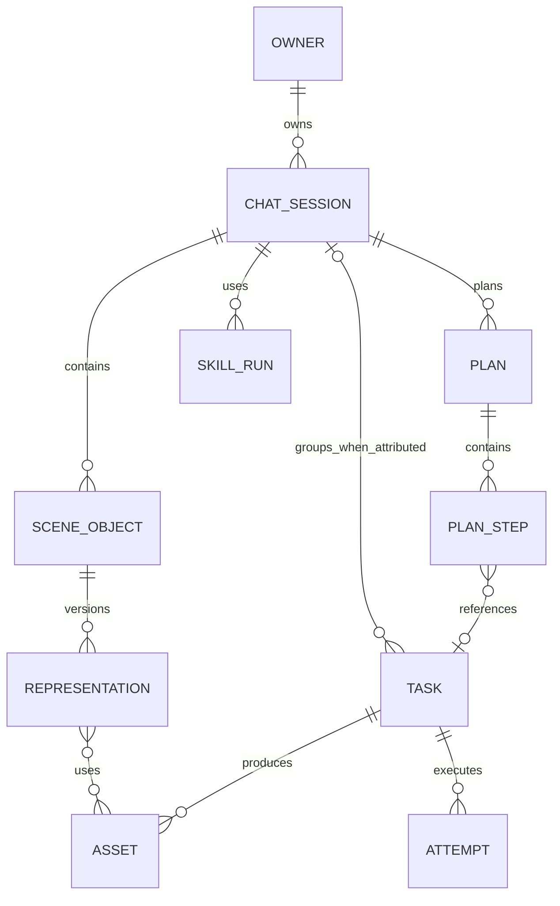

# D01/D02/D04：身份、单一输入与场景契约

状态：**G1 设计草案**，基于 `a32a93799c08cf98c6f5e0481e233809233b1b7c`。下文“现行”仅指这个提交的源码；“目标”是后续 G2/C 阶段的约束，不代表接口或表已经存在。入口事实见 `internal/generation/module.go`、`internal/chat/generationtool/executor.go`、`internal/catalog/catalog.go`、`src/lib/canvas/browser-client.ts`、`src/lib/canvas/export-canvas.ts`。旧审计对确定性导出的 A12 静态推导仍须用像素 fixture 复核；最近的 CSP 修复也须以当前浏览器行为重新验收。

## 1. 身份与所有权（D01）

| 身份 | 现行事实 | 目标不变量 |
|---|---|---|
| Principal/owner | HTTP `Identify` 得到身份，Generation Task 有 `OwnerID`；登录 session 是可撤销凭据 | Principal 是请求主体；owner ID 是资源归属。管理员能力来自显式 permission，不把任意 owner ID 当作认证凭据 |
| ChatSession | 对话与 Task 可带稳定 `session_id` | 一个命名 ChatSession 是用户的创作项目；同名仍按 ID 隔离。旧 Task 无唯一归属时保留 `session_id=null` |
| SceneObject | Canvas 目前以 `CanvasNodeRecord` 的节点 ID 和 project revision 保存；没有统一的 2D/3D 对象身份 | 一个对象有稳定 ID、owner、session、revision、创建/删除墓碑；位置、z-order、可见性和表示都通过版本控制，不用 Task ID 冒充对象 ID |
| Representation | 现行节点把 type、几何和 data 放在一起；3D 产物与 2D 节点缺共同表示层 | 每个对象可有多个不可变表示版本：bitmap、vector、model3D、rendered capture；当前激活版本只是指针，旧版与来源保留 |
| Asset | 输入/输出资产已有平台 ID 和归属验证；生成必需资产 READY 才能完成 | Asset ID 为平台稳定身份，内容 hash/字节长度/media type 是完整性证据；字节一旦 READY 不在原 ID 下改写。跨 owner 物理去重不共享访问权 |
| Task/Attempt | Generation 有稳定平台 Task ID、Attempt ID 和版本；上游 Job 隶属 Attempt | 每个公开生成/处理步骤对应一个 Task，Task 不等于 ChatSession/SceneObject。remote ID 只在 Attempt/Adapter 私有域。终态只有 Generation 能写 |
| Plan/Step/SkillRun | Processing Plan 已有持久步骤；Skill 目录存在，用户可用 SkillRun 未形成统一事实 | Plan 编排多个公开 Task；Step 记录 Task ID 和输入 selector；SkillRun 记录 recipe revision、来源、输出、复核状态，不替代 Task 生命周期 |



创建与更新规则：新工作台创作 Task 必须带已归属当前 owner 的 session；兼容旧 API 若未提供 session，可保持无归属，不能按名称推断或伪造。图中 Task 到 ChatSession 因此是可选关系。owner、session、object、source asset、source task 的关系在**服务端同一准入事务**内核验；UI 的隐藏字段不构成权限。`SceneObject` 更新采用 `(object_id, expected_revision)` compare-and-swap；生成途中用户移动、替换或删除对象，结果仍可保存为候选 Representation，但不能自动覆盖已变化的当前对象。删除用墓碑保留 Task/来源链。管理员跨 owner 读取必须通过独立 permission 与审计动作；不要让普通下载继承 admin 的宽范围。

### 本分支代码状态（2026-09-29）

| 项目 | 状态 | 证据边界 |
|---|---|---|
| `PreparedInput` | **代码已接入，待最终回归与部署验收** | 原生任务、Agent、Canvas 直提、Processing Plan 使用冻结输入和单次人类 `ExecutionGrant`；旧兼容写入口先拒绝。远程 `source_url` 的内容不可冻结，新增任务要求先导入平台 Asset。Scene 来源锁定 revision 与 Representation；RenderManifest 输出 ID/hash/size 必须等于实际投递的唯一图片输入。hash 不等于付费批准。 |
| `SceneObject`/Representation | **运行服务/API 与后台候选回填已接入，待环境验收** | `internal/scene` 定义 owner/session、revision、active representation、墓碑与只写表示；SQLite 仓储和 CAS、公开 owner-scoped API 与成功 Task 候选扫描已有定向测试。Canvas 工作流尚未证明统一迁移。 |
| `RenderManifest` | **服务端渲染/API 与 Generation 校验已接入，待浏览器像素比对** | 创建 API 只接收 frame，由服务端生成像素/摘要并持久化不可变清单。浏览器展示与受信 renderer 的实际像素一致性尚需测试环境样本。 |

上述状态是源码观察，不是测试结论。新分支自动化、浏览器和测试环境证据统一记在 [05](05-local-regression.md)。

## 2. CatalogBundle 与执行身份（D02）

现行 `default_catalog.json` 是产品配置源；Generation.Submit 已校验 Capability/Offering/输入/owner/依赖，规范化后以 Offering 快照和请求 hash 创建 `QUEUED` Task。Chat 的 `selectOffering` 仍可把 `modelID` 当匹配条件并取第一个可用项。现行 `ApplicationSchema.Public()` 清除部分私有字段后复制较宽的 runtime/chat 区域；这证明公开面偏宽，不等于已经泄漏密钥。

目标是在启动/构建时把 Schema 解析成唯一的 `CatalogBundle`：

- `bundle_revision` 与规范化内容 hash 固定一次部署的产品声明；所有 Provider、Agent、Generation、HTTP 投影从该实例读取。源文件可拆，但不能形成第二真源。
- 每个执行请求锁定 `offering_id + offering_revision + capability`。`model_id` 是搜索/展示值；多 Offering 命中时必须让用户/Agent 使用已解析的唯一 Offering，不能按列表顺序隐式选第一个。历史 Task 的 Offering 快照不随目录热更新而漂移。
- 解析后的默认值、条件、参数映射、格式/大小约束和用户文案来自 Schema。不可约的 wire 解析属于 Adapter；Adapter 不维护产品参数表。
- 用服务端构造的 `PublicProductSchema`、`PublicChat`、`PublicAssetDelivery` 显式白名单投影。浏览器只获取展示/可操作字段，不获取密钥设置名、上游端点、租约/退避/缓存路径等运行接线。`/api/v1/schema`、扩展 discovery、首屏 inline 数据、兼容响应分别做字段测试；前端所需受控资产 URL 应由服务端直接给出。

`PreparedInput` 是**尚未提交的不可变执行快照**，不是 Task、费用授权或上游请求。规范化的 JSON 必须有 schema version，至少记录 owner/session、意图来源、Offering 身份与 Catalog revision、参数、每个输入 Asset 的 ID+hash/角色、可选 SceneObject revision、RenderManifest hash。计算 `input_hash` 时用稳定字段顺序/数值与 Unicode 规范；时间戳、签名 URL、临时 token 不入 hash。版本不识别则拒绝执行，不静默降级为旧参数。

```json
{
  "schema_version": 1,
  "owner_id": "owner-example",
  "session_id": "session-example",
  "intent_id": "intent-example",
  "source": {"kind": "scene", "object_id": "object-example", "object_revision": 7},
  "offering": {"id": "offering-example", "revision": "revision-example", "capability": "image-to-image", "catalog_revision": "catalog-example"},
  "parameters": {"prompt": "正视图，保持服装轮廓"},
  "assets": [{"id": "asset-example", "role": "source_image", "sha256": "hex-example"}],
  "render_manifest_hash": "hex-example",
  "input_hash": "hex-example"
}
```

以上是目标字段示例，不是现行 API payload；`hex-example` 表示占位值。`intent_id` 和提交幂等键的作用域应固定为 `(owner_id, intent_id)`；相同键+相同规范输入只返回原平台 Task，相同键+不同输入返回冲突。接受 Task 与 `task.submitted` 事件在同一持久事务提交。**平台幂等不等于 Provider 付费请求 exactly-once**：上游提交结果不明时仍按运行时文档停机对账。

Chat、Canvas、Processing Plan 和 legacy API 都只是输入适配器：先解析同一 Offering 和 `PreparedInput`，再统一调用 Generation.Submit。旧入口允许的省略/default 必须在兼容矩阵中逐一列出，不能让不同入口在同一显式选择上落到不同 Offering。付费动作只能沿用经逐入口核实的现有必需人工确认路径；本轮实现分支已移除 3D 面板的 `approved_credits` 报价批准字段，显式执行/重试仍须绑定 Offering revision 与 Plan version。缺口路径后续停用/引导至现有路径，不因已计算 `input_hash` 就视为同意。

## 3. Scene、虚线 frame 与可见输入（D04）

现行 Canvas 有节点、project revision 和宽高比；`exportCanvasToBlob` 目前按可见节点 bbox+padding 生成导出尺寸，`selectedOnly` 会筛选节点。它没有把虚线 frame 固定为唯一 Provider 输入边界。导出的坐标与画板呈现还存在已审计的静态差异，修复须先于任何以导出像素为基础的输入冻结。

目标把 2D scene 表示成 `SceneObject + Representation + frame + scene_revision`，并确定以下几何：

1. 坐标使用画布逻辑像素；对象局部点 `q` 经 `T(x,y)·R(rotation)·S(scale)` 到世界坐标，frame 由世界坐标矩形和输出宽高定义。mask 首先归属目标对象的局部坐标，再由同一矩阵映射到 frame 输出像素。预览、选区、导出使用同一个变换实现及版本。
2. 虚线 frame 是投递边界。无论节点 bbox、当前选区或对象超出框外多少，Provider 视觉文件只由 frame 内可见像素生成；框外节点不作为隐含 reference。pin 只给 frame 内对象指定 target/reference 角色，不能扩大画面。若要让框外对象参与，用户须先移动 frame/对象并查看新的执行预览。
3. 背景、透明度、裁剪、文本字体、图层顺序、隐藏状态、旋转、矢量线端点与箭头方向都纳入 renderer 版本化规则。`RenderManifest` 固定 scene revision、frame rect、对象 ID+revision、Asset hash、mask 映射、renderer revision、每个目标变体的尺寸/编码/hash。
4. 用户看到的“将发送”预览必须对应 Provider 的**同一目标变体**。LLM 缩略图可以另有尺寸/编码/hash，但要能追溯到同一 manifest，且不得无提示取前 N 张。最多 50 张位图是 scene 的服务端事务上限；第 51 张无论来自单端或并发提交都拒绝/等待用户选择，不静默丢图。高成本渲染可分批/缩略，但不能改变冻结输入。

```json
{
  "schema_version": 1,
  "scene_revision": 12,
  "frame": {"x": 0, "y": 0, "width": 1024, "height": 1024},
  "objects": [{"id": "object-example", "revision": 7, "representation_id": "rep-example", "asset_sha256": "hex-example", "role": "reference", "visible": true, "z_index": 2}],
  "renderer_revision": "renderer-example",
  "variants": [
    {"purpose": "provider", "width": 1024, "height": 1024, "media_type": "image/png", "sha256": "hex-example"},
    {"purpose": "llm_thumbnail", "width": 512, "height": 512, "media_type": "image/jpeg", "sha256": "hex-example"}
  ]
}
```

现行 `CanvasProject.revision` 可作迁移起点，但旧节点的 ID 不自动宣称等于新 `SceneObject` ID；迁移需显式映射表。旧任务只存可验证的旧输入/Asset 关系，缺 object provenance 时标 `legacy_unattributed`，不得按文件名或同名 session 猜测。

### 3D 与 2D 的双向表示

2D 图生 3D 后，目标是保留原 `SceneObject` 的 2D rect、anchor、layer，新增 model3D Representation 与独立 3D transform/camera-fit。Agent 可以提出“将新 3D 版本放回原图位置”，但应用前仍比较 object revision；若用户在等待时移动/删改对象，显示待应用版本，不能覆盖新状态。该设计保证来源和位置连续，不保证单图生成的 3D 几何与真实透视完全一致。

目标体验中，3D 截图进入 2D 需区分 `Asset READY → PreviewReady → CaptureReady` 三种证据。PreviewReady/CaptureReady 要由真实浏览器预览和 readback 流程给出；预览失败不改变原 3D Task 的成功态。当前分支已加入 Capture 仓储/API 与工作区截图、上传、入 2D 画布交互：服务端校验 owner、成功源 Task、模型 Asset 归属、上传 PNG 的完整解码、CAS 字节长度/摘要和幂等键，并记录 camera/view 元数据。它只能证明客户端提交的 PNG 字节与本地 Asset 一致及其来源关联，不能证明服务端可信重渲染。工作区到 Scene bitmap Representation 的持久映射、真实 WebGL 预览/readback 和刷新恢复尚待浏览器验收；不得把此 Capture 记录单独视为 RenderManifest 验证通过。

## 4. 并发、迁移和验收样例

| 场景 | 契约期望 |
|---|---|
| 同名 session、跨 owner 的 task/asset/object ID | 只按稳定 ID+owner 归属；无权读取返回统一拒绝，不泄露存在性 |
| 同一 intent 双击/并发提交 | 一个公开 Task；不同规范输入共用键时冲突；不推论上游恰好一次 |
| 显式 Offering 不可用或版本已变 | 停止并要求重新选择/预览；不退回同 model 的第一个 Offering |
| 画布 50 与并发第 51 张 | scene revision/位图数量事务校验；不能静默截断或只做前端计数 |
| 框外图片、旋转矢量、mask、透明背景 | 用户执行预览与 Provider 变体像素一致；框外内容不进入 LLM/Provider；line/arrow golden fixture 与画板同向 |
| 3D 材质失败或截图时对象变化 | 不产出 CaptureReady；原 Task/Asset 状态保持；对象变化时旧结果进入待应用版本 |
| 公开 Schema 加入服务端 canary 字段 | API、首屏、扩展 discovery、兼容响应都不出现；允许字段仍可用 |

G1 需要补一份可机器比较的字段级 JSON Schema/fixture 清单和现行所有创建入口的逐 route 对照。本文冻结语义和样例；字段名最终以 G1 评审的 schema revision 为准，不能让代码先行反向定义产品。
