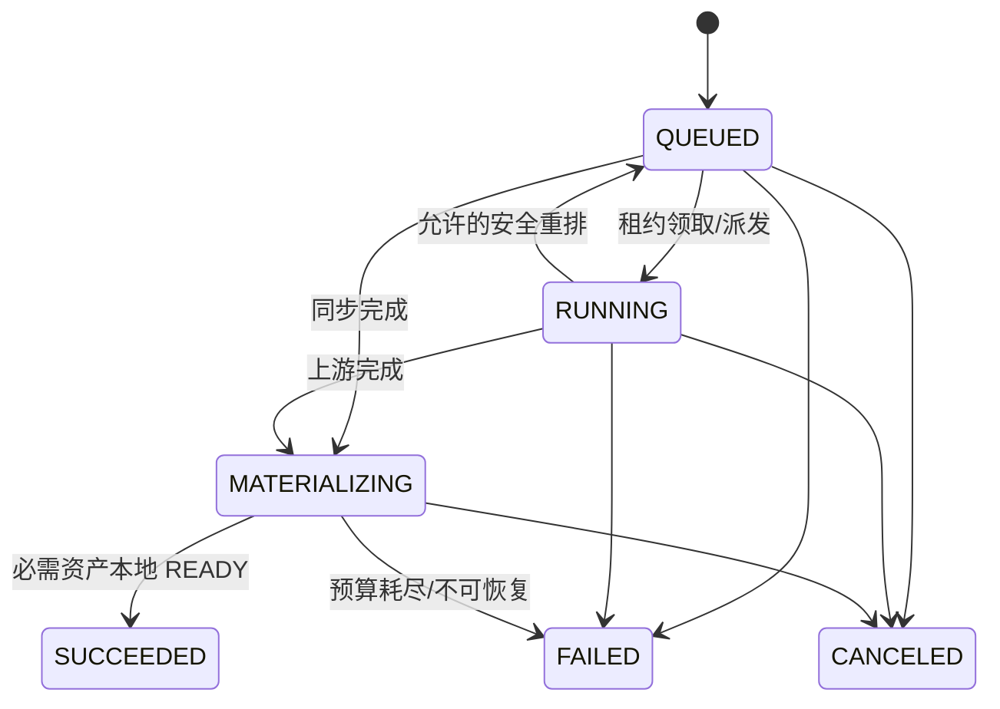
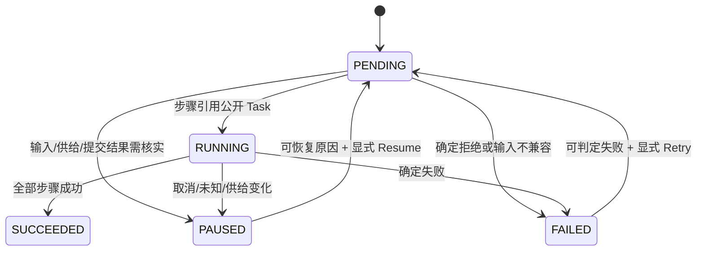

# G1：任务、计划与资产的运行可靠性契约

状态：**架构草案，待 G1 联合审定；文中目标不能代表已发布功能**。基线为 `codex/art-ai-architecture-v3` 的 `a32a93799c08cf98c6f5e0481e233809233b1b7c`。本分支后续加了两个局部修复：CAS 命中校验与损坏修复，以及 Processing Plan 的按输入数量估算；它们不代表本文件全部目标已实现或测试环境已发布。本文须与 G1 身份、输入、公开投影和现行人工确认路径共同冻结。下文以「现行事实」「目标决策」「待定」标识证据层级。

## 1. 身份、写入权与不可变约束

**现行事实。** 命名 Chat session 是用户的一项创作工作，`generation.Task` 是一次公开生成或处理步骤；平台 Task ID 在 Submit 时生成，上游 Job ID 属于 Attempt。Generation 是 Task/Attempt、租约、资产落盘与事件的唯一写入者；Processing Plan 用 Gateway 查询和提交 Task，不能自行宣布 Task 成功。`Submit` 校验 owner、Offering、归一输入、输入资产和依赖，原子创建 `QUEUED` Task 与 `task.submitted` 事件，并以幂等键及请求 hash 识别重放。[源码：module.go](../../internal/generation/module.go#L140)、[plans.go](../../internal/processing/plans.go#L395)。

**目标决策。** 一条执行链按 `owner_id + session_id + plan_id/step_index + task_id + attempt_id + offering_id/revision + frozen_input_revision` 追踪。Plan step 只引用真实 Task/Asset；一个步骤成功后永久保留 Task ID，失败重试产生可追溯的新尝试或新 Task，不改写先前成功事实。所有 UI 进度、版本、下载和后续输入从 Task/Asset/Event 投影。上游 Job ID、签名 URL、Opaque 和租约 token 仅在服务端。相同展示名称的 session 不共享身份；跨 owner 的 Task/Asset 引用一律拒绝。后续步骤只能引用前一步 `SUCCEEDED` 且本地 READY、符合目标 Offering 输入契约的资产；同 Provider `source_task` 只在 Schema 明许时使用，异 Provider 走平台 Asset，不传源 Provider remote ID。

## 2. 状态机及唯一事实

### 2.1 Task 与 Attempt

**现行事实。** 状态和允许转换见 [transition.go](../../internal/generation/transition.go#L1)。以下表只列业务含义；确切转换以该文件为当前基线。

| 对象/状态 | 含义及约束 |
|---|---|
| Task `QUEUED` | 已持久受理，未证明上游已开始；可被 Worker 领取，也可确定取消。 |
| Task `RUNNING` | 正在提交或观察；允许因可恢复调度回到 `QUEUED`，不代表第二次付费提交。 |
| Task `MATERIALIZING` | 上游完成，必需产物仍须下载、校验、本地落盘；不能显示成功下载。 |
| Task `SUCCEEDED` / `FAILED` / `CANCELED` | 终态，仅等值重放；迟到 webhook、取消或观察不能复活或改写终态。 |
| Attempt `QUEUED` / `SUBMITTING` / `RUNNING` | 一次上游尝试的调度、付费提交与观察；与平台 Task 生命周期分离。 |
| Attempt `UPSTREAM_SUCCEEDED` | 上游成功，但 Task 仍可能在物化，不能等同于 Task 成功。 |
| Attempt `FAILED` / `SUBMISSION_UNKNOWN` / `CANCELED` | Attempt 终态；未知结果保留可能已付费的事实，不能按普通失败重发。 |

现行允许边的完整列表如下；自返只表示重复观察/幂等重放，不允许修改已终态事实。每条非自返边在目标实现中仍须由内核验证版本、租约（适用时）及对应的业务守卫。

| 对象 | 从 | 允许到达 |
|---|---|---|
| Task | `QUEUED` | `RUNNING`、`MATERIALIZING`、`FAILED`、`CANCELED` |
| Task | `RUNNING` | `RUNNING`、`MATERIALIZING`、`QUEUED`、`FAILED`、`CANCELED` |
| Task | `MATERIALIZING` | `MATERIALIZING`、`SUCCEEDED`、`FAILED`、`CANCELED` |
| Task | `SUCCEEDED` / `FAILED` / `CANCELED` | 仅各自同名自返 |
| Attempt | `QUEUED` | `SUBMITTING`、`CANCELED` |
| Attempt | `SUBMITTING` | `RUNNING`、`UPSTREAM_SUCCEEDED`、`FAILED`、`SUBMISSION_UNKNOWN`、`CANCELED` |
| Attempt | `RUNNING` | `RUNNING`、`UPSTREAM_SUCCEEDED`、`FAILED`、`SUBMISSION_UNKNOWN`、`CANCELED` |
| Attempt | `UPSTREAM_SUCCEEDED` / `FAILED` / `SUBMISSION_UNKNOWN` / `CANCELED` | 仅各自同名自返 |

Attempt 的 `SUBMISSION_UNKNOWN` 是终态证据，后续对账不能把原 Attempt 改回 `RUNNING`。Task 因结果不明进入 `FAILED` 时，公开失败须保留“上游可能已受理/收费”的安全标识；Plan 不能把它当作普通可重试失败。

`QUEUED → MATERIALIZING` 可用于同步 Provider；`RUNNING → QUEUED` 是受控调度恢复。不能依状态名称推断成本或退款。**目标决策。** 每次状态变化与对应事件在同一事务提交，并由 version、租约围栏验证；消费者按 Task 版本或事件序号去重。任务失败不删除同 session 先前的成功 Task/Asset。Agent、Plan、HTTP 只投影或请求转换，不直接写 Task 终态。

### 2.2 Plan 与 Agent 等待

**现行事实与本轮实现分支。** Processing Plan 为 `PENDING / RUNNING / SUCCEEDED / FAILED / PAUSED`；`PAUSED` 覆盖提交结果不明、Offering 变化/不可用、任务取消等停机原因。`advance` 跳过已成功步骤，读取现有 Task 结果，再按受限输入规则提交下一步。[plans.go](../../internal/processing/plans.go#L17)。本轮实现分支去除了数字报价批准；重试/恢复使用 Plan version CAS 和 Offering revision。对于已受理但响应丢失的 Task，先按原幂等键只读核对，再判断当前 Catalog 是否允许新提交；旧计划缺失未知提交标记时按持久失败原因恢复，不重提付费 Task。

Plan/Step 的现行推进边按 `plans.go` 的 `Create`、`advance`、`Retry`、`Resume` 可概括为：`PENDING → RUNNING/PAUSED/FAILED`，`RUNNING → RUNNING/SUCCEEDED/PAUSED/FAILED`；`PAUSED → PENDING` 只允许可恢复原因并经显式 Resume，`FAILED → PENDING` 只允许可判定失败的 Retry，`SUCCEEDED` 不再推进。计划状态是编排事实，不得重定义 Task 的合法边。

**本分支状态：运行链路已接入，定向恢复测试通过；待同提交全量与测试环境验收。** Chat 有持久 turn checkpoint、`WAITING_TASK` 状态、按 owner/session 校验等待 Task、终态/超时唤醒与周期扫描重放。Agent 的已受理调用在聊天绑定丢失、Offering 下线、临时读取失败和重启后依原 Grant/Task 恢复；提交结果不明时保留未完成调用，不让新付费调用代替。见 `internal/chat/orchestrator_waiting.go`、`internal/chat/generationtool` 与 SQLite operation/grant 仓储。Plan 持有步骤依赖、冻结输入、原幂等身份、真实 Task ID 与暂停原因。事件丢失时扫描重读 Task 快照，观察超时不能把 Task 改成 `FAILED`。

**Stop 与付费准入的最终围栏。** AgentPending Grant 持久绑定触发的 assistant turn；Generation 创建 Task 的 SQLite `BEGIN IMMEDIATE` 事务在消费 Grant 前校验同一 owner/session 的 turn 存在且 `stop_requested=0`。Stop 先提交则新 Task 被拒绝；Task 先提交则只恢复已接受任务的原 ID，不能重复收费。旧未绑定 turn 的未消费 Agent Grant 在迁移后拒绝新准入，已绑定 Task 可精确回读。这一规则同时覆盖普通 Agent 工具和三视图 SkillRun 的付费首步；资产校验期间 Stop 先完成的确定性并发测试已加入，环境侧仍需实测取消/恢复的可见状态。

**目标决策。** Plan 每次推进只做一个可证明的幂等动作；Agent 对话暂停或停止不绕过 Task/Plan 的取消边界。

**目标决策。** 后续产物在前一步提交前尚不存在，因此冻结的是「父 step/Task 身份 + 结果 role/variant/格式等有界 selector + 目标 Offering 输入限制」，不是虚构的 Asset ID/hash。前一步 READY 后唯一解析并再校验 owner、role、media type、扩展名、大小、来源与目标契约；零个或多个不确定候选都停下请求用户选择/修订，不能猜测或改模型。冻结输入或费用范围变化时重新展示执行快照；现行必需人工确认无法覆盖的后续付费步骤保持 `PAUSED` 或不可提交。

## 3. 租约、围栏与付费派发

**现行事实。** Worker 仅在有执行容量时 claim，续租失败会取消执行上下文。数据库 Commit 以 `lease_token + expected_version + lease_until` 判定，失去租约的旧 Worker 不能提交 Task/Attempt 状态；它先前发出的上游副作用仍可能发生。[scheduler.go](../../internal/generation/scheduler.go#L143)、[coordinator.go](../../internal/generation/coordinator.go#L99)。非幂等提交前记录 checkpoint/intent；中断在 `SUBMITTING` 后可能转 `SUBMISSION_UNKNOWN`，不能宣称端到端 exactly once。

**目标决策。** 每次付费 `Start` 前持久化 `DispatchIntent`：Task/Attempt、Offering revision、规范化输入 hash、Provider 幂等能力及 key、请求关联标识、时间和派发阶段。只有现行人工确认路径满足所需范围时才能走付费派发；本文不新增收费审批协议。Grant 按批准模式签发的新规则见 `docs/product.md`，是已定目标，未实现。Provider 支持服务端幂等/查询时才按其已证实契约重放同一 key 或查回原 Job；不支持时，对「请求可能到达」的超时、断线、租约丢失、进程崩溃标 `SUBMISSION_UNKNOWN` 并停机对账，不能生成新 Attempt 盲重发。上游对账证据确认未受理后，才可由既有人工流程决定再次付费；确认已受理则关联原 Job 继续观察。对账只修复事实，不得在终态 Attempt 上非法转换；必要时以可审计的新记录关联，具体迁移方式待定。

| 故障窗口 | 目标恢复动作 |
|---|---|
| intent 持久化前崩溃 | 没有已发请求证据；重新走准入和当前人工确认路径。 |
| intent 已持久化、网络发送前崩溃 | 先核查发送阶段/Provider 幂等证据；无法证明未到达时按未知结果停机。 |
| 请求发出、响应或本地 Commit 前崩溃 | 按同一 Provider key/关联标识查回；不能用新的付费 Start 猜测结果。 |
| 租约丢失且旧 Worker 仍在网络调用 | 旧 Worker 的状态提交被围栏拒绝；新 Worker 先检查 intent/Job/未知结果，不能并发再派发。 |

**待定。** 每个 Adapter 的真实幂等键、查询/对账能力、上游收费点和取消/退款语义须逐 Offering 记录；无证据者按非幂等处理。`DispatchIntent` 字段和存储迁移须在 D01/D02 与 Provider contract 共同审定。

## 4. 物化、输入资产与缓存

**现行事实。** `MATERIALIZING` 从同一 Attempt 的 ArtifactClaim 调 `OpenAsset`，检查输出规则、实际媒体类型和写入完整性，全部必需资产满足才提交 `SUCCEEDED`。必需产物失败会重试或使 Task 失败；可选及后台资源单独记事件/资源态，不阻断已满足必需产物的 Task 成功。`cache.Begin` 在下载处记录操作活动，**不证明**内容级去重或持久缓存命中。[coordinator.go](../../internal/generation/coordinator.go#L622)、[coordinator.go](../../internal/generation/coordinator.go#L934)。可刷新 claim 时通过原 Job `Observe`，上下文显式禁止付费派发，保留原 Attempt；不调用新的 `Start`。[coordinator.go](../../internal/generation/coordinator.go#L981)。

**目标决策。** 输入 Asset 是带 owner、来源 Task、角色、格式、大小、内容身份与本地存储状态的平台对象。每次派发前按目标 Offering 的输入规则重验本地 READY、owner、role、media type/扩展名、大小与依赖；前端 URL 和 remote Job ID 不能代替平台 Asset ID。输出先是 claim，再是下载中的内容，最后经大小、媒体类型、格式/完整性、存储提交验证的 READY Asset。下载中断/校验失败不得留下可下载的 READY 记录；部分成功文件可以按内容身份安全复用，但重试时必须重新验证 owner、来源、hash、权限和当前 Offering 输出槽位。物理内容可全局按 hash 去重；逻辑 Asset/缓存关联须保留 owner、Task、claim、来源、变体、编码/变换与 Schema revision，每次读取或复用都重新校验归属、权限、输出槽位及内容完整性。全局物理命中不授予跨用户访问，也不证明本次产物已 READY；签名 URL 的 token/query 不进入内容缓存身份、事件或日志，逻辑 claim 与内容 hash 才用于复核；`cache.Begin` 的活动记录更不能当作内容去重证据。

**目标决策。** 物理写入遵循临时文件 → 大小/格式/hash 校验 → 原子发布 → READY 关联提交；崩溃后清理孤儿临时文件，并核对「READY 元数据对应字节实际存在」。磁盘容量预算、保留期和 GC 应按引用关系决定回收：仍被 Task/Representation 引用的 READY 字节不可被缓存淘汰；无引用内容才可在受控策略下回收。发现字节损坏或丢失时先使相应读取失效，按原 Job/来源和可恢复预算重新物化；无法恢复时，未终态且缺必需资源的 Task 按状态机失败，已成功 Task 保持终态并单独标注资源故障，均不得继续发放损坏内容。操作活动缓存、内容寻址存储及 HTTP/浏览器缓存分层管理；HTTP 命中不得绕过 owner 鉴权和 READY 复核。这些是设计要求，现行代码尚未证明完整实现。

**目标决策。** 签名 URL 仅作为短期 claim。只有 Offering/Adapter 声明可从原 Job 刷新、错误可归类为凭证过期或可恢复下载故障、且次数/时间预算仍允许时，才按退避通过原 Attempt 的 `Observe` 刷新 claim，再用 `OpenAsset` 物化；403 也可能是永久拒绝，不能一律刷新。刷新前后核对同一逻辑 claim 的 Task、Attempt、Job、role、variant、媒体类型与预期资源身份，变化超出契约即停下。刷新所得 URL 及其每次重定向继续受允许的 host/协议、重定向次数、响应大小与资产大小上限约束，不因换 URL 放宽受控下载边界。刷新失败保留同一 Task/Attempt 和可诊断事件。刷新路径不能再发付费 `Start`，也不能把原始签名 URL 暴露给 UI。若上游原 Job 不可查询或资源永久不可取，**尚未 SUCCEEDED** 的 Task 因必需资源缺失按失败策略终止，可选资源独立失败；已 SUCCEEDED 的 Task 保持终态并单独标资源损坏/不可用；不得把仅有远端 URL 的产物标 READY。成功后出现可选资源异步变化，只更新资源投影/事件，不回退 `SUCCEEDED` Task。

**本分支状态：基础已实现并局部测试，运行链路未接入/未验收（CAS）。** CAS 写入已有大小/hash 命中校验和损坏修复；`art-ai-storage --check` 在存储锁下对引用清单与字节做只读扫描。扫描要求停止非协作写入者，报告缺失/损坏等问题，但不会修复数据或改写任务状态。尚无新分支最终门禁结果或真实维护扫描报告。其余本节物化与 READY 契约仍需按设计验收，不能据此宣称全部已实现。

## 5. 失败、取消、事件与公开观察

**目标决策。** 区分确定拒绝、可重试观察/下载错误、结果不明付费提交、格式/来源不兼容、用户取消。`Cancel` 是请求而非上游已取消或退款证明：QUEUED 未派发可确定取消；RUNNING 需记录上游取消结果；结果不明需先对账；已 READY 的成功资产与历史版本保留。迟到观察和重复 webhook 只可在状态机/版本允许时更新事实。公开错误来自安全文案或 Schema message key，原始上游响应与密钥仅服务端诊断可见。Plan 失败或暂停不能抹掉前驱步骤和其 READY Asset。

**目标决策。** 同一事务持久化 Task/Attempt/Asset 变化和事件。事件至少携带稳定 `event_id/sequence`、`task_id`、`task_version`、类型、时间、可公开字段；Plan/Agent 等待记录用 cursor 消费，断线 SSE 从 cursor 补读，重复或乱序事件以任务快照和版本收敛。通知只提示「去重读」，不能仅凭通知负载提交下一付费步骤。观察超时只重新排程；超过明确的观察/对账预算再进入安全停机或确定失败。HTTP、SSE、历史页和下载使用同一 owner/Task/Asset 事实与权限检查。

**待定。** 事件保留期、cursor 格式、重放窗口、Plan/Agent waiter 的持久表结构、旧任务没有对应事件时的快照补偿、取消与上游退款的显示字段，需在 G1 决议和迁移样例中确定。

## 6. 迁移与验收矩阵

**目标决策。** 旧 Plan 的 `PENDING/RUNNING/PAUSED/...` 保留原义；新增等待记录由现有 Task ID、step index、Plan version 回填或懒创建，先重读 Task 再订阅事件。旧 Plan 没有可证实的冻结输入/人工确认范围时，不自动推进后续付费步骤；已成功步骤仍引用旧 Task，不重提。旧 Task 无 session 归属时不伪造 session。部署迁移需具备新旧 reader 并行、重启重放和回滚策略，不能通过清空历史获得通过。

| 验收场景 | 必须观察到的证据与禁止行为 |
|---|---|
| 同一请求并发 Submit、重启重放 | 一个稳定 Task ID，request hash 冲突显式拒绝；事件重放不会第二次 `Start`。 |
| 付费 Start 前/后断电与响应丢失 | intent、Attempt、Provider key/Job 和对账轨迹完整；未知结果停下，无盲目付费重发。 |
| 两 Worker 交错、租约失效 | 旧 token/version 的 Commit 被拒；新 Worker 不因接管就重发可能已执行的付费动作。 |
| 上游成功但签名 URL 过期 | 原 Job `Observe` 刷新，同 Attempt 继续物化；无新 `Start`/新收费。 |
| 必需文件部分成功、损坏或错误媒体类型 | Task 不成功、不可下载伪 READY 文件；重试或明确失败，既有文件复核后安全复用。 |
| 可选/后台文件失败 | 必需资源 READY 时 Task 成功；该资源单独标失败/待获取，历史成功版本保留。 |
| 四个以上慢任务、Chat 重启、SSE 重放 | Chat worker 可接新请求；等待持久恢复，事件去重，Plan 成功步骤仅提交一次。 |
| 取消在 QUEUED、RUNNING、未知提交、成功之后 | 逐种记录接受、上游结果和费用证据；界面不预先承诺退款或撤回已 READY 资产。 |
| 跨用户/跨 Provider/格式不兼容 | 拒绝资产越权和异 Provider remote ID；目标 Offering 不兼容时停下，不静默换模型。 |
| 处理面板仅选择动作、改变参数/费用、Resume/Retry | 打开面板不派发；只执行用户选中的公开步骤；费用与输入改变时回到现行必需人工确认，缺路径则停用。 |

验收记录须关联固定提交、Catalog revision、Task/Attempt/Plan/Asset ID、事件序列、Provider dispatch 次数和输出 hash。此表是未来 C 阶段合约/故障注入/测试栈验收要求；本次文档写入本身不表示任何场景已经通过。
